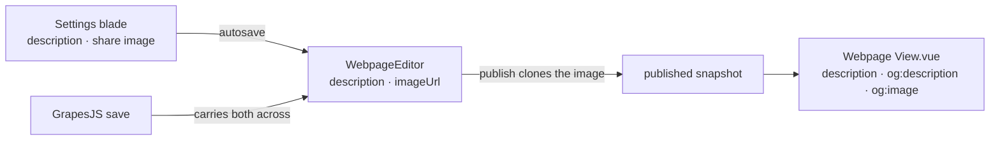

# Webpage Social Preview

A published webpage is a page someone shares, and a shared link is judged by its unfurl: the title, the line under it and the image above both. The title is the resource's name. The line and the image come from the Webpage's **Settings** blade, so a published page unfurls with what it is about rather than the site's own description and logo.

Webflow keeps the same pair in each page's settings, a meta description and an Open Graph image, with the Open Graph description following the meta description when it is not set apart ([Webflow Help Center, Add SEO title and meta description](https://help.webflow.com/hc/en-us/articles/33961237278611-Add-SEO-title-and-meta-description), [Control the look of social shares with Open Graph](https://help.webflow.com/hc/en-us/articles/33961370297107-Control-the-look-of-social-shares-with-Open-Graph)).

## How it works

- **Settings blade.** `ResourceBladeDefinitionMap[Webpage]` declares it after the built-in Editor. Its description field is plain text capped at `WEBPAGE_DESCRIPTION_MAX_LENGTH` (160 characters, the length a search result shows in full). Its share image uploads through `useUploadResourceFile` as one of the webpage's own file assets ([resource file assets](/docs/resource/resource-file-assets)), and the field shows the image with a Remove beside it. Both edits autosave.
- **Stored on the content.** `description` and `imageUrl` sit on `WebpageEditor` beside the captured `css` and `html`, so every save and every snapshot carries them. The image is an empty string or a resource asset url. An editor save carries both across the GrapesJS storage tick, so a save from the Editor never drops what the Settings blade wrote.
- **Cloned on publish.** The publish transform clones every asset url the content holds, `imageUrl` included, so the published image survives the owner replacing the working copy's file.
- **Read on the published view.** `View.vue` sets the meta description and the Open Graph description from the snapshot, and the Open Graph image as the absolute url of the cloned asset. An empty field leaves the site's own description and logo standing. The title stays the resource's name, which the published read already sets.

A change to the Settings blade reaches a shared link only once the page is published again, since a link unfurls from the published snapshot.

## Not in it

- **No per-type rollout.** A Webpage is the one type whose purpose is to be shared as a page. A Note or a Flowchart takes the same two fields on its own content when an owner asks.
- **No generated description.** The first LLM dependency is [deferred](/docs/resource/deferred/ai-resource-generation).

## Key files

| File                                                                   | Role                                                                 |
| ---------------------------------------------------------------------- | -------------------------------------------------------------------- |
| `apps/web/shared/models/webpageEditor/data/WebpageEditor.ts`           | `description` and `imageUrl` on the content and its schema           |
| `apps/web/app/store/webpageEditor/index.ts`                            | carries both across an editor save; exposes the content to the blade |
| `apps/web/app/components/Resource/Webpage/Settings.vue`                | the Settings blade: description, share image, autosave               |
| `apps/web/app/services/resource/ResourceBladeDefinitionMap.ts`         | the Webpage's Settings blade                                         |
| `apps/web/app/components/Resource/Webpage/View.vue`                    | the published page's description and image meta                      |
| `apps/web/app/composables/resource/useReadPublishedResourceContent.ts` | the title, unchanged                                                 |
| `apps/web/shared/services/resource/constants.ts`                       | `WEBPAGE_DESCRIPTION_MAX_LENGTH`                                     |

## Sources

- [Webflow Help Center — Add SEO title and meta description](https://help.webflow.com/hc/en-us/articles/33961237278611-Add-SEO-title-and-meta-description) — the meta description as a page setting.
- [Webflow Help Center — Control the look of social shares with Open Graph](https://help.webflow.com/hc/en-us/articles/33961370297107-Control-the-look-of-social-shares-with-Open-Graph) — the Open Graph image above the title and description, and the Open Graph pair following the SEO pair.
