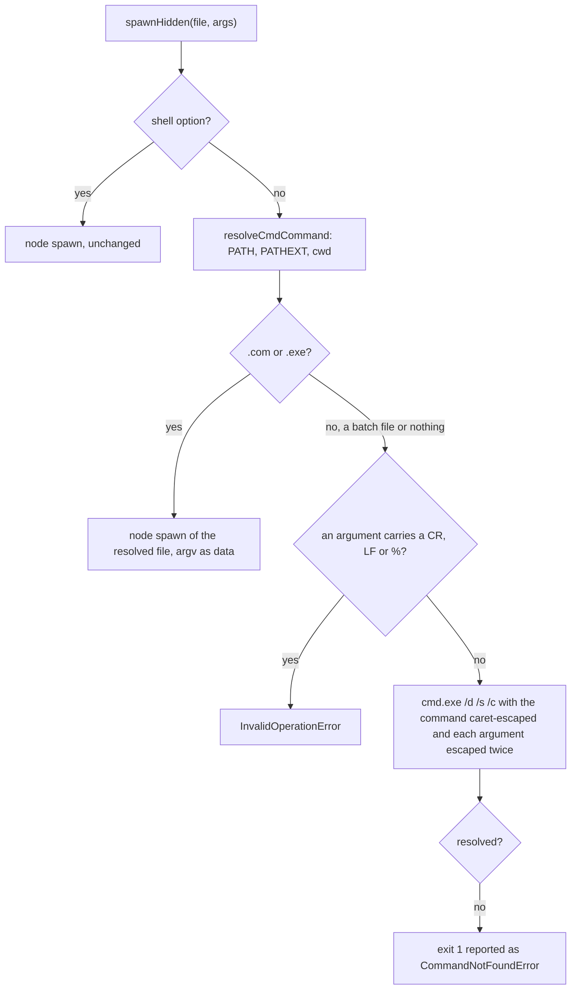

# Win32 spawn

Every virrun child is spawned through `spawnHidden`, which hands an argv to `spawnResolved`. The window hiding is not virrun's: every child process in the repo goes through `@esposter/shared-node/child-process`, whose wrappers force `windowsHide` on every spawn, and the lint rule on `node:child_process` enforces it, because a windowless parent's console child opens its own terminal window. Off win32 `spawnResolved` is node's `spawn` unchanged. On win32 it is the part virrun cannot do with node's `spawn` alone: node runs a `.com` or `.exe` directly but refuses a `.cmd` or `.bat`, so `pnpm`, `npx` and every `node_modules/.bin` entry is unreachable without `cmd.exe`, and `cmd.exe` parses an argument a second time.

This used to be the `cross-spawn` package (moxystudio/node-cross-spawn 7.0.6). It was absorbed into `packages/virrun` because only the win32 argv path of it is used, and that path is a few hundred lines with its tests. The verdict on every upstream issue and pull request is in the [Upstream](#upstream) table below. Whether a package is absorbed at all is [dependency admission](/docs/architecture/dependency-admission).

## How a spawn runs

- **Resolution.** `resolveCmdCommand` looks the name up the way `which` does with `PATHEXT`: a name already carrying an extension in `PATHEXT` is tried as given, any other gets each extension appended, and a name with a separator is looked up under the working directory. The `PATH` key is found whatever its case, since Windows environment names are case-insensitive.
- **A command found nowhere** still goes to `cmd.exe`, which exits 1. That exit is reported as the `spawn <command> ENOENT` error node gives a missing executable, which `getCommandNotFoundHint` reads.
- **The command** is caret-escaped as one word, so a path with a space is not split at the space.

## Escaping

An argument becomes `"…"` with each metacharacter caret-escaped: the brackets and parentheses, `%`, `!`, `^`, the quotes, the backquote, the angle brackets, `&`, `|`, `;`, the comma, the space, `*` and `?`. A run of backslashes is literal, except one that ends at a quote or at the end of the argument: that run is doubled, and a quote is written `\"`, which node's MSVCRT command-line parser reads as one quote. A `.cmd` or `.bat` re-parses the `%*` it expands, so the escaping is applied twice. The escaping is a linear loop rather than a regular expression over the backslash run, which backtracks on a long one.

The escaper is checked against upstream's `escape.js` on random arguments of up to twelve characters, and the two agree on every argument without a run of two backslashes. A run of two or more is where upstream is wrong (see [#160](#upstream)).

## Refusals

Two characters cannot be escaped for `cmd.exe`, so an argv bound for it carrying one is refused rather than spawned. Only an argv bound for it: a resolved `.com` or `.exe` receives its arguments as data with no `cmd.exe` in between, which is how `wsl.exe --exec sh -c` carries the sandbox's multi-line scripts, and refusing every win32 argv refused the whole WSL sandbox with it:

- **A line break** ends the command line inside `cmd.exe` even within quotes, so the rest would run as a second command. Upstream spawns it anyway ([#179](#upstream)).
- **A percent sign** expands an environment variable. Caret escaping does not stop it, because the name the escape spells can be set by the caller: `set path^^=^"^&calc` makes `%path%` expand to `"&calc` ([#171](#upstream), the BatBadBut attack).

A shell command string skips all of this: there is nothing to resolve, and a shell's exit code 1 on win32 would read as a missing command.

## Residual

- **A batch file's own line.** The escaping holds for the arguments virrun hands a batch file. A batch file the user wrote that expands `%1` and re-parses it in its own body is outside what an escaper can protect; virrun runs what its user types, so that line is the user's.
- **Killing a `cmd.exe` child.** A kill reaches `cmd.exe`, and a grandchild it started can survive. `forwardTerminationSignals` kills the direct child only. A process-tree kill is its owner's change, not this module's ([#148](#upstream)).
- **Shebang files.** Upstream runs an extensionless file whose first line is `#!` through the interpreter it names. Nothing virrun spawns is one, so it is not ported.

## Sources

- The upstream repository, [moxystudio/node-cross-spawn](https://github.com/moxystudio/node-cross-spawn), its issues and pull requests, read through the GitHub API.
- [Batch files and BatBadBut](https://flatt.tech/research/posts/batbadbut-you-cant-securely-execute-commands-on-windows/), the escaping analysis behind the percent sign and the caret refusals.
- [qntm, "Everyone quotes command line arguments the wrong way"](https://qntm.org/cmd), the backslash and quote rules node's parser uses.
- [Rob van der Woude, escape characters](http://www.robvanderwoude.com/escapechars.php), the metacharacter set `cmd.exe` reads.

## Upstream

Every issue and pull request the upstream tracker held at the audit date, with its verdict. The verdicts are the four the [admission page](/docs/architecture/dependency-admission) sets, plus the two that are about this port: **Fixed here** names a defect the port fixes and the test that pins it, **Fixed upstream, kept** names a fix this port keeps the behaviour of. **Out of scope** names the owner, **Not applicable** a surface this port does not have, and **Not a defect** a dependency bump, a bot, a question or a report with no defect in it. The test titles are in `packages/virrun/src/services/exec/spawn/*.test.ts`, and each `#<number>` in a title is the upstream item it answers.

Regression tests against upstream were checked by running upstream's escaper on the same arguments; a refusal (#171, #179) upstream does not make at all, so its test fails there by construction.

| Upstream                                                          | Kind  | State  | Verdict              | Title                                                                                           | Proof                                                                                                                                        |
| :---------------------------------------------------------------- | :---- | :----- | :------------------- | :---------------------------------------------------------------------------------------------- | :------------------------------------------------------------------------------------------------------------------------------------------- |
| [#1](https://github.com/moxystudio/node-cross-spawn/issues/1)     | Issue | closed | Not applicable       | npm install fail on windows                                                                     | closed 2014 install report; no code path today                                                                                               |
| [#2](https://github.com/moxystudio/node-cross-spawn/pull/2)       | PR    | closed | Not a defect         | npm publish ignore test/ dir. fix #1                                                            | closed 2014; a publish-time ignore list, not runtime code                                                                                    |
| [#3](https://github.com/moxystudio/node-cross-spawn/issues/3)     | Issue | closed | Not applicable       | fails if passed argument is number                                                              | argv is typed as strings, so a number is not an argument here                                                                                |
| [#4](https://github.com/moxystudio/node-cross-spawn/pull/4)       | PR    | merged | Not applicable       | Export spawn as a property as well as a function.                                               | exports a spawn property; this module exports spawnResolved                                                                                  |
| [#5](https://github.com/moxystudio/node-cross-spawn/pull/5)       | PR    | closed | Fixed upstream, kept | multiple commands in single line like "git init && git remote add ..." not working on windows   | a `&` in an argument is escaped, so it stays data (escapeCmdArgument table)                                                                  |
| [#6](https://github.com/moxystudio/node-cross-spawn/issues/6)     | Issue | closed | Not a defect         | Doesn't work                                                                                    | closed 2014 report with no reproduction                                                                                                      |
| [#7](https://github.com/moxystudio/node-cross-spawn/issues/7)     | Issue | closed | Not applicable       | npm install fails on raspi                                                                      | closed 2014 install on a single-board computer; no code path                                                                                 |
| [#8](https://github.com/moxystudio/node-cross-spawn/issues/8)     | Issue | closed | Not applicable       | Can't seem to install                                                                           | closed 2015 install report; no code path                                                                                                     |
| [#9](https://github.com/moxystudio/node-cross-spawn/issues/9)     | Issue | closed | Fixed upstream, kept | Command escaping doesn't work on Windows when there's a space in the path                       | #9 caret-escapes a command path with a space (spawnResolved.test.ts)                                                                         |
| [#10](https://github.com/moxystudio/node-cross-spawn/pull/10)     | PR    | merged | Fixed upstream, kept | Keep commands with - unescaped                                                                  | `-` is not in the metacharacter set, so it stays unescaped (constants.ts)                                                                    |
| [#11](https://github.com/moxystudio/node-cross-spawn/issues/11)   | Issue | closed | Not applicable       | Support spawnSync                                                                               | closed 2015 spawnSync support; no sync spawn here                                                                                            |
| [#12](https://github.com/moxystudio/node-cross-spawn/pull/12)     | PR    | merged | Not applicable       | Added `spawn.sync()`                                                                            | merged 2015 spawnSync support                                                                                                                |
| [#13](https://github.com/moxystudio/node-cross-spawn/pull/13)     | PR    | merged | Not applicable       | Use `spawn-sync` for backwards compatibility with 0.10                                          | merged 2015 spawnSync; no sync spawn here                                                                                                    |
| [#14](https://github.com/moxystudio/node-cross-spawn/issues/14)   | Issue | closed | Not applicable       | Variable name collision: `spawnSync`                                                            | closed 2015 spawnSync name collision; no sync spawn here                                                                                     |
| [#15](https://github.com/moxystudio/node-cross-spawn/pull/15)     | PR    | merged | Not applicable       | Fixed a variable name collision that was causing failures on Windows                            | merged 2015 variable rename in the spawnSync port                                                                                            |
| [#16](https://github.com/moxystudio/node-cross-spawn/issues/16)   | Issue | closed | Fixed upstream, kept | Does not return error ENOENT when program not found on Windows                                  | reports a command found nowhere as ENOENT when cmd.exe exits 1 (spawnResolved.test.ts)                                                       |
| [#17](https://github.com/moxystudio/node-cross-spawn/issues/17)   | Issue | closed | Not applicable       | Setup Windows CI                                                                                | closed 2015 CI setup                                                                                                                         |
| [#18](https://github.com/moxystudio/node-cross-spawn/pull/18)     | PR    | closed | Not applicable       | Optional spawn sync                                                                             | closed 2015 optional spawnSync                                                                                                               |
| [#19](https://github.com/moxystudio/node-cross-spawn/issues/19)   | Issue | closed | Not applicable       | Extract an async only version                                                                   | closed 2015 async-only request; spawn is already async                                                                                       |
| [#20](https://github.com/moxystudio/node-cross-spawn/issues/20)   | Issue | closed | Not applicable       | spawn.sync looks broke                                                                          | closed 2015 spawnSync report                                                                                                                 |
| [#21](https://github.com/moxystudio/node-cross-spawn/issues/21)   | Issue | closed | Not applicable       | Test on windows are failed                                                                      | closed 2015 Windows test setup                                                                                                               |
| [#22](https://github.com/moxystudio/node-cross-spawn/issues/22)   | Issue | closed | Not a defect         | Failing when trying to run a git command                                                        | closed 2015; a git invocation failing in one environment                                                                                     |
| [#23](https://github.com/moxystudio/node-cross-spawn/issues/23)   | Issue | closed | Not a defect         | Failed to replace env in config: ${APPDATA}                                                     | closed 2015; environment expansion in a consumer's config, not a spawn                                                                       |
| [#24](https://github.com/moxystudio/node-cross-spawn/pull/24)     | PR    | closed | Not a defect         | Update all dependencies 🌴                                                                      | merged dependency bump                                                                                                                       |
| [#25](https://github.com/moxystudio/node-cross-spawn/pull/25)     | PR    | closed | Not a defect         | Update spawn-sync to version 1.0.15 🚀                                                          | merged dependency bump                                                                                                                       |
| [#26](https://github.com/moxystudio/node-cross-spawn/pull/26)     | PR    | closed | Not a defect         | rimraf@2.5.1 breaks build 🚨                                                                    | closed dependency bump                                                                                                                       |
| [#27](https://github.com/moxystudio/node-cross-spawn/pull/27)     | PR    | closed | Not a defect         | which@1.2.2 breaks build 🚨                                                                     | closed dependency bump                                                                                                                       |
| [#28](https://github.com/moxystudio/node-cross-spawn/issues/28)   | Issue | closed | Not applicable       | Remove `spawn-sync`                                                                             | closed; removal of the spawnSync dependency                                                                                                  |
| [#29](https://github.com/moxystudio/node-cross-spawn/pull/29)     | PR    | merged | Not a defect         | Update glob to version 7.0.0 🚀                                                                 | merged dependency bump                                                                                                                       |
| [#30](https://github.com/moxystudio/node-cross-spawn/issues/30)   | Issue | closed | Not a defect         | executing rvm within normal bash conditions                                                     | closed 2016 rvm usage question                                                                                                               |
| [#31](https://github.com/moxystudio/node-cross-spawn/pull/31)     | PR    | closed | Not applicable       | Don't require spawn-sync unless someone is on node@0.10 and actually calls spawnSync            | merged; optional spawnSync                                                                                                                   |
| [#32](https://github.com/moxystudio/node-cross-spawn/issues/32)   | Issue | closed | Fixed upstream, kept | Make cmd optional                                                                               | a `.exe` runs directly with no cmd.exe (runs a resolved .exe directly on win32)                                                              |
| [#33](https://github.com/moxystudio/node-cross-spawn/issues/33)   | Issue | closed | Not a defect         | Unable to pipe stdout and stderr to a file                                                      | closed piping question, answered by stdio options                                                                                            |
| [#34](https://github.com/moxystudio/node-cross-spawn/pull/34)     | PR    | merged | Fixed upstream, kept | Only spawn cmd.exe if necessary                                                                 | a `.exe` runs directly with no cmd.exe (runs a resolved .exe directly on win32)                                                              |
| [#35](https://github.com/moxystudio/node-cross-spawn/pull/35)     | PR    | closed | Not a defect         | mocha@2.5.0 breaks build 🚨                                                                     | closed dependency bump                                                                                                                       |
| [#36](https://github.com/moxystudio/node-cross-spawn/pull/36)     | PR    | closed | Not a defect         | Update eslint to version 3.0.0 🚀                                                               | closed dependency bump                                                                                                                       |
| [#37](https://github.com/moxystudio/node-cross-spawn/pull/37)     | PR    | closed | Not a defect         | Update mocha to version 3.0.0 🚀                                                                | closed dependency bump                                                                                                                       |
| [#38](https://github.com/moxystudio/node-cross-spawn/pull/38)     | PR    | closed | Not a defect         | Update mocha to version 3.0.1 🚀                                                                | closed dependency bump                                                                                                                       |
| [#39](https://github.com/moxystudio/node-cross-spawn/pull/39)     | PR    | merged | Not a defect         | Update mocha to version 3.0.2 🚀                                                                | merged dependency bump                                                                                                                       |
| [#40](https://github.com/moxystudio/node-cross-spawn/issues/40)   | Issue | closed | Not applicable       | Add `kill` function to spawn object                                                             | closed; kill is the ChildProcess's own method                                                                                                |
| [#41](https://github.com/moxystudio/node-cross-spawn/pull/41)     | PR    | merged | Not applicable       | Remove non-essential files from the npm package                                                 | merged; packaging of non-essential files                                                                                                     |
| [#42](https://github.com/moxystudio/node-cross-spawn/issues/42)   | Issue | closed | Fixed upstream, kept | Different escaping between spawn and cross-spawn                                                | the metacharacter tables and the round trip through a shim (spawnResolved.platform.test.ts)                                                  |
| [#43](https://github.com/moxystudio/node-cross-spawn/pull/43)     | PR    | closed | Fixed upstream, kept | Node 6 shell option                                                                             | closed as the duplicate of the escaping rework in #83                                                                                        |
| [#44](https://github.com/moxystudio/node-cross-spawn/pull/44)     | PR    | closed | Out of scope         | Adding kill functionallity for win.                                                             | closed; Windows kill is the process-tree residual, see the Residual section                                                                  |
| [#45](https://github.com/moxystudio/node-cross-spawn/pull/45)     | PR    | closed | Not a defect         | Shell                                                                                           | closed; a superseded shell branch                                                                                                            |
| [#46](https://github.com/moxystudio/node-cross-spawn/pull/46)     | PR    | merged | Not applicable       | Shell2                                                                                          | merged; the shell option, which spawnHidden passes through unchanged                                                                         |
| [#47](https://github.com/moxystudio/node-cross-spawn/pull/47)     | PR    | closed | Not applicable       | Drop an unmaintained Node line                                                                  | closed; support for an unmaintained Node line                                                                                                |
| [#48](https://github.com/moxystudio/node-cross-spawn/pull/48)     | PR    | merged | Not applicable       | Fix shell option with Node 7                                                                    | merged; shell option on Node 7                                                                                                               |
| [#49](https://github.com/moxystudio/node-cross-spawn/issues/49)   | Issue | closed | Not applicable       | Cross-spawn fails to run remove command on windows                                              | closed 2016; `rm` is a caller's command, not a Windows one                                                                                   |
| [#50](https://github.com/moxystudio/node-cross-spawn/issues/50)   | Issue | closed | Not a defect         | Is there a way to pipe to parent stdout and then save that output to a variable?                | closed question about piping output to a variable                                                                                            |
| [#51](https://github.com/moxystudio/node-cross-spawn/pull/51)     | PR    | closed | Out of scope         | Fixes bug: unable to spawn .bat with %<environment variable>% in name                           | a command name is the user's own (virrun runs what its user types); a `%` in an argument is refused (#171)                                   |
| [#52](https://github.com/moxystudio/node-cross-spawn/issues/52)   | Issue | closed | Not a defect         | An in-range update of eslint is breaking the build 🚨                                           | closed greenkeeper bot report                                                                                                                |
| [#53](https://github.com/moxystudio/node-cross-spawn/pull/53)     | PR    | closed | Not a defect         | eslint@3.13.0 breaks build 🚨                                                                   | merged dependency bump                                                                                                                       |
| [#54](https://github.com/moxystudio/node-cross-spawn/issues/54)   | Issue | closed | Not a defect         | An in-range update of eslint is breaking the build 🚨                                           | closed greenkeeper bot report                                                                                                                |
| [#55](https://github.com/moxystudio/node-cross-spawn/pull/55)     | PR    | closed | Not a defect         | eslint@3.13.1 breaks build 🚨                                                                   | closed dependency bump                                                                                                                       |
| [#56](https://github.com/moxystudio/node-cross-spawn/pull/56)     | PR    | closed | Not a defect         | eslint@3.14.0 breaks build 🚨                                                                   | closed dependency bump                                                                                                                       |
| [#57](https://github.com/moxystudio/node-cross-spawn/pull/57)     | PR    | closed | Not a defect         | eslint@3.14.1 breaks build 🚨                                                                   | closed dependency bump                                                                                                                       |
| [#58](https://github.com/moxystudio/node-cross-spawn/issues/58)   | Issue | closed | Fixed upstream, kept | don't check for windows, check for cmd                                                          | the win32 branch resolves the file, not the platform name (runs a resolved .exe directly on win32)                                           |
| [#59](https://github.com/moxystudio/node-cross-spawn/issues/59)   | Issue | closed | Not a defect         | An in-range update of eslint is breaking the build 🚨                                           | closed greenkeeper bot report                                                                                                                |
| [#60](https://github.com/moxystudio/node-cross-spawn/pull/60)     | PR    | closed | Not a defect         | eslint@3.15.0 breaks build 🚨                                                                   | closed dependency bump                                                                                                                       |
| [#61](https://github.com/moxystudio/node-cross-spawn/issues/61)   | Issue | closed | Not applicable       | spawn.sync result object has `result.status == 0` for `result.signal == SIGKILL`                | closed; spawn.sync status, no sync spawn here                                                                                                |
| [#62](https://github.com/moxystudio/node-cross-spawn/issues/62)   | Issue | closed | Not a defect         | An in-range update of rimraf is breaking the build 🚨                                           | closed greenkeeper bot report                                                                                                                |
| [#63](https://github.com/moxystudio/node-cross-spawn/pull/63)     | PR    | closed | Not a defect         | rimraf@2.6.0 breaks build 🚨                                                                    | closed dependency bump                                                                                                                       |
| [#64](https://github.com/moxystudio/node-cross-spawn/pull/64)     | PR    | closed | Not a defect         | eslint@3.16.0 breaks build 🚨                                                                   | closed dependency bump                                                                                                                       |
| [#65](https://github.com/moxystudio/node-cross-spawn/pull/65)     | PR    | closed | Not a defect         | eslint@3.16.1 breaks build 🚨                                                                   | closed dependency bump                                                                                                                       |
| [#66](https://github.com/moxystudio/node-cross-spawn/pull/66)     | PR    | closed | Not a defect         | rimraf@2.6.1 breaks build 🚨                                                                    | closed dependency bump                                                                                                                       |
| [#67](https://github.com/moxystudio/node-cross-spawn/pull/67)     | PR    | merged | Not applicable       | A newer Node supports the shell option for spawn                                                | merged; the shell option documented in the README                                                                                            |
| [#68](https://github.com/moxystudio/node-cross-spawn/issues/68)   | Issue | closed | Not applicable       | child_process.spawn shell option is available in Node v5 and v4 too                             | closed; Node 6 shell option                                                                                                                  |
| [#69](https://github.com/moxystudio/node-cross-spawn/pull/69)     | PR    | merged | Not applicable       | Corrects node versions supporting spawn shell option in README                                  | merged; README versions                                                                                                                      |
| [#70](https://github.com/moxystudio/node-cross-spawn/issues/70)   | Issue | closed | Not applicable       | spawn inputs console warnings into stdout stream                                                | closed 2017; console output from spawn's stdin, not a path here                                                                              |
| [#71](https://github.com/moxystudio/node-cross-spawn/pull/71)     | PR    | closed | Not a defect         | mocha@3.4.0 breaks build 🚨                                                                     | merged dependency bump                                                                                                                       |
| [#72](https://github.com/moxystudio/node-cross-spawn/pull/72)     | PR    | closed | Not a defect         | mocha@3.4.2 breaks build 🚨                                                                     | closed dependency bump                                                                                                                       |
| [#73](https://github.com/moxystudio/node-cross-spawn/pull/73)     | PR    | closed | Not a defect         | Add Greenkeeper badge 🌴                                                                        | closed badge PR                                                                                                                              |
| [#74](https://github.com/moxystudio/node-cross-spawn/issues/74)   | Issue | closed | Not a defect         | An in-range update of lru-cache is breaking the build 🚨                                        | closed greenkeeper bot report                                                                                                                |
| [#75](https://github.com/moxystudio/node-cross-spawn/pull/75)     | PR    | closed | Not a defect         | updated package.json                                                                            | closed package.json edit                                                                                                                     |
| [#76](https://github.com/moxystudio/node-cross-spawn/pull/76)     | PR    | closed | Not a defect         | Update eslint to the latest version 🚀                                                          | closed dependency bump                                                                                                                       |
| [#77](https://github.com/moxystudio/node-cross-spawn/issues/77)   | Issue | closed | Out of scope         | Commands with spaces fail with shell: true                                                      | shell command strings are the caller's by design; spawnHidden's shell path is unchanged                                                      |
| [#78](https://github.com/moxystudio/node-cross-spawn/issues/78)   | Issue | closed | Fixed upstream, kept | Paths with NTFS JUNCTIONS (links)                                                               | closed 2018; existsSync and statSync follow a junction (resolveCmdCommand.ts)                                                                |
| [#79](https://github.com/moxystudio/node-cross-spawn/issues/79)   | Issue | closed | Not a defect         | An in-range update of rimraf is breaking the build 🚨                                           | closed greenkeeper bot report                                                                                                                |
| [#80](https://github.com/moxystudio/node-cross-spawn/issues/80)   | Issue | closed | Not a defect         | Possible issue with pre-commit + npm + spawn env                                                | closed 2017 pre-commit environment report                                                                                                    |
| [#81](https://github.com/moxystudio/node-cross-spawn/pull/81)     | PR    | closed | Not a defect         | Update mocha to the latest version 🚀                                                           | closed dependency bump                                                                                                                       |
| [#82](https://github.com/moxystudio/node-cross-spawn/issues/82)   | Issue | closed | Fixed upstream, kept | Bad escaping when an argument has quotes followed by a pipe                                     | a quote followed by `\|` is escaped as data (escapeCmdArgument table)                                                                        |
| [#83](https://github.com/moxystudio/node-cross-spawn/pull/83)     | PR    | merged | Fixed upstream, kept | Fix certain arguments not being correctly escaped or causing batch syntax error                 | the escaper this port rewrites; its table and round trip are the pins (escapeCmdArgument.test.ts)                                            |
| [#84](https://github.com/moxystudio/node-cross-spawn/pull/84)     | PR    | merged | Not a defect         | English Wikipedia reference in Readme                                                           | merged README reference                                                                                                                      |
| [#85](https://github.com/moxystudio/node-cross-spawn/pull/85)     | PR    | closed | Not a defect         | Update eslint to the latest version 🚀                                                          | merged dependency bump                                                                                                                       |
| [#86](https://github.com/moxystudio/node-cross-spawn/pull/86)     | PR    | closed | Not a defect         | Update mocha to the latest version 🚀                                                           | merged dependency bump                                                                                                                       |
| [#87](https://github.com/moxystudio/node-cross-spawn/issues/87)   | Issue | closed | Not applicable       | Cannot resolve dependency 'spawn-sync'                                                          | closed; the spawn-sync module                                                                                                                |
| [#88](https://github.com/moxystudio/node-cross-spawn/issues/88)   | Issue | closed | Out of scope         | Support option to mirror exit status                                                            | closed; exit-status mirroring is the caller's to do                                                                                          |
| [#89](https://github.com/moxystudio/node-cross-spawn/pull/89)     | PR    | closed | Not a defect         | Update dependencies to enable Greenkeeper 🌴                                                    | merged greenkeeper bot setup                                                                                                                 |
| [#90](https://github.com/moxystudio/node-cross-spawn/issues/90)   | Issue | closed | Fixed upstream, kept | path.normalize(command) breaks local command on rebased cwd                                     | #90 looks a name with a separator up under the working directory (resolveCmdCommand.test.ts)                                                 |
| [#91](https://github.com/moxystudio/node-cross-spawn/pull/91)     | PR    | merged | Fixed upstream, kept | fix: fix paths being incorrectly normalized on unix                                             | a relative command is resolved under cwd, not normalised away (#90 test)                                                                     |
| [#92](https://github.com/moxystudio/node-cross-spawn/pull/92)     | PR    | merged | Not a defect         | Update eslint-config-moxy to the latest version 🚀                                              | merged dependency bump                                                                                                                       |
| [#93](https://github.com/moxystudio/node-cross-spawn/pull/93)     | PR    | merged | Not a defect         | Update lint-staged to the latest version 🚀                                                     | merged dependency bump                                                                                                                       |
| [#94](https://github.com/moxystudio/node-cross-spawn/pull/94)     | PR    | merged | Not applicable       | fix: avoid using deprecated Buffer constructor                                                  | merged; the Buffer constructor, which this code does not call                                                                                |
| [#95](https://github.com/moxystudio/node-cross-spawn/issues/95)   | Issue | closed | Not a defect         | How do I run an npm command with NPM_TOKEN?                                                     | closed 2018 NPM_TOKEN usage question                                                                                                         |
| [#96](https://github.com/moxystudio/node-cross-spawn/issues/96)   | Issue | closed | Not a defect         | Child process hangs                                                                             | closed 2018 hang report with no reproduction in the thread                                                                                   |
| [#97](https://github.com/moxystudio/node-cross-spawn/pull/97)     | PR    | closed | Not a defect         | Update babel-jest to the latest version 🚀                                                      | merged dependency bump                                                                                                                       |
| [#98](https://github.com/moxystudio/node-cross-spawn/pull/98)     | PR    | closed | Not a defect         | Update @commitlint/config-conventional to the latest version 🚀                                 | closed dependency bump                                                                                                                       |
| [#99](https://github.com/moxystudio/node-cross-spawn/pull/99)     | PR    | closed | Not a defect         | Update @commitlint/cli to the latest version 🚀                                                 | closed dependency bump                                                                                                                       |
| [#100](https://github.com/moxystudio/node-cross-spawn/pull/100)   | PR    | closed | Not a defect         | Update eslint to the latest version 🚀                                                          | closed dependency bump                                                                                                                       |
| [#101](https://github.com/moxystudio/node-cross-spawn/pull/101)   | PR    | closed | Not a defect         | Update regenerator-runtime to the latest version 🚀                                             | closed dependency bump                                                                                                                       |
| [#102](https://github.com/moxystudio/node-cross-spawn/pull/102)   | PR    | closed | Not applicable       | remove 'nice-try' dependency                                                                    | closed; removal of the nice-try dependency                                                                                                   |
| [#103](https://github.com/moxystudio/node-cross-spawn/pull/103)   | PR    | closed | Not a defect         | Update eslint-config-moxy to the latest version 🚀                                              | closed dependency bump                                                                                                                       |
| [#104](https://github.com/moxystudio/node-cross-spawn/issues/104) | Issue | open   | Out of scope         | Please add switch to opt-out of special ENOENT behavior for Windows if desired                  | an opt-out of the ENOENT report: no caller needs it, and getCommandNotFoundHint reads the report                                             |
| [#105](https://github.com/moxystudio/node-cross-spawn/issues/105) | Issue | closed | Not a defect         | An in-range update of babel-preset-moxy is breaking the build 🚨                                | closed greenkeeper bot report                                                                                                                |
| [#106](https://github.com/moxystudio/node-cross-spawn/pull/106)   | PR    | closed | Not a defect         | Update eslint-config-moxy to the latest version 🚀                                              | merged dependency bump                                                                                                                       |
| [#107](https://github.com/moxystudio/node-cross-spawn/pull/107)   | PR    | closed | Not a defect         | Update husky to the latest version 🚀                                                           | merged dependency bump                                                                                                                       |
| [#108](https://github.com/moxystudio/node-cross-spawn/issues/108) | Issue | closed | Not applicable       | Drop support for versions below Node.js 6                                                       | closed; Node 6 support                                                                                                                       |
| [#109](https://github.com/moxystudio/node-cross-spawn/pull/109)   | PR    | closed | Not a defect         | Update nice-try to the latest version 🚀                                                        | closed dependency bump                                                                                                                       |
| [#110](https://github.com/moxystudio/node-cross-spawn/pull/110)   | PR    | closed | Not a defect         | Update lint-staged to the latest version 🚀                                                     | closed dependency bump                                                                                                                       |
| [#111](https://github.com/moxystudio/node-cross-spawn/issues/111) | Issue | closed | Not applicable       | Wrong detection under yarn on windows                                                           | closed 2018; yarn detection, and this resolver reads PATH and PATHEXT only                                                                   |
| [#112](https://github.com/moxystudio/node-cross-spawn/pull/112)   | PR    | closed | Not a defect         | Update regenerator-runtime to the latest version 🚀                                             | merged dependency bump                                                                                                                       |
| [#113](https://github.com/moxystudio/node-cross-spawn/pull/113)   | PR    | closed | Not applicable       | feat: drop semver from dependencies                                                             | closed; semver is not a dependency here                                                                                                      |
| [#114](https://github.com/moxystudio/node-cross-spawn/pull/114)   | PR    | closed | Not a defect         | Update eslint to the latest version 🚀                                                          | closed dependency bump                                                                                                                       |
| [#115](https://github.com/moxystudio/node-cross-spawn/pull/115)   | PR    | closed | Not a defect         | ci: test Node.js 4, 6, 8, 10 and latest (11)                                                    | closed dependency bump                                                                                                                       |
| [#116](https://github.com/moxystudio/node-cross-spawn/pull/116)   | PR    | closed | Not a defect         | ci: use npm install                                                                             | closed CI change                                                                                                                             |
| [#117](https://github.com/moxystudio/node-cross-spawn/pull/117)   | PR    | closed | Not a defect         | Update babel-preset-moxy to the latest version 🚀                                               | closed dependency bump                                                                                                                       |
| [#118](https://github.com/moxystudio/node-cross-spawn/pull/118)   | PR    | closed | Not a defect         | Update standard-version to the latest version 🚀                                                | closed dependency bump                                                                                                                       |
| [#119](https://github.com/moxystudio/node-cross-spawn/issues/119) | Issue | closed | Not a defect         | Improper documentation                                                                          | closed 2019 documentation report                                                                                                             |
| [#120](https://github.com/moxystudio/node-cross-spawn/issues/120) | Issue | closed | Not a defect         | How to store the value of a command?                                                            | closed 2019 question                                                                                                                         |
| [#121](https://github.com/moxystudio/node-cross-spawn/pull/121)   | PR    | closed | Not applicable       | Remove dependency nice-try                                                                      | closed; removal of nice-try, which this package does not use                                                                                 |
| [#122](https://github.com/moxystudio/node-cross-spawn/issues/122) | Issue | open   | Not applicable       | `which` bin conflicts with native `which` when running npm scripts...                           | this package ships no `which` bin                                                                                                            |
| [#123](https://github.com/moxystudio/node-cross-spawn/pull/123)   | PR    | closed | Not applicable       | refactor: remove nice-try                                                                       | closed; removal of nice-try                                                                                                                  |
| [#124](https://github.com/moxystudio/node-cross-spawn/issues/124) | Issue | closed | Fixed upstream, kept | Does not work inside workers threads                                                            | closed 2019; resolveCmdCommand takes cwd and never calls process.chdir                                                                       |
| [#125](https://github.com/moxystudio/node-cross-spawn/pull/125)   | PR    | merged | Not applicable       | refactor: drop support for versions below Node.js 6                                             | merged; Node 6 support                                                                                                                       |
| [#126](https://github.com/moxystudio/node-cross-spawn/pull/126)   | PR    | closed | Not applicable       | Inline dependencies path-key and shebang-command                                                | closed; inlining dependencies, which this port has none of                                                                                   |
| [#127](https://github.com/moxystudio/node-cross-spawn/pull/127)   | PR    | merged | Fixed upstream, kept | Support worker threads                                                                          | worker threads: resolveCmdCommand takes cwd and never calls process.chdir                                                                    |
| [#128](https://github.com/moxystudio/node-cross-spawn/pull/128)   | PR    | closed | Not a defect         | chore(deps): bump lodash.template from 4.4.0 to 4.5.0                                           | closed dependency bump                                                                                                                       |
| [#129](https://github.com/moxystudio/node-cross-spawn/issues/129) | Issue | closed | Not applicable       | Publish as global package?                                                                      | closed; publishing as a global package                                                                                                       |
| [#130](https://github.com/moxystudio/node-cross-spawn/issues/130) | Issue | closed | Fixed upstream, kept | Does not work inside workers threads with custom current working directory                      | closed 2020; resolveCmdCommand takes cwd and never calls process.chdir                                                                       |
| [#131](https://github.com/moxystudio/node-cross-spawn/pull/131)   | PR    | closed | Fixed upstream, kept | Support worker threads with custom current working directory                                    | worker threads: resolveCmdCommand takes cwd and never calls process.chdir                                                                    |
| [#132](https://github.com/moxystudio/node-cross-spawn/pull/132)   | PR    | merged | Fixed upstream, kept | fix(core): fix worker threads                                                                   | worker threads: resolveCmdCommand takes cwd and never calls process.chdir                                                                    |
| [#133](https://github.com/moxystudio/node-cross-spawn/pull/133)   | PR    | merged | Fixed upstream, kept | fix: detect path key based on correct environment                                               | #133 reads the search path whatever the case of its environment name (resolveCmdCommand.test.ts)                                             |
| [#134](https://github.com/moxystudio/node-cross-spawn/issues/134) | Issue | closed | Not applicable       | Cannot download v7.0.3                                                                          | closed 2020; a download problem for 7.0.3                                                                                                    |
| [#135](https://github.com/moxystudio/node-cross-spawn/issues/135) | Issue | open   | Out of scope         | Use the `/q` flag with `cmd.exe`                                                                | the /q flag suppresses an echo a user's own batch file may print; virrun's shims start with @ECHO off, so it would change output for nothing |
| [#136](https://github.com/moxystudio/node-cross-spawn/issues/136) | Issue | open   | Out of scope         | use unix tools if available in windows                                                          | unix tools on Windows is a feature no caller asks for                                                                                        |
| [#137](https://github.com/moxystudio/node-cross-spawn/issues/137) | Issue | open   | Out of scope         | EBADF: bad file descriptor, uv_pipe_open on windows with ipc                                    | EBADF with ipc is a Node pipe issue; virrun opens no ipc channel                                                                             |
| [#138](https://github.com/moxystudio/node-cross-spawn/issues/138) | Issue | open   | Out of scope         | Node.js spawn results in ENOENT on Termux/Android                                               | a Termux host, which virrun does not support                                                                                                 |
| [#139](https://github.com/moxystudio/node-cross-spawn/issues/139) | Issue | open   | Out of scope         | Support ~ (tilde) in PATH                                                                       | neither cmd.exe nor node expands `~` in PATH on Windows                                                                                      |
| [#140](https://github.com/moxystudio/node-cross-spawn/issues/140) | Issue | open   | Not applicable       | spawnSync freezes                                                                               | spawnSync freezes; no sync spawn here                                                                                                        |
| [#141](https://github.com/moxystudio/node-cross-spawn/issues/141) | Issue | open   | Not a defect         | double quotes in arguments                                                                      | the proposed `""` is cmd.exe's own form; node reads `\"` as a quote, pinned by the quote cases of escapeCmdArgument                          |
| [#142](https://github.com/moxystudio/node-cross-spawn/pull/142)   | PR    | merged | Not a defect         | Adds travis jobs on ppc64le                                                                     | merged CI job for ppc64le                                                                                                                    |
| [#143](https://github.com/moxystudio/node-cross-spawn/issues/143) | Issue | open   | Fixed here           | windowsHide option                                                                              | #143 a caller cannot re-show the window by passing windowsHide false (packages/shared-node/src/services/childProcess/spawn.test.ts)          |
| [#145](https://github.com/moxystudio/node-cross-spawn/issues/145) | Issue | open   | Out of scope         | Stop Child Process on SIGINT                                                                    | SIGINT handling is the caller's; forwardTerminationSignals forwards it to the direct child                                                   |
| [#147](https://github.com/moxystudio/node-cross-spawn/issues/147) | Issue | open   | Not a defect         | Block or remove please                                                                          | title-only request to block or remove; no defect                                                                                             |
| [#148](https://github.com/moxystudio/node-cross-spawn/issues/148) | Issue | open   | Out of scope         | In Windows, spawn.kill() doesn't kill child process                                             | a Windows kill reaches the direct child only, so a grandchild under cmd.exe survives; see the Residual section                               |
| [#149](https://github.com/moxystudio/node-cross-spawn/issues/149) | Issue | closed | Not applicable       | process.version is undefined                                                                    | closed 2021; process.version, which this code does not read                                                                                  |
| [#150](https://github.com/moxystudio/node-cross-spawn/issues/150) | Issue | open   | Fixed here           | The command itself is not properly escaped                                                      | #150 keeps a command name with spaces one word, not the cmd.exe builtin it spells (spawnResolved.test.ts)                                    |
| [#151](https://github.com/moxystudio/node-cross-spawn/issues/151) | Issue | open   | Not applicable       | error is null                                                                                   | spawnSync result typing; no sync spawn here                                                                                                  |
| [#152](https://github.com/moxystudio/node-cross-spawn/issues/152) | Issue | open   | Not a defect         | apple m1 throw error                                                                            | no reproduction; the sample is an application's own error handling                                                                           |
| [#153](https://github.com/moxystudio/node-cross-spawn/issues/153) | Issue | closed | Not a defect         | is cross-spawn has asynchronous method ?                                                        | closed 2023 question, answered                                                                                                               |
| [#154](https://github.com/moxystudio/node-cross-spawn/pull/154)   | PR    | closed | Not applicable       | feat(index): add asynchronous method                                                            | closed; an async API, and spawn is already async                                                                                             |
| [#155](https://github.com/moxystudio/node-cross-spawn/pull/155)   | PR    | open   | Not applicable       | chore: migrate to typescript                                                                    | migrates to TypeScript; this port is TypeScript                                                                                              |
| [#156](https://github.com/moxystudio/node-cross-spawn/pull/156)   | PR    | merged | Not a defect         | Remove unused argument                                                                          | merged removal of an unused argument                                                                                                         |
| [#157](https://github.com/moxystudio/node-cross-spawn/issues/157) | Issue | open   | Not a defect         | Error: spawn rm ENOENT                                                                          | rm is not a Windows executable; the maintainer's reply says so                                                                               |
| [#158](https://github.com/moxystudio/node-cross-spawn/pull/158)   | PR    | open   | Fixed here           | fix: cmd-shim not identified if placed outside `node_modules/.bin/`                             | #158 runs a resolved batch file through cmd.exe with each argument escaped twice (spawnResolved.test.ts)                                     |
| [#159](https://github.com/moxystudio/node-cross-spawn/issues/159) | Issue | closed | Not a defect         | I get different results using mac terminals and using cross-spawn                               | closed 2026; a terminal difference with no defect shown                                                                                      |
| [#160](https://github.com/moxystudio/node-cross-spawn/pull/160)   | PR    | merged | Fixed here           | fix: disable regexp backtracking                                                                | #160 doubles every backslash in a run of two that ends at a quote (escapeCmdArgument.test.ts)                                                |
| [#161](https://github.com/moxystudio/node-cross-spawn/pull/161)   | PR    | merged | Not a defect         | Tidy project                                                                                    | merged tidy-up of the project                                                                                                                |
| [#162](https://github.com/moxystudio/node-cross-spawn/pull/162)   | PR    | merged | Fixed upstream, kept | fix: fix escaping bug introduced by backtracking                                                | fixes the escaping broken by the backtracking change; its pins are the #163 and #160 tests                                                   |
| [#163](https://github.com/moxystudio/node-cross-spawn/issues/163) | Issue | closed | Fixed upstream, kept | 7.0.4 release breaks windows                                                                    | closed; the replacement string that read $1 out of the argument (#163 test)                                                                  |
| [#164](https://github.com/moxystudio/node-cross-spawn/issues/164) | Issue | open   | Not a defect         | Cannot update cross-spawn@7.0.5                                                                 | a dependency update problem, not a behaviour                                                                                                 |
| [#165](https://github.com/moxystudio/node-cross-spawn/issues/165) | Issue | closed | Out of scope         | Backport GHSA-3xgq-45jj-v275                                                                    | a backport to the v6 major, which is not maintained here                                                                                     |
| [#166](https://github.com/moxystudio/node-cross-spawn/pull/166)   | PR    | merged | Not a defect         | fix: update cross-spawn version to 7.0.5 in package-lock.json                                   | merged lockfile version bump                                                                                                                 |
| [#167](https://github.com/moxystudio/node-cross-spawn/issues/167) | Issue | open   | Fixed here           | CVE-2024-21538 \| Regular Expression Denial of Service (ReDoS) in cross-spawn \| Version Fixed? | #167 escapes a long backslash run in one pass (escapeCmdArgument.test.ts)                                                                    |
| [#168](https://github.com/moxystudio/node-cross-spawn/issues/168) | Issue | closed | Not applicable       | [ERR_REQUIRE_ESM]: require() of ES Module                                                       | closed 2024; a require of an ES module, and this build is ESM                                                                                |
| [#171](https://github.com/moxystudio/node-cross-spawn/issues/171) | Issue | open   | Fixed here           | Vulnerable to arbitrary command execution on Windows (BatBadBut)                                | #171 refuses a percent sign in an argument bound for cmd.exe (spawnResolved.test.ts); see the Residual section                               |
| [#172](https://github.com/moxystudio/node-cross-spawn/pull/172)   | PR    | open   | Not a defect         | Update README.md                                                                                | README edit                                                                                                                                  |
| [#173](https://github.com/moxystudio/node-cross-spawn/issues/173) | Issue | open   | Not a defect         | Spawn                                                                                           | title-only report with a quoted comment and no defect                                                                                        |
| [#174](https://github.com/moxystudio/node-cross-spawn/issues/174) | Issue | open   | Not a defect         | Spawn                                                                                           | title-only report with a quoted comment and no defect                                                                                        |
| [#175](https://github.com/moxystudio/node-cross-spawn/issues/175) | Issue | open   | Not applicable       | Consider dropping support for older Node lines                                                  | which Node lines are supported; this package's engines                                                                                       |
| [#176](https://github.com/moxystudio/node-cross-spawn/issues/176) | Issue | open   | Not applicable       | Deprecation warning on Node 24 [DEP0190]                                                        | DEP0190 is raised for argv with shell:true; spawnResolved passes no shell option                                                             |
| [#177](https://github.com/moxystudio/node-cross-spawn/pull/177)   | PR    | closed | Not applicable       | Inline `shebang-command`, `shebang-regex` and `path-key`                                        | inlines shebang-command, shebang-regex and path-key: this port has no such dependency                                                        |
| [#178](https://github.com/moxystudio/node-cross-spawn/issues/178) | Issue | open   | Out of scope         | Performance optimization opportunities for process spawning                                     | no measured cost; a process spawn is not on a hot path here                                                                                  |
| [#179](https://github.com/moxystudio/node-cross-spawn/issues/179) | Issue | open   | Fixed here           | Windows cmd.exe Command Injection via Newline Characters                                        | #179 refuses a line break in an argument bound for cmd.exe (spawnResolved.test.ts)                                                           |
| [#180](https://github.com/moxystudio/node-cross-spawn/issues/180) | Issue | open   | Out of scope         | Maintaining this Module                                                                         | the maintainer's own project health                                                                                                          |
| [#181](https://github.com/moxystudio/node-cross-spawn/issues/181) | Issue | open   | Out of scope         | Consider npm Staged Publishing — sole publisher + 230M weekly downloads                         | the maintainer's publishing policy                                                                                                           |
| [#183](https://github.com/moxystudio/node-cross-spawn/pull/183)   | PR    | open   | Fixed upstream, kept | fix: resolve relative commands with custom cwd in Worker threads                                | worker threads with a custom cwd: resolveCmdCommand takes cwd and never calls process.chdir (#90 test)                                       |
