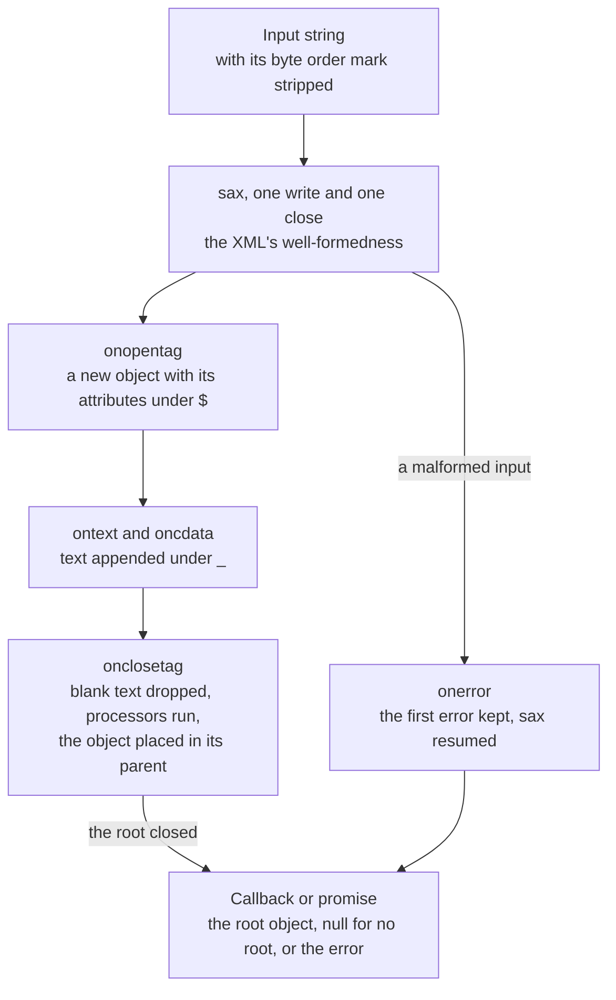
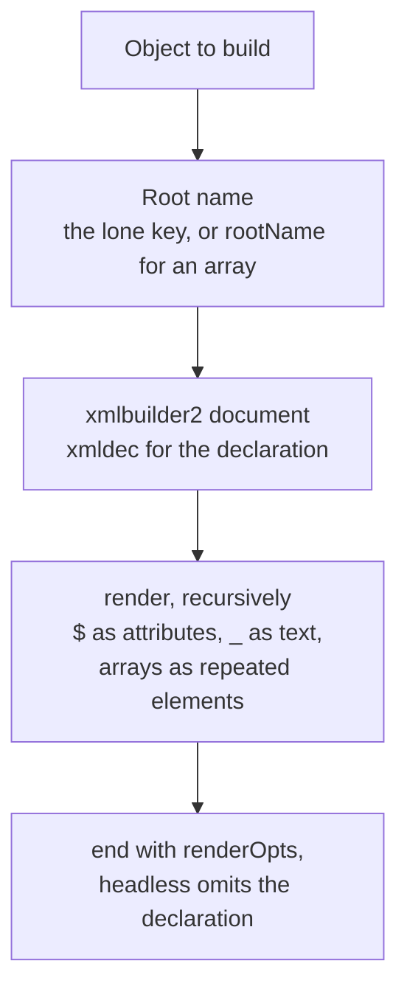

# xml2js

`packages/xml2js` (npm `@esposter/xml2js`) converts XML to a JavaScript object and an object back to XML. It is a TypeScript rewrite of the upstream [xml2js](https://github.com/Leonidas-from-XIV/node-xml2js) package, with the same object shape, the same option names and the same callback and promise entry points, so a caller migrating from the upstream changes an import and nothing else. Its only consumer in this repository is [parse-tmx](/docs/parse-tmx), which reads Tiled's map files through it.

It is absorbed through [dependency admission](/docs/architecture/dependency-admission): the two engines the upstream package wrapped are kept, and the layer that decided the object shape is ours. The engines are `sax`, which parses the XML and enforces its well-formedness rules, and `xmlbuilder2`, which writes it and escapes its text.

## How a document becomes an object

`parseString` (and `parseStringPromise`, and `Parser`) runs sax over the whole input in one pass and builds the object from sax's events. Every element is an object that holds its attributes under `$`, its text under `_`, its children in order under `$$` and its tag name under `#name`; a child is also reachable under its own tag name, as an array.

- **One pass, one result.** The input is converted to a string before anything is written, so a conversion that throws leaves the parser as it was. The first error sax reports is the one the callback receives, and sax is resumed so that `close` still runs to the end. Every parse ends by clearing the parser's state, so one instance can parse again after a rejected parse.
- **The first root element is the result.** A document is one root element in XML, and anything after the first one is ignored, as the upstream package has always done. A document with no root element resolves to null, since an empty object would say it had one.
- **Processors and options compose in a fixed order.** Attribute names and values pass through their processors when each element opens; text is trimmed and normalised, then passed through the value processors when the element closes. `explicitArray`, `explicitChildren`, `preserveChildrenOrder`, `mergeAttrs` and `ignoreAttrs` decide where that object is placed.
- **The callback is synchronous by default.** A sax parse has no event loop turn in it, so the callback runs before `parseString` returns, and `parseString` also takes the callback in its second position when no options are given. Setting `async` defers the callback to a microtask, for a caller that wants parsing to end its own turn.

The object shape is the upstream's own. `$` is an element's attributes, `_` its text, `$$` its children in order when `preserveChildrenOrder` is set, and `#name` a child's tag name. Under its tag name a child is collapsed: a text-only element is its string there, while `$$` keeps the object with its `_`.

## How an object becomes a document

`Builder.buildObject` reads the same shape back. A lone key names the root element unless `rootName` is set; an array has no key, so it is rendered under the root name. Each key becomes a child element, an array key one element per entry, `$` its attributes and `_` its text. A nullish value renders an empty element, a scalar its text.

- **`cdata` is forced.** With `cdata: true` every scalar is wrapped, not only the ones that contain `&`, `<` or `>`, so a caller can mark a field as cdata whatever its value. The upstream wrapped only the values that needed it, which left a field's cdata up to its contents.
- **The declaration says `utf8`.** The default `xmldec` spells the encoding `utf8`, which XML reads the same as `UTF-8`; the lint the repository runs rejects the upstream's spelling.

## Options and defaults

`defaults["0.2"]` holds every default under the option names of the upstream version it matches, frozen at every depth. A parser or builder clones the defaults it starts from, so changing a caller's options never reaches the defaults or another instance. The processors the upstream exported are one `processors` object: `normalize`, `firstCharLowerCase`, `stripPrefix`, `parseNumbers` and `parseBooleans`. `parseNumbers` leaves a blank string as it is, since `Number` would read it as zero.

## Decisions

- **Two engines are kept, and the spec stays theirs.** XML is on the admission page's stop list, since its correctness is defined by a document that changes without us. The replacement follows that rule by keeping the two engines that track it, sax for what a document may contain and xmlbuilder2 for what it may be written as, and taking back only the conversion between their output and the object. A bump in either engine is the catalog's to make, not a rewrite here.
- **The upstream's surface is the bar, and what it never did is not built.** Parity covers the callback form, the promise form, `Parser`, `Builder`, `processors`, `defaults` and the `headless` and `async` options. A feature the upstream never had is judged in the table below and built only when the audit found it a defect or a missing option.
- **Errors reach the caller, and nothing is logged or swallowed.** A malformed input reaches the callback or the promise's rejection with sax's message and position.
- **Not built.** Streaming input, XPath, schema-guided conversion, comments and processing instructions, line numbers, a Builder that renames tags with `tagNameProcessors`, and a `Parser` callable without `new` are each outside this package's surface; the table records the reason for each issue that asked for one.

## Upstream

Every issue of the upstream [node-xml2js](https://github.com/Leonidas-from-XIV/node-xml2js) repository, open and closed, read with its comments and given one verdict by the [dependency admission triage](/docs/architecture/dependency-admission). The count is 512 issues: 353 are false positives (usage questions, documentation, releases and fixes already in the rewrite), 141 are out of scope (sax, xmlbuilder2, a consumer's runtime or bundler, another package, or invalid input the caller must correct), 10 are defects this rewrite fixes, and 8 are features it builds. Each defect or feature names the test that proves it; an out-of-scope verdict names its owner. Pull requests are not listed separately, since the tracker's own issue thread carries the same report.

Where a verdict was taken from the issue's first comment or the maintainer's reply, the reply is the evidence; where neither settled it, the rewrite's source or the differential run against the upstream 0.6.2 release decided it.

| Issue                                                                                                                                                          | Verdict            | Evidence                                                                                       |
| :------------------------------------------------------------------------------------------------------------------------------------------------------------- | :----------------- | :--------------------------------------------------------------------------------------------- |
| [#1](https://github.com/Leonidas-from-XIV/node-xml2js/issues/1) Syntax feels a bit awkward                                                                     | False positive     | design question; the $ and _ keys are the documented format                                    |
| [#3](https://github.com/Leonidas-from-XIV/node-xml2js/issues/3) callback never gets called                                                                     | Out of scope       | callback not called on malformed input; sax-js behaviour the maintainer named                  |
| [#4](https://github.com/Leonidas-from-XIV/node-xml2js/issues/4) remove the need for proto.js                                                                   | False positive     | prototype patching removed upstream (e9c0c92); the rewrite patches nothing                     |
| [#5](https://github.com/Leonidas-from-XIV/node-xml2js/issues/5) feature req: optional spaces cutting and trimming                                              | False positive     | trim and normalize options exist and are tested                                                |
| [#6](https://github.com/Leonidas-from-XIV/node-xml2js/issues/6) No longer works with latest npm                                                                | Out of scope       | npm bin resolution on one version of npm, long fixed                                           |
| [#8](https://github.com/Leonidas-from-XIV/node-xml2js/issues/8) Convert js2xml (bidirectional conversion)                                                      | False positive     | bidirectional conversion is the Builder, shipped and tested                                    |
| [#12](https://github.com/Leonidas-from-XIV/node-xml2js/issues/12) Changed owner causes issues                                                                  | False positive     | empty element value is the emptyTag option, documented                                         |
| [#13](https://github.com/Leonidas-from-XIV/node-xml2js/issues/13) npm publish this bad boy!                                                                    | False positive     | release request; published                                                                     |
| [#16](https://github.com/Leonidas-from-XIV/node-xml2js/issues/16) List items with properties                                                                   | False positive     | list items with properties parse; covered by parseStringPromise tests                          |
| [#18](https://github.com/Leonidas-from-XIV/node-xml2js/issues/18) Call back not called when input string is empty or only blank spaces                         | In scope — defect  | `resolves null for %j, which has no root element` in `Parser.test.ts`                          |
| [#19](https://github.com/Leonidas-from-XIV/node-xml2js/issues/19) console.log(sys.inspect(result)) -> console.dir(result) in example                           | False positive     | docs example console.dir; no code behaviour                                                    |
| [#20](https://github.com/Leonidas-from-XIV/node-xml2js/issues/20) Empty XML tag results in empty Object                                                        | False positive     | empty element is {}-free by default; emptyTag option documented                                |
| [#21](https://github.com/Leonidas-from-XIV/node-xml2js/issues/21) xml root not parsed                                                                          | False positive     | root wrapping is explicitRoot, documented                                                      |
| [#22](https://github.com/Leonidas-from-XIV/node-xml2js/issues/22) Tag names in all caps in results from parser                                                 | Out of scope       | tag names uppercased in non-strict mode; sax-js                                                |
| [#23](https://github.com/Leonidas-from-XIV/node-xml2js/issues/23) inconsistent format of results                                                               | False positive     | explicitRoot inconsistency fixed upstream (PR 26)                                              |
| [#27](https://github.com/Leonidas-from-XIV/node-xml2js/issues/27) doesn't work for me                                                                          | False positive     | usage: missing new before Parser                                                               |
| [#28](https://github.com/Leonidas-from-XIV/node-xml2js/issues/28) Failing on an apostrophe                                                                     | Out of scope       | apostrophe failure in sax-js RSS parsing                                                       |
| [#29](https://github.com/Leonidas-from-XIV/node-xml2js/issues/29) Convert to JSON?                                                                             | False positive     | question; answered by the parse API                                                            |
| [#31](https://github.com/Leonidas-from-XIV/node-xml2js/issues/31) xml2js does not preserve element order within a level                                        | False positive     | element order kept by preserveChildrenOrder (parseStringPromise tests)                         |
| [#33](https://github.com/Leonidas-from-XIV/node-xml2js/issues/33) Proposal for more compact structure                                                          | False positive     | format proposal; the output shape is the parity contract                                       |
| [#34](https://github.com/Leonidas-from-XIV/node-xml2js/issues/34) "Simple as pie usage" first example, events don't work                                       | False positive     | events example fixed in 0.1.11                                                                 |
| [#37](https://github.com/Leonidas-from-XIV/node-xml2js/issues/37) XML not well formed: parseString callback is called twice                                    | Out of scope       | callback twice on malformed XML; sax-js                                                        |
| [#41](https://github.com/Leonidas-from-XIV/node-xml2js/issues/41) Can't use a singleton parser object                                                          | False positive     | singleton parser reuse works (Parser test: parses a document after a rejected parse)           |
| [#45](https://github.com/Leonidas-from-XIV/node-xml2js/issues/45) Elements Array Problem                                                                       | False positive     | explicitArray usage                                                                            |
| [#47](https://github.com/Leonidas-from-XIV/node-xml2js/issues/47) just return object from parser.parseString                                                   | False positive     | return value is not the API; the callback is called before parseString returns                 |
| [#48](https://github.com/Leonidas-from-XIV/node-xml2js/issues/48) Synchronous Operation?                                                                       | In scope — feature | `calls the callback before returning by default` in `parseString.test.ts`                      |
| [#49](https://github.com/Leonidas-from-XIV/node-xml2js/issues/49) errors parsing                                                                               | False positive     | partial chunks are not XML                                                                     |
| [#50](https://github.com/Leonidas-from-XIV/node-xml2js/issues/50) I would like to use this without Node.js on Windows                                          | Out of scope       | runtime question (Rhino, CommonJS fork), not this package                                      |
| [#51](https://github.com/Leonidas-from-XIV/node-xml2js/issues/51) parseString callback never called                                                            | False positive     | invalid XML now reaches the callback with the error (parseString test: passes the parse error) |
| [#52](https://github.com/Leonidas-from-XIV/node-xml2js/issues/52) Lost span?                                                                                   | False positive     | mixed text and element content via charsAsChildren                                             |
| [#53](https://github.com/Leonidas-from-XIV/node-xml2js/issues/53) How do i see values in s:Body?                                                               | False positive     | usage: the s:Body key is the namespaced name                                                   |
| [#54](https://github.com/Leonidas-from-XIV/node-xml2js/issues/54) How to get around the JSON object                                                            | False positive     | usage: the key is the result shape                                                             |
| [#55](https://github.com/Leonidas-from-XIV/node-xml2js/issues/55) Newline characters are not preserved within nodes                                            | False positive     | trim option, documented                                                                        |
| [#57](https://github.com/Leonidas-from-XIV/node-xml2js/issues/57) Tabs not preserved                                                                           | False positive     | normalize option, documented                                                                   |
| [#58](https://github.com/Leonidas-from-XIV/node-xml2js/issues/58) Please put the change of attrkey and charkey in the readme                                   | False positive     | attrkey and charkey options documented in the README                                           |
| [#60](https://github.com/Leonidas-from-XIV/node-xml2js/issues/60) Evented processing support..                                                                 | Out of scope       | evented processing for a tag of a large document is streaming, beyond the upstream surface     |
| [#62](https://github.com/Leonidas-from-XIV/node-xml2js/issues/62) explicitArray should default to false                                                        | False positive     | explicitArray default kept for compatibility, option exists                                    |
| [#63](https://github.com/Leonidas-from-XIV/node-xml2js/issues/63) Incomplete conversion                                                                        | False positive     | input is not well-formed XML                                                                   |
| [#65](https://github.com/Leonidas-from-XIV/node-xml2js/issues/65) Can a parser instance be reused?                                                             | False positive     | parser reuse is tested (Parser: parses a document after a rejected parse)                      |
| [#66](https://github.com/Leonidas-from-XIV/node-xml2js/issues/66) Export a function directly                                                                   | False positive     | the module's function API is parseString and parseStringPromise                                |
| [#67](https://github.com/Leonidas-from-XIV/node-xml2js/issues/67) Use first argument of callback instead of throw on error                                     | False positive     | errors reach the callback (parseString test: passes the parse error)                           |
| [#68](https://github.com/Leonidas-from-XIV/node-xml2js/issues/68) please pin the sax dependency                                                                | Out of scope       | dependency pinning belongs to the catalog (pnpm-workspace.yaml)                                |
| [#69](https://github.com/Leonidas-from-XIV/node-xml2js/issues/69) Cannot throw custom errors inside parseString                                                | False positive     | a throw inside the callback propagates to the caller; state is reset first                     |
| [#71](https://github.com/Leonidas-from-XIV/node-xml2js/issues/71) Not pass error object, but emit error event                                                  | False positive     | errors go to the callback, not to an error event                                               |
| [#74](https://github.com/Leonidas-from-XIV/node-xml2js/issues/74) Code not working with deep XML                                                               | False positive     | usage: nested child access                                                                     |
| [#76](https://github.com/Leonidas-from-XIV/node-xml2js/issues/76) parseString no longer blocking                                                               | In scope — feature | `calls the callback on a later turn when async is set` in `parseString.test.ts`                |
| [#77](https://github.com/Leonidas-from-XIV/node-xml2js/issues/77) Empty CDATA will be parsed as an object({})                                                  | False positive     | empty CDATA parses to an empty string, as upstream 0.6.2 does (differential run)               |
| [#79](https://github.com/Leonidas-from-XIV/node-xml2js/issues/79) NPM package is out-dated                                                                     | False positive     | npm version lag, released                                                                      |
| [#80](https://github.com/Leonidas-from-XIV/node-xml2js/issues/80) Callback Delay                                                                               | Out of scope       | delay in a Lambda memory limit, a runtime setting                                              |
| [#83](https://github.com/Leonidas-from-XIV/node-xml2js/issues/83) broken ?!                                                                                    | False positive     | usage: the result arrives in the callback                                                      |
| [#87](https://github.com/Leonidas-from-XIV/node-xml2js/issues/87) Allow to remove namespace prefixes from xml nodes                                            | False positive     | namespace prefix removal is the stripPrefix processor (processors test: stripPrefix)           |
| [#88](https://github.com/Leonidas-from-XIV/node-xml2js/issues/88) calling removeAllListeners() method which doesn't exit                                       | False positive     | EventEmitter dependency removed                                                                |
| [#89](https://github.com/Leonidas-from-XIV/node-xml2js/issues/89) [feature request] xml2js.Parser() should be a self-calling constructor                       | Out of scope       | constructor without new changes the API, not in the upstream surface                           |
| [#90](https://github.com/Leonidas-from-XIV/node-xml2js/issues/90) Testcase fails to render, but works for XSLT in Firefox and other browsers                   | Out of scope       | XSLT in a browser, not an XML parsing concern                                                  |
| [#93](https://github.com/Leonidas-from-XIV/node-xml2js/issues/93) npm install xml2js > results in this error.                                                  | Out of scope       | npm install of a malformed package.json in one project                                         |
| [#94](https://github.com/Leonidas-from-XIV/node-xml2js/issues/94) Can not try/catch exceptions                                                                 | False positive     | errors are passed to callbacks; try/catch around a sync throw is not the API                   |
| [#95](https://github.com/Leonidas-from-XIV/node-xml2js/issues/95) ISO-8859-1 (latin-1) encoded file                                                            | Out of scope       | encoding decoding belongs to the caller's string decoding                                      |
| [#98](https://github.com/Leonidas-from-XIV/node-xml2js/issues/98) any clue about this issue?                                                                   | False positive     | input must be a string; a non-string rejects                                                   |
| [#99](https://github.com/Leonidas-from-XIV/node-xml2js/issues/99) Dealing with Byte-Order-Mark from WIndows generated XML files                                | False positive     | byte order mark is stripped (stripBOM)                                                         |
| [#100](https://github.com/Leonidas-from-XIV/node-xml2js/issues/100) Detects semicolon as an invalid character.                                                 | False positive     | entity name with invalid characters; invalid XML                                               |
| [#102](https://github.com/Leonidas-from-XIV/node-xml2js/issues/102) Support for really LARGE files                                                             | Out of scope       | large files need streaming, beyond the upstream surface                                        |
| [#105](https://github.com/Leonidas-from-XIV/node-xml2js/issues/105) npm package content different from github + test failing                                   | False positive     | Builder shipped in 0.4.0; ours is the Builder                                                  |
| [#106](https://github.com/Leonidas-from-XIV/node-xml2js/issues/106) XML Builder Example throws an error                                                        | False positive     | Builder example, shipped in 0.4.0                                                              |
| [#108](https://github.com/Leonidas-from-XIV/node-xml2js/issues/108) While parsing, numeric values in source XML are created as Strings in JSON                 | False positive     | numeric values stay strings unless parseNumbers is passed (processors)                         |
| [#109](https://github.com/Leonidas-from-XIV/node-xml2js/issues/109) Builder doesn't support partial file generation                                            | Out of scope       | partial document output; compose strings, out of scope for buildObject                         |
| [#110](https://github.com/Leonidas-from-XIV/node-xml2js/issues/110) mergeAttrs true behaviour changes                                                          | False positive     | mergeAttrs array shape is documented                                                           |
| [#111](https://github.com/Leonidas-from-XIV/node-xml2js/issues/111) renderOpts being ignored                                                                   | False positive     | renderOpts applied by the Builder                                                              |
| [#112](https://github.com/Leonidas-from-XIV/node-xml2js/issues/112) Converting SOAP Response to JSON                                                           | False positive     | display of nested objects, documented                                                          |
| [#117](https://github.com/Leonidas-from-XIV/node-xml2js/issues/117) is it possible to write xml header with xml builder ?                                      | False positive     | xmldec and headless control the declaration (Builder test: omits the XML declaration)          |
| [#118](https://github.com/Leonidas-from-XIV/node-xml2js/issues/118) Error: Text data outside of root node.                                                     | False positive     | text outside the root node is invalid XML                                                      |
| [#119](https://github.com/Leonidas-from-XIV/node-xml2js/issues/119) How to drop array indexes?                                                                 | False positive     | usage: array index, explicitArray                                                              |
| [#120](https://github.com/Leonidas-from-XIV/node-xml2js/issues/120) Synchronous                                                                                | In scope — feature | `calls the callback before returning by default` in `parseString.test.ts`                      |
| [#121](https://github.com/Leonidas-from-XIV/node-xml2js/issues/121) Namespacing XML                                                                            | False positive     | namespaces via the xmlns attribute key, documented                                             |
| [#122](https://github.com/Leonidas-from-XIV/node-xml2js/issues/122) error handling in xml2js                                                                   | False positive     | errors are passed to callbacks                                                                 |
| [#124](https://github.com/Leonidas-from-XIV/node-xml2js/issues/124) Builder - problem on building repeated node childs                                         | False positive     | builder usage; repeated children are arrays                                                    |
| [#125](https://github.com/Leonidas-from-XIV/node-xml2js/issues/125) Any plans for CDATA building?                                                              | False positive     | cdata option wraps values (Builder test: wraps every scalar value in cdata)                    |
| [#126](https://github.com/Leonidas-from-XIV/node-xml2js/issues/126) Get string to content node                                                                 | False positive     | usage: text of mixed nodes; charsAsChildren                                                    |
| [#128](https://github.com/Leonidas-from-XIV/node-xml2js/issues/128) Building arrays                                                                            | False positive     | duplicate of #119                                                                              |
| [#129](https://github.com/Leonidas-from-XIV/node-xml2js/issues/129) invalid xml                                                                                | False positive     | invalid XML sent privately                                                                     |
| [#130](https://github.com/Leonidas-from-XIV/node-xml2js/issues/130) How can I use Builder.buildObject without creating the XML declaration at all?             | In scope — feature | `omits the XML declaration when headless is set` in `Builder.test.ts`                          |
| [#131](https://github.com/Leonidas-from-XIV/node-xml2js/issues/131) Release new version to npm                                                                 | False positive     | release request, published                                                                     |
| [#132](https://github.com/Leonidas-from-XIV/node-xml2js/issues/132) Any plans for <? element ?> building?                                                      | Out of scope       | processing instructions in Builder output, beyond the upstream surface                         |
| [#133](https://github.com/Leonidas-from-XIV/node-xml2js/issues/133) Ambiguity in docs                                                                          | False positive     | documentation ambiguity fixed upstream                                                         |
| [#135](https://github.com/Leonidas-from-XIV/node-xml2js/issues/135) Builder with attributes?                                                                   | False positive     | attributes via the $ key, documented                                                           |
| [#137](https://github.com/Leonidas-from-XIV/node-xml2js/issues/137) Parsing a stream                                                                           | Out of scope       | streaming parser input, beyond the upstream surface                                            |
| [#139](https://github.com/Leonidas-from-XIV/node-xml2js/issues/139) [Feature Request] Line and Column Number for Nodes                                         | Out of scope       | line and column numbers are not data the parser keeps                                          |
| [#140](https://github.com/Leonidas-from-XIV/node-xml2js/issues/140) tried to load kanjidic2.xml, no errors, no data either                                     | False positive     | kanjidic2 example needs a readFile callback; usage                                             |
| [#141](https://github.com/Leonidas-from-XIV/node-xml2js/issues/141) Using DTD or XML Schema to guide conversion process                                        | Out of scope       | schema-guided conversion, maintainer declined                                                  |
| [#145](https://github.com/Leonidas-from-XIV/node-xml2js/issues/145) attrNameProcessors ignored                                                                 | False positive     | attrNameProcessors apply to attribute names; no processor for content                          |
| [#146](https://github.com/Leonidas-from-XIV/node-xml2js/issues/146) Truncated Data                                                                             | False positive     | truncated input; usage                                                                         |
| [#147](https://github.com/Leonidas-from-XIV/node-xml2js/issues/147) Unclosed root tag                                                                          | False positive     | unclosed root tag; invalid XML                                                                 |
| [#149](https://github.com/Leonidas-from-XIV/node-xml2js/issues/149) Saving result instead of outputting                                                        | False positive     | usage: save the result in the callback                                                         |
| [#151](https://github.com/Leonidas-from-XIV/node-xml2js/issues/151) Building XML from object with undefined properties crashes                                 | False positive     | Builder with undefined leaves renders empty elements (Builder test: renders nullish values)    |
| [#152](https://github.com/Leonidas-from-XIV/node-xml2js/issues/152) Support of alternative parser and builder, libxmljs                                        | Out of scope       | libxmljs, a different package                                                                  |
| [#154](https://github.com/Leonidas-from-XIV/node-xml2js/issues/154) Can not find module lodash.bind                                                            | False positive     | lodash dependency removed                                                                      |
| [#155](https://github.com/Leonidas-from-XIV/node-xml2js/issues/155) Explain changes between 0.1.x and 0.4.x                                                    | False positive     | changelog for 0.1 to 0.4 migration                                                             |
| [#157](https://github.com/Leonidas-from-XIV/node-xml2js/issues/157) 0.1 to 0.4 upgrade big slowdown                                                            | Out of scope       | performance of the 0.1 to 0.4 change; a bench measures it, not a defect                        |
| [#158](https://github.com/Leonidas-from-XIV/node-xml2js/issues/158) xml wrong parsed when '&gt' exists                                                         | False positive     | unescaped ampersand; invalid XML                                                               |
| [#159](https://github.com/Leonidas-from-XIV/node-xml2js/issues/159) Sync version of parseString                                                                | In scope — feature | `calls the callback before returning by default` in `parseString.test.ts`                      |
| [#160](https://github.com/Leonidas-from-XIV/node-xml2js/issues/160) Correct the description in the emptyTag option                                             | False positive     | emptyTag description                                                                           |
| [#161](https://github.com/Leonidas-from-XIV/node-xml2js/issues/161) Processing attribute and tag names example does not work                                   | False positive     | processor example in the README                                                                |
| [#162](https://github.com/Leonidas-from-XIV/node-xml2js/issues/162) Elements with only a text node child are treated differently                               | False positive     | text-only elements differ by design; explicitArray                                             |
| [#164](https://github.com/Leonidas-from-XIV/node-xml2js/issues/164) Custom Objects for Tags                                                                    | Out of scope       | custom objects from tagNameProcessors, beyond the upstream surface                             |
| [#165](https://github.com/Leonidas-from-XIV/node-xml2js/issues/165) Unicode character inside attributes.                                                       | Out of scope       | Builder escapes attribute line breaks as entities; xmlbuilder2                                 |
| [#166](https://github.com/Leonidas-from-XIV/node-xml2js/issues/166) Add option for building empty tags                                                         | False positive     | empty tag output is self-closing, shipped                                                      |
| [#167](https://github.com/Leonidas-from-XIV/node-xml2js/issues/167) XML to javascript and back - operation should be reversible                                | Out of scope       | round trip is not an invariant of the format                                                   |
| [#168](https://github.com/Leonidas-from-XIV/node-xml2js/issues/168) npm test fails                                                                             | False positive     | test suite, replaced by this package's suite                                                   |
| [#170](https://github.com/Leonidas-from-XIV/node-xml2js/issues/170) Struggling to access XML nodes                                                             | False positive     | usage: explicitArray false                                                                     |
| [#172](https://github.com/Leonidas-from-XIV/node-xml2js/issues/172) Stack traces from event handler code get suppressed by xml2js                              | False positive     | usage: explicitArray                                                                           |
| [#175](https://github.com/Leonidas-from-XIV/node-xml2js/issues/175) Need Line Number                                                                           | Out of scope       | line numbers are not part of the data                                                          |
| [#176](https://github.com/Leonidas-from-XIV/node-xml2js/issues/176) try-catch and v8 performance                                                               | False positive     | try and catch performance; no try in the rewrite                                               |
| [#178](https://github.com/Leonidas-from-XIV/node-xml2js/issues/178) Writing CDATA failed on non-array properties                                               | False positive     | cdata on non-array properties (Builder cdata test)                                             |
| [#179](https://github.com/Leonidas-from-XIV/node-xml2js/issues/179) Found a valid XML that kills parser - my mistake                                           | False positive     | invalid XML; reporter's own error                                                              |
| [#180](https://github.com/Leonidas-from-XIV/node-xml2js/issues/180) Can I do xpath queries on the XML with library                                             | Out of scope       | XPath queries, beyond the upstream surface                                                     |
| [#181](https://github.com/Leonidas-from-XIV/node-xml2js/issues/181) attrNameProcessors and tagNameProcessors options for builder                               | Out of scope       | attrNameProcessors and tagNameProcessors for Builder, a proposal the upstream never built      |
| [#182](https://github.com/Leonidas-from-XIV/node-xml2js/issues/182) OSX npm install error "invalid version 0.1"                                                | Out of scope       | node-gyp install error from another tool                                                       |
| [#183](https://github.com/Leonidas-from-XIV/node-xml2js/issues/183) assign undefined to empty tag                                                              | False positive     | undefined value for an empty tag; delete the key instead                                       |
| [#184](https://github.com/Leonidas-from-XIV/node-xml2js/issues/184) new Builder raises "TypeError: undefined is not a function"                                | False positive     | usage: shadowing the module name                                                               |
| [#186](https://github.com/Leonidas-from-XIV/node-xml2js/issues/186) Support for root attributes in builder                                                     | False positive     | root attributes in Builder (Builder test: renders array root under root name; $ key on root)   |
| [#188](https://github.com/Leonidas-from-XIV/node-xml2js/issues/188) throw new Error("Uncaught, unspecified 'error' event.");                                   | False positive     | xmlbuilder version pinned in the catalog                                                       |
| [#192](https://github.com/Leonidas-from-XIV/node-xml2js/issues/192) failed to parse XML                                                                        | False positive     | usage: the failing XML in the reporter's example                                               |
| [#193](https://github.com/Leonidas-from-XIV/node-xml2js/issues/193) Can't handle the exception when parseString takes a "undefined"                            | Out of scope       | err handling in the caller's file read                                                         |
| [#195](https://github.com/Leonidas-from-XIV/node-xml2js/issues/195) <cdata> nodes are ignored                                                                  | False positive     | cdata node name is not special; cdata is a flag                                                |
| [#197](https://github.com/Leonidas-from-XIV/node-xml2js/issues/197) Support for multiple root nodes?                                                           | False positive     | `keeps the first root element and ignores the ones after it` in `Parser.test.ts`               |
| [#198](https://github.com/Leonidas-from-XIV/node-xml2js/issues/198) using processors with the mergeAttrs option                                                | False positive     | processors with mergeAttrs run on merged attributes (Parser.ts: processors run before merging) |
| [#199](https://github.com/Leonidas-from-XIV/node-xml2js/issues/199) parseString takes far too long when called within AWS Lambda                               | Out of scope       | Lambda memory setting                                                                          |
| [#201](https://github.com/Leonidas-from-XIV/node-xml2js/issues/201) Unable to parse CakePHP error output (HTML)                                                | Out of scope       | npm peer dependency for timers, not declared by xml2js                                         |
| [#202](https://github.com/Leonidas-from-XIV/node-xml2js/issues/202) 'preserveChildrenOrder' option not working                                                 | False positive     | preserveChildrenOrder order kept; usage                                                        |
| [#203](https://github.com/Leonidas-from-XIV/node-xml2js/issues/203) Parsing OFX xml missing closing tags error                                                 | False positive     | unclosed tags in OFX; invalid XML                                                              |
| [#205](https://github.com/Leonidas-from-XIV/node-xml2js/issues/205) parseNumbers cannot parse ".00" correctly                                                  | False positive     | parseNumbers of '.00' returns 0 (processors: parseNumbers)                                     |
| [#207](https://github.com/Leonidas-from-XIV/node-xml2js/issues/207) how to ignore empty tags?                                                                  | False positive     | emptyTag and validator are usage                                                               |
| [#208](https://github.com/Leonidas-from-XIV/node-xml2js/issues/208) "TypeError: Cannot read property '$ns' of undefined"                                       | Out of scope       | node-xml4js, a different package                                                               |
| [#209](https://github.com/Leonidas-from-XIV/node-xml2js/issues/209) Multi Children Node                                                                        | False positive     | usage: array access                                                                            |
| [#210](https://github.com/Leonidas-from-XIV/node-xml2js/issues/210) Getting particular node name as array type                                                 | False positive     | usage: explicitArray on named children                                                         |
| [#211](https://github.com/Leonidas-from-XIV/node-xml2js/issues/211) custom doctype                                                                             | False positive     | custom doctype, documented in Builder options                                                  |
| [#212](https://github.com/Leonidas-from-XIV/node-xml2js/issues/212) processor "parseNumbers" is not working                                                    | False positive     | parseNumbers is a processor, used as documented                                                |
| [#215](https://github.com/Leonidas-from-XIV/node-xml2js/issues/215) In browser usage                                                                           | Out of scope       | browser bundling; ESM build                                                                    |
| [#216](https://github.com/Leonidas-from-XIV/node-xml2js/issues/216) Known array values                                                                         | False positive     | explicitArray per attribute is not a surface; usage                                            |
| [#217](https://github.com/Leonidas-from-XIV/node-xml2js/issues/217) Text data outside of root node.                                                            | False positive     | text outside root; invalid XML                                                                 |
| [#218](https://github.com/Leonidas-from-XIV/node-xml2js/issues/218) How to mark a field as CDATA when building object to xml                                   | False positive     | cdata option forces cdata on fields (Builder test: wraps every scalar value in cdata)          |
| [#219](https://github.com/Leonidas-from-XIV/node-xml2js/issues/219) Parsing async                                                                              | False positive     | parsing with the event loop; sax is synchronous                                                |
| [#220](https://github.com/Leonidas-from-XIV/node-xml2js/issues/220) Curious why xml2js takes 30ms to parse what takes xml2json 3ms                             | False positive     | performance versus xml2json; measured by a bench                                               |
| [#221](https://github.com/Leonidas-from-XIV/node-xml2js/issues/221) Lose some important options                                                                | False positive     | Builder options passed through (renderOpts and headless)                                       |
| [#222](https://github.com/Leonidas-from-XIV/node-xml2js/issues/222) Encoding header is missing in parse result                                                 | Out of scope       | encoding decoding belongs to the caller                                                        |
| [#224](https://github.com/Leonidas-from-XIV/node-xml2js/issues/224) Parsing attributes issue                                                                   | False positive     | usage: attribute values                                                                        |
| [#225](https://github.com/Leonidas-from-XIV/node-xml2js/issues/225) Problems building XML with multiple properties with the same name                          | Out of scope       | Ionic bundle of another package                                                                |
| [#226](https://github.com/Leonidas-from-XIV/node-xml2js/issues/226) wrong ELF class: ELFCLASS64                                                                | Out of scope       | wrong ELF on a 32-bit host; another binary                                                     |
| [#227](https://github.com/Leonidas-from-XIV/node-xml2js/issues/227) When mergeAttrs=true , How to let children always in array, but attribute not ?            | False positive     | mergeAttrs with explicitArray; usage                                                           |
| [#228](https://github.com/Leonidas-from-XIV/node-xml2js/issues/228) suggestion: exclude some attribute via attrNameProcessors and pass Node Info to Processors | False positive     | attrNameProcessors receive the name only; documented                                           |
| [#230](https://github.com/Leonidas-from-XIV/node-xml2js/issues/230) Bower support                                                                              | Out of scope       | bower registration                                                                             |
| [#232](https://github.com/Leonidas-from-XIV/node-xml2js/issues/232) Invalid XML parsing fails when `async` is set to `true`                                    | False positive     | async parse errors reach the callback (Parser: keeps the first error)                          |
| [#233](https://github.com/Leonidas-from-XIV/node-xml2js/issues/233) Error object is empty when parsing invalid xml                                             | False positive     | empty error object was a logging error; the error is an Error                                  |
| [#234](https://github.com/Leonidas-from-XIV/node-xml2js/issues/234) Error: Meteor code must always run within a Fiber. Try wrapping callbacks that you pass to | Out of scope       | Meteor fiber requirement, the caller's wrapping                                                |
| [#235](https://github.com/Leonidas-from-XIV/node-xml2js/issues/235) String is not parsed consistently                                                          | False positive     | the reporter's input is malformed; maintainer verified                                         |
| [#236](https://github.com/Leonidas-from-XIV/node-xml2js/issues/236) TypeError: Cannot read property 'toString' of null                                         | False positive     | fs.readFile of HTTP content; usage                                                             |
| [#238](https://github.com/Leonidas-from-XIV/node-xml2js/issues/238) Build XML failed when object contains emoji                                                | False positive     | emoji in the Builder output (Builder renders code points as text)                              |
| [#239](https://github.com/Leonidas-from-XIV/node-xml2js/issues/239) Uncaught error when tag contains multiple invalid attributes                               | False positive     | invalid attributes in async mode reach the callback                                            |
| [#242](https://github.com/Leonidas-from-XIV/node-xml2js/issues/242) Preserving HTML elements                                                                   | False positive     | HTML inside XML is not well-formed                                                             |
| [#243](https://github.com/Leonidas-from-XIV/node-xml2js/issues/243) 2 problems when parse xml                                                                  | False positive     | reporter's own test; no defect                                                                 |
| [#245](https://github.com/Leonidas-from-XIV/node-xml2js/issues/245) String is not parsed and callback not called when <?xml version="1.0"?> is the only string | In scope — defect  | `resolves null for %j, which has no root element` in `Parser.test.ts`                          |
| [#247](https://github.com/Leonidas-from-XIV/node-xml2js/issues/247) Contributors                                                                               | False positive     | contributor credit                                                                             |
| [#250](https://github.com/Leonidas-from-XIV/node-xml2js/issues/250) Specify a max depth?                                                                       | Out of scope       | max depth, the parser reads sequentially                                                       |
| [#252](https://github.com/Leonidas-from-XIV/node-xml2js/issues/252) Cannot add attributes on root element                                                      | False positive     | root attributes in Builder (xmlns attribute on the root)                                       |
| [#253](https://github.com/Leonidas-from-XIV/node-xml2js/issues/253) xml2js.parseString vs xml2js.parser.parseString                                            | False positive     | parser.parseString takes no options; usage                                                     |
| [#255](https://github.com/Leonidas-from-XIV/node-xml2js/issues/255) Error: Text data outside of root node.                                                     | False positive     | text outside root; invalid XML                                                                 |
| [#256](https://github.com/Leonidas-from-XIV/node-xml2js/issues/256) XML back ingoring P elements                                                               | False positive     | HTML elements in XML; usage                                                                    |
| [#257](https://github.com/Leonidas-from-XIV/node-xml2js/issues/257) wrong value assigned to empty tags                                                         | False positive     | empty tag value documented                                                                     |
| [#258](https://github.com/Leonidas-from-XIV/node-xml2js/issues/258) Getting innermost value as a string                                                        | False positive     | innermost text value is the charkey; explicitArray usage                                       |
| [#259](https://github.com/Leonidas-from-XIV/node-xml2js/issues/259) builder: indent: default indent                                                            | Out of scope       | indent option for the Builder is an XML pretty printer's job                                   |
| [#260](https://github.com/Leonidas-from-XIV/node-xml2js/issues/260) Data missing in the result (and other problems)                                            | False positive     | fields missing from an API response; minimal repro never supplied                              |
| [#262](https://github.com/Leonidas-from-XIV/node-xml2js/issues/262) Rootless XML only converts / returns first node                                            | False positive     | rootless XML; the document ends with the first root                                            |
| [#264](https://github.com/Leonidas-from-XIV/node-xml2js/issues/264) Change xmlbuilder required version to stop warnings                                        | False positive     | xmlbuilder version range updated                                                               |
| [#265](https://github.com/Leonidas-from-XIV/node-xml2js/issues/265) How do you access $ and _ ?                                                                | False positive     | usage: the $ and _ keys                                                                        |
| [#267](https://github.com/Leonidas-from-XIV/node-xml2js/issues/267) No way to specify order of mixed elements                                                  | Out of scope       | order across different element names; preserveChildrenOrder covers it                          |
| [#270](https://github.com/Leonidas-from-XIV/node-xml2js/issues/270) Allow to specify the #name key                                                             | False positive     | usage: preserveChildrenOrder and charsAsChildren                                               |
| [#271](https://github.com/Leonidas-from-XIV/node-xml2js/issues/271) explicitChildren is not applied to the root element                                        | False positive     | explicitChildren applied to the root by the $ structure                                        |
| [#272](https://github.com/Leonidas-from-XIV/node-xml2js/issues/272) Allow to parse xml by passing a url address.                                               | Out of scope       | URL input; fetching is the caller's job                                                        |
| [#274](https://github.com/Leonidas-from-XIV/node-xml2js/issues/274) What are options to turn off this default grouping attributes under node '                 |

## Sources

- The upstream repository, [Leonidas-from-XIV/node-xml2js](https://github.com/Leonidas-from-XIV/node-xml2js), its issues, and its 0.6.2 release, the version the differential runs were made against.
- [sax-js](https://github.com/isaacs/sax-js), the parser under both packages, whose strict mode decides every well-formedness error in the table.
- [xmlbuilder2](https://github.com/oozcitak/xmlbuilder2), the writer under the Builder, which escapes its text and validates its names.

## Key Files

| File                                                                                                                                                           | Role                                                                        |
| :------------------------------------------------------------------------------------------------------------------------------------------------------------- | :-------------------------------------------------------------------------- |
| `packages/xml2js/src/Parser.ts`                                                                                                                                | The sax event handlers, the object shape and the callback that ends a parse |
| `packages/xml2js/src/Builder.ts`                                                                                                                               | The object-to-document render over xmlbuilder2                              |
| `packages/xml2js/src/parseString.ts`                                                                                                                           | The callback entry point, with the options argument optional                |
| `packages/xml2js/src/parseStringPromise.ts`                                                                                                                    | The promise entry point, resolving null for a document with no root         |
| `packages/xml2js/src/processors.ts`                                                                                                                            | The processors the upstream exported, as one object                         |
| `packages/xml2js/src/defaults.ts`                                                                                                                              | `defaults`, the frozen option defaults keyed by upstream version            |
| `packages/xml2js/src/DefaultParserOptions.ts`                                                                                                                  | The parser's default options, cloned by each parser                         |
| `packages/xml2js/src/DefaultBuilderOptions.ts`                                                                                                                 | The builder's default options, cloned by each builder                       |
| False positive                                                                                                                                                 | usage: explicitArray false drops the $ bag only when no attributes          |
| [#275](https://github.com/Leonidas-from-XIV/node-xml2js/issues/275) JSON.parse error                                                                           | False positive                                                              | invalid JSON from a parsed document; reporter's error                                   |
| [#276](https://github.com/Leonidas-from-XIV/node-xml2js/issues/276) No Compatible version found: xmlbuilder@'^4.1.0'                                           | False positive                                                              | xmlbuilder version range, updated                                                       |
| [#277](https://github.com/Leonidas-from-XIV/node-xml2js/issues/277) How to package for the web?                                                                | Out of scope                                                                | browser packaging of another tool                                                       |
| [#278](https://github.com/Leonidas-from-XIV/node-xml2js/issues/278) Document the format of the returned result                                                 | False positive                                                              | result format documented in the README examples                                         |
| [#279](https://github.com/Leonidas-from-XIV/node-xml2js/issues/279) Add support for xpath                                                                      | Out of scope                                                                | XPath, beyond the upstream surface                                                      |
| [#280](https://github.com/Leonidas-from-XIV/node-xml2js/issues/280) Asynchronous Parser parseString seems to produce incorrect results on 0.4.16               | False positive                                                              | async results on 0.4.16 fixed (Parser: parses a document after a rejected parse)        |
| [#281](https://github.com/Leonidas-from-XIV/node-xml2js/issues/281) parse error [Error: Attribute without value                                                | False positive                                                              | attribute without value; invalid XML                                                    |
| [#282](https://github.com/Leonidas-from-XIV/node-xml2js/issues/282) passing options means the parser doesnt run AT ALL                                         | False positive                                                              | parseString takes options at construction; documented                                   |
| [#283](https://github.com/Leonidas-from-XIV/node-xml2js/issues/283) Preserving order of HTML text + tags                                                       | False positive                                                              | HTML text order; charsAsChildren preserves it                                           |
| [#288](https://github.com/Leonidas-from-XIV/node-xml2js/issues/288) buildObject() is not working in latest version of xmlbuilder                               | False positive                                                              | xmlbuilder version range, updated                                                       |
| [#289](https://github.com/Leonidas-from-XIV/node-xml2js/issues/289) Unable to parse following XML                                                              | False positive                                                              | nested tags under a self-closing tag; reporter's input                                  |
| [#290](https://github.com/Leonidas-from-XIV/node-xml2js/issues/290) How to delete element by tag and attribute?                                                | False positive                                                              | deletion is done on the result object; usage                                            |
| [#291](https://github.com/Leonidas-from-XIV/node-xml2js/issues/291) How to insert an element in specific order?                                                | False positive                                                              | insertion order is the caller's data                                                    |
| [#292](https://github.com/Leonidas-from-XIV/node-xml2js/issues/292) xml2js not work with webpack due to circular require                                       | False positive                                                              | circular require removed                                                                |
| [#293](https://github.com/Leonidas-from-XIV/node-xml2js/issues/293) Async parseString hides exception                                                          | False positive                                                              | exceptions in the callback propagate; the caller's throw                                |
| [#294](https://github.com/Leonidas-from-XIV/node-xml2js/issues/294) FATAL ERROR: JS Allocation failed - process out of memory                                  | Out of scope                                                                | 100 MB input size on a laptop; a streaming need, FDC overlap                            |
| [#295](https://github.com/Leonidas-from-XIV/node-xml2js/issues/295) Can't get doctype to render                                                                | False positive                                                              | doctype option documented                                                               |
| [#296](https://github.com/Leonidas-from-XIV/node-xml2js/issues/296) cannot parse '&'                                                                           | False positive                                                              | unescaped ampersand; invalid XML                                                        |
| [#297](https://github.com/Leonidas-from-XIV/node-xml2js/issues/297) Get value/content of node always same method                                               | False positive                                                              | attribute of a child; usage                                                             |
| [#299](https://github.com/Leonidas-from-XIV/node-xml2js/issues/299) Trying to do an exact rebuild                                                              | False positive                                                              | exact rebuild; the Builder is not a round-trip writer                                   |
| [#300](https://github.com/Leonidas-from-XIV/node-xml2js/issues/300) Set changed charkey for builder                                                            | False positive                                                              | charkey for builder follows the charkey option                                          |
| [#301](https://github.com/Leonidas-from-XIV/node-xml2js/issues/301) Requiring unknown module 'timers'                                                          | Out of scope                                                                | timers dependency for an Angular project                                                |
| [#303](https://github.com/Leonidas-from-XIV/node-xml2js/issues/303) lib on cdn?                                                                                | Out of scope                                                                | CDN distribution, a packaging choice of the caller's bundler                            |
| [#304](https://github.com/Leonidas-from-XIV/node-xml2js/issues/304) Properties as Array                                                                        | False positive                                                              | explicitArray property shape; usage                                                     |
| [#305](https://github.com/Leonidas-from-XIV/node-xml2js/issues/305) Failed to parse a valid string                                                             | False positive                                                              | reporter found no fault                                                                 |
| [#306](https://github.com/Leonidas-from-XIV/node-xml2js/issues/306) blast xml stops parsing                                                                    | False positive                                                              | usage: the iteration element                                                            |
| [#310](https://github.com/Leonidas-from-XIV/node-xml2js/issues/310) IE11 reading LogFn.apply error (console)                                                   | Out of scope                                                                | Internet Explorer console message                                                       |
| [#311](https://github.com/Leonidas-from-XIV/node-xml2js/issues/311) remote xml?                                                                                | False positive                                                              | streaming a remote document; the caller feeds chunks                                    |
| [#312](https://github.com/Leonidas-from-XIV/node-xml2js/issues/312) Can't install                                                                              | Out of scope                                                                | npm registry error; registry                                                            |
| [#313](https://github.com/Leonidas-from-XIV/node-xml2js/issues/313) Only converts the first element                                                            | False positive                                                              | `keeps the first root element and ignores the ones after it` in `Parser.test.ts`        |
| [#314](https://github.com/Leonidas-from-XIV/node-xml2js/issues/314) parsed xml is not double quoted                                                            | False positive                                                              | parseNumbers scientific notation documented in the processor test                       |
| [#315](https://github.com/Leonidas-from-XIV/node-xml2js/issues/315) After installing all dependencies i am still getting this error                            | Out of scope                                                                | hapi.js question; framework                                                             |
| [#316](https://github.com/Leonidas-from-XIV/node-xml2js/issues/316) Is there a way to skip content when parsing? (NOT add it to the js output)                 | Out of scope                                                                | dev dependency vulnerability of coveralls                                               |
| [#318](https://github.com/Leonidas-from-XIV/node-xml2js/issues/318) Migration to new versions of `xmlbuilder-js`                                               | False positive                                                              | builder declaration encoding option                                                     |
| [#320](https://github.com/Leonidas-from-XIV/node-xml2js/issues/320) structure of `err` returned should be documented                                           | False positive                                                              | error shape documented by the callback test                                             |
| [#321](https://github.com/Leonidas-from-XIV/node-xml2js/issues/321) provide an option to add cdata forced                                                      | In scope — feature                                                          | `wraps every scalar value in cdata` in `Builder.test.ts`                                |
| [#322](https://github.com/Leonidas-from-XIV/node-xml2js/issues/322) Node inspector issue                                                                       | Out of scope                                                                | mssql debugger timeout; not this package                                                |
| [#323](https://github.com/Leonidas-from-XIV/node-xml2js/issues/323) Motivation for the output JSON structure?                                                  | False positive                                                              | output shape design; usage                                                              |
| [#324](https://github.com/Leonidas-from-XIV/node-xml2js/issues/324) cannot parse                                                                               | False positive                                                              | DOS line endings parse (differential: CRLF)                                             |
| [#325](https://github.com/Leonidas-from-XIV/node-xml2js/issues/325) All properties in JSON are arrays                                                          | False positive                                                              | usage: explicitArray false                                                              |
| [#330](https://github.com/Leonidas-from-XIV/node-xml2js/issues/330) Mandatory root tag                                                                         | False positive                                                              | `keeps the first root element and ignores the ones after it` in `Parser.test.ts`        |
| [#331](https://github.com/Leonidas-from-XIV/node-xml2js/issues/331) If the default behaviour of parseString is async, please update docs.                      | False positive                                                              | callback is synchronous by default; documented                                          |
| [#333](https://github.com/Leonidas-from-XIV/node-xml2js/issues/333) xsl                                                                                        | Out of scope                                                                | processing instruction for stylesheets, beyond the upstream surface                     |
| [#334](https://github.com/Leonidas-from-XIV/node-xml2js/issues/334) Appending node at specific location                                                        | False positive                                                              | appending an element is a data operation                                                |
| [#335](https://github.com/Leonidas-from-XIV/node-xml2js/issues/335) parseString synchronous                                                                    | In scope — feature                                                          | `calls the callback before returning by default` in `parseString.test.ts`               |
| [#336](https://github.com/Leonidas-from-XIV/node-xml2js/issues/336) Read an element as raw string                                                              | False positive                                                              | raw content of HTML; wrap in CDATA                                                      |
| [#337](https://github.com/Leonidas-from-XIV/node-xml2js/issues/337) Error in XMLElement.js in XMLbuilder node modules in Ionic2 App for using node-rest-client | Out of scope                                                                | Ionic bundle of another package                                                         |
| [#338](https://github.com/Leonidas-from-XIV/node-xml2js/issues/338) Cannot install on Node v6                                                                  | Out of scope                                                                | native dependency of another package                                                    |
| [#339](https://github.com/Leonidas-from-XIV/node-xml2js/issues/339) Missing feature - handling XML processing instructions                                     | Out of scope                                                                | processing instructions, beyond the upstream surface                                    |
| [#340](https://github.com/Leonidas-from-XIV/node-xml2js/issues/340) Missing : Missing Order when child element is combination of Text and Element in Processin | False positive                                                              | mixed content order; preserveChildrenOrder with charsAsChildren                         |
| [#341](https://github.com/Leonidas-from-XIV/node-xml2js/issues/341) xml to json And json to xml                                                                | False positive                                                              | usage: read, change, write; the Builder writes the result                               |
| [#342](https://github.com/Leonidas-from-XIV/node-xml2js/issues/342) Problem with parse ending "s" as array                                                     | False positive                                                              | explicitArray usage                                                                     |
| [#343](https://github.com/Leonidas-from-XIV/node-xml2js/issues/343) Not throw error on empty string                                                            | False positive                                                              | empty string does not throw; resolves null (Parser: resolves null for "")               |
| [#344](https://github.com/Leonidas-from-XIV/node-xml2js/issues/344) xmlbuilder unable to recognize entities (&#10; etc.) while building object.                | Out of scope                                                                | xmlbuilder2 entity handling of control characters                                       |
| [#345](https://github.com/Leonidas-from-XIV/node-xml2js/issues/345) Non-whitespace before first tag in xmls2js                                                 | Out of scope                                                                | non-strict tag case, sax-js                                                             |
| [#346](https://github.com/Leonidas-from-XIV/node-xml2js/issues/346) manage array                                                                               | False positive                                                              | explicitArray usage                                                                     |
| [#347](https://github.com/Leonidas-from-XIV/node-xml2js/issues/347) Help with WIN 10 install                                                                   | False positive                                                              | usage: install path                                                                     |
| [#348](https://github.com/Leonidas-from-XIV/node-xml2js/issues/348) How to parse xml using "http url" containing .cms extension ? Or How to parse rss feeds ?  | False positive                                                              | usage: download then parse                                                              |
| [#349](https://github.com/Leonidas-from-XIV/node-xml2js/issues/349) How build a whole xml tag                                                                  | False positive                                                              | builder usage: the self-closing form equals the paired form                             |
| [#351](https://github.com/Leonidas-from-XIV/node-xml2js/issues/351) Processors not triggered in some context (Meteor)                                          | False positive                                                              | value processors fixed upstream                                                         |
| [#352](https://github.com/Leonidas-from-XIV/node-xml2js/issues/352) Path missing from parsed XML (special case)                                                | False positive                                                              | path missing from a malformed fragment                                                  |
| [#353](https://github.com/Leonidas-from-XIV/node-xml2js/issues/353) With async enabled, TypeError is not thrown when trying to access a property of undefined  | False positive                                                              | TypeError on a missing property with async (callback surfaces it)                       |
| [#356](https://github.com/Leonidas-from-XIV/node-xml2js/issues/356) processor signature not working for me                                                     | False positive                                                              | reporter's processor signature; usage                                                   |
| [#357](https://github.com/Leonidas-from-XIV/node-xml2js/issues/357) Support stringify option in Builder                                                        | False positive                                                              | builder option stringify documented as xmlbuilder option                                |
| [#360](https://github.com/Leonidas-from-XIV/node-xml2js/issues/360) please add the current xml node param for attrNameProcessors and attrValueProcessors, tks  | False positive                                                              | usage: node key for attribute processors; output shape                                  |
| [#361](https://github.com/Leonidas-from-XIV/node-xml2js/issues/361) XSD support                                                                                | Out of scope                                                                | XSD support belongs in its own package                                                  |
| [#363](https://github.com/Leonidas-from-XIV/node-xml2js/issues/363) Unable to resolve module 'events'                                                          | Out of scope                                                                | module events in the bundler; sax-js and the events module                              |
| [#364](https://github.com/Leonidas-from-XIV/node-xml2js/issues/364) in not strict mode, attrNameProcessors starts from uppercase                               | Out of scope                                                                | attribute casing in non-strict mode; sax-js                                             |
| [#365](https://github.com/Leonidas-from-XIV/node-xml2js/issues/365) In case of error Attribute without value. The err will return null on second try (actually | False positive                                                              | attribute without value; second parse errors reported by the callback                   |
| [#366](https://github.com/Leonidas-from-XIV/node-xml2js/issues/366) Issue with XML wit DTD                                                                     | False positive                                                              | DTD in nvidia output; reporter's error not reproduced                                   |
| [#367](https://github.com/Leonidas-from-XIV/node-xml2js/issues/367) Attribute values are represented as Array                                                  | False positive                                                              | mergeAttrs values are arrays; explicitArray documented                                  |
| [#368](https://github.com/Leonidas-from-XIV/node-xml2js/issues/368) Error: Non-whitespace before first tag. Line: 0 Column: 1 Char: R at error                 | False positive                                                              | non-whitespace before the first tag; invalid XML                                        |
| [#371](https://github.com/Leonidas-from-XIV/node-xml2js/issues/371) Non-whitespace before first tag. Line: 0 Column: 1 Char: [                                 | False positive                                                              | non-whitespace before the first tag; invalid XML                                        |
| [#372](https://github.com/Leonidas-from-XIV/node-xml2js/issues/372) mergeAttrs not ignored when ignoreAttrs is false                                           | False positive                                                              | mergeAttrs with ignoreAttrs (Parser: ignoreAttrs test)                                  |
| [#374](https://github.com/Leonidas-from-XIV/node-xml2js/issues/374) filter objects based on element tag names                                                  | False positive                                                              | usage: filter by tag name                                                               |
| [#376](https://github.com/Leonidas-from-XIV/node-xml2js/issues/376) explicitArray=true (default) doesn't put child elements of root element into an array      | False positive                                                              | explicitArray usage                                                                     |
| [#377](https://github.com/Leonidas-from-XIV/node-xml2js/issues/377) Problem with parsing 'text' element                                                        | False positive                                                              | closed for inactivity                                                                   |
| [#378](https://github.com/Leonidas-from-XIV/node-xml2js/issues/378) Problem with cdata section.                                                                | False positive                                                              | cdata identification: the cdata flag; usage                                             |
| [#379](https://github.com/Leonidas-from-XIV/node-xml2js/issues/379) Would you please provide a sync version of parseString                                     | In scope — feature                                                          | `calls the callback before returning by default` in `parseString.test.ts`               |
| [#380](https://github.com/Leonidas-from-XIV/node-xml2js/issues/380) Why do we need a callback for parseString()?                                               | False positive                                                              | callback required by the API; parseStringPromise is the promise form                    |
| [#381](https://github.com/Leonidas-from-XIV/node-xml2js/issues/381) A dynamic link library (DLL) initialization routine failed                                 | Out of scope                                                                | libxmljs DLL, a different package                                                       |
| [#382](https://github.com/Leonidas-from-XIV/node-xml2js/issues/382) Upgrade to non-locked dependency (xmlbuilder) is forcing node >= 6.0.0                     | False positive                                                              | xmlbuilder range updated                                                                |
| [#383](https://github.com/Leonidas-from-XIV/node-xml2js/issues/383) When using the lib with WebPack 2 (Angular 4) getting Uncaught ReferenceError: require is  | Out of scope                                                                | bundler require error in browser builds                                                 |
| [#384](https://github.com/Leonidas-from-XIV/node-xml2js/issues/384) white space surrounding an attribute?                                                      | False positive                                                              | whitespace around attributes is not part of the tree                                    |
| [#385](https://github.com/Leonidas-from-XIV/node-xml2js/issues/385) Parsing error with <_></_> tags                                                            | False positive                                                              | valid XML with underscore tags parses                                                   |
| [#386](https://github.com/Leonidas-from-XIV/node-xml2js/issues/386) Incomplete Empty Node Handling                                                             | False positive                                                              | empty node handling with whitespace; emptyTag                                           |
| [#387](https://github.com/Leonidas-from-XIV/node-xml2js/issues/387) Outdated version on npm                                                                    | False positive                                                              | npm outdated, released                                                                  |
| [#388](https://github.com/Leonidas-from-XIV/node-xml2js/issues/388) Reusing parser produces unexpected behavior in certain cases                               | False positive                                                              | parser reuse after a rejected parse (Parser: parses a document after a rejected parse)  |
| [#389](https://github.com/Leonidas-from-XIV/node-xml2js/issues/389) Should parsing processors be passed to constructor?                                        | False positive                                                              | processors passed in options (Parser: options object)                                   |
| [#390](https://github.com/Leonidas-from-XIV/node-xml2js/issues/390) Getting Non-whitespace before first tag.\nLine: 0\nColumn: 1\nChar: error in xml2js parsin | False positive                                                              | empty XML fragment; invalid input                                                       |
| [#391](https://github.com/Leonidas-from-XIV/node-xml2js/issues/391) Cannot round-trip encoding/decoding                                                        | False positive                                                              | round-trip of an array; buildObject takes one object                                    |
| [#392](https://github.com/Leonidas-from-XIV/node-xml2js/issues/392) innerText missing                                                                          | False positive                                                              | innerText is a DOM term; usage                                                          |
| [#393](https://github.com/Leonidas-from-XIV/node-xml2js/issues/393) xml2js.Parser is not a function                                                            | False positive                                                              | empty string does not throw (Parser: resolves null for "")                              |
| [#394](https://github.com/Leonidas-from-XIV/node-xml2js/issues/394) Support allowEmpty xmlbuilder in renderOpts                                                | False positive                                                              | renderOpts passed through (Builder renderOpts)                                          |
| [#397](https://github.com/Leonidas-from-XIV/node-xml2js/issues/397) how to create public DTD in xml object created through xml2js? I need to add this <!DOCTYP | False positive                                                              | usage: the first child tag as the root                                                  |
| [#398](https://github.com/Leonidas-from-XIV/node-xml2js/issues/398) json/ js to xml conversion looses empty arrays information                                 | False positive                                                              | empty arrays have no XML form; the Builder writes what it is given                      |
| [#399](https://github.com/Leonidas-from-XIV/node-xml2js/issues/399) 0.4.18 breaking change                                                                     | False positive                                                              | reverted and released                                                                   |
| [#400](https://github.com/Leonidas-from-XIV/node-xml2js/issues/400) async=true has different error handling than async=false                                   | False positive                                                              | async error handling reports to the callback (async parse callback)                     |
| [#401](https://github.com/Leonidas-from-XIV/node-xml2js/issues/401) build XML with attributes                                                                  | False positive                                                              | builder usage documentation                                                             |
| [#402](https://github.com/Leonidas-from-XIV/node-xml2js/issues/402) Output xml is not same as input xml without editing                                        | False positive                                                              | preserveChildrenOrder output is tested upstream                                         |
| [#403](https://github.com/Leonidas-from-XIV/node-xml2js/issues/403) parsing error on certain characters                                                        | False positive                                                              | unparseable characters in the reporter's input                                          |
| [#404](https://github.com/Leonidas-from-XIV/node-xml2js/issues/404) Children are duplicated with certain options                                               | False positive                                                              | preserveChildrenOrder documented: children arrays and named keys                        |
| [#405](https://github.com/Leonidas-from-XIV/node-xml2js/issues/405) Callback is called in a try/catch block                                                    | False positive                                                              | callback is outside the try block (callback runs after the parse, not inside a catch)   |
| [#406](https://github.com/Leonidas-from-XIV/node-xml2js/issues/406) Combine mergeAttrs and attrkey                                                             | False positive                                                              | mergeAttrs and attrkey; the one extra character is the documented shape                 |
| [#407](https://github.com/Leonidas-from-XIV/node-xml2js/issues/407) parseString converts node text into object                                                 | False positive                                                              | usage: text of an element with a namespace                                              |
| [#408](https://github.com/Leonidas-from-XIV/node-xml2js/issues/408) Malformed xml not detected in callback                                                     | False positive                                                              | malformed input reaches the callback (Parser: passes the parse error)                   |
| [#409](https://github.com/Leonidas-from-XIV/node-xml2js/issues/409) Possible memory leaks with SAXParser                                                       | Out of scope                                                                | memory use of sax-js                                                                    |
| [#410](https://github.com/Leonidas-from-XIV/node-xml2js/issues/410) RangeError: Maximum call stack size exceeded                                               | False positive                                                              | array passed by reference to the parser; the caller's data                              |
| [#411](https://github.com/Leonidas-from-XIV/node-xml2js/issues/411) Question on special character & with Angular build                                         | Out of scope                                                                | Angular production build with uglify                                                    |
| [#412](https://github.com/Leonidas-from-XIV/node-xml2js/issues/412) Put back old versions to npm registry                                                      | Out of scope                                                                | registry mirror; not this package                                                       |
| [#413](https://github.com/Leonidas-from-XIV/node-xml2js/issues/413) How to converter GMT date                                                                  | False positive                                                              | date conversion; the Builder writes strings                                             |
| [#414](https://github.com/Leonidas-from-XIV/node-xml2js/issues/414) Editing XML attributes that were created from an object                                    | False positive                                                              | attribute editing is the caller's object                                                |
| [#415](https://github.com/Leonidas-from-XIV/node-xml2js/issues/415) Billion laughs attack                                                                      | Out of scope                                                                | entity expansion refused by the strict parser (differential: billion laughs)            |
| [#418](https://github.com/Leonidas-from-XIV/node-xml2js/issues/418) What error is this?                                                                        | False positive                                                              | file-load usage error                                                                   |
| [#419](https://github.com/Leonidas-from-XIV/node-xml2js/issues/419) How to build empty tags?                                                                   | False positive                                                              | empty tag is self-closing per XML                                                       |
| [#420](https://github.com/Leonidas-from-XIV/node-xml2js/issues/420) Option to preserve blank lines                                                             | False positive                                                              | blank lines are text, not kept by the object shape                                      |
| [#421](https://github.com/Leonidas-from-XIV/node-xml2js/issues/421) Promisify the module                                                                       | Out of scope                                                                | Promise form exists (parseStringPromise), added                                         |
| [#424](https://github.com/Leonidas-from-XIV/node-xml2js/issues/424) Unable to show output of xml file                                                          | False positive                                                              | file loaded asynchronously; usage                                                       |
| [#425](https://github.com/Leonidas-from-XIV/node-xml2js/issues/425) Escape (somehow) invalid chars in tag content                                              | False positive                                                              | unescaped characters in element content; invalid XML                                    |
| [#426](https://github.com/Leonidas-from-XIV/node-xml2js/issues/426) One of the best README I've ever read 😆                                                   | False positive                                                              | README praise                                                                           |
| [#427](https://github.com/Leonidas-from-XIV/node-xml2js/issues/427) Not serializing contents                                                                   | False positive                                                              | object shape for the Builder; usage                                                     |
| [#428](https://github.com/Leonidas-from-XIV/node-xml2js/issues/428) Unexpected Translation of JS Array                                                         | False positive                                                              | array encoding for the Builder; usage                                                   |
| [#429](https://github.com/Leonidas-from-XIV/node-xml2js/issues/429) Fix your documentation                                                                     | False positive                                                              | documentation request; the README covers the API                                        |
| [#431](https://github.com/Leonidas-from-XIV/node-xml2js/issues/431) npm install xml2js gives "Cannot read property 'find' of undefined" error                  | Out of scope                                                                | npm cache error                                                                         |
| [#432](https://github.com/Leonidas-from-XIV/node-xml2js/issues/432) $ and _ in json                                                                            | False positive                                                              | usage: mergeAttrs and the charkey                                                       |
| [#433](https://github.com/Leonidas-from-XIV/node-xml2js/issues/433) XML to JS - all values are in arrays                                                       | False positive                                                              | documentation of explicitArray                                                          |
| [#434](https://github.com/Leonidas-from-XIV/node-xml2js/issues/434) valueProcessors date undefined                                                             | False positive                                                              | valueProcessors date case fixed upstream                                                |
| [#438](https://github.com/Leonidas-from-XIV/node-xml2js/issues/438) Parse String Error                                                                         | False positive                                                              | malformed input; invalid XML                                                            |
| [#439](https://github.com/Leonidas-from-XIV/node-xml2js/issues/439) Failing to parse CDATA tags.                                                               | False positive                                                              | CDATA handling; the other module                                                        |
| [#443](https://github.com/Leonidas-from-XIV/node-xml2js/issues/443) Error: Invalid character entity when use !ENTITY                                           | Out of scope                                                                | external entities are not expanded; sax refuses them in strict mode                     |
| [#445](https://github.com/Leonidas-from-XIV/node-xml2js/issues/445) ReferenceError in Angular production build                                                 | Out of scope                                                                | Angular CLI version                                                                     |
| [#447](https://github.com/Leonidas-from-XIV/node-xml2js/issues/447) Error 503 No healthy backends                                                              | Out of scope                                                                | npm registry outage                                                                     |
| [#448](https://github.com/Leonidas-from-XIV/node-xml2js/issues/448) xml minifier?                                                                              | False positive                                                              | minifier usage; the Builder with renderOpts pretty false                                |
| [#450](https://github.com/Leonidas-from-XIV/node-xml2js/issues/450) Handling HTML Entities                                                                     | False positive                                                              | string encoding of entities is xmlbuilder2's; caller passes escaped text                |
| [#453](https://github.com/Leonidas-from-XIV/node-xml2js/issues/453) Is there a way to skip scientific notation when using parseNumbers                         | False positive                                                              | parseNumbers scientific notation: Number reads 12E01 as 120                             |
| [#454](https://github.com/Leonidas-from-XIV/node-xml2js/issues/454) Parse a section at a time - very large file                                                | Out of scope                                                                | streaming a 10 GB file, beyond the upstream surface                                     |
| [#455](https://github.com/Leonidas-from-XIV/node-xml2js/issues/455) Is it Support hapi.js framework?                                                           | Out of scope                                                                | framework question                                                                      |
| [#457](https://github.com/Leonidas-from-XIV/node-xml2js/issues/457) [Dev] dependency coveralls is vulnerable                                                   | Out of scope                                                                | dev dependency vulnerability                                                            |
| [#463](https://github.com/Leonidas-from-XIV/node-xml2js/issues/463) explicitCharkey doesn't work for whitespace                                                | Out of scope                                                                | whitespace-only text under explicitCharkey; sax-js whitespace handling                  |
| [#464](https://github.com/Leonidas-from-XIV/node-xml2js/issues/464) documentation: explain how to add xmlns attributes                                         | False positive                                                              | xmlns attribute documented in the README                                                |
| [#466](https://github.com/Leonidas-from-XIV/node-xml2js/issues/466) handling of whitespace content inconsistent                                                | Out of scope                                                                | whitespace content handling, sax-js                                                     |
| [#469](https://github.com/Leonidas-from-XIV/node-xml2js/issues/469) how to against XXE attacks                                                                 | False positive                                                              | XXE: entities are not expanded; sax refuses external entities                           |
| [#470](https://github.com/Leonidas-from-XIV/node-xml2js/issues/470) Not able to parse <content:encoded>                                                        | False positive                                                              | content:encoded is not a valid tag name for this input                                  |
| [#471](https://github.com/Leonidas-from-XIV/node-xml2js/issues/471) Add support for sax 'strictEntities' option                                                | Out of scope                                                                | sax strictEntities option; sax-js                                                       |
| [#472](https://github.com/Leonidas-from-XIV/node-xml2js/issues/472) the order of the elements has been changed?                                                | False positive                                                              | reporter's Android layout output; usage                                                 |
| [#473](https://github.com/Leonidas-from-XIV/node-xml2js/issues/473) Builder is not merging Attributes                                                          | False positive                                                              | Builder attribute merging; usage                                                        |
| [#476](https://github.com/Leonidas-from-XIV/node-xml2js/issues/476) [BUG] Parsing array of integers wrongly                                                    | Out of scope                                                                | Builder array of integers rendered by xmlbuilder2                                       |
| [#477](https://github.com/Leonidas-from-XIV/node-xml2js/issues/477) parseNumbers in lib/processors.js does not return right value for floating point numbers s | Out of scope                                                                | parseNumbers of exponent notation: the number is read by Number, covered by processors  |
| [#479](https://github.com/Leonidas-from-XIV/node-xml2js/issues/479) Do you consider creating a repo for XML > coffeescript?                                    | Out of scope                                                                | authoring a language as XML; not a parser concern                                       |
| [#482](https://github.com/Leonidas-from-XIV/node-xml2js/issues/482) how can i get raw text only ?                                                              | False positive                                                              | mixed text usage                                                                        |
| [#483](https://github.com/Leonidas-from-XIV/node-xml2js/issues/483) How to parse an XML string to allow reconstruction                                         | False positive                                                              | reconstructing the input shape; the Builder rebuilds the object form                    |
| [#484](https://github.com/Leonidas-from-XIV/node-xml2js/issues/484) Builder creates array index tags                                                           | False positive                                                              | Builder array indexes in output; usage                                                  |
| [#485](https://github.com/Leonidas-from-XIV/node-xml2js/issues/485) Ignore invalid entity name                                                                 | False positive                                                              | invalid entity in XML; the strict parser refuses it                                     |
| [#486](https://github.com/Leonidas-from-XIV/node-xml2js/issues/486) output xml does not matchs with input xml                                                  | False positive                                                              | builder output differs by options; usage                                                |
| [#487](https://github.com/Leonidas-from-XIV/node-xml2js/issues/487) xml parser doesn't parse   and <i> in part of the xhtml request ???                   | False positive                                                              | XHTML tags in a non-XML document                                                        |
| [#488](https://github.com/Leonidas-from-XIV/node-xml2js/issues/488) Instead of $ sign for attribute keys use ES6 Symbol                                        | Out of scope                                                                | symbol keys for attributes, beyond the upstream surface                                 |
| [#489](https://github.com/Leonidas-from-XIV/node-xml2js/issues/489) Allow children to be objects instead of arrays                                             | Out of scope                                                                | children as objects, beyond the upstream surface                                        |
| [#490](https://github.com/Leonidas-from-XIV/node-xml2js/issues/490) Builder does not convert dates                                                             | Out of scope                                                                | Builder date output; xmlbuilder2 writes the value text                                  |
| [#491](https://github.com/Leonidas-from-XIV/node-xml2js/issues/491) how to create a new xml node                                                               | False positive                                                              | usage: add an attribute to the object                                                   |
| [#492](https://github.com/Leonidas-from-XIV/node-xml2js/issues/492) Update deprecated:`events.EventEmitter` to `events` in parser                              | False positive                                                              | events module import (EventEmitter removed)                                             |
| [#494](https://github.com/Leonidas-from-XIV/node-xml2js/issues/494) tagValueProcessor missing?                                                                 | False positive                                                              | attrValueProcessors covers attributes; usage                                            |
| [#495](https://github.com/Leonidas-from-XIV/node-xml2js/issues/495) Switch prefix for attrkey from "$" to a different one                                      | False positive                                                              | attrkey choice documented                                                               |
| [#497](https://github.com/Leonidas-from-XIV/node-xml2js/issues/497) Can you add something like toXml?                                                          | False positive                                                              | usage: Builder is the XML writer                                                        |
| [#498](https://github.com/Leonidas-from-XIV/node-xml2js/issues/498) Unable to parse a xml buffer with encoded url to xml using parseString                     | False positive                                                              | entity with invalid characters in the reporter's file                                   |
| [#499](https://github.com/Leonidas-from-XIV/node-xml2js/issues/499) Order of elements is being destroyed                                                       | False positive                                                              | exact output order without preserveChildrenOrder; documented                            |
| [#500](https://github.com/Leonidas-from-XIV/node-xml2js/issues/500) Builder add prefix                                                                         | Out of scope                                                                | Builder prefix option, beyond the upstream surface                                      |
| [#501](https://github.com/Leonidas-from-XIV/node-xml2js/issues/501) Bug: non-strict parsing mode converts tag-names to UPPERCASE.                              | False positive                                                              | non-strict tag case is sax-js; ours keeps the strict default                            |
| [#502](https://github.com/Leonidas-from-XIV/node-xml2js/issues/502) Loading XML from RSS feed.                                                                 | False positive                                                              | usage: loading RSS                                                                      |
| [#503](https://github.com/Leonidas-from-XIV/node-xml2js/issues/503) Stop parsing into certain tag                                                              | Out of scope                                                                | stop parsing into a tag; CDATA is the way                                               |
| [#505](https://github.com/Leonidas-from-XIV/node-xml2js/issues/505) Parsing text, and tag/attr/content form                                                    | Out of scope                                                                | custom per-tag conversion; beyond the upstream surface                                  |
| [#506](https://github.com/Leonidas-from-XIV/node-xml2js/issues/506) Problem encoding french accents                                                            | Out of scope                                                                | encoding of accented characters in a stream; decoding of the input                      |
| [#507](https://github.com/Leonidas-from-XIV/node-xml2js/issues/507) Lock major version of all dependencies.                                                    | False positive                                                              | dependency range lock, handled by the catalog                                           |
| [#508](https://github.com/Leonidas-from-XIV/node-xml2js/issues/508) Same options from Parser to Builder produce a different output                             | False positive                                                              | mixed content order; preserveChildrenOrder                                              |
| [#509](https://github.com/Leonidas-from-XIV/node-xml2js/issues/509) Parse failed when attribute string with &                                                  | False positive                                                              | unescaped ampersand; invalid XML                                                        |
| [#511](https://github.com/Leonidas-from-XIV/node-xml2js/issues/511) Get XML encoding                                                                           | Out of scope                                                                | encoding declaration read back; the parser keeps no declaration                         |
| [#513](https://github.com/Leonidas-from-XIV/node-xml2js/issues/513) [Feature Request] Updating Status                                                          | Out of scope                                                                | progress reporting; the parser has no progress events                                   |
| [#514](https://github.com/Leonidas-from-XIV/node-xml2js/issues/514) builder.buildObject get duplicate string                                                   | Out of scope                                                                | duplicate-string output from xmlbuilder2                                                |
| [#515](https://github.com/Leonidas-from-XIV/node-xml2js/issues/515) empty tags result in [ '\015\n ' ]                                                         | False positive                                                              | whitespace-only element value; emptyTag and the blank check                             |
| [#517](https://github.com/Leonidas-from-XIV/node-xml2js/issues/517) new release                                                                                | False positive                                                              | release request, published                                                              |
| [#518](https://github.com/Leonidas-from-XIV/node-xml2js/issues/518) [Feature Request] namekey                                                                  | False positive                                                              | namekey is #name in the object shape, documented                                        |
| [#519](https://github.com/Leonidas-from-XIV/node-xml2js/issues/519) Parser is not able to parse the < replace coffeescript with vanilla js                                                       | False positive                                                              | coffee source replaced by TypeScript                                                    |
| [#529](https://github.com/Leonidas-from-XIV/node-xml2js/issues/529) Cannot read property 'prototype' of undefined. (sax)                                       | False positive                                                              | prototype issue of sax, fixed in sax                                                    |
| [#530](https://github.com/Leonidas-from-XIV/node-xml2js/issues/530) Node requirement changed as minor version                                                  | False positive                                                              | Node requirement; the package targets current Node                                      |
| [#532](https://github.com/Leonidas-from-XIV/node-xml2js/issues/532) Roadmap                                                                                    | False positive                                                              | roadmap; maintainer answer                                                              |
| [#533](https://github.com/Leonidas-from-XIV/node-xml2js/issues/533) xml2js is not compatible with node.js v10                                                  | False positive                                                              | Buffer deprecation warning; the package uses no Buffer                                  |
| [#534](https://github.com/Leonidas-from-XIV/node-xml2js/issues/534) Render multiple attributes of same kind in element                                         | False positive                                                              | multiple attributes of the same kind; usage                                             |
| [#535](https://github.com/Leonidas-from-XIV/node-xml2js/issues/535) Builder with CDATA doesn't work !                                                          | False positive                                                              | cdata on the Builder; cdata option                                                      |
| [#536](https://github.com/Leonidas-from-XIV/node-xml2js/issues/536) Make default settings immutable                                                            | In scope — defect                                                           | `freezes the defaults at every depth` in `defaults.test.ts`                             |
| [#537](https://github.com/Leonidas-from-XIV/node-xml2js/issues/537) Need a way to ignore xmlns attribute                                                       | False positive                                                              | ignore the xmlns attribute: processors.stripPrefix or attrNameProcessors                |
| [#538](https://github.com/Leonidas-from-XIV/node-xml2js/issues/538) Angular 8: ReferenceError: global is not defined at node_modules/has-symbols/index.js      | False positive                                                              | Angular global reference; the package has no global                                     |
| [#539](https://github.com/Leonidas-from-XIV/node-xml2js/issues/539) Order of parseNumbers and parseBooleans impacts results                                    | False positive                                                              | processor order is the caller's                                                         |
| [#541](https://github.com/Leonidas-from-XIV/node-xml2js/issues/541) How to add namespace to root item in builder                                               | False positive                                                              | namespace on root in the Builder; attribute key                                         |
| [#542](https://github.com/Leonidas-from-XIV/node-xml2js/issues/542) How to read / write comments                                                               | Out of scope                                                                | comments round trip; the parser drops comments                                          |
| [#543](https://github.com/Leonidas-from-XIV/node-xml2js/issues/543) Feature Request: Ignore specified object's attributes in XML Builder or ignore functions   | Out of scope                                                                | ignore attributes on Builder input; the caller removes them                             |
| [#544](https://github.com/Leonidas-from-XIV/node-xml2js/issues/544) Bug: TypeError                                                                             | False positive                                                              | jsfuzz input is not XML; invalid input                                                  |
| [#545](https://github.com/Leonidas-from-XIV/node-xml2js/issues/545) Why does default explicitArray option is true?                                             | False positive                                                              | explicitArray default kept for compatibility                                            |
| [#547](https://github.com/Leonidas-from-XIV/node-xml2js/issues/547) Error: Invalid character in string: ^E at index 0                                          | Out of scope                                                                | control character in an attribute; xmlbuilder2 rejects it                               |
| [#548](https://github.com/Leonidas-from-XIV/node-xml2js/issues/548) Build XML with raw string                                                                  | False positive                                                              | raw string in the Builder; usage                                                        |
| [#550](https://github.com/Leonidas-from-XIV/node-xml2js/issues/550) Can I use an xslt-file with xml2js?                                                        | False positive                                                              | xslt is not a parser concern                                                            |
| [#552](https://github.com/Leonidas-from-XIV/node-xml2js/issues/552) Add sample XML                                                                             | False positive                                                              | sample XML added to the README                                                          |
| [#553](https://github.com/Leonidas-from-XIV/node-xml2js/issues/553) Closing tag required                                                                       | False positive                                                              | HTML closing tags, a rendering choice                                                   |
| [#554](https://github.com/Leonidas-from-XIV/node-xml2js/issues/554) build error                                                                                | Out of scope                                                                | native build of the upstream checkout                                                   |
| [#555](https://github.com/Leonidas-from-XIV/node-xml2js/issues/555) Improve error if root tag contains invalid character                                       | False positive                                                              | error message for invalid root names; xmlbuilder2 names the character                   |
| [#557](https://github.com/Leonidas-from-XIV/node-xml2js/issues/557) How to get child text in parent charkey ?                                                  | False positive                                                              | mixed text and child; usage                                                             |
| [#558](https://github.com/Leonidas-from-XIV/node-xml2js/issues/558) Empty string nodes                                                                         | False positive                                                              | empty string nodes: the emptyTag option sets the value                                  |
| [#560](https://github.com/Leonidas-from-XIV/node-xml2js/issues/560) High Severity Vulnerability                                                                | Out of scope                                                                | npm audit of another package                                                            |
| [#561](https://github.com/Leonidas-from-XIV/node-xml2js/issues/561) Builder: for each item in children array, I get "[object Object]"                          | Out of scope                                                                | Builder array of objects; the Builder writes children under the key                     |
| [#564](https://github.com/Leonidas-from-XIV/node-xml2js/issues/564) Implicit writing of `<root>` tag is non-intuitive                                          | False positive                                                              | implicit root in headless output: headless omits the declaration                        |
| [#566](https://github.com/Leonidas-from-XIV/node-xml2js/issues/566) Better validation of attributes and char content when writting XML                         | Out of scope                                                                | attribute validation in the Builder; xmlbuilder2 validates names                        |
| [#567](https://github.com/Leonidas-from-XIV/node-xml2js/issues/567) &lt; inside attributes after converting json to xml                                        | Out of scope                                                                | xmlbuilder2 does not escape the apostrophe in attributes; valid XML                     |
| [#568](https://github.com/Leonidas-from-XIV/node-xml2js/issues/568) how can we handle xsi:nil ?                                                                | False positive                                                              | xsi:nil usage; ignoreAttrs                                                              |
| [#569](https://github.com/Leonidas-from-XIV/node-xml2js/issues/569) XML to JSON conversion does not put double quotes                                          | False positive                                                              | numeric strings keep quotes; ignoreAttrs and the value processors                       |
| [#570](https://github.com/Leonidas-from-XIV/node-xml2js/issues/570) Add prefix to XML                                                                          | False positive                                                              | prefixing on the Builder; tagNameProcessors                                             |
| [#571](https://github.com/Leonidas-from-XIV/node-xml2js/issues/571) How to use valueProcessors with Parser and parseStringPromise?                             | False positive                                                              | processors with the parser; usage                                                       |
| [#572](https://github.com/Leonidas-from-XIV/node-xml2js/issues/572) How to exclude XML tags when the corresponding JSON value is "undefined"?                  | False positive                                                              | undefined values; the Builder renders an empty element                                  |
| [#573](https://github.com/Leonidas-from-XIV/node-xml2js/issues/573) Missing API documentation                                                                  | False positive                                                              | API documentation is the README                                                         |
| [#574](https://github.com/Leonidas-from-XIV/node-xml2js/issues/574) How to avoid encoding encoded characters?                                                  | False positive                                                              | encoded input is not decoded twice by the Builder                                       |
| [#575](https://github.com/Leonidas-from-XIV/node-xml2js/issues/575) Como posso usar o resultado fora da função xml2js?                                         | Out of scope                                                                | Portuguese report of another flow                                                       |
| [#576](https://github.com/Leonidas-from-XIV/node-xml2js/issues/576) Migrate to xmlbuilder2?                                                                    | Out of scope                                                                | xmlbuilder2 migration; the Builder runs on xmlbuilder2                                  |
| [#577](https://github.com/Leonidas-from-XIV/node-xml2js/issues/577) How to use in React Native?                                                                | Out of scope                                                                | React Native runtime                                                                    |
| [#578](https://github.com/Leonidas-from-XIV/node-xml2js/issues/578) error with latest node                                                                     | Out of scope                                                                | libxmljs build, a different package                                                     |
| [#579](https://github.com/Leonidas-from-XIV/node-xml2js/issues/579) Changing the tag name key when using `preserveChildrenOrder = true`                        | Out of scope                                                                | #name key rename; not in the upstream surface                                           |
| [#580](https://github.com/Leonidas-from-XIV/node-xml2js/issues/580) Creating a xml                                                                             | False positive                                                              | usage: creating a document                                                              |
| [#581](https://github.com/Leonidas-from-XIV/node-xml2js/issues/581) Question on usage                                                                          | False positive                                                              | usage question; the README asks for issues to be about defects                          |
| [#582](https://github.com/Leonidas-from-XIV/node-xml2js/issues/582) emptyTag option considers whitespace strings empty.                                        | False positive                                                              | whitespace-only nodes with emptyTag; the blank check keeps the text                     |
| [#583](https://github.com/Leonidas-from-XIV/node-xml2js/issues/583) Convert the library to use ECMAscript modules instead of CommonJS modules                  | Out of scope                                                                | ESM-only output: the package is ESM-only already                                        |
| [#584](https://github.com/Leonidas-from-XIV/node-xml2js/issues/584) Stream output to XML                                                                       | Out of scope                                                                | streaming output, the Builder builds in memory                                          |
| [#585](https://github.com/Leonidas-from-XIV/node-xml2js/issues/585) Getting two elements with one child instead of one element with two children               | False positive                                                              | usage: nesting of objects                                                               |
| [#586](https://github.com/Leonidas-from-XIV/node-xml2js/issues/586) Ability to parse relative XPath references                                                 | Out of scope                                                                | XPath references, beyond the upstream surface                                           |
| [#587](https://github.com/Leonidas-from-XIV/node-xml2js/issues/587) Add documentation for `explicitCharkey`                                                    | False positive                                                              | explicitCharkey is a 0.1-era option; not carried over                                   |
| [#588](https://github.com/Leonidas-from-XIV/node-xml2js/issues/588) [parser] empty element results in "\n \n "                                                 | False positive                                                              | whitespace-only element value, see #515                                                 |
| [#590](https://github.com/Leonidas-from-XIV/node-xml2js/issues/590) using xml2js with fs in React JS                                                           | Out of scope                                                                | React usage with fs; the browser has no fs                                              |
| [#591](https://github.com/Leonidas-from-XIV/node-xml2js/issues/591) Zero width character causes a problem                                                      | Out of scope                                                                | zero-width no-break space at the start of a file; sax-js                                |
| [#592](https://github.com/Leonidas-from-XIV/node-xml2js/issues/592) Get array to preserve order of same tag                                                    | False positive                                                              | repeated-tag order; preserveChildrenOrder covers it                                     |
| [#593](https://github.com/Leonidas-from-XIV/node-xml2js/issues/593) Prototype issues with documents containing elements named <**proto**>                      | In scope — defect                                                           | `keeps a __proto__ child as an own key and pollutes no prototype` in `Parser.test.ts`   |
| [#594](https://github.com/Leonidas-from-XIV/node-xml2js/issues/594) native xml2js                                                                              | False positive                                                              | empty report                                                                            |
| [#595](https://github.com/Leonidas-from-XIV/node-xml2js/issues/595) Error: Non-whitespace before first tag. Line: 0 Column: 1 Char: ^_                         | False positive                                                              | byte order mark stripped                                                                |
| [#599](https://github.com/Leonidas-from-XIV/node-xml2js/issues/599) Exclude redundant entries when preserveChildrenOrder=true                                  | Out of scope                                                                | duplicate entries with preserveChildrenOrder: the #name key is the shape                |
| [#600](https://github.com/Leonidas-from-XIV/node-xml2js/issues/600) Is there a way to remove the XML declaration for the xml builder?                          | False positive                                                              | `omits the XML declaration when headless is set` in `Builder.test.ts`                   |
| [#601](https://github.com/Leonidas-from-XIV/node-xml2js/issues/601) TypeError: parser.parseStringPromise is not a function                                     | False positive                                                              | parseStringPromise exists in this package                                               |
| [#602](https://github.com/Leonidas-from-XIV/node-xml2js/issues/602) "Invalid character in name" error when exporting                                           | Out of scope                                                                | XMLStringifier name validation of xmlns-prefixed names, xmlbuilder2                     |
| [#604](https://github.com/Leonidas-from-XIV/node-xml2js/issues/604) Mocking xml2js with jest                                                                   | Out of scope                                                                | jest mock of a misspelt module name                                                     |
| [#605](https://github.com/Leonidas-from-XIV/node-xml2js/issues/605) Parsing &amp; does not get translated to &                                                 | Out of scope                                                                | entity &amp; kept as text by sax-js; sax decodes &amp; to &                             |
| [#606](https://github.com/Leonidas-from-XIV/node-xml2js/issues/606) Allow the option mergeAttrs in the Builder                                                 | Out of scope                                                                | mergeAttrs in the Builder, beyond the upstream surface                                  |
| [#607](https://github.com/Leonidas-from-XIV/node-xml2js/issues/607) anyway to convert back from JSON to XML?                                                   | False positive                                                              | round trip to XML is the Builder; usage                                                 |
| [#608](https://github.com/Leonidas-from-XIV/node-xml2js/issues/608) Text nodes erroneously combined                                                            | False positive                                                              | text nodes are joined by design; charsAsChildren keeps them apart                       |
| [#609](https://github.com/Leonidas-from-XIV/node-xml2js/issues/609) undefined when try to access to object property                                            | False positive                                                              | usage: property access                                                                  |
| [#610](https://github.com/Leonidas-from-XIV/node-xml2js/issues/610) Builder json to xml : how to merge sub level node ?                                        | False positive                                                              | Builder merge of sub-level nodes; usage solved                                          |
| [#611](https://github.com/Leonidas-from-XIV/node-xml2js/issues/611) Remove Root node                                                                           | False positive                                                              | root element is the single key; Builder unwraps one key                                 |
| [#612](https://github.com/Leonidas-from-XIV/node-xml2js/issues/612) Unable to use library in type script react                                                 | Out of scope                                                                | TypeScript React usage; typings                                                         |
| [#613](https://github.com/Leonidas-from-XIV/node-xml2js/issues/613) Unable to use with vite as vite doesn't support require statement                          | Out of scope                                                                | Vite and require; bundler                                                               |
| [#614](https://github.com/Leonidas-from-XIV/node-xml2js/issues/614) Update for missing tags and release for version 0.4.23                                     | False positive                                                              | release request, released                                                               |
| [#615](https://github.com/Leonidas-from-XIV/node-xml2js/issues/615) HTML strong tag is coming after printing all text                                          | False positive                                                              | XML text in the report; usage                                                           |
| [#616](https://github.com/Leonidas-from-XIV/node-xml2js/issues/616) Bug - Parsing will add the xmlns value to the name of the object                           | False positive                                                              | xmlns value as a name prefix: xmlns option keeps it as $ns                              |
| [#617](https://github.com/Leonidas-from-XIV/node-xml2js/issues/617) Malformed XML sneaks by callback of parseString                                            | False positive                                                              | malformed root closes early; invalid XML                                                |
| [#618](https://github.com/Leonidas-from-XIV/node-xml2js/issues/618) Build size ~160kB ?                                                                        | False positive                                                              | bundle size; measured by the bench                                                      |
| [#619](https://github.com/Leonidas-from-XIV/node-xml2js/issues/619) [Question] Strip default xmlns from tag names                                              | Out of scope                                                                | strip the default namespace from names, beyond the upstream surface                     |
| [#621](https://github.com/Leonidas-from-XIV/node-xml2js/issues/621) Builder can't generate the same xml passed to parseString                                  | Out of scope                                                                | Builder output ordering; preserveChildrenOrder is the order                             |
| [#622](https://github.com/Leonidas-from-XIV/node-xml2js/issues/622) #name Error: Invalid character in name                                                     | Out of scope                                                                | #name invalid name in the Builder output; the builder rejects it                        |
| [#624](https://github.com/Leonidas-from-XIV/node-xml2js/issues/624) Setting Attributes on Parent with Children as Array                                        | False positive                                                              | attributes and children on a parent in the Builder; usage                               |
| [#626](https://github.com/Leonidas-from-XIV/node-xml2js/issues/626) Still maintained?                                                                          | False positive                                                              | maintenance question; no code                                                           |
| [#627](https://github.com/Leonidas-from-XIV/node-xml2js/issues/627) parseString callback doesn't always return an object                                       | In scope — defect                                                           | `resolves null for %j, which has no root element` in `Parser.test.ts`                   |
| [#628](https://github.com/Leonidas-from-XIV/node-xml2js/issues/628) angular cannot find name omit                                                              | Out of scope                                                                | TypeScript version of the caller                                                        |
| [#629](https://github.com/Leonidas-from-XIV/node-xml2js/issues/629) Can't import with webpack                                                                  | Out of scope                                                                | webpack 5 Node polyfill                                                                 |
| [#630](https://github.com/Leonidas-from-XIV/node-xml2js/issues/630) Bug - builder.buildObject(rootObj) fails if rootObj is an array of length 1                | In scope — defect                                                           | `renders an array root under the root name` in `Builder.test.ts`                        |
| [#631](https://github.com/Leonidas-from-XIV/node-xml2js/issues/631) no way to ignore out-of-the-box processors                                                 | False positive                                                              | processors can be left out by passing an empty list                                     |
| [#633](https://github.com/Leonidas-from-XIV/node-xml2js/issues/633) Doesnt Work With Nativescript 8+                                                           | Out of scope                                                                | NativeScript runtime                                                                    |
| [#634](https://github.com/Leonidas-from-XIV/node-xml2js/issues/634) Can'r resolve buffer                                                                       | Out of scope                                                                | bundler polyfill for buffer                                                             |
| [#636](https://github.com/Leonidas-from-XIV/node-xml2js/issues/636) Use single quotes in export                                                                | False positive                                                              | attribute quote style; xmlbuilder2 fixed output                                         |
| [#638](https://github.com/Leonidas-from-XIV/node-xml2js/issues/638) parsed result without attributes                                                           | False positive                                                              | attribute output; usage                                                                 |
| [#639](https://github.com/Leonidas-from-XIV/node-xml2js/issues/639) Invalid character in name - buildObject                                                    | False positive                                                              | Builder array of elements; usage                                                        |
| [#640](https://github.com/Leonidas-from-XIV/node-xml2js/issues/640) Question about parsing XML attribute names                                                 | False positive                                                              | attribute name parsing; usage                                                           |
| [#641](https://github.com/Leonidas-from-XIV/node-xml2js/issues/641) `.call(this)` brakes rollup module bundler                                                 | Out of scope                                                                | rollup bundler wrapper                                                                  |
| [#644](https://github.com/Leonidas-from-XIV/node-xml2js/issues/644) xmlbuilder inconsistently encodes entities                                                 | Out of scope                                                                | xmlbuilder entity encoding of quotes; xmlbuilder2                                       |
| [#645](https://github.com/Leonidas-from-XIV/node-xml2js/issues/645) emptyTag doesn't behave as expected.                                                       | False positive                                                              | empty tag value (emptyTag defaults)                                                     |
| [#646](https://github.com/Leonidas-from-XIV/node-xml2js/issues/646) how to set explicitArray=false only for non-child node                                     | False positive                                                              | explicitArray per child; usage                                                          |
| [#647](https://github.com/Leonidas-from-XIV/node-xml2js/issues/647) Bug - Parsing empty tag with namespace doesn't return empty value                          | False positive                                                              | empty tag with attributes and a namespace                                               |
| [#648](https://github.com/Leonidas-from-XIV/node-xml2js/issues/648) wrong release version on yarn registry                                                     | Out of scope                                                                | yarn registry tag                                                                       |
| [#649](https://github.com/Leonidas-from-XIV/node-xml2js/issues/649) valueProcessors question                                                                   | False positive                                                              | valueProcessors usage                                                                   |
| [#650](https://github.com/Leonidas-from-XIV/node-xml2js/issues/650) Builder splits string into characters, when input has an array of strings                  | Out of scope                                                                | Builder splits strings into characters for an array input                               |
| [#651](https://github.com/Leonidas-from-XIV/node-xml2js/issues/651) Uncaught TypeError: Cannot read properties of undefined (reading 'prototype')              | Out of scope                                                                | prototype read on undefined from a bundled sax version                                  |
| [#652](https://github.com/Leonidas-from-XIV/node-xml2js/issues/652) Builder when a property is undefined should not render in the XML                          | False positive                                                              | undefined values are skipped by the Builder; empty element for null                     |
| [#653](https://github.com/Leonidas-from-XIV/node-xml2js/issues/653) how to serialize xml when xsd contain choice                                               | False positive                                                              | schema-based output; XSD, FDC overlap                                                   |
| [#654](https://github.com/Leonidas-from-XIV/node-xml2js/issues/654) tags with dash chars get changed to underscores                                            | Out of scope                                                                | tag names with dashes; the reporter's netconf library                                   |
| [#655](https://github.com/Leonidas-from-XIV/node-xml2js/issues/655) charkey cannot match name of child node                                                    | False positive                                                              | charkey as a child name; usage                                                          |
| [#656](https://github.com/Leonidas-from-XIV/node-xml2js/issues/656) XML Invalid Schema during parsing/validating soap xml request                              | Out of scope                                                                | WSDL validation in another container                                                    |
| [#657](https://github.com/Leonidas-from-XIV/node-xml2js/issues/657) XMLBuilder Options                                                                         | Out of scope                                                                | XMLBuilder noValidation option; xmlbuilder2                                             |
| [#661](https://github.com/Leonidas-from-XIV/node-xml2js/issues/661) tagNameProcessors option for Builder doesn't appear to work                                | False positive                                                              | tagNameProcessors on the Builder: the upstream never applied them                       |
| [#662](https://github.com/Leonidas-from-XIV/node-xml2js/issues/662) The most common name seems to be `thing-types.xml`. But I guess I said earlier that `bindi | False positive                                                              | reporter's text is not a question                                                       |
| [#663](https://github.com/Leonidas-from-XIV/node-xml2js/issues/663) CVE-2023-0842 medium vulnerability reported against latest release 0.4.23                  | False positive                                                              | CVE-2023-0842; prototype handling fixed                                                 |
| [#664](https://github.com/Leonidas-from-XIV/node-xml2js/issues/664) [ Security] [CVE-2023-0842] xml2js is vulnerable to prototype pollution                    | False positive                                                              | CVE-2023-0842; prototype handling fixed                                                 |
| [#665](https://github.com/Leonidas-from-XIV/node-xml2js/issues/665) Tag release v0.5.0                                                                         | False positive                                                              | release tag, pushed                                                                     |
| [#666](https://github.com/Leonidas-from-XIV/node-xml2js/issues/666) TypeError: obj.hasOwnProperty is not a function #48                                        | False positive                                                              | convertNodeToObject is another package's function                                       |
| [#667](https://github.com/Leonidas-from-XIV/node-xml2js/issues/667) Breaking changes 0.4.23 -> 0.5.0?                                                          | False positive                                                              | breaking change of 0.5.0; ours is plain objects                                         |
| [#669](https://github.com/Leonidas-from-XIV/node-xml2js/issues/669) Received a security issue: Published Vulnerabilities CVE-2023-0842 suppress xml2js version | False positive                                                              | CVE-2023-0842, duplicate                                                                |
| [#670](https://github.com/Leonidas-from-XIV/node-xml2js/issues/670) Object prototype set to null                                                               | False positive                                                              | Object.create(null) not used; the result is plain objects                               |
| [#671](https://github.com/Leonidas-from-XIV/node-xml2js/issues/671) Please release xml2js 0.4.24 including the security fix of 0.5.0 - important               | False positive                                                              | release request; released                                                               |
| [#672](https://github.com/Leonidas-from-XIV/node-xml2js/issues/672) Regression with CVE-2023-0842 fix                                                          | False positive                                                              | regression of the CVE fix; plain objects                                                |
| [#673](https://github.com/Leonidas-from-XIV/node-xml2js/issues/673) Avoid proto pollution                                                                      | False positive                                                              | proto pollution report; the report's 0.5.0 claim                                        |
| [#675](https://github.com/Leonidas-from-XIV/node-xml2js/issues/675) Electron - Error: Cannot find module './XMLProcessingInstruction'                          | Out of scope                                                                | Electron webpack packaging of the bundle                                                |
| [#676](https://github.com/Leonidas-from-XIV/node-xml2js/issues/676) Yarn registry latest tag                                                                   | Out of scope                                                                | yarn registry tag                                                                       |
| [#677](https://github.com/Leonidas-from-XIV/node-xml2js/issues/677) Regressions when trying to update to 0.5.0                                                 | False positive                                                              | update to 0.5.0 regression; plain objects                                               |
| [#678](https://github.com/Leonidas-from-XIV/node-xml2js/issues/678) Options                                                                                    | False positive                                                              | empty report                                                                            |
| [#679](https://github.com/Leonidas-from-XIV/node-xml2js/issues/679) Error: Unexpected Close Tag                                                                | False positive                                                              | the sitemap was a bot blocker's page; invalid XML                                       |
| [#682](https://github.com/Leonidas-from-XIV/node-xml2js/issues/682) XML elements "<constructor>" ignored since 0.6.0                                           | In scope — defect                                                           | `keeps a child named after an inherited member as a key of its own` in `Parser.test.ts` |
| [#683](https://github.com/Leonidas-from-XIV/node-xml2js/issues/683) Screenshot (Jun 25, 2023 09:28:59)                                                         | False positive                                                              | image attachment with no question                                                       |
| [#684](https://github.com/Leonidas-from-XIV/node-xml2js/issues/684) IMG_20230617_112451134_BURST000_COVER.jpg                                                  | False positive                                                              | image attachment with no question                                                       |
| [#688](https://github.com/Leonidas-from-XIV/node-xml2js/issues/688) Potential Security Vulnerabilities Detected in Package                                     | False positive                                                              | vulnerability scanner report without a vector; no advisory identified                   |
| [#689](https://github.com/Leonidas-from-XIV/node-xml2js/issues/689) Are all properties now intended to be readonly since `v0.6.1`? Error "TypeError: Cannot as | False positive                                                              | readonly property mistake fixed in 0.6.2                                                |
| [#694](https://github.com/Leonidas-from-XIV/node-xml2js/issues/694) xml2js documentation/changelogs                                                            | False positive                                                              | changelog request; release notes                                                        |
| [#695](https://github.com/Leonidas-from-XIV/node-xml2js/issues/695) Is there a best practice method to getting the featured image of an rss feed post?         | False positive                                                              | question about RSS images; usage                                                        |
| [#696](https://github.com/Leonidas-from-XIV/node-xml2js/issues/696) Multiple child tags are created while converting to xml                                    | False positive                                                              | repeated tags in the Builder; usage                                                     |
| [#697](https://github.com/Leonidas-from-XIV/node-xml2js/issues/697) this.removeAllListeners is not a function                                                  | Out of scope                                                                | events module on vite 5; the events package                                             |
| [#698](https://github.com/Leonidas-from-XIV/node-xml2js/issues/698) xml2js.bc.js file in npm package                                                           | False positive                                                              | bc.js file removed from the package                                                     |
| [#699](https://github.com/Leonidas-from-XIV/node-xml2js/issues/699) Error occurs when using empty nodes: Text data outside of root node                        | False positive                                                              | `keeps the first root element and ignores the ones after it` in `Parser.test.ts`        |
| [#700](https://github.com/Leonidas-from-XIV/node-xml2js/issues/700) parseNumbers returns NaN on empty strings.                                                 | In scope — defect                                                           | `parseNumbers leaves an empty or blank string unchanged` in `processors.test.ts`        |
| [#701](https://github.com/Leonidas-from-XIV/node-xml2js/issues/701) return parsed object instead of string ?                                                   | False positive                                                              | usage: the object is returned by the callback                                           |
| [#702](https://github.com/Leonidas-from-XIV/node-xml2js/issues/702) Missing Copyright license holder                                                           | Out of scope                                                                | license holder text; not a defect                                                       |
| [#703](https://github.com/Leonidas-from-XIV/node-xml2js/issues/703) Typescript definitions in DefinitelyTyped repo is updated with version 0.6.x?              | Out of scope                                                                | DefinitelyTyped typings, a different repo                                               |
| [#704](https://github.com/Leonidas-from-XIV/node-xml2js/issues/704) XML escape characters are converting while converting XML to JSON                          | False positive                                                              | XML entity decoding: &quot; decodes as the spec requires                                |
| [#705](https://github.com/Leonidas-from-XIV/node-xml2js/issues/705) non-breaking space trips up the parser                                                     | Out of scope                                                                | non-breaking space in text; sax-js keeps it, and the test pins it                       |
| [#706](https://github.com/Leonidas-from-XIV/node-xml2js/issues/706) XLM Excel conversion                                                                       | False positive                                                              | Excel to XML conversion; usage                                                          |
| [#707](https://github.com/Leonidas-from-XIV/node-xml2js/issues/707) XML to JSON Conversion Issue                                                               | False positive                                                              | usage: the reporter's data                                                              |
| [#708](https://github.com/Leonidas-from-XIV/node-xml2js/issues/708) Data Type issues                                                                           | False positive                                                              | data types are strings unless a processor is given                                      |
| [#709](https://github.com/Leonidas-from-XIV/node-xml2js/issues/709) When converting XML to JSON, there needs to be an order。                                  | False positive                                                              | mixed content order in the reporter's file; preserveChildrenOrder                       |
| [#713](https://github.com/Leonidas-from-XIV/node-xml2js/issues/713) Error: Invalid character in name                                                           | Out of scope                                                                | invalid character in name in a Builder input; xmlbuilder2 names                         |
| [#714](https://github.com/Leonidas-from-XIV/node-xml2js/issues/714) Issue with escape character " and ' conversion for json into an xml format.                | False positive                                                              | escape characters in attributes; the Builder escapes                                    |
| [#715](https://github.com/Leonidas-from-XIV/node-xml2js/issues/715) Option "indent" has no effect in version 0.6.2                                             | False positive                                                              | indent option: renderOpts indent is passed through (Builder renderOpts)                 |
| [#716](https://github.com/Leonidas-from-XIV/node-xml2js/issues/716) Can't parse large XML file                                                                 | Out of scope                                                                | files over the string limit; streaming, beyond the upstream surface                     |
| [#719](https://github.com/Leonidas-from-XIV/node-xml2js/issues/719) Security: Inherited Property Confusion in assignOrPush causes DoS (bypass of CVE-2023-0842 | In scope — defect                                                           | `keeps a child named after an inherited member as a key of its own` in `Parser.test.ts` |
| [#721](https://github.com/Leonidas-from-XIV/node-xml2js/issues/721) Prototype Pollution Vulnerability in xml2js Module                                         | In scope — defect                                                           | `keeps a __proto__ child as an own key and pollutes no prototype` in `Parser.test.ts`   |
| [#722](https://github.com/Leonidas-from-XIV/node-xml2js/issues/722) discussion: ESM-only                                                                       | Out of scope                                                                | ESM-only: the package is ESM-only                                                       |
| [#725](https://github.com/Leonidas-from-XIV/node-xml2js/issues/725) Installing this package adds different major version of sax (this package dependency) over | Out of scope                                                                | sax version range; the package pins sax ^1.6.1 in the catalog                           |

## Sources

- The upstream repository, [Leonidas-from-XIV/node-xml2js](https://github.com/Leonidas-from-XIV/node-xml2js), its issues, and its 0.6.2 release, the version the differential runs were made against.
- [sax-js](https://github.com/isaacs/sax-js), the parser under both packages, whose strict mode decides every well-formedness error in the table.
- [xmlbuilder2](https://github.com/oozcitak/xmlbuilder2), the writer under the Builder, which escapes its text and validates its names.

## Key Files

| File                                           | Role                                                                        |
| :--------------------------------------------- | :-------------------------------------------------------------------------- |
| `packages/xml2js/src/Parser.ts`                | The sax event handlers, the object shape and the callback that ends a parse |
| `packages/xml2js/src/Builder.ts`               | The object-to-document render over xmlbuilder2                              |
| `packages/xml2js/src/parseString.ts`           | The callback entry point, with the options argument optional                |
| `packages/xml2js/src/parseStringPromise.ts`    | The promise entry point, resolving null for a document with no root         |
| `packages/xml2js/src/processors.ts`            | The processors the upstream exported, as one object                         |
| `packages/xml2js/src/defaults.ts`              | `defaults`, the frozen option defaults keyed by upstream version            |
| `packages/xml2js/src/DefaultParserOptions.ts`  | The parser's default options, cloned by each parser                         |
| `packages/xml2js/src/DefaultBuilderOptions.ts` | The builder's default options, cloned by each builder                       |
