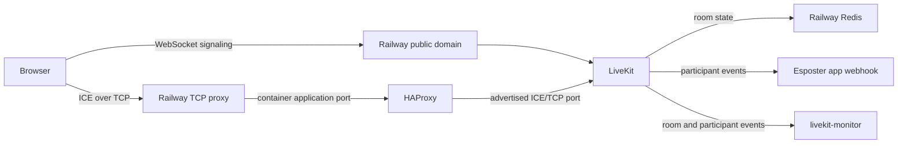

# LiveKit Railway service

This service copies the `livekit-server` binary from the official `livekit/livekit-server` image onto the official `haproxy` image. A Railway-specific entrypoint starts it.

The base is HAProxy's LTS image, not a distro with HAProxy installed. The image tag then names the HAProxy version, which Renovate and `pnpm outdated:dependencies` both read. An `apt-get install` would take whatever the distro carries, and no version in the repository would name it.

The image already holds the other programs that the entrypoint calls: bash, `getent` and CA certificates. It runs as its unprivileged `haproxy` user. For that reason, the generated LiveKit config is written under `/tmp`.

Railway does not expose UDP publicly. This service therefore follows the TCP-only Railway template pattern. LiveKit advertises the Railway TCP proxy IP for ICE candidates. HAProxy forwards Railway's application port to the advertised ICE port inside the container. Redis stays a separate Railway Redis service. It holds the room state.



## Railway Setup

1. Create a Railway service from this repository.

2. Configure the service with these settings:

   ```text
   Root Directory: livekit-server
   Dockerfile Path: Dockerfile
   Replicas: 1
   ```

3. Enable a public domain for WebSocket/API signaling.

4. Add a TCP proxy with application port `7882`.

   The TCP proxy application port must be `7882`. Redeploy this service after the TCP proxy exists.

   Check: the service holds `RAILWAY_TCP_PROXY_DOMAIN`, `RAILWAY_TCP_PROXY_PORT` and `RAILWAY_TCP_APPLICATION_PORT`. Railway injects them after the TCP proxy is created.

5. Set these variables:

   ```text
   LIVEKIT_API_KEY=${{secret(32)}}
   LIVEKIT_API_SECRET=${{secret(64)}}
   LIVEKIT_APP_WEBHOOK_URL=${{shared.BASE_URL}}/api/webhooks/livekit
   LIVEKIT_LOG_LEVEL=info
   LIVEKIT_MONITOR_WEBHOOK_URL=https://${{livekit-monitor.RAILWAY_PUBLIC_DOMAIN}}/api/webhook
   PORT=8080
   REDIS_URL=${{Redis.REDIS_URL}}
   ```

   Check: the deploy logs have no line that starts with `ERROR:`.

6. Set these LiveKit variables in the Esposter app:

   ```text
   LIVEKIT_API_KEY=${{livekit-server.LIVEKIT_API_KEY}}
   LIVEKIT_API_SECRET=${{livekit-server.LIVEKIT_API_SECRET}}
   LIVEKIT_URL=wss://your-livekit-server.up.railway.app
   ```

   Set `LIVEKIT_URL` to the public Railway or custom domain of the LiveKit service.

## Notes

- Use one LiveKit replica for the first Railway deployment. Railway's TCP proxy assigns one public proxy port. WebRTC ICE candidates need a stable endpoint.
- `RAILWAY_TCP_PROXY_PORT` is the public port that Railway assigns. It differs from the application port that the proxy was created with.
- UDP is the faster transport. This deployment cannot use it yet, because Railway exposes TCP only. Until then, the TCP proxy and the HAProxy forward carry the media. They are an interim setup, not the target setup. The target is Railway routing UDP to the range that LiveKit already advertises.
- The entrypoint resolves `RAILWAY_TCP_PROXY_DOMAIN`. It passes the resolved IP address to LiveKit as `--node-ip`. It starts HAProxy to forward Railway's container TCP proxy port to LiveKit's advertised ICE/TCP port.
- LiveKit does not document an `external_tcp_port` setting. So `rtc.tcp_port` is set to Railway's external TCP proxy port. The container application port forwards to it.
- The generated config sets no UDP port range. LiveKit's own `50000-60000` default applies. The media path is the one that any host gets: UDP first, then TCP as the fallback.
- Railway routes no UDP today. The UDP candidates go nowhere. After ICE tries them, clients settle on the TCP candidate. The cost is connection setup time. When Railway routes UDP, the fast path is already configured, and nothing in this config changes.
- Warning: do not pin the UDP range to `0..0`. It reads as "no UDP", but it is not. LiveKit treats a zero `port_range_start` as unset outside development mode, and it fills the default back in. The config then misstates the range.
- Set "rtc.force_tcp" only if the setup delay must end before Railway ships UDP. It drops UDP from the gathered candidates.
- Set `LIVEKIT_APP_WEBHOOK_URL` to the `/api/webhooks/livekit` route of the Esposter app. Participant leave and aborted connection events then clean up the app call state.
- `REDIS_URL` must use the `redis://` or `rediss://` scheme. The entrypoint matches the scheme case-insensitively, and it refuses any other scheme. It does not use a default, because a wrong guess connects either way.
- The `rediss://` scheme turns TLS on.
- Credentials use the URL form `username[:password]`. `user@` is a username. `:password@` is a password. Both halves are percent-decoded. The host is split at the last `@`, so a password that holds an `@` survives.
- A trailing `/n` is the database number. It is passed through as `db`.
- The generated config writes TLS as `redis.tls.enabled`. `use_tls` is the deprecated spelling of the same switch. When both appear, `use_tls` loses to the nested block.
- `${{Redis.REDIS_URL}}` is a private-network address. Its credentials stay inside the project's encrypted Wireguard mesh, and they never cross the public internet. This is the trusted-network exception that allows a credentialed `redis://` URL. Railway's Redis has no TLS listener. Requiring `rediss://` would leave the service with no reachable Redis.
- Warning: a URL from "REDIS_PUBLIC_URL" or from any TCP proxy address crosses the public internet. Such a URL must use `rediss://`.
- Set `LIVEKIT_MONITOR_WEBHOOK_URL` to the livekit-monitor service. The monitor then records room and participant events.
