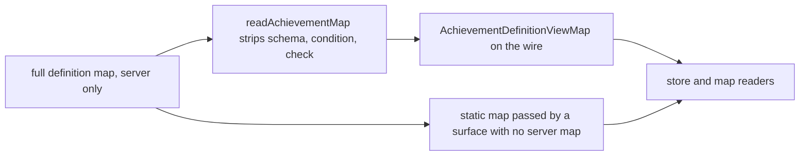

# Achievement client view type

The server sends each achievement definition without its input schema, its condition and its check. The client types describe that payload, so the schema cannot be read from a client value.

## How it works

`readAchievementMap` removes the three server-only fields and returns the rest, typed as the view map. The store holds that view map, its entries are the view with the achievement's name added, and the map readers take the view map as their parameter. The static map a surface passes when it has no server map is assignable to the view map, since it holds every field the view needs.

## Data model

None.

## Key files

| File                                                                   | Role                                                                            |
| ---------------------------------------------------------------------- | ------------------------------------------------------------------------------- |
| `apps/web/shared/models/achievement/AchievementDefinitionView.ts`      | a definition as the client holds it: the schema and the name left out           |
| `apps/web/shared/models/achievement/AchievementDefinitionViewMap.ts`   | the view keyed by every achievement name                                        |
| `apps/web/shared/models/achievement/AchievementDefinitionEntry.ts`     | a view with its name, as the store and the components read it                   |
| `apps/web/server/trpc/routers/achievement.ts`                          | `readAchievementMap` strips the server-only fields and is typed as the view map |
| `apps/web/app/store/achievement/index.ts`                              | the store holds the view map and its entries                                    |
| `apps/web/app/services/achievement/toUserAchievementWithDefinition.ts` | the join of a user's achievement with a view                                    |
| `apps/web/app/composables/user/useReadUserAchievements.ts`             | the map a surface passes, defaulting to the static map                          |

## Notes

- The change is types only, so it has no spec delta. The behaviour it types, the stripped payload, is the endpoint's and is already tested through the router.
- The achievement specs that describe the map's payload are swept in task 1.2.
