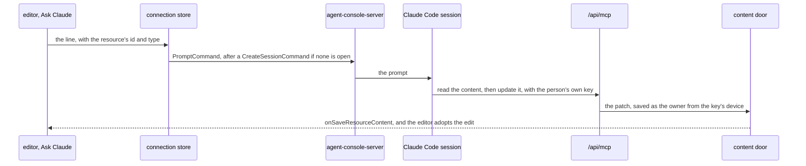

# In-product assistant

Built on the [agent content tools](../../specs/architecture/agent-content-tools/design.md) and [live edits](../architecture-ai-native-resources-live-edits/design.md). A person working in an editor should not have to leave it to ask an agent for an edit, and asking from inside it must not open a second way in. So the assistant is a shortcut into the person's own Claude Code session, which then works through the tools any agent uses. It also waits on something outside this proposal: a host the page can pair with, which the [agent console](../../specs/infra/claude-interface/agent-console/README.md) offers only once it is shown again.

## One path

The page never calls `/api/mcp` — the endpoint refuses any request carrying an `Origin` header, which every browser request does — and no model runs inside Esposter. The editor hands the request to a session on the person's own host, and that session reaches the resource through the same tools, under the same key scopes and rate limits, as a session started in a terminal. An in-product edit and an outside agent's edit are then one path: the same tools, the same door, the same activity entry naming the key.

## The command

**Ask Claude** is registered through `useCommands` from the blade header, so it sits in the toolbar and in the command palette for every type, needing nothing from any. It takes a line of text and sends it through the agent console's connection store as a `PromptCommand` to the session the person picks: one already open on the host, or a new one from a `CreateSessionCommand` in a folder they choose, the choice the console's new-session panel already offers. The prompt names the resource by id and type, so the session's first call is the describe or read tool rather than a search.

The session reaches Esposter through the MCP server entry the follow-ups plugin already ships, with the person's own key, which needs the `Resources` scope ([agent access](../../specs/architecture/agent-access/design.md)); the settings card's steps set that up, as the TodoList's Connect an agent dialog does for follow-ups. The edit lands in the open editor through live edits, so the person watches it arrive, and an edit of their own still unsaved meets it as a choice rather than being overwritten.

## Free

A Claude feature in Esposter costs the person nothing beyond the subscription their Claude Code already runs on, the rule the [Claude interface](../../specs/infra/claude-interface/README.md) is built under. The turn runs in the person's own session, on their own machine and plan, exactly as a line typed into the console does; Esposter calls no model, holds no model key and meters nothing. The [SDK-driven companion](../../rejected/infra/sdk-driven-companion/design.md) was rejected partly for being a chat beside the work that holds none of it, and this session is the reverse: the resource is the work, and the session holds and edits it.

With no host paired, the command shows how to pair one rather than falling back to anything hosted, since there is nothing hosted to fall back to.

## Key files

| File                                                                       | Role after the change                                              |
| -------------------------------------------------------------------------- | ------------------------------------------------------------------ |
| `apps/web/app/components/Resource/Blade/Header.vue`                        | registers Ask Claude for every type                                |
| `apps/web/app/store/agentConsole/connection.ts`                            | sends the prompt to the paired host, unchanged                     |
| `apps/web/app/components/AgentConsole/Panel/NewSession.vue`                | the folder choice, shared with the command                         |
| `packages/agent-console-server/src/models/command/PromptCommand.ts`        | the wire a prompt crosses, unchanged                               |
| `packages/agent-console-server/src/models/command/CreateSessionCommand.ts` | the wire a new session crosses, unchanged                          |
| `packages/follow-ups/.mcp.json`                                            | the MCP server entry a session reaches Esposter through, unchanged |
