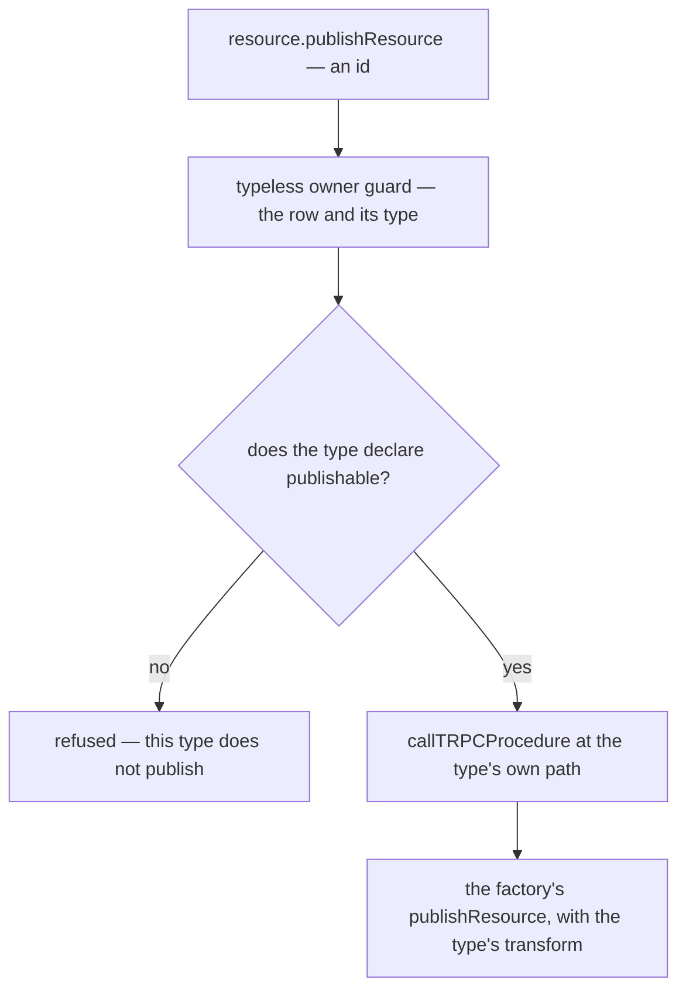

# Lifecycle tools

Ships beside the owner's-alone declaration in [agent keys](../architecture-ai-native-resources-agent-keys/design.md). An edit to a document is only half of what a person does with a resource: they create it, name and tag it, bin and restore it, publish it, follow what links to it and roll it back. Each of those already has a procedure, and most of them are typeless, on the cross-type `resource` router. This unit serves them as one tool per operation, under the `Resources` scope a key is made with ([agent access](../../specs/architecture/agent-access/design.md)), so the tool list does not grow with the number of types.

## One tool per operation

| Operation                 | Procedure                                                         | How it is served                                                                   |
| ------------------------- | ----------------------------------------------------------------- | ---------------------------------------------------------------------------------- |
| Create                    | `resource.createResource`                                         | new, taking a type and a name, through the `createResourceRow` the factory calls   |
| Rename and tag            | `resource.updateResource`                                         | new, typeless, the factory's body, which names no type                             |
| Bin and restore           | `resource.deleteResources`, `resource.restoreResources`           | opted in — a binned resource comes back whole                                      |
| Duplicate                 | `resource.duplicateResource`                                      | opted in                                                                           |
| Read one, publication too | `resource.readResource`                                           | opted in                                                                           |
| Publish and unpublish     | `resource.publishResource`, `resource.unpublishResource`          | new, dispatched to the type's own generated procedure                              |
| Upload and remove a file  | `resource.generateUploadFileSasEntities`, `resource.deleteFile`   | new, dispatched — the agent's own shell PUTs the bytes to the signed URL           |
| References                | `resource.readResourceReferences`                                 | opted in — what this resource links to, and what links to it                       |
| Activity                  | `resource.readActivities`                                         | opted in                                                                           |
| History                   | `resource.readSnapshotHistory`, `resource.restoreSnapshotVersion` | opted in — a restore takes a revision first, so it is undone as easily             |
| Datasets                  | `dataset.readDataset`                                             | opted in — a Sheet's rows, a Survey's responses or a Program's status as one table |

Linking needs no tool: a reference is a field declared with `createResourceLinkSchema`, so writing it through the content tools is linking, and the save projects it into the [resource-link index](../../specs/architecture/resource-links/design.md).

## Dispatch to the type's own procedure

Publishing and file assets live only in `createResourceProcedures`, built per type, because a type hands its publish transform to the factory: a Dashboard resolves its bound datasets and a Webpage points its asset urls at their published clones. So the typeless tool reads the row, asks `checkHasCapability` whether the type declares the capability, and calls the generated procedure at the type's own path — the type uncapitalized, as `useResourceRouter` dispatches in the browser — through tRPC's own call path, as the bridge calls any procedure. The transform runs unchanged, and a type without the capability is refused in words before anything runs, rather than with the 404 its missing procedure would give.

The dispatching procedures call into the routers beside them, so they sit in a router merged after the base router, as the achievement router does for the same reason.



## Each type's own procedures

A procedure only one type has stays on that type's router, opted in where it is the owner's act; the rest are declared the owner's alone in [agent keys](../architecture-ai-native-resources-agent-keys/design.md).

| Type      | Procedures                                                            | Why an agent may call them                                                 |
| --------- | --------------------------------------------------------------------- | -------------------------------------------------------------------------- |
| Blueprint | `blueprint.captureBlueprint`, `blueprint.deployBlueprint`             | a capture reads resources the owner owns, a deploy creates new ones        |
| Program   | `program.generateProgramParticipants`, `program.readProgramStatus`    | issuing one idempotent token per audience member, and reading who answered |
| Survey    | `survey.readSurveyResponseRecords`, `survey.readSurveyResponsesCount` | reading answers the owner already reads                                    |
| TodoList  | the follow-up procedures                                              | unchanged, under the follow-ups scope                                      |

## Key files

| File                                                                  | Role after the change                                                    |
| --------------------------------------------------------------------- | ------------------------------------------------------------------------ |
| `apps/web/server/trpc/routers/resource.ts`                            | its typeless procedures opted in, with a typeless create and update      |
| `apps/web/server/trpc/routers/index.ts`                               | merges the dispatching router after the base router                      |
| `apps/web/server/trpc/procedure/resource/createResourceProcedures.ts` | unchanged — the dispatch reaches its publish and file procedures by path |
| `apps/web/shared/services/resource/checkHasCapability.ts`             | the capability gate the dispatch asks                                    |
| `apps/web/server/trpc/routers/blueprint.ts`                           | capture and deploy opted in                                              |
| `apps/web/server/trpc/routers/program.ts`                             | participants and status opted in                                         |
| `apps/web/server/trpc/routers/survey.ts`                              | the response reads opted in                                              |
| `apps/web/server/trpc/routers/dataset.ts`                             | `readDataset` opted in                                                   |

New code lands here:

```text
apps/web/server/trpc/routers/resourceDispatch.ts   publish, unpublish and file assets, dispatched to the type's own procedure
```
