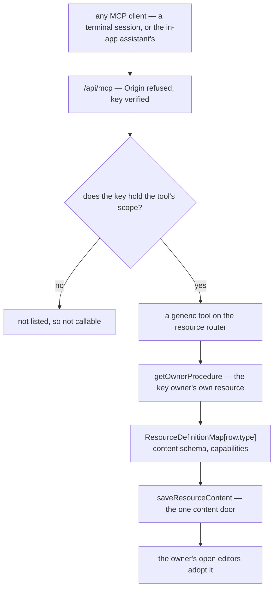

# AI-native resources

Every resource editor in Esposter is built for a person's pointer and keyboard. An agent reaches the app through one MCP endpoint ([agent access](../../specs/architecture/agent-access/design.md)), and generic tools there find, describe, read and patch every type's document ([agent content tools](../../specs/architecture/agent-content-tools/design.md)). The rest of what a person does is still closed to it: an agent's save strands the owner's open editor behind a refresh, and creating, publishing, linking or rolling back a resource has no tool. An editor only a person can drive is closed to the agents that now do much of the owner's work, and adding tools one editor at a time is how the endpoint once came to reach a single type.

This proposal wires the agent surface once, at the resource layer. A resource type already declares everything an agent needs in its `ResourceDefinitionMap` entry: a content schema that validates every save, the capabilities that gate its lifecycle, and the one content door every write goes through. Generic procedures on the cross-type `resource` router read that declaration off the row they are handed, so a type is agent-reachable because it is in the map, as the content tools already are.

## Sub-pages

Each is a unit built on its own, listed in build order:

- [Agent keys](../architecture-ai-native-resources-agent-keys/design.md) — the keys made before scopes given the follow-ups scope, and the operations that stay the owner's; scopes, read-only hints and per-key attribution shipped ([agent access](../../specs/architecture/agent-access/design.md)), and the content tools after them ([agent content tools](../../specs/architecture/agent-content-tools/design.md))
- [Live edits](../architecture-ai-native-resources-live-edits/design.md) — an open editor adopts an agent's save, and an unsaved edit meets it as a choice shown at once
- [Lifecycle tools](../architecture-ai-native-resources-lifecycle-tools/design.md) — create, rename, tag, delete, restore, publish, references, history and datasets, plus each type's own procedures
- Schema fidelity — shipped in [agent content tools](../../specs/architecture/agent-content-tools/design.md): Flowchart labels, Note documents, Survey models and captured GrapesJS output now follow their editors' rules
- [Typed commands](../architecture-ai-native-resources-typed-commands/design.md) — the per-type operations a patch fits badly, the Sheet's own command classes first
- [In-product assistant](../architecture-ai-native-resources-in-product-assistant/design.md) — an editor's Ask Claude, handed to the person's own session so it takes the same path as any agent

## The standard

> Whatever a person can do in an editor, an agent can do through a typed procedure — derived from what the type already declares, never written per type.

Every edit a person makes in any editor ends in one of two places: a new document through the content door, or a lifecycle procedure such as publish. So the contract every type meets covers both, read off its existing declaration — three parts for the document, which the [agent content tools](../../specs/architecture/agent-content-tools/design.md) meet, and one for its lifecycle, which [lifecycle tools](../architecture-ai-native-resources-lifecycle-tools/design.md) will:

1. **Describe.** The type's content schema as JSON Schema, carrying its enums, limits and nesting, with the paths an agent may not write marked.
2. **Read.** The content as the JSON the blob already stores, whole or at a JSON Pointer.
3. **Edit.** RFC 6902 operations applied on the server, the result parsed by the type's own schema and saved through the existing door at a content version, so a concurrent edit is refused or guarded rather than overwritten.
4. **Lifecycle.** The resource's lifecycle — create, rename, tag, delete, restore, publish, references — as typeless tools, the type read off the row.

A type earns an operation of its own only where a patch fits badly ([typed commands](../architecture-ai-native-resources-typed-commands/design.md)), and the TodoList's follow-ups are that layer's first entry, kept as they are.

**Neither a capability nor generated per-type tools.** A capability is opt-in by the [resources](../../specs/architecture/resource/design.md) admission rule, and this must hold for every type, so there is nothing to declare: the content schema it reads exists for every type already. Generated per-type procedures would multiply the tool list by the number of types and embed each content schema in a tool's input. The id already names the type, so one tool serves all of them. Per-type tools are what reached a single type. The [write-once](../../specs/architecture/write-once/design.md) test decides it: the mechanism's input already exists uniformly, so the mechanism is written once, from the first case.

**One registration fits MCP's tool shape.** A tool's input schema must be a JSON Schema whose root is an object, and every generic tool's input is a small object naming an id. The content schema never appears in an input schema at all; it is the answer of the describe tool, read as data. So the bridge serves each generic tool once, and no type lengthens the tool list, which matters because every tool's schema is context an agent pays for on every turn.

## The audit

What each type's content schema gives the generic tools, and what reaches beyond its content. Each schema was converted with Zod's `z.toJSONSchema` in input mode, the side a writer fills: a schema holding a Date throws under the default, since Zod has no JSON Schema for a Date, and converts once a Date is written as the `date-time` string the stored JSON already holds.

| Type      | Conversion       | Where the schema stops describing the content                                                          | Beyond the content                                                               |
| --------- | ---------------- | ------------------------------------------------------------------------------------------------------ | -------------------------------------------------------------------------------- |
| Blueprint | as is            | each entry's `content`, another type's document that deploy parses                                     | capture and deploy                                                               |
| Dashboard | Dates as strings | nowhere                                                                                                | publish, whose transform resolves every bound dataset                            |
| Email     | Dates as strings | the GrapesJS project — `pages` and every key its catchall passes — and the captured `html` (read-only) | publish, file assets, a personalized export only a live editor can produce       |
| Flowchart | Dates as strings | edge data has no writable fields; node labels are described                                            | publish                                                                          |
| Note      | as is            | every node's `attrs` and extra keys; node types are checked against the writing kit                    | publish                                                                          |
| Program   | as is            | nowhere                                                                                                | participant generation and status                                                |
| Sheet     | Dates as strings | nowhere                                                                                                | dataset reads, browser-side import and export, column edits that touch every row |
| Survey    | as is            | the model is empty or parses to a JSON object; SurveyJS-specific constraints stay unchecked            | responses, publish, file assets                                                  |
| TodoList  | Dates as strings | nowhere                                                                                                | ticking a repeating todo rolls its date                                          |
| Webpage   | Dates as strings | the GrapesJS project, and the captured `html` and `css` (read-only)                                    | publish, file assets                                                             |

**The headline:** every type needs the same four parts of the contract, which is the argument for writing them once. Every schema converts, given the one Date rule, so describing is generic; a type whose third column reads "nowhere" is described all the way down and the content tools reach it whole, and the others stop at the paths that column names, which is where generic writing stops too.

## Where auto-wiring cannot reach

The generic tools reach exactly as far as a type's content schema describes its document. Where it does not, they refuse the write rather than guess, and these are the gaps, each with its reason and where it closes:

- **An undescribed part of a schema.** `z.unknown()` and the loose objects behind it accept anything, so the server cannot check what an agent writes there: the GrapesJS project of an Email or a Webpage, a Note node's `attrs`, a Blueprint entry's `content`. Writes under those paths are refused. The Flowchart's node label is described and its edge data is empty; the Blueprint entry's content stays undescribed by design.
- **Output another engine derives in the browser.** A Webpage's and an Email's published HTML is what GrapesJS captured at the last editor save, so a patched project would publish stale markup. Until the [page builder](../resource-page-builder-program/design.md) replaces the format, captured HTML and CSS are read-only to an agent apart from the Email's dataset binding.
- **A document inside a string.** A Survey's questions are SurveyJS's JSON stored as one string, so an agent replaces the model whole. The server checks a non-empty model parses to an object, while keeping the empty string as the existing empty-model sentinel; SurveyJS-specific requirements such as question types and unique names stay unchecked.
- **Binary content.** A file asset is uploaded by an HTTP PUT to a short-lived signed URL. An agent with a shell, as a Claude Code session has, makes that request itself; a client that can only call tools cannot upload, and no tool carries bytes, since a body is capped at `MAX_REQUEST_SIZE`.
- **Work only the browser does.** Import and export are handlers in the browser. An agent needs no import, since it writes the content, and reads in place of exporting; the one export it cannot reproduce is the Email's personalized HTML, which needs a live GrapesJS until the page builder compiles on the server.
- **An edit whose effect is computed.** Renaming a Sheet column re-keys every row, and changing its type re-coerces every cell. A patch can only restate that by hand, so these are [typed commands](../architecture-ai-native-resources-typed-commands/design.md).
- **A document larger than an agent's context.** A Sheet may hold far more than any context window, so a large document is read by pointer and in pages, never whole.
- **View state.** Selection, scroll and zoom are not the resource, so no tool reaches them.

## The enforcer

**By construction first.** No step registers a type with the agent surface, so there is no step to forget: the generic tools read the type from the row and the schema from the map, and the map `satisfies Record<ResourceType, ResourceDefinition>`, so a new `ResourceType` does not typecheck without a content schema, and is agent-reachable the moment it does.

**Then one test, over `ResourceTypes` with no roster.** It holds the content already: every type converts to a root object, and the paths it marks undescribed or read-only match the record the test keeps per type, so a partial surface is never silent and the record shrinks only by a source fix ([agent content tools](../../specs/architecture/agent-content-tools/design.md)).

A second test holds the procedures beyond the content: every procedure on a type's router that the factory did not generate declares either an MCP description or a human-only reason, so a new editor's own procedure cannot ship without a decision ([agent keys](../architecture-ai-native-resources-agent-keys/design.md)).

There is deliberately no per-type patch round trip. It would need a fixture document per type — a roster by another name — and the content door already makes every stored document a JSON round trip: it stores `JSON.stringify` of the parsed content and reads it back through the schema. What a patch adds is the applier, and its own tests hold that an edit followed by its inverse returns the original, which is the page builder's proof as well.

## Phases

The generic tools reach every type at once, so ordering by value is ordering the units and the source fixes. The app keeps no usage figures by type that a session can read, so value is read from what the owner works in — the TodoList daily, per [TodoList agent follow-ups](../../specs/resource/todolist-agent-follow-ups/design.md) — and from which types the generic tools reach whole.

1. **Agent keys, then content tools** — shipped ([agent access](../../specs/architecture/agent-access/design.md), [agent content tools](../../specs/architecture/agent-content-tools/design.md)). Every type is found, described, read and edited, and the TodoList, Sheet, Dashboard and Program are reached whole, since their schemas describe everything. What [agent keys](../architecture-ai-native-resources-agent-keys/design.md) leaves — the keys made before scopes, and the operations that stay the owner's — is its own unit.
2. **Live edits**, so an agent's write never strands a person's open editor behind a refresh.
3. **Lifecycle tools** — publishing, links, history and each type's own procedures.
4. **Schema fidelity** — shipped: Flowchart node labels, Note document validation, Survey JSON-object validation, and read-only captured GrapesJS output ([agent content tools](../../specs/architecture/agent-content-tools/design.md)).
5. **Typed commands** — the Sheet's column commands, a repeating todo's tick, and a Note written as Markdown once [Note Markdown portability](../resource-note-markdown-portability/design.md) ships its converter.
6. **The in-product assistant**, once the agent console pairs a host again.
7. **The page builder's cutover.** Its document is a typed node tree whose schema the registry builds, its edits are JSON Patch operations, and it renders on the server at publish. So at the cutover the Webpage and the Email are described all the way down, their captured HTML goes, and the generic tools reach them whole with no unit of their own; the content tools apply the page builder's `applyPatches`, which lives in `@esposter/shared` beside the headless core that applies it too.

## Notes

- [JSON Patch content saves](../../rejected/resource/json-patch-content-saves/design.md) stay rejected. That page rejects the browser computing a diff of a whole document to save it, and an editor still saves whole documents, through [delta content saves](../../specs/resource/delta-content-saves/design.md) when they are large. An agent never diffs: it writes the operations it means, the way the rejection says per-type knowledge would, and the server applies them before the same door.
- No model runs inside Esposter, so [AI resource generation](../../deferred/resource/ai-resource-generation/design.md) stays deferred on its own trigger. What that page imagines — a model writing a schema-validated document — becomes an agent in the owner's own session writing through these tools.
- An agent acting through a key is the owner on another device, not a second user, so [resource collaboration](../../deferred/resource/document-collaboration/design.md) stays deferred: there is still no access list, only the owner.
- MCP asks a client to keep a person able to deny a tool call, which Claude Code's permission prompts do. Nothing on the server waits for a person: a call a key may make lands at once, as the owner's own write would.

## Sources

- [Model Context Protocol — tools](https://modelcontextprotocol.io/specification/2025-06-18/server/tools) — a tool is a name, a description and an input schema, results come back as content or as an execution error the model reads, and servers must validate inputs, control access and rate-limit calls.
- [Model Context Protocol — schema reference](https://modelcontextprotocol.io/specification/2025-06-18/schema) — a tool's `inputSchema` is typed with an object root, which is why every generic tool takes an object naming an id.
