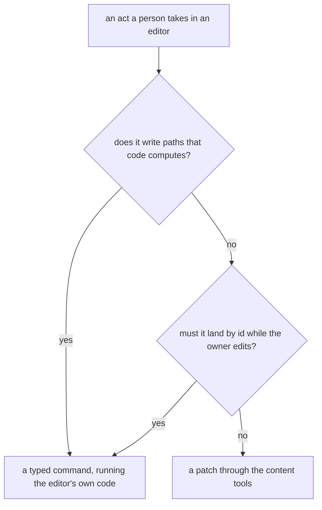

# Typed commands

Built on the [agent content tools](../../specs/architecture/agent-content-tools/design.md), whose patch reaches every type and whose update service every command here runs inside. A patch writes exactly the paths it names, which is what an agent wants for most edits and exactly wrong for a few. This unit is that few, and the rule that keeps it few.

## When a type earns a command

A command is added only where an act a person takes meets one of two conditions:

1. **It writes paths code computes.** Renaming a Sheet column re-keys that value in every row; changing its type re-coerces every cell through `coerceValue`; changing a date column's format rewrites every date; ticking a repeating todo rolls its due date forward in a time zone. A patch could say the same only by redoing the editor's computation by hand, row by row, and an agent doing that gets it subtly different.
2. **It must land by id while the owner edits.** A JSON Pointer addresses an array by index, so an unpinned patch that tests a row's id is refused once a row is inserted above it, and the agent reads again. A command names the row by id and is reapplied to newer content, as the follow-ups are.

Everything else is a patch: appending a row is `add /data/rows/-`, setting a cell is a replace after a test of the row's id, and inserting a page-builder node is the page builder's own patch. The TodoList's follow-ups are this layer's first entry, and stay as they are.

## The Sheet runs its own commands

The Sheet's editor already works in commands. `CommandType` names each, and each subclass of `ADataSourceCommand` executes against a `DataSource` and keeps what it needs to undo — `UpdateColumnCommand` re-keying and re-coercing rows among them. They live in `apps/web/app/models`, and their constructors take what the editor had in hand: the original column, the row values before the edit.

They move to `apps/web/shared` with plain-data inputs, each recording its undo from the document when it executes rather than from its caller, together with the services they import, each a function of the document. The browser builds them as before, and its history is unchanged. The server runs the same classes: `sheet.runSheetCommand` takes an id, an optional content version and a command, a discriminated union over `CommandType`, and executes it inside the generic update service. A column rename from the toolbar and one from an agent are then one implementation, with one set of tests and benches.

## A repeating todo's tick

Ticking a repeating todo rolls it to its next due date in a time zone rather than completing it — the checkbox does it in the browser, and `completeFollowUp` does it for a follow-up, both through `rollRecurringItem`. `todoList.toggleTodoCompleted` does it for any todo, under the `Resources` scope, through the same function. The follow-ups keep their own procedures under their own scope, so a follow-ups key still ticks nothing the owner wrote.

## A Note written as Markdown

An agent writes Markdown far more reliably than ProseMirror JSON, and a heading's level or a link's address lives in the node attributes the content tools refuse to write. So `note.writeNoteMarkdown` takes Markdown and either replaces the document or appends to it, parsed on the server against the writing kit's own extensions. The converter is the one [Note Markdown portability](../resource-note-markdown-portability/design.md) admits, Tiptap's own, so this command waits on that proposal's dependency while the rest of this unit does not.

## The page builder has none

The page builder's edits are JSON Patch operations already, so an agent edits a webpage or an email through the content tools' patch and the page builder adds no command of its own.

## Key files

| File                                                                 | Role after the change                                                |
| -------------------------------------------------------------------- | -------------------------------------------------------------------- |
| `apps/web/app/models/resource/sheet/commands/CommandType.ts`         | moves to shared — the discriminant of the agent's command union      |
| `apps/web/app/models/resource/sheet/commands/ADataSourceCommand.ts`  | moves to shared, with plain-data inputs and undo recorded on execute |
| `apps/web/app/models/resource/sheet/commands/UpdateColumnCommand.ts` | moves to shared — the clearest case a patch cannot express           |
| `apps/web/app/store/resource/sheet/history/index.ts`                 | builds the same commands from shared, unchanged in behaviour         |
| `apps/web/server/trpc/routers/sheet.ts`                              | `runSheetCommand`                                                    |
| `apps/web/server/trpc/routers/todoList.ts`                           | `toggleTodoCompleted`, beside the follow-ups                         |
| `apps/web/shared/services/resource/todoList/rollRecurringItem.ts`    | unchanged — the roll every tick shares                               |
| `apps/web/server/trpc/routers/note.ts`                               | `writeNoteMarkdown`                                                  |
