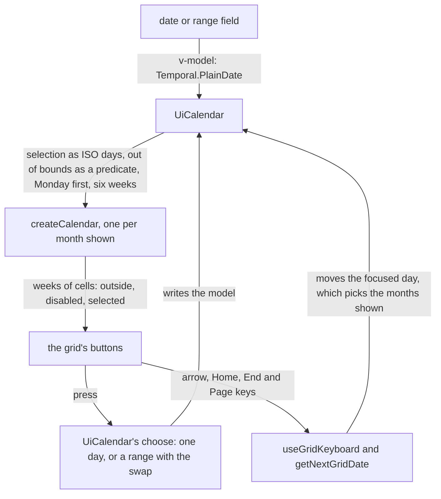

# Calendar grid on Vuetify 0

## Context

The library draws two month grids: `UiCalendar`, the grid a date or range field picks from, and the event calendar's month view. Both read six weeks of `Temporal.PlainDate` days from a helper of their own, and `UiCalendar` adds its own bounds, clamping, paging and two-month layout around them. The [calendar page](../../specs/architecture/calendar/design.md) kept Vuetify 0 out because its only date offering was an adapter written against a bundled Temporal polyfill.

Vuetify 0's 1.4 release adds `createCalendar`, and its installed build settles the bundle question: `createCalendar` imports `PlainDateAdapter`, which imports Vuetify 0's own helpers and no Temporal, while `@js-temporal/polyfill` is imported only by `V0DateAdapter`, an optional peer this change never names.

## How the grid is split

`createCalendar` speaks ISO day strings and `UiCalendar` keeps `Temporal.PlainDate` models, so the boundary converts with `toString()` on the way in and `Temporal.PlainDate.from` on the way out. The grid's `value` is a getter over the models, and no press calls the grid's `select`: the swap the spec requires is `UiCalendar`'s `choose`, unchanged. A range shown in two months is two grids, the second's `month` one month after the first's, and `UiCalendar` keeps the focus that decides which months are shown.

The event calendar's month view takes its six weeks from `createCalendar` with no value, so the hand-written six weeks have no reader left and are deleted.

## Decisions

- **The grid comes from Vuetify 0, the selection stays ours.** Rejected: taking `createCalendar`'s `select` and its range semantics, which would turn the spec's swap into a restart and so change what a reader gets for the same presses.
- **No `V0DateAdapter`.** The plain adapter is the default and brings no polyfill; naming the Temporal adapter would bring the second Temporal back, which is the reason the grid was hand-written in the first place.
- **The keyboard stays the library's.** Rejected: driving the walk from `createCalendar`'s `move`, which covers a grid of days but not the event calendar's hours, so the two grids would walk by two mechanisms.
- **The months, their bounds and their paging stay `UiCalendar`'s.** Rejected: giving the grids `min` and `max` and paging them with `createCalendar`'s `next`, `prev` and `step`. A grid pages itself into its bounds, so a month outside them, which a range's second month can be, would draw the bound's month again in place of its own days disabled, and the two grids would repeat a month. The grids get the bounds as a `disabled` predicate, so each day out of bounds is the grid's own disabled cell.
- **The today marker stays the clock's.** Measured with fake timers that move the wall clock past midnight while the grid's own midnight timer is still waiting, as a sleep across midnight does: the grid still shows the old day for as long as that wait lasts, and the clock reads the new day within its minute. Taking the grid's flag would leave the ring behind for hours after a sleep, and the event calendar's month and time views read today from the clock, so one calendar would show two days as today. The ring's test in `Calendar.test.ts` fails on the grid's flag.
- **A press stays `choose`, so a spill day stays pressable.** A one-month grid draws its spill days as pressable buttons today, and a day of another month is chosen, which turns the page to it. Rejected: pressing through `select`, which refuses a day outside the month and would make those days inert. The grid's `outside` flag only draws them fainter. The test "chooses a day of the month before on click, turning the page to its month" fails if the press goes through the refused path.
- **Weeks start on Monday through one constant.** `CALENDAR_FIRST_DAY_OF_WEEK` is the number both grids take, so a change to the week's start is one edit, and the test "starts each week on Monday" fails for either grid if it drifts.

## Risks

- **The library's grid.** `createCalendar` is new in Vuetify 0's 1.4 release. Its Monday start, its six rows and its disabled flags are what the calendar tests pin, so a later release that changes one of them fails those tests rather than the reader.

## Key files

| File                                                     | Role                                                                               |
| :------------------------------------------------------- | :--------------------------------------------------------------------------------- |
| `apps/web/app/components/Ui/Calendar.vue`                | The date grid, drawn by `createCalendar` with its own selection and press handling |
| `apps/web/app/components/Ui/EventCalendar/MonthView.vue` | The event calendar's month, its six weeks from `createCalendar` with no value      |
| `apps/web/app/services/ui/constants.ts`                  | `CALENDAR_FIRST_DAY_OF_WEEK`, the first day both grids take                        |
| `apps/web/app/util/date/getNextGridDate.ts`              | The key-to-day walk, kept                                                          |
| `apps/web/app/composables/ui/useGridKeyboard.ts`         | The one tab stop, kept                                                             |
| `openspec/specs/architecture/calendar/design.md`         | The page whose Vuetify 0 paragraph and key files this change rewrites              |
