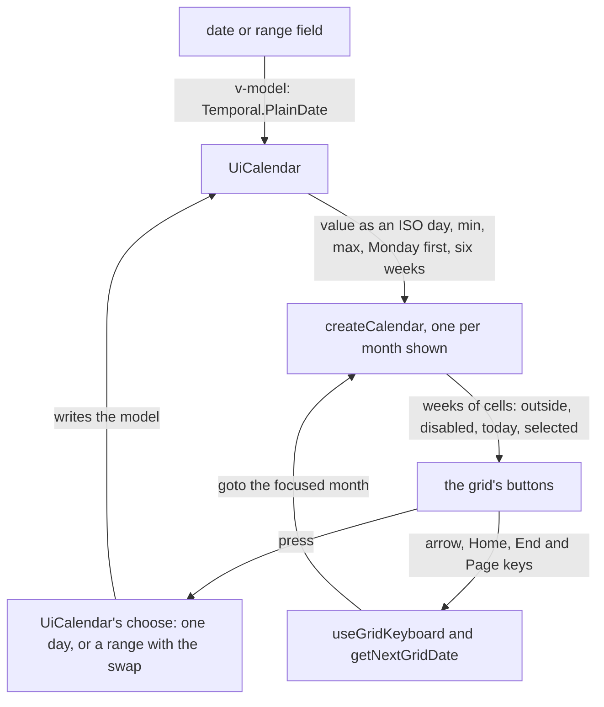

# Calendar grid on Vuetify 0

## Context

The library draws two month grids: `UiCalendar`, the grid a date or range field picks from, and the event calendar's month view. Both read six weeks of `Temporal.PlainDate` days from `getCalendarWeeks`, and `UiCalendar` adds its own bounds, clamping, paging and two-month layout around them. The [calendar page](../../specs/architecture/calendar/design.md) kept Vuetify 0 out because its only date offering was an adapter written against a bundled Temporal polyfill.

Vuetify 0's 1.4 release adds `createCalendar`, and its installed build settles the bundle question: `createCalendar` imports `PlainDateAdapter`, which imports Vuetify 0's own helpers and no Temporal, while `@js-temporal/polyfill` is imported only by `V0DateAdapter`, an optional peer this change never names.

## How the grid is split

`createCalendar` speaks ISO day strings and `UiCalendar` keeps `Temporal.PlainDate` models, so the boundary converts with `toString()` on the way in and `Temporal.PlainDate.from` on the way out. The grid's `value` is a getter over the models, and no press calls the grid's `select`: the swap the spec requires is `UiCalendar`'s `choose`, unchanged. A range shown in two months is two grids, the second's `month` one month after the first's.

The event calendar's month view takes its six weeks from the same composable with no value, so `getCalendarWeeks` has no reader left and is deleted.

## Decisions

- **The grid comes from Vuetify 0, the selection stays ours.** Rejected: taking `createCalendar`'s `select` and its range semantics, which would turn the spec's swap into a restart and so change what a reader gets for the same presses.
- **No `V0DateAdapter`.** The plain adapter is the default and brings no polyfill; naming the Temporal adapter would bring the second Temporal back, which is the reason the grid was hand-written in the first place.
- **The keyboard stays the library's.** Rejected: driving the walk from `createCalendar`'s `move`, which covers a grid of days but not the event calendar's hours, so the two grids would walk by two mechanisms.
- **This overturns the calendar page's "Vuetify 0 ships a date adapter rather than a date picker".** That paragraph is rewritten when this change ships, with the bundle finding above as its reason.

## Risks

- **Today.** `UiCalendar` reads today from `useCalendarClock`, and the grid's today comes from its adapter's `Date`. Both are the reader's local day in the browser, so the grid's flag replaces the clock only if the two agree across midnight, which task 1.3 checks against the clock's own tests.
- **Spill days.** `createCalendar` refuses a press on a day outside the month. The task that moves the grid confirms no spill day is pressable today before relying on the flag.

## Key files

| File                                                     | Role                                                                    |
| :------------------------------------------------------- | :---------------------------------------------------------------------- |
| `apps/web/app/components/Ui/Calendar.vue`                | The date grid, moved onto `createCalendar` with its own press handling  |
| `apps/web/app/components/Ui/EventCalendar/MonthView.vue` | The event calendar's month, moved onto the same composable              |
| `apps/web/app/services/ui/getCalendarWeeks.ts`           | The hand-written six weeks, deleted once both grids read the composable |
| `apps/web/app/util/date/getNextGridDate.ts`              | The key-to-day walk, kept                                               |
| `apps/web/app/composables/ui/useGridKeyboard.ts`         | The one tab stop, kept                                                  |
| `openspec/specs/architecture/calendar/design.md`         | The page whose Vuetify 0 paragraph this change rewrites                 |
