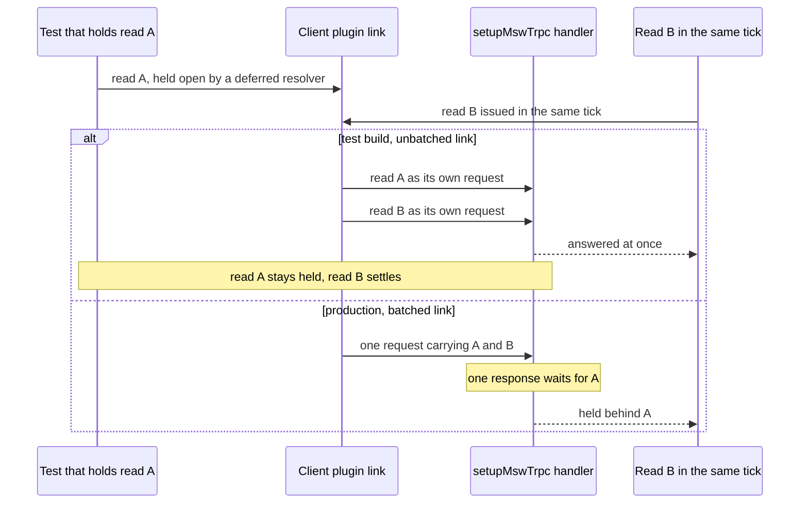
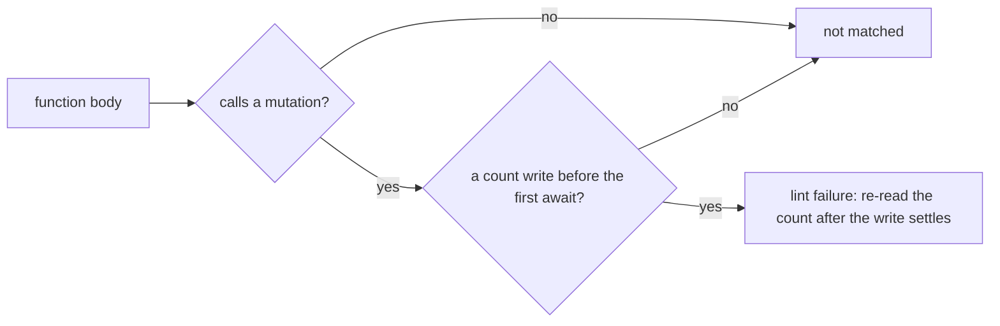

# Client-data enforcement

Two client-data rules move off review and onto rungs the build holds: the optimistic count gets a lint rule, and a test's held read gets a test client that cannot batch.

## Scope

Today the count rule is enforced by `no-restricted-syntax` selectors for deltas and reassignments, and by review for an optimistic write. The held-read rule is enforced by nothing; the test that hit it is the only reference. The change adds one custom oxlint rule, one link choice in the client plugin, and the sweep of the two anti-pattern entries. It does not change any store or any read.

## Decisions

- **The optimistic count is a lint rule, not a test.** A test would have to be written for each store that moves a count, and a store added later is covered only if its author writes one. A lint rule reads every file the moment it exists, which is the cost profile the ladder prefers at rung 3. The rule is syntactic: it fails a write to a server-derived count that precedes the first `await` in a function that calls a mutation. What the syntax cannot see, a delta computed into a variable first, stays with the existing reviewer note.
- **The rule's subject is a field list, not a path list.** The rule matches the count fields the existing selectors already name, read from one exported list that both the selectors and the plugin import. A list of subjects is not a roster of exceptions, so it does not break the rule against the ladder's no-roster test. The alternative, a suffix pattern, would also match a local value's count that is not server-derived.
- **The viewer's own mark is out of scope by name.** The client holds a viewer's vote exactly, so a write to it before the server answers is correct. The rule matches the count, not the mark, so the vote's optimistic flag is never flagged.
- **The held read is removed structurally, not detected.** A test deadlocks because a batch is answered as one response, so the cause is the batch in the test client. The alternative, a lint rule that finds a held read, cannot see the deadlock, which is in the batch's shape and not in the test's syntax. A harness that detects a held read would need a timer, which the no-polling rule forbids.
- **The batch choice is one function, and tests take the unbatched branch.** The client plugin already branches on the environment for its server and socket links. The batch choice moves into one function that takes the environment, the test build passes `true` and each request goes out alone, and production passes `false`. Production's batching is then tested by a unit test of that function, not by the component tests.

## How it works



For the optimistic count, the rule is a single pass over the tree, with no run-time part:



## Key files

| File                                                                          | Role                                                                                   |
| ----------------------------------------------------------------------------- | -------------------------------------------------------------------------------------- |
| `apps/web/app/plugins/trpc.ts`                                                | the client's link split; the batch choice moves into one function it calls             |
| `apps/web/shared/util/environment/constants.ts`                               | where the build mode is read once; gains the test flag the batch choice reads          |
| `apps/web/app/services/trpc/mswTrpc.test.ts`                                  | the harness that answers the client at the network, with the real plugin's links       |
| `packages/configuration/eslint/restrictedSyntaxes.js`                         | the count selectors, which read the shared field list                                  |
| `scripts/src/services/oxlint/persistThenNotify/noUnhandledEffectAfterEmit.ts` | the precedent plugin's logic, the shape the count rule follows                         |
| `scripts/src/oxlint/persistThenNotify.ts`                                     | the precedent plugin's registration, which the count rule's registration copies        |
| `openspec/specs/architecture/client-data/design.md`                           | the two anti-pattern entries, rewritten from "not yet" to the rung that now holds them |

New files, in the tree form the design template asks for:

```text
packages/configuration/eslint/serverCountFields.js                  the one list of server-derived count fields, read by the selectors and the rule
scripts/src/services/oxlint/countWriteAfterSettle/                  the rule's logic over an AST
scripts/src/oxlint/countWriteAfterSettle.ts                         the plugin's registration, beside persistThenNotify's
apps/web/app/services/trpc/createHttpBatchingLink.ts                the batch choice, one function taking the environment
```

## Notes

- Production batching is no longer exercised by the harness's tests. A unit test of `createHttpBatchingLink` pins that production batches, which is the one property the harness no longer covers.
- The existing selectors name their fields inline. Moving them to the shared list changes the selectors' text, not what they match, and their fixture tests stay as they are.
- The rule finds only the write before an `await`. A count written after a mutation settles but before the re-read lands is a different shape, and the design's anti-pattern entry keeps the review note for it.
