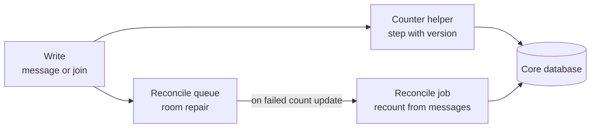

# Event counters and values across stores

Built on the [declarations](../architecture-derived-fields-tags/design.md) and the [server maintenance](../architecture-derived-fields-relations-server/design.md), and last of the four changes in the [derived fields program](../architecture-derived-fields-program/design.md). The aggregates are maintained by the database. This change covers the values the database cannot maintain: counters that a write steps by a declared amount, assigned values a write determines, values answered only by the server, and the one place a value crosses a store boundary and needs repair.

## How it works



A counter is stepped by one helper inside the write's batch. The helper takes the table, the row key, the column and the step, and writes the step with the version raised, so each counter change is one statement rather than an expression each call site builds. The write's own precondition stays where it is, and the database's check constraints still refuse an out-of-range result, so a refused step fails the batch.

An assigned value is written through the same helper family with the value the write determines. The helper is the only code that writes the value, so the mention reset and the publish copy follow one path. The reset reaches the overlay as the entry's own declaration, not as a patch to `mentionCount`, so the overlay's refusal of a patch to a derived key does not apply to it.

Values that the server answers and the client never predicts stay answer-only. Their tags say so, and the write's answer carries them like any other derived value.

A value that crosses a store boundary cannot be maintained by a trigger, since the database that holds the contributing rows is not the one that holds the value. The write that changes the contributing row updates the value through the helper after its own write. When that second write fails, the write path enqueues one reconcile for the room, and the reconcile recounts the mention count and the last message time from the messages the room holds.

## Decisions

- **One helper for each counter step, not per-site arithmetic.** A counter step written at each site is the arithmetic this program removes, and a site that forgets the version raise leaves a stale version for the read to order against.
- **Reconcile over a two-phase commit.** The room's messages and the member rows sit in different databases, so no transaction covers both. A reconcile recounts from the source, which converges whatever order the failure took.
- **Answer-only is the default.** A value is predicted only where the write states its step and the screen that shows it is held by the viewer. Each answer-only value's tag records why, so the reason is written where the value is declared.
- **The mention reset is predicted by its write.** The column is a counter the server answers. The room read states the reset as an assigned value, zero, on its entry, and the predictor shows it at once while the reader is on the room; the column's own prediction stays answer-only.

## Key files

| File                                                              | Role after this change                                                                           |
| :---------------------------------------------------------------- | :----------------------------------------------------------------------------------------------- |
| `apps/web/server/trpc/routers/invite.ts`                          | the join's step of an invite's uses goes through the counter helper                              |
| `apps/web/server/services/message/createUserMessage.ts`           | the mention increment across the store boundary, which enqueues a reconcile when its write fails |
| `apps/web/server/services/message/updateUserToRoom.ts`            | the member write a room read makes, where the mention reset goes through the assigned helper     |
| `apps/web/server/services/resource/incrementResourceViewCount.ts` | the view count's step goes through the counter helper                                            |
| `apps/web/server/services/storage/reserveStorageBytes.ts`         | the stored bytes' step goes through the counter helper, and stays answer-only                    |
| `apps/jobs/src/handlers/reconcileStorageLedgerEntryHandler.ts`    | the storage repair, which the counter helper's step also serves                                  |
| `apps/web/app/components/Message/Model/Room/List/Item.vue`        | shows the viewer's mention count, which the reset predicts at zero                               |

The counter helper and the assigned helper are new. They sit in the shared server package, since the web app and the jobs app both step counters.

```text
packages/db/src/services/derived/
  applyCounterDelta.ts        steps a counter by its declared amount, with the version raised
  applyAssignedValue.ts       writes an assigned value, with the version raised
apps/jobs/src/handlers/
  reconcileDerivedCountHandler.ts   recounts a value that crossed a store boundary from its source
```

## Notes

- The reconcile recounts a whole room's mention counts, so it is bounded by the room's members. A room's reconcile is queued at most once while one is pending, so a burst of failed writes costs one recount.
- The mention badge behaviour the mention-badges spec states holds unchanged, since its counts are the same values, now moved through the helper.
