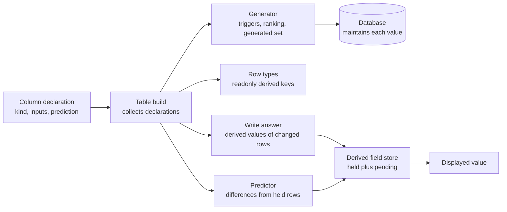
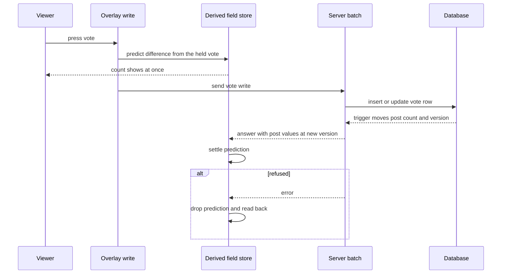

# Derived fields

One declaration on each server-derived column says what kind of value it is and what it is computed from. The database, the write answers, the values a client displays and the row types all read that one declaration, so a new derived value costs one line on its column, and the mechanisms behind it are written once.

## Scope

Today the server keeps its derived values right by hand. The post counts move in the batch of the write that changes them, the ranking is a second statement guarded by the count it was computed from, a deleted account's rankings are recomputed by a job, and invite uses, view counts, mention counts and storage bytes each move in their own write. The client re-reads a count after a write and moves it for nothing but the viewer's own vote's mark. Each count is its own mechanism, so a path that forgets one, such as a cascade, a job or a raw statement, leaves the value wrong and nothing notices.

This program adds:

- one declaration per derived column, naming its kind, its inputs and its prediction rule;
- five kinds, each with one database mechanism and one client rule;
- one write answer and one batched read, both built from the declarations;
- one client store and one predictor, replacing the count store;
- row types that keep a client from writing a derived value; and
- the verification that every declared value equals its recomputation.

It is delivered in four changes, built in this order, each shippable on its own with the tree whole:

| Change                                                                        | Delivers                                                                                                |
| :---------------------------------------------------------------------------- | :------------------------------------------------------------------------------------------------------ |
| [tags](../architecture-derived-fields-tags/design.md)                         | the declaration, its kinds, the generated set, the types, and the classification of every column        |
| [relations-server](../architecture-derived-fields-relations-server/design.md) | triggers, the ranking as a stored generated value, the write answer, the batched read and the recompute |
| [relations-client](../architecture-derived-fields-relations-client/design.md) | the one store, the predictor, the vote and comment predictions, and the retirement of the count lint    |
| [counters](../architecture-derived-fields-counters/design.md)                 | the counter, assigned and answer-only values, and the repair of values that cross a store boundary      |

## Settled — do not re-propose

- **A count store per table.** The count-only store is superseded by one store keyed by table, row and field. A second store for another table is the shape this program removes.
- **Projecting a count onto the overlay's post row.** A count on the row would share the row's version with the post's text, so an edit and a vote would order each other. The count is held by its own key at its own version.
- **A hand-kept list of derived fields**, in a registry, a lint file or a test. Every list is generated from the declarations, and a stale generated file fails its check.
- **A client delta with no held state behind it.** A prediction takes its before from the row the write replaces, or from a guard the server enforces on the write. A write with neither waits for its answer. This is the refinement of the rule that a client never moves a count by a delta: the delta is allowed only where its before is known, and an unknown before is not a value.
- **SQLite generated columns for aggregates.** A generated column reads only its own row, so a count over other rows needs a trigger. A generated column is used for the one kind that reads only its own row, which is the ranking.
- **Maintenance through Drizzle hooks.** A hook runs only for statements built through Drizzle, so a cascade, a job or a raw statement skips it.
- **Recomputing an aggregate on the client.** A client holds the contributing rows only for what it has loaded, never all of a post's votes, so it cannot compute the count and must predict its change.
- **Adopting an existing library for the whole mechanism.** Checked against the open-source options before review. The incremental view engines found each run in a PostgreSQL, DuckDB or streaming server (DBSP as Feldera's runtime, Materialize, OpenIVM, pg_trickle), not in D1 or a Durable Object's SQLite, and no SQLite or D1 build was found. Rails counter caches keep a declared count in application callbacks, which raw writes and external loads skip, so the database trigger is the mechanism here. TanStack DB would replace the overlay and predictor on the client, a change larger than this program, which keeps the overlay it already built. Revisit if D1 gains an incremental engine, or the overlay is retired for another reason.

## How it works

One declaration feeds four consumers: the database's maintenance, the row types, the write answer and the client's predictor. The client's store then holds what the answer and the predictor give, and the screen reads it back.



A vote shows its count at once and settles on the server's answer. A refusal drops the prediction and reads the value back.



## The model

A derived field is a column whose value the server computes from other data, and no client writes one. Its declaration names:

- its **kind**, one of the five below;
- its **inputs**: the columns it is computed from, on its own row or on the rows that contribute to it;
- for an aggregate, its **relation**: how a contributing row reaches the rows it moves;
- its **prediction**: `Predicted` when a client may move the value at once, `AnswerOnly` when only the server's answer sets it.

Every part keeps one invariant: at the version a derived value is stored at, it equals the value computed from its inputs.

## Why each value needs a declaration

Nothing in the schema says which columns the server derives, or what a change to one contributing row does to another row. The database can carry that rule only once it is written as a trigger, and a client can predict a change only once it knows the same rule. A list of derived columns kept beside the schema would state the fact a second time, and the first change to a column without its list entry would leave the two disagreeing. So the declaration is the one statement of the rule, and every consumer reads it, which is why the program keeps metadata and no list.

## The cost of a new derived value

- An aggregate over rows costs one declaration on its column. Its trigger is generated, its prediction follows from the same declaration, its answer and its read are built from it, and its types are read from it.
- A counter costs one declaration and one call to the counter helper in the write that steps it, since only the write knows the step.
- A function of its own row costs one declaration, and its stored value comes from the generated column or the write's recompute.

Nothing in the cost depends on how many derived values already exist, so the cost of each new one is the same.

## The kinds

| Kind        | What the value is                                                   | Database maintenance                                                                                                    | Client prediction                                                                 | Inventory                                                                                                                                                 |
| :---------- | :------------------------------------------------------------------ | :---------------------------------------------------------------------------------------------------------------------- | :-------------------------------------------------------------------------------- | :-------------------------------------------------------------------------------------------------------------------------------------------------------- |
| `Aggregate` | a reduction over the contributing rows, by `Count`, `Sum` or `Max`  | triggers on the contributing table, when both tables are in one store; otherwise the write path that changes the source | the difference the changed row makes, from the held row it replaces               | `commentCount`, `likeCount`, `lastMessageAt`                                                                                                              |
| `Function`  | a pure function of columns on the same row                          | a stored generated column where the database computes the same value; otherwise recomputed in the write's batch         | recomputed from predicted inputs, where a client reads the value                  | `ranking`                                                                                                                                                 |
| `Inherited` | copied from a source row when the row is created, and never changed | set by the insert                                                                                                       | copied from the held source row; waits for the answer when the source is not held | `depth`, `ancestorIds`, `threadRootId`, `publishVersion` (activity), `modelVersion`                                                                       |
| `Counter`   | adds a step its write declares, under the write's own guard         | the step is added in the write's batch by one helper                                                                    | the step, once the write is issued, when `Predicted`                              | `uses`, `requestCount`, `count` (views), `amount`, `mentionCount` (increments), `storageBytesUsed`, `publishVersion`, `contentVersion`, `revisionVersion` |
| `Assigned`  | a value the write determines                                        | set by the write, from the value it determines                                                                          | the value, only where the write determines it from held data                      | `mentionCount` (reset), `publishedContentVersion`, `contentSize`, `plaintextBytes`, `storedBytes`                                                         |

The inventory column is the classification of every candidate the schema holds. The tags change completes it: each column it lists is confirmed against its writer, and a column whose writer disagrees is reclassified there. A candidate that stays a plain input is recorded there with its reason.

## Inventory

The classification the five kinds are judged against. A column marked `AnswerOnly` is declared with `prediction: AnswerOnly`, and the reason in its last column is the decision, not a gap.

| Column                                                                     | Kind                         | Prediction   | Store                               | Reason for the prediction                                                                                         |
| :------------------------------------------------------------------------- | :--------------------------- | :----------- | :---------------------------------- | :---------------------------------------------------------------------------------------------------------------- |
| `posts.commentCount`                                                       | `Aggregate` Count, Ancestors | `Predicted`  | D1 core                             | a reply moves every post above it, which the client holds through the thread it has loaded                        |
| `posts.likeCount`                                                          | `Aggregate` Sum, Foreign     | `Predicted`  | D1 core                             | a vote's before is the viewer's held vote                                                                         |
| `posts.ranking`                                                            | `Function`                   | `AnswerOnly` | D1 core                             | no client reads it, and the reply placeholder does not compute it; a read that depends on it waits for the answer |
| `posts.depth`, `posts.ancestorIds`                                         | `Inherited`                  | `Predicted`  | D1 core                             | copied from the held parent when the parent is held, otherwise answered                                           |
| `rooms.lastMessageAt`                                                      | `Aggregate` Max, cross-store | `AnswerOnly` | D1 core and room object             | the timestamp is the server's clock, so a predicted value would differ from the server's                          |
| `usersToRooms.mentionCount` (increments)                                   | `Counter`                    | `AnswerOnly` | D1 core, moved from the room object | a mention is written by another member's message, which this viewer does not hold                                 |
| `usersToRooms.mentionCount` (reset, stated by its write)                   | `Assigned` (0), per write    | `Predicted`  | D1 core                             | the write states zero and predicts it; the column's own prediction is the row above's                             |
| `invites.uses`                                                             | `Counter`                    | `AnswerOnly` | D1 core                             | the count is listed on the manager, which the joining viewer does not hold                                        |
| `apiKeys.requestCount`                                                     | `Counter`                    | `AnswerOnly` | D1 core                             | no screen shows it while a request is made                                                                        |
| `resourceViews.count`                                                      | `Counter`                    | `AnswerOnly` | D1 core                             | a view is not an action the viewer waits on                                                                       |
| `userAchievements.amount`                                                  | `Counter`                    | `AnswerOnly` | D1 core                             | progress is evaluated from activity by the achievement path                                                       |
| `users.storageBytesUsed`                                                   | `Counter`, repaired          | `AnswerOnly` | D1 core                             | the reserve's answer is the quota; the reconcile repairs its difference from the counted bytes                    |
| `resources.contentSize`, `resourceVersions.plaintextBytes`, `storedBytes`  | `Assigned`                   | `AnswerOnly` | D1 core                             | computed from the stored bytes at save, which the client does not hold                                            |
| `resources.contentVersion`, `resources.revisionVersion`                    | `Counter`                    | `AnswerOnly` | D1 core                             | the resource store's content sync owns these versions, and a prediction would contest its conflict check          |
| `resourcePublications.publishedContentVersion`                             | `Assigned` (copy)            | `AnswerOnly` | D1 core                             | taken from the content version at publish, which the publish answer carries                                       |
| `resourcePublications.publishVersion`, `resourceActivities.publishVersion` | `Counter`, `Inherited`       | `AnswerOnly` | D1 core                             | each publish is a single write whose answer is the new version                                                    |
| `surveyResponses.modelVersion`                                             | `Inherited`                  | `AnswerOnly` | D1 core                             | copied from the resource's model at the response's creation                                                       |
| `callSessions.threadRootId`                                                | `Inherited`                  | `AnswerOnly` | room object                         | copied from the message's thread root at creation                                                                 |
| `storageLedger` declared and counted bytes                                 | input                        | —            | D1 core                             | the ledger's declared and counted bytes are inputs to the storage counter, and are not derived                    |
| Read-time totals (`memberCount`, `countsByTopRole`, the roleless group)    | not a column                 | —            | —                                   | computed by the read from the rows it returns, so they are outside the declarations                               |

## One formula for every aggregate

For a relation with a reduction, a row contributes:

- zero when the row is removed, meaning its `deletedAt` is set;
- one for `Count`, and its value for `Sum`, when it is live.

A change to a contributing row moves each of its targets by `contribution(after)` minus `contribution(before)`. The triggers apply that difference on the server, row by row. The client applies the same difference to the row the write replaces, and a create's before is zero.

A create predicted this way is exact on success. The create's own guard refuses it while a live contribution stands, so a success is always a new contribution. An update or a removal is exact when the held row equals the one the server holds. When it does not, the answer settles the value, and no drift remains.

`Max` takes the larger of the target's value and the new row's value on insert. Its one declared value, `lastMessageAt`, is cross-store, so no trigger maintains it and the reconcile recounts it. The rescan on removal, through an index that covers the relation, is built with the first in-store `Max`, which adds its own test.

Relations come in two shapes:

- `Foreign`: one column names the single target. A vote's `postId` names its post.
- `Ancestors`: a JSON array names every target. A reply's stored `ancestorIds` ends with its parent, so one reply moves each post above it. A row with no targets contributes nothing, so a root post needs no filter.

The key columns of a relation are immutable after insert. A trigger refuses an update that changes one, so a row cannot move between targets without its contribution moving with it.

## Where the value lives

Each table belongs to the D1 core or to one object's storage, as [Cloudflare services](../../specs/architecture/cloudflare-services/design.md) sets out. A trigger reaches only its own database, so a relation that crosses the boundary is written by the write path that changes its contributing row, through the same helper the database uses. Such a write is not atomic with its source. When the write fails after its source row is written, the write path enqueues one reconcile that recounts the value from its source. The [counters](../architecture-derived-fields-counters/design.md) change owns that repair.

## Answers and reads

Each write answers with the row it changed and a list of the derived values of every row its batch changed in a table that declares derived values. Each entry names the table, the row, the version the batch left the row at, and its values. One helper builds the list from the declarations, so a write declares nothing about its answer. A refused write answers with its error and no list.

A batched read, `derived.readFields`, takes a table and its row keys, and answers the same entries. It is chunked at one cap per request, and each chunk is awaited before the next, as the count read is today.

## The client

One store holds, for each table, row and field, the held value and its version, and for each write, the predictions still pending. The value a screen shows is the held value plus the predictions pending for it. Every display of a derived field reads through this one path, which replaces the version check the post rows make today.

The predictor runs inside the overlay write. It records each row the write sets together with the row it replaces, and emits the differences the declarations give for that row's relations. A counter's step and an assigned value come from the write, since the write is the only place that knows them. A new row's aggregates start at zero, which is exact because a new row has no contributors yet.

Drafts and patches are typed without derived keys. A draft for a new reply takes its inherited values from the held parent, and waits for its answer when the parent is not held.

**Convergence.** Once every write issued against a held state has settled, each held derived value equals the server's value at its version. While a write is pending, a read may already include that write's effect, and the value then shows that effect twice until the write settles. The window is accepted: the answer and the read-back both settle it, and no value is ever left wrong.

## Enforcement, by rung

Each rung is the highest one that can carry the rule. The rules this program removes, the count lint selectors and their tests, are retired in the change that adds the rung above them.

- **Construction.** Derived keys are `readonly` in every row type, and drafts and patches omit them. A client write to one is a type error.
- **Structural.** One store, one predictor, one answer helper, one read procedure and one trigger generator. Each rule has one place.
- **Build.** The generated set and the migration's triggers are regenerated and compared by a test, under the generated-artifacts standard.
- **Lint.** The count selectors are retired in the relations-client change, since the readonly types refuse the same writes there. One selector, fed by the generated set, refuses a `set` of a derived key outside the helper module. The relations-server change adds it, since that change removes the arithmetic it guards.
- **Test.** The relations-server change's invariant test runs random sequences of routed votes and comments and checks every in-store aggregate against its recomputation. A cross-store value is checked by the reconcile's test, and each counter step by its write's router test. A generation check holds the database's triggers to the generated set.

## Generated artifacts

```text
packages/db-schema/generated/derived/
  derivedColumns.json     every declared column, its table, its kind and its inputs
```

- The JSON file is read by the lint selector and by the read procedure's table list.
- The triggers and the ranking expression are written into migrations by the generator, and a test compares the database's trigger list with the generator's output.
- Both are cleared and rewritten by their generator, and nobody edits them.

## Migration and backfill

The migration is one change to the schema and one recompute.

- The triggers and the stored ranking are created in one migration. The posts table is rebuilt for the ranking, since a stored generated column cannot be added to an existing table, and the rebuild is written through the `drizzle` skill's chain recovery.
- Before the ranking is rebuilt, a parity query over the production database counts the rows whose stored ranking differs from the expression. The deploy records its zero, and stops if it is not zero.
- Every aggregate is recomputed once from its inputs in the same migration, with one update per relation. Recomputing a correct value leaves it unchanged, so the recompute is idempotent and needs no version bump.

## Failure paths

- **A refused write** leaves every batch statement unapplied, since a batch is atomic. Its answer is the error, its prediction is dropped, and its values are read back.
- **A change to a key column** fails in the trigger, so the write fails and nothing moves.
- **A cross-store write that fails after its source** is repaired by the reconcile the counters change defines.
- **A ranking parity mismatch** stops the migration before any row is rebuilt.

## Verification before build

Each item below is a question the build answers. The outcome named under it is the decision, so none is left open. The relations-server change owns items 1 to 4 and 7 and resolves them in its section 0 before any of its server tasks; the tags change owns item 5; item 6 is the self-trigger test in the relations-server change's task 1.2.

1. **Cascades fire triggers.** Whether a row removed by a foreign-key cascade fires its delete trigger, tested in `packages/db-mock`. If it does, cascades maintain their aggregates through the triggers. If it does not, each cascading writer recomputes the affected targets in its own batch, and the account-erase path is the first to change.
2. **The database computes the ranking expression.** Whether the database's math functions produce the ranking to the tolerance the parity test sets. If they do, `ranking` is a stored generated column. If they do not, `ranking` is recomputed by the write's batch from the new count, which is what the ranking statement does today.
3. **Triggers survive the snapshot.** Whether drizzle-kit's snapshot ignores triggers, so the generator must append them to each migration. The generator is written to append, and the test checks the database's list.
4. **A trigger leaves `updatedAt`.** Whether any reader treats `updatedAt` as an edit marker. The decision is that counts do not change it. A reader that treats it as an edit marker is wrong today, and is fixed in the relations-server change.
5. **Every candidate column is classified.** The tags change reads each integer, real and timestamp column once against its writer, and records the kind or the reason for input. A column whose writer is not found is recorded as an open input and named.
6. **The self-trigger is inert.** A trigger on the posts table fires for the counter updates it makes. Its `WHEN` clause limits it to changes in contribution or relation, so the self-update does nothing, and a test confirms it.

7. **D1 runs triggers.** Whether D1 runs `CREATE TRIGGER`, including a trigger body of several statements applied through a migration, checked locally with Miniflare and remotely with Wrangler against a scratch database. If D1 refuses triggers, the aggregates move to the write path: each write recomputes its targets in its batch, the cascade rule in item 1 applies to every writer, and the guarantees the triggers give become guarantees of the write path. The outcome is recorded in the relations-server change before its server work begins.

## Notes

- The rule that the client never moves a count by a delta is overturned for a prediction whose before is known. The client-data requirement that states it is modified in the relations-client change, and the direction it names, a delta with no held before, is rejected in Settled above.
- The post comment-count requirement, which says every post above a comment counts it, holds unchanged. Its implementation moves from hand-written statements to triggers, and its scenarios need no change.

## Key files

| File                                                                         | Role after the program                                                                      |
| :--------------------------------------------------------------------------- | :------------------------------------------------------------------------------------------ |
| `packages/db-schema/src/sqliteTable.ts`                                      | collects each column's declaration onto the table, as it already collects the table's scope |
| `packages/db-schema/src/createMetadataSchema.ts`                             | the version column every declared aggregate's trigger raises                                |
| `packages/db-schema/src/schema/post/postsInPost.ts`                          | declares `commentCount`, `likeCount`, `ranking`, `depth` and `ancestorIds`                  |
| `packages/db-schema/src/schema/message/usersToRoomsInMessage.ts`             | declares `mentionCount`                                                                     |
| `packages/db-schema/src/schema/message/roomsInMessage.ts`                    | declares `lastMessageAt`                                                                    |
| `packages/db-schema/src/schema/message/invitesInMessage.ts`                  | declares `uses`                                                                             |
| `packages/db-schema/src/schema/auth/usersInAuth.ts`                          | declares `storageBytesUsed`                                                                 |
| `packages/db-schema/src/schema/auth/apiKeysInAuth.ts`                        | declares `requestCount`                                                                     |
| `packages/db-schema/src/schema/resource/resourcesInResource.ts`              | declares `contentSize`, `contentVersion` and `revisionVersion`                              |
| `packages/db-schema/src/schema/resource/resourceViewsInResource.ts`          | declares `count`                                                                            |
| `packages/db-schema/src/schema/resource/resourcePublicationsInResource.ts`   | declares `publishedContentVersion` and `publishVersion`                                     |
| `packages/db-schema/src/schema/resource/resourceVersionsInResource.ts`       | declares `plaintextBytes` and `storedBytes`                                                 |
| `packages/db-schema/src/schema/resource/resourceActivitiesInResource.ts`     | declares `publishVersion` as inherited                                                      |
| `packages/db-schema/src/schema/resource/surveyResponsesInResource.ts`        | declares `modelVersion` as inherited                                                        |
| `packages/db-schema/src/schema/message/callSessionsInMessage.ts`             | declares `threadRootId` as inherited                                                        |
| `packages/db-schema/src/schema/achievement/userAchievementsInAchievement.ts` | declares `amount`                                                                           |
| `packages/shared/src/services/post/getPostRanking.ts`                        | the definition the ranking expression must equal, kept as the parity test's oracle          |
| `apps/web/server/services/post/updateLikeRanking.ts`                         | removed; the ranking is stored from its inputs                                              |
| `apps/web/server/trpc/routers/like.ts`                                       | the vote writes, which lose their count arithmetic and answer with the derived values       |
| `apps/web/server/trpc/routers/post.ts`                                       | the comment writes, which lose their ancestor arithmetic and answer with the derived values |
| `apps/web/server/services/post/tombstonePostSubtree.ts`                      | removes the subtree; the triggers move the ancestors per removed row                        |
| `apps/jobs/src/services/account/computePostRankingUpdates.ts`                | removed; the ranking follows its inputs without a job                                       |
| `apps/web/server/services/message/createUserMessage.ts`                      | the write path that moves a mention count across the store boundary                         |
| `apps/web/server/services/resource/incrementResourceViewCount.ts`            | the counter step for a view                                                                 |
| `apps/web/server/services/storage/reserveStorageBytes.ts`                    | the counter step for stored bytes                                                           |
| `apps/web/server/trpc/routers/invite.ts`                                     | the counter step for an invite's uses                                                       |
| `apps/web/app/store/post/count.ts`                                           | removed; its one store is replaced by the derived field store                               |
| `apps/web/app/composables/post/usePostRows.ts`                               | reads derived fields through the one store, replacing its version check                     |
| `apps/web/app/services/shared/overlay/createTable.ts`                        | reports each table's derived names, so the overlay refuses a patch to one                   |
| `apps/web/app/store/overlay.ts`                                              | runs the predictor inside each write and settles or drops its predictions                   |
| `apps/web/app/services/post/overlay/getSetLikeEntry.ts`                      | the vote create entry, whose before the predictor reads from the view                       |
| `apps/web/app/services/post/overlay/getLikePatchEntry.ts`                    | the vote update and removal entries, whose before the predictor reads from the view         |
| `scripts/src/services/oxlint/selectorBan/syntaxes/restrictedSyntaxes.ts`     | its count selectors are retired; one generated selector replaces them                       |
| `openspec/specs/architecture/client-data/design.md`                          | its count rules, anti-patterns and key files are rewritten as built                         |
| `openspec/specs/architecture/client-data/spec.md`                            | its two count requirements are modified                                                     |
| `openspec/specs/post/likes/spec.md`                                          | its vote-count requirement is modified                                                      |

## Sources

- The SQLite pages on `CREATE TRIGGER` and on generated columns. Neither is read yet. The relations-server change reads both before it builds, and records in its design the cases they settle, so no decision here rests on an unread page.
- The library survey in Settled. These were read as search results, not as full pages, and each full page is read before a build relies on it:
  - Rails counter caches: the [Active Record Associations guide](https://guides.rubyonrails.org/association_basics.html) and the [Associations API](https://api.rubyonrails.org/classes/ActiveRecord/Associations/ClassMethods.html). The count column sits on the parent, a count changed outside Rails's callbacks is not updated, and `reset_counters` repairs drift.
  - DBSP: the [DBSP paper](https://arxiv.org/abs/2203.16684), which describes the incremental view maintenance framework. The Feldera engine that runs it is a separate streaming runtime.
  - Materialize: [What is Materialize?](https://materialize.com/docs/overview/), a streaming database built on Timely and Differential Dataflow.
  - OpenIVM: the [OpenIVM paper](https://arxiv.org/abs/2404.16486) and its [repository](https://github.com/ila/openivm), a DuckDB extension.
  - pg_trickle: the [pgxn distribution page](https://pgxn.org/dist/pg_trickle/), a PostgreSQL extension.
  - TanStack DB: the [mutations guide](https://tanstack.com/db/latest/docs/guides/mutations), which gives optimistic client state with rollback on error.
- The negative result that no SQLite or D1 build was found comes from the search run in an earlier round. It was not repeated here.
