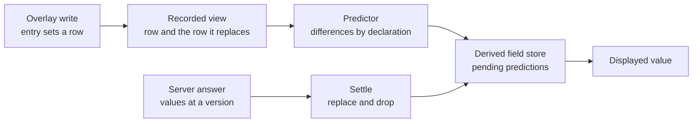

# Client predictions for derived fields

Built on the [server maintenance change](../architecture-derived-fields-relations-server/design.md), and third of the four changes in the [derived fields program](../architecture-derived-fields-program/design.md). This change replaces the post count store with one store for every derived value, adds the predictor that moves a value at once from the row a write replaces, routes every display of a derived value through that store, and retires the count lint selectors whose rule the types now carry.

## How it works



The overlay runs each write's entry against a view that records every row the entry sets, together with the row the view held before it. The predictor reads the declarations of each recorded table. For each relation a recorded row contributes to, it takes the contribution the row makes after the write, less the contribution of the held row it replaces, and applies that difference to each target. A create's held row is absent, which contributes nothing, so the difference is the new row's own contribution.

The predictions are pending entries in the derived field store, keyed by the write. A value shown to a viewer is the held value plus the pending predictions for it. The answer to a write replaces the held values at the version the answer carries, which settles that write's predictions. A refused write drops them and reads its values back. Every settle also reads the touched rows back, as the count read does today, so another viewer's change reaches the store even when this write did nothing.

A counter's step and an assigned value are not visible in the rows a write sets, so the write states them when it is issued, as the entry's own declaration rather than a patch. The overlay's refusal of a patch to a derived key does not reach them, and the predictor reads them from the entry as it reads a row.

Every display of a derived value reads through the store, so the post rows, the feed card and the post page show the same value. The version check the post rows make today is the store's check.

## Decisions

- **One predictor inside the overlay, not a wrapper at each write.** Every write that sets a contributing row needs the same difference. A wrapper at each call site is a second place to forget one, which is the failure this program removes.
- **The before is the row the view held, not the row the caller passed.** A second vote queued behind the first sees the first vote's effect, since the view already holds it.
- **A removal predicts only when the held subtree count is current.** The comment's own count is the server's count of its live replies, so a held value predicts the subtree exactly. Summing the replies the client has loaded would miss the ones it has not, so that shape is rejected.
- **The version rule is the overlay's rule.** A read and an answer therefore order the same way, and a count held at a newer version is never replaced by an older read.
- **One store, not one per table.** A store per table is the count-only store this program removes.

## Key files

| File                                                                          | Role after this change                                                                                                                                            |
| :---------------------------------------------------------------------------- | :---------------------------------------------------------------------------------------------------------------------------------------------------------------- |
| `apps/web/app/store/post/count.ts`                                            | removed; its held counts and its batched read move to the derived field store                                                                                     |
| `apps/web/app/store/post/count.test.ts`                                       | removed with its store; its read and version tests move to the derived field store's test                                                                         |
| `apps/web/app/models/post/PostCountFields.ts`                                 | removed; the answer's shape comes from the generic answer model                                                                                                   |
| `apps/web/app/store/overlay.ts`                                               | runs the predictor inside each write, and settles or drops its predictions with its answer                                                                        |
| `apps/web/app/store/post/like.ts`                                             | the vote writes stop calling the count store, and rely on the overlay's predictor                                                                                 |
| `apps/web/app/store/post/like.test.ts`                                        | asserts the vote's predicted count, its settle and its refusal                                                                                                    |
| `apps/web/app/store/post/comment/index.ts`                                    | the comment writes stop calling the count store and rely on the predictor for their ancestors; the reply placeholder is a draft that does not compute its ranking |
| `apps/web/app/store/post/comment/index.test.ts`                               | asserts the reply predictions, the removal predictions and the copy that waits for its answer                                                                     |
| `apps/web/app/composables/post/usePostRows.ts`                                | reads derived fields through the store, replacing its own version check                                                                                           |
| `apps/web/app/services/post/overlay/getSetLikeEntry.ts`                       | the vote create entry the predictor reads the view's before from                                                                                                  |
| `apps/web/app/services/post/overlay/getLikePatchEntry.ts`                     | the vote update and removal entries the predictor reads the view's before from                                                                                    |
| `apps/web/app/services/shared/overlay/createTable.ts`                         | its derived names let the drafts and patches of a table omit its derived keys                                                                                     |
| `scripts/src/services/oxlint/selectorBan/syntaxes/restrictedSyntaxes.ts`      | its count selectors are retired, since the readonly types now refuse the same writes                                                                              |
| `scripts/src/services/oxlint/selectorBan/syntaxes/restrictedSyntaxes.test.ts` | its tests for the retired selectors are retired with them                                                                                                         |
| `openspec/specs/architecture/client-data/design.md`                           | its count rules, its anti-patterns and its key files are rewritten as built                                                                                       |
| `openspec/specs/post/likes/design.md`                                         | its vote count rules and key files are rewritten as built                                                                                                         |

The store, the predictor and the settle helper are new, and sit in the folders below beside the code that uses them.

```text
apps/web/app/store/derived/
  index.ts                    the derived field store: held values, pending predictions, reads
apps/web/app/services/derived/
  getContributionDifference.ts  the difference a row makes to a target, from the held row it replaces
  predictDerivedFields.ts       the predictions a write's recorded rows give
  settleDerivedFields.ts        the held values an answer sets, and the predictions it settles
```

## Notes

- A count moved by a prediction is still re-read after its write settles. The prediction is what the viewer sees at once, and the read is what catches a change made by another viewer.
- A copy the client cannot take from a held source is not predicted, since a guess at the source's copied values would be shown as fact. The row waits for its answer.
- A value shown while a write is pending may include the effect of a read that already saw the write. That window is the program's accepted convergence window, and it closes when the write settles.
- A reply's placeholder is a draft, so it takes no derived keys. Its counts start at zero, which the predictor states, and its ranking is not computed on the client.
- The predictor and the trigger template compute the same difference, one in TypeScript and one in SQL. A test runs sampled writes through both and checks each prediction against the answer it settles to, where the held rows equal the server's.
