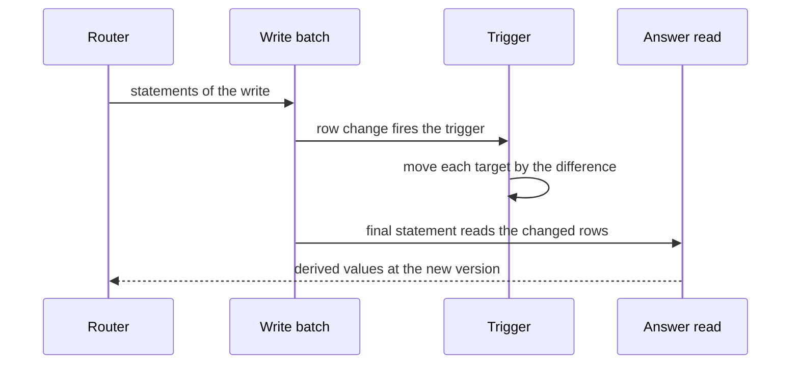

# Server maintenance of derived fields

Built on the [declarations](../architecture-derived-fields-tags/design.md), and second of the four changes in the [derived fields program](../architecture-derived-fields-program/design.md). This change moves the server's counts and the ranking onto the database, answers each vote and comment with the values it changed, and replaces the count read with the generic read. The program sets the kinds and the rules; this page states what the server builds from them.

## How it works



Each aggregate relation becomes one trigger per contributing table and per change type: an insert, an update and a removal. The trigger body is generated from the declaration and is the same for every aggregate, so only its table names, its reduction and its relation differ. For each changed row it computes the contribution before and after the change, and applies the difference to each target the relation names. A `WHEN` clause limits it to changes that alter a contribution or a relation, so a target's own update never triggers its aggregate again.

The database raises the target's version inside the trigger. The version column's update function is embedded only in statements Drizzle builds, so a trigger does not raise it on its own, and the trigger increments the column itself. The update time is left alone, since a count is not an edit. Verification item four in the program records that decision and its one reader check.

A trigger also refuses any update that changes a relation's key column, so a row cannot move between targets without its contribution moving with it.

Each vote and comment write keeps its guards, since those are the write's precondition, and drops its arithmetic. The answer is one more statement at the end of the same batch: it reads the derived values of the rows the batch changed. Since a batch runs its statements in order, the answer reads the values the triggers left, and no later write can change them before it is read.

The ranking becomes a value computed from the count and the creation time. If the database computes the same value as the definition, the ranking is a stored generated column, and the separate ranking statement and the account job that recomputes rankings are removed. If it does not, the batch recomputes the ranking from the new count in the same batch, which is the one statement that remains.

The count read is replaced by the generic read. It takes a table and row keys, answers each key with its version and values, and is chunked at one cap. Its one caller, the post count store, moves to it in this change, so the tree compiles at every commit.

## Verification

These checks are the change's gate. Each records its outcome in this section before any server task starts, which is section 0 of the tasks. The program's items 1 to 4 and 7 are here, and the account-erase path follows the cascade outcome.

- **Cascades.** Whether a foreign-key cascade fires the child's delete trigger in the test database. The outcome decides whether a cascading writer relies on the trigger or recomputes its targets in its own batch. The account-erase path is the first that would change, and task 2.3 builds it on the outcome.
- **Ranking.** Whether the database's math functions match the definition to the tolerance the parity test sets. The outcome decides between the stored generated column and the batch recompute.
- **Triggers on D1.** Whether D1 runs trigger statements at all, and whether a trigger body of several statements applies through a migration, which one other project reports failing. The outcome decides whether the aggregates use triggers or the write path recomputes their targets.
- **Trigger self-firing.** A count update fires the posts table's triggers, so the `WHEN` clause must reject it. A test on the replies' counts confirms the self-update changes nothing.
- **Reading.** The two SQLite pages on triggers and generated columns are read before any trigger is written, and the cases they settle are recorded here.
- **Snapshot.** Whether drizzle-kit's snapshot ignores triggers. The generator appends them to each migration either way, and the migration test reads the database's trigger list.
- **Update time.** Each reader that treats `updatedAt` as an edit marker, named here with its fix, since a count leaves that column alone.

## Notes

- A migration that stores the ranking as a generated column rebuilds the posts table, since an existing table cannot take a stored generated column. The rebuild copies every row, so the parity query runs before it, and the deploy stops if any stored ranking differs from the expression by more than the parity tolerance.
- Removed with the arithmetic: the ranking update that followed every vote, the account job that recomputed rankings, and the subtree count subquery in the comment delete. The subtree itself is still removed by the existing tombstone statement, and each removed row moves its ancestors through its own trigger.
- A create path that wrote the ranking itself stops doing so, since a generated column cannot be written.
- The lint selector that refuses an update to a derived key outside its helpers is added here, in the change that removes the arithmetic it guards, and it reads the generated set.

## Key files

| File                                                          | Role after this change                                                                                          |
| :------------------------------------------------------------ | :-------------------------------------------------------------------------------------------------------------- |
| `packages/db-schema/src/schema/post/postsInPost.ts`           | the ranking becomes a generated value, and the count relations are declared for the triggers                    |
| `packages/shared/src/services/post/getPostRanking.ts`         | the definition the stored ranking must equal, kept as the parity test's oracle                                  |
| `apps/web/server/services/post/updateLikeRanking.ts`          | removed; the ranking is no longer a second statement                                                            |
| `apps/web/server/trpc/routers/like.ts`                        | the vote writes lose their count and ranking arithmetic and answer with the derived values                      |
| `apps/web/server/trpc/routers/post.ts`                        | the comment writes lose their ancestor arithmetic, answer with the derived values, and move to the generic read |
| `apps/web/server/services/post/tombstonePostSubtree.ts`       | removes the subtree; the triggers move each ancestor per removed row                                            |
| `apps/web/shared/models/db/post/ReadPostCountsInput.ts`       | replaced by the generic read's input                                                                            |
| `apps/web/app/store/post/count.ts`                            | its one read moves to the generic read, so the store compiles at every commit                                   |
| `apps/web/server/trpc/routers/like.test.ts`                   | asserts the answers and the trigger-moved counts                                                                |
| `apps/web/server/trpc/routers/post.test.ts`                   | asserts the comment counts through the triggers, and the generic read                                           |
| `apps/jobs/src/services/account/computePostRankingUpdates.ts` | removed; the ranking follows its inputs without a job                                                           |
| `apps/jobs/src/handlers/deleteAccountHandler.test.ts`         | asserts the account erase leaves counts and rankings right without the job                                      |

The trigger template, the answer helper and the read procedure are new, and sit beside the code that uses them.

```text
packages/db-schema/src/services/derived/
  createDerivedTriggerSql.ts   the trigger template for one aggregate relation
apps/web/server/services/derived/
  getDerivedAnswer.ts          the derived values of the rows a batch changed
  readDerivedFields.ts         the batched read by table and keys
apps/web/server/trpc/routers/
  derived.ts                   the read procedure
```
