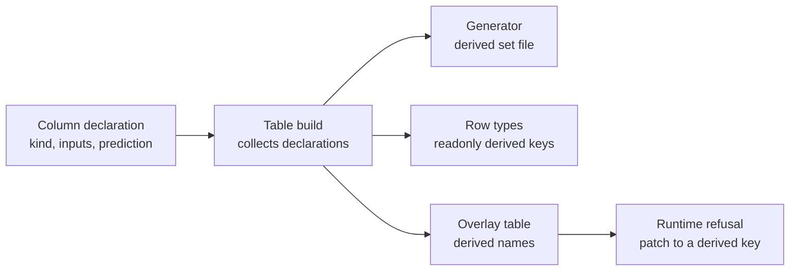

# Derived field declarations

Built as the first of the four changes in the [derived fields program](../architecture-derived-fields-program/design.md), which sets the kinds, the inventory and the rules every later change follows. This change adds the declaration itself, the generated set that reads the declarations, the types that keep a client from writing a derived value, and the classification of every candidate column the inventory lists.

## How it works



A derived column is declared where it is defined. A declaration helper wraps the column's builder, so the declaration sits on the same line as the column and cannot exist without it. When the table is built, the table collects its columns' declarations onto itself, the same way it already collects its scope, as a property the schema module defines without enumerating it. Nothing else reads the declarations at build time.

Three consumers read the collected declarations:

- **The generator** writes the derived set from every table's declarations into one generated JSON file. Each later change reads that file, and no other file names the set.
- **The types** mark each derived key readonly on the row types the table produces, and leave it out of the draft and patch types. A type-level marker on the declared column's value carries the fact, so the marker is what a type test proves.
- **The overlay** reads the derived names from the table it is given, so a patch that names one is refused at runtime, for a caller that reaches the overlay without the types.

The classification completes the program's inventory: each candidate column is read against its writer. A column the writer confirms gets its declaration. A column that is a plain input stays undeclared, and its reason is recorded in the program's inventory.

## Decisions

- **The declaration sits on the column, not in a map on the table's options.** A map keyed by column name would be a second line to change on a rename, and a stale key would read as a derived value that no longer exists.
- **No registry of derived columns.** A registry is a list kept by hand beside the declarations, and it drifts the first time a declaration lands without its entry. The generated set is derived from the declarations, so it cannot.
- **A type-level marker, and a runtime declaration.** A type alone cannot tell the predictor which relation a value moves along, and a runtime property alone cannot make a row type readonly. Both are needed, and each is one declaration.
- **The marker's shape is the one a type test proves.** A plain number must stay assignable where the server writes the value through a SQL expression, and must become readonly where a client reads it. The brand is chosen so the type test for both holds, and the choice is recorded with the test.
- **A write's step or assigned value is an entry's declaration, never a patch.** The runtime refusal applies to a patch's fields. A counter step or an assigned value reaches the overlay as the entry's own declaration, which only the counter or assigned helper applies, so the refusal does not meet it.

## Key files

| File                                                                         | Role after this change                                                     |
| :--------------------------------------------------------------------------- | :------------------------------------------------------------------------- |
| `packages/db-schema/src/sqliteTable.ts`                                      | collects each column's declaration onto its table                          |
| `packages/db-schema/src/schema/post/postsInPost.ts`                          | declares the post counts, the ranking and the inherited columns            |
| `packages/db-schema/src/schema/message/usersToRoomsInMessage.ts`             | declares the mention count                                                 |
| `packages/db-schema/src/schema/message/roomsInMessage.ts`                    | declares the last message time                                             |
| `packages/db-schema/src/schema/message/invitesInMessage.ts`                  | declares the invite's uses                                                 |
| `packages/db-schema/src/schema/message/callSessionsInMessage.ts`             | declares the thread root as inherited                                      |
| `packages/db-schema/src/schema/auth/usersInAuth.ts`                          | declares the storage bytes counter                                         |
| `packages/db-schema/src/schema/auth/apiKeysInAuth.ts`                        | declares the request count                                                 |
| `packages/db-schema/src/schema/resource/resourcesInResource.ts`              | declares the content size and the two content versions                     |
| `packages/db-schema/src/schema/resource/resourceViewsInResource.ts`          | declares the view count                                                    |
| `packages/db-schema/src/schema/resource/resourcePublicationsInResource.ts`   | declares the published content version and the publish version             |
| `packages/db-schema/src/schema/resource/resourceVersionsInResource.ts`       | declares the plaintext and stored bytes                                    |
| `packages/db-schema/src/schema/resource/resourceActivitiesInResource.ts`     | declares the publish version as inherited                                  |
| `packages/db-schema/src/schema/resource/surveyResponsesInResource.ts`        | declares the model version as inherited                                    |
| `packages/db-schema/src/schema/achievement/userAchievementsInAchievement.ts` | declares the achievement amount                                            |
| `apps/web/app/services/shared/overlay/createTable.ts`                        | reports each table's derived names, and the overlay refuses a patch to one |

The declaration helper, the kinds, the generator and the generated set are new, and sit in the folders the layout below names, beside the code that reads them.

```text
packages/db-schema/src/services/derived/
  derived.ts                  the declaration helper, wrapping a column's builder
  readDerivedDeclarations.ts  reads a table's collected declarations
packages/db-schema/src/models/derived/
  DerivedKind.ts              the five kinds
  DerivedPrediction.ts        Predicted or AnswerOnly
  AggregateReduction.ts       Count, Sum or Max
  DerivedRelation.ts          Foreign or Ancestors
  DerivedDeclaration.ts       the declaration, a union by kind
packages/db-schema/generated/derived/
  derivedColumns.json         the generated set
scripts/src/services/derived/
  generateDerivedColumns.ts   writes the generated set from the declarations
```

## Notes

- The generated set is read by the lint selector the relations-server change adds, and by the read procedure's table list. A set that lacks a declaration lets a write to that key pass the selector until the set is regenerated, and the generation check fails in CI until it is, so that check is what keeps the set whole. A set that holds a removed column refuses a valid write until it is regenerated.
- A declaration names its kind, and a kind's required attributes are checked when the declaration is built. A declaration missing one of them fails the schema build, not a later write.
- A declaration's inputs are checked against the table it sits on, or, for an aggregate, against the contributing table its relation names. An aggregate's input is a column of the contributing rows, so it is not on the declaring table.
