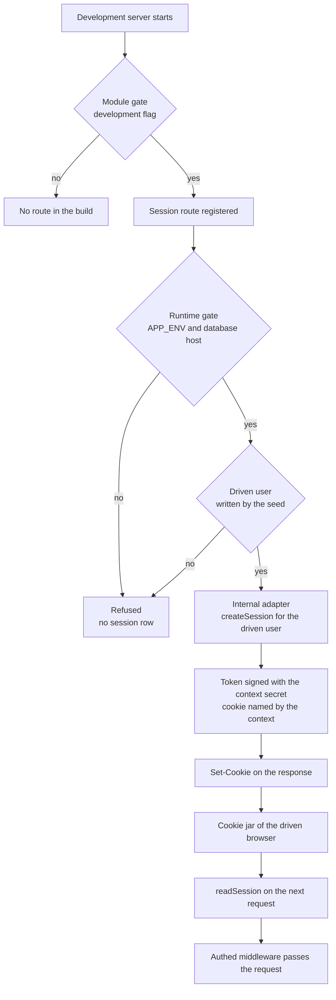
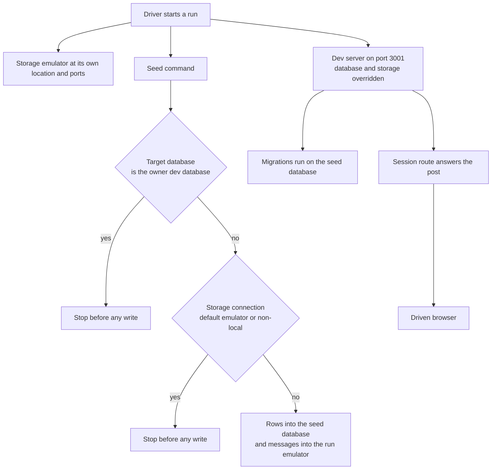

# Driven session

A driven browser can open the app's signed-in pages as one seeded person, through a route that only a development server registers and that refuses every request made against a non-local database or in production. The rest of the app's session check is unchanged.

## How it works

A signed-in page cannot be checked in a driven browser today. Every authed procedure reads the session cookie and refuses a request without one, and sign-in goes only through third-party providers, so no driver can become a person. This change adds the one route that signs a person in, and only where a person's own machine runs the app.

The route is registered by a Nuxt module, not by a file under the app's server routes, so the production bundle never carries it. The module registers the route only when the development flag is set, the same gate the local storage emulator's module uses. In a development server the handler still refuses unless the environment flag is not production, the database host is the local machine, and the seed has written the driven user.

When the handler accepts, it takes the session context from better-auth's own instance. Better-auth's internal adapter creates the session row for the driven user, the context's secret signs the token, and the context's cookie definition names the cookie and sets its attributes. The response carries the cookie, the driven browser's cookie jar keeps it, and the next request is an ordinary signed-in request that the session reader and the authed middleware check unchanged.



A run stays off the owner's data at both stores. The seed writes to a database of its own on the owner's local Postgres server, and the driver starts the server with the database address overridden to that database. The configuration loader fills a key from the `.env` file only when the process environment does not already hold it, so the override reaches the app and the migrator that runs with it. The seed's messages go to a storage emulator the driver starts at its own location and ports, and the driver overrides the storage connection string to point there. The owner's emulator starts only for the default connection string, which the run no longer uses.



The driver step itself is a post to the route followed by the page visits, written into the driven-browser reference. Nothing here runs in the edit loop, which the run-app skill keeps for a claim no test reaches.

## Scope

**Today**, a driven browser reaches the public pages only. An authed procedure refuses a request without a session, and the dev database holds no seed to sign in as.

**This change adds** the session route and its module, the seed and its entry command, the driver step in the driven-browser reference, and an amendment to a rejected option in the genshin-phases design. Production behaviour, production schema and the owner's dev data are unchanged.

**Infrastructure** is what the owner's machine already runs: the local Postgres server and the local storage emulator. A run adds one database on that Postgres server and one emulator at its own location and ports. No Azure resource is created or written, and no new service is introduced.

**Failure and retry.** The route writes one session row per accepted post, and the driver posts once per run. A refused post writes nothing. The seed upserts by fixed identifiers, so a run that fails partway is finished by the next run. A seed aimed at a forbidden target stops before its first write, so a refusal leaves both stores as they were. A run whose emulator is missing fails at the seed's first table write, and the Postgres rows the seed wrote before that stay in place for the next run to converge.

## Decisions

- **The route lives in a development-only module, not under the app's server routes.** A file under the server routes is part of every build, and the production bundle would carry a route that signs people in. The module registers the route only when the development flag is set, and it uses the gate the local emulator's module already uses. Rejected: a server route behind a runtime check, which production would carry and one configuration change could expose.
- **The handler signs in through better-auth's own context.** It takes the internal adapter, the secret and the session cookie definition from the context, and signs the token with better-auth's exported HMAC helper. Rejected: a hand-written cookie with a fixed name and a copied signature, which drifts the day better-auth changes its cookie name or encoding.
- **The route takes no input and signs in one user.** The driven user is one identity the seed writes and the handler reads. Rejected: a route that names the user, which would sign in any user of a local database, the owner's own development accounts included.
- **That identity is a constant in `@esposter/shared`.** The seed and the handler both need it, and that package is the lowest one both already depend on, which is the placement rule for a value with two consumers. A second home in the schema package was considered and rejected, since that package holds schema and migrations and no seed data. The cost is a development-only identifier in a client-safe package, accepted because it is one string. Its value is a version-4 shaped id, the shape every id the repo generates has and `z.uuid()` accepts, rather than the zero UUID (`ZERO_UUID`), because the automod actor holds the zero UUID and the audit log would label the driven user's own actions as AutoMod.
- **The seed writes to a second database on the owner's Postgres server.** The seed's rows live in one database that the owner's dev data never shares, so no marker a later change could forget has to separate them. Rejected: the owner's database with a marker column, which changes the owner's data and leaves the seed's rows wherever the marker is missed.
- **The seed's messages go to an emulator the run starts, not the owner's.** The owner's emulator keeps its data beside the app, so seed entities written there would sit in the owner's data. Rejected: a table-name prefix, since the table names come from the app's entity code and the driven server reads the same tables.
- **No environment variable enables the route.** A deployed environment could set any variable, so the runtime gate reads the environment flag, which the app already declares, and the database host. Rejected: an enabling variable.
- **The seed is a scripts command outside the `ai:` catalogue.** The catalogue lists the scripts no person types, and the owner runs the seed as well as a driver, so an `ai:` name would file it under the wrong heading.

## Rejected

- **A header that bypasses the authed middleware.** It would impersonate at the one check every authed procedure passes, so any request carrying the header is signed in, in every build.
- **An API key used as the session.** The key plugin is configured never to open a session, which keeps a key to the procedures it opts into. A key used as a session would open every procedure to its holder.
- **Real OAuth in Playwright.** It needs each provider's application, its secrets and its consent screen inside the loop, all of which sit outside the repository.
- **An Azure dev database for the run.** The driven-browser reference forbids writes to the dev Azure resources, and a seed written there would sit beside the owner's data.
- **A Mock Service Worker browser worker.** The repo's tRPC adapter for Mock Service Worker runs in happy-dom on the node entry, no browser worker exists, and the app's service worker would contend for the page's requests.
- **pglite-socket as the database.** It is not in the lockfile, and its compatibility with the app's Postgres driver is unproven. It is worth revisiting once it is in the lockfile and proves the driver.
- **Canned `page.route` responses for tRPC as the main path.** They drift from the client's call sites and prove no server path. They are allowed as a one-page smoke test, and no more.

## Key files

| File                                                     | Role                                                                                                    |
| -------------------------------------------------------- | ------------------------------------------------------------------------------------------------------- |
| `apps/web/modules/startAzuriteEmulator.ts`               | The precedent: a development-only module gated on the development flag, which the new module follows.   |
| `apps/web/modules/serveGenshinExtractions.test.ts`       | The precedent for a module's colocated test, in the same folder.                                        |
| `apps/web/server/auth.ts`                                | The better-auth instance whose context the handler takes; its sign-in requirements do not change.       |
| `apps/web/server/services/auth/readSession.ts`           | The session reader the handler's cookie is proved against in its read-back test.                        |
| `apps/web/server/trpc/middleware/getAuthedMiddleware.ts` | The one check a minted session passes, unchanged.                                                       |
| `apps/web/server/db/index.ts`                            | Reads the database address when the server starts, so the driver's override reaches the app's database. |
| `apps/web/shared/models/environment/Environment.ts`      | The production value the runtime gate compares the environment flag with.                               |
| `packages/db-schema/src/schema/auth/sessionsInAuth.ts`   | The session row a minted session writes, whose token is unique.                                         |
| `packages/shared/src/index.ts`                           | The generated barrel that carries the driven user's constant after the package builds.                  |
| `scripts/package.json`                                   | Gains the `dev:seed` script.                                                                            |
| `scripts/src/workspace/commandEntries.test.ts`           | The rule that the seed's entry starts through the timing wrapper.                                       |
| `scripts/src/workspace/openspecScenarioTasks.test.ts`    | Holds this change's tasks and its scenarios to each other.                                              |
| `.agents/skills/run-app/references/driven-browser.md`    | Gains the driver step and loses its statement that nothing is signed in.                                |
| `openspec/changes/genshin-phases/design.md`              | Its rejected Playwright option is amended by task 5.1.                                                  |
| `openspec/specs/architecture/auth/design.md`             | On ship, gains a note on the development-only route beside its provider-only requirement.               |

The new files, all in the change's own folders:

```text
apps/web/modules/devSession.ts                      the module: registers the route in a development build only
apps/web/modules/devSession.test.ts                 the module's gate test
apps/web/server/services/devSession/                the handler, its runtime gate and their tests
packages/shared/src/services/devSeed/constants.ts   the driven user's identifier, read by the handler and the seed
scripts/src/devSeed/index.ts                        the entry the dev:seed script runs, through the timing wrapper
scripts/src/services/devSeed/                       the seed and its target gates
scripts/src/models/devSeed/                         the seed's types
```

## Notes

- **Risk: the cookie jar shares a cookie between the driver's request and the page, on an IPv6 literal host.** Task 4.2 proves it by the page listing the seeded rows. If it fails, the driver sets the cookie on the page's own context, and task 4.1 is revised before the run is repeated.
- **Risk: the installed better-auth returns the session the handler needs from its internal adapter.** The source generates the token and the expiry in the call, and the handler reads the returned session. Task 2.1 checks the shape, and the read-back test in task 1.2 holds it to the reader.
- **Risk: the session reader runs against the in-memory test database.** Task 1.2 proves it. If it cannot, the read-back moves to the driven check and this design is revisited before any later task is started.
- **Risk: the owner's Postgres role can create the seed's database.** Task 3.2 proves it with the first seed run, and a role that cannot create one stops the seed before any write.
- **Risk: the emulator's table-port and location options are as the run needs, and the seed's table writes run under them.** Task 3.2 proves both with a seed run against a scratch location.
- **Risk: the workspace packages the scripts already depend on export the table writes the seed needs.** Task 3.2 checks it, and a missing write adds the scripts manifest row that the change's Key files names.
- **Risk: a read in the driven flows publishes to a dev Azure service.** The achievement and notification paths run on authed procedures and can reach the dev Event Grid, Service Bus or Web PubSub resources. Task 4.2 records every request host and fails the run on any host that is neither the loopback address nor the blob read host.
- **Trade: every development run on the machine can sign the driven user in.** The machine is the owner's own, and the route's gates keep it to that machine's local database.
- **The auth capability's provider-only requirement stays true for every build a person reaches.** The route here is the one exception, reachable only in a development build against a local database. Task 5.2 names it in the auth design when this change ships.

## Sources

- The installed better-auth package, read in its source: the internal adapter's session creation, which generates the token and the expiry, and the cookie builder, which signs a token as the session cookie's value. The handler reuses the context these expose, and the signing that the reader verifies.
- The installed configuration loader's dotenv handling: a key from the `.env` file fills the process environment only when the process environment does not already hold it. This is the precedence the driver's overrides rely on, read in the installed package and to be confirmed by task 4.2.
