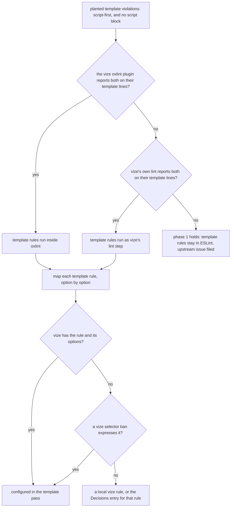

# ESLint retirement

## Context

The lint runs as two passes today, as the [lint toolchain](../../specs/architecture/lint-toolchain/design.md) describes. oxlint is the fast pass. It runs repo-wide with the type-aware backend and reads the script blocks of a `.vue` file. ESLint is the second pass, for what oxlint cannot parse or express: `.vue` templates, JSON, and the `no-restricted-syntax` selector bans. ESLint runs from the configuration that `withNuxt` composes in `apps/web/.nuxt/eslint.config.mjs`, extended by `packages/configuration/eslint/index.vue.js` for the app and the three scoped-style Vue packages, and by `packages/configuration/eslint/index.typescript.js` everywhere else. `eslint-plugin-oxlint` (`packages/configuration/eslint/oxlint.js`) switches off every ESLint rule oxlint already runs, so no file is checked twice.

The parser under that configuration is `@typescript-eslint/typescript-estree`, which builds its tree with the classic TypeScript API. It is the last reader of the `typescript-native-bridge` override ([Rust TypeScript toolchain](../architecture-rust-typescript-toolchain/design.md), "Phase 3 and 4"). Deleting ESLint deletes that reader, so the override and the `typescript` package can go too.

## What ESLint does today, and where each piece goes

ESLint still runs a short list of rule families once the bridge has switched off everything oxlint covers. Each family gets one destination.

| Family                                                                | Runs on                  | Destination                                                                                         |
| :-------------------------------------------------------------------- | :----------------------- | :-------------------------------------------------------------------------------------------------- |
| eslint-plugin-vue template rules, from `withNuxt` and `vueRules.js`   | `.vue` templates         | vize's `vue/*` rules, configured to the same options                                                |
| eslint-plugin-vue script rules                                        | `.vue` script blocks     | oxlint's native `vue/*` where it has the rule, else vize's `script/*`                               |
| `vue/no-restricted-syntax`, the template selector list                | `.vue` templates         | vize's `vue/no-restricted-syntax`, the selectors rewritten for vize's template tree                 |
| eslint-plugin-vuejs-accessibility                                     | `.vue` templates         | vize's `a11y/*` rules, which name all but one of the rules we run                                   |
| `directives/require-template-reason`, local                           | template comments        | a workspace test over every tracked template's directive comments, since vize's tree carries none   |
| `scoped-styles/no-unknown-attribute`, local                           | scoped-style packages    | vize selector bans generated from the same HTML data, in an entry for those three packages          |
| `no-restricted-syntax`, the script selector lists                     | `.ts` and `.vue` scripts | a local oxlint JS plugin that reads the same lists, composed per path in `oxlint.config.ts`         |
| perfectionist                                                         | all code                 | `jsPlugins`, as `eslint-plugin-pinia` loads today                                                   |
| UnoCSS `order`, `blocklist`                                           | script and class strings | `jsPlugins`                                                                                         |
| UnoCSS `order-attributify`                                            | `.vue` templates         | deleted with ESLint, since no vize rule or selector expresses an order (Decisions)                  |
| `nuxt/*` rules, from `@nuxt/eslint-plugin`                            | `.ts`, `.vue` scripts    | `jsPlugins`                                                                                         |
| `link-checker/*`, from `nuxt-link-checker`                            | `.ts`, `.vue`            | `jsPlugins` if it loads without the Nuxt runtime, else `routing/no-route-literal` alone (Decisions) |
| `depend/ban-dependencies`                                             | `package.json`           | a workspace test over every manifest                                                                |
| `jsonc/*` and `@eslint/json`                                          | JSON and JSONC files     | a workspace test over the tracked JSON files                                                        |
| `no-octal`                                                            | `.ts`, `.vue`            | deleted: every file here is an ES module, where a legacy octal literal is already a syntax error    |
| `no-useless-assignment`, `@typescript-eslint/consistent-type-imports` | `.ts`, `.vue`            | already run by oxlint; the ESLint copy goes with ESLint                                             |

## The template pass

oxlint parses only the script blocks of a `.vue` file, and its JS plugins see the same script program. A plugin that reads the template can report a template position only where the script comes first: in a file whose template comes first, the position throws or lands on the script block ([oxc 15761](https://github.com/oxc-project/oxc/issues/15761)). Every component here that has a script puts it first, so that limit does not bind. The one that does is vize's own guide on its oxlint plugin: a `.vue` file with no script block never runs its per-file rules, and a few dozen components here have none.

So the phase opens with a gate. A planted violation in a script-first component, and another in a component with no script block, must both be reported on their template lines. The gate is run against vize's oxlint plugin first, since a pass inside oxlint keeps the lint one command and one walk of the tree. If the plugin misses the script-less component, vize's own lint, which parses the whole component, runs as a step beside oxlint instead. Giving those components an empty script block to reach the plugin is rejected: it is a file shape that exists only for the linter. Either way the rest of the phase is the same, since only the host differs.

The gate chose vize's own lint. The plugin inside oxlint reported the script-first finding on a script line, with the template position only in its message, and missed the script-less component entirely. The plugin's `oxlint-vize` wrapper reported both on their template lines, but it runs a second oxlint over temporary copies, cannot carry the type-aware backend or the timing flag the root lint passes, and took an order of magnitude longer than vize's own lint over every component. vize's own lint reported both on their template lines in a few seconds for the whole tree. So the template pass is the root `lint:vue` task, vize reads its options off the `vue` key of `vite.config.ts`, the one place it reads them, and `oxlint-plugin-vize` is not installed. The incremental preset runs only the rules those options name, so a rule is on because the options say so, never because vize's defaults changed.

The template rules moved as one batch. Every eslint-plugin-vue and vuejs-accessibility rule that had a vize twin runs in vize with its options, and Nuxt's Vue block in ESLint is replaced by the few rules vize cannot run yet, each under an `@TODO` naming the gap: casing with exceptions, the same-name bind shorthand, the blank line between blocks, which oxfmt does not add, and the bare `@click.stop` ban, since vize's template tree carries no node for a directive's modifiers. `vue/first-attribute-linebreak` is deleted rather than kept: oxfmt places every first attribute, so on a formatted tree it can never fire. The three element bans are selectors, because vize's element ban takes no message. A page, a layout and a server component keep their one root through a scoped entry, since most components here render a fragment. The template selector list still carries the shared list's script-only entries; matching dispatches on node type, so they cost nothing, and the list splits when the script bans move to oxlint in the next phase. vize evaluates `vite.config.ts` and everything it imports, so `oxlint.config.ts` sets the type-aware backend's switches only when they are absent, which its config runtime allows.

## The script pass

The script selector bans keep their data. The `restricted*Syntaxes.js` lists and the inline ones in `typescriptRules.js` move to `oxlint/`, beside the rest of the oxlint data, and one local JS plugin under `scripts/src/oxlint/` registers each entry's selector as a visitor and reports its message. The per-path composition that `index.vue.js` does with its `.append` blocks becomes `overrides` entries in `oxlint.config.ts`. An oxlint override replaces a rule's options as an ESLint block does, so each override still carries the base list it extends. The existing tests beside each list plant violations, and they move with the list, so each ban is proved in its new host before ESLint's copy goes.

The phase opens with its own gate: a planted violation for a selector of each shape the lists use, such as attribute regexes, `:not(...)`, descendant and `:has(...)`, must be reported by the JS plugin. A selector the plugin's engine cannot run is rewritten as a visitor in the same plugin. A rule is never dropped for that reason.

The gate passed whole. oxlint's JS plugins take an esquery selector as a visitor key, so `selector-ban/no-restricted-syntax` keeps no matcher of its own: each ban's selector is a key and its message is reported where it matches, with bans sharing a selector grouped under one key. Every shape the script lists write runs, from attribute regexes and nested paths to `:has`, `:not` over an ancestor, `:nth-child`, siblings and `:matches`. A template selector never runs there, since oxlint hands a plugin no template, which is why the template lists are vize's.

## Decisions

**No behaviour is dropped unseen.** Every rule ESLint runs today is moved with a planted violation that its new host reports, or it is deleted by a Decisions entry here that says why the rule, or a different one, is the better pattern. A rule that has no host yet and no such entry is a blocker. It stays in ESLint, the change's `x-waiting` names it and its upstream issue, and the phase moves on to the next rule. ESLint is deleted only once no blocker is left. Rejected: dropping a rule that is hard to move and noting it afterwards, which loses a check nobody decided to lose.

**Each phase leaves the lint no slower.** Task 1.1 records the root lint's wall time on the whole repository before any rule moves, and each phase's last task measures again against it. A move that makes the lint slower is reworked before the phase closes: a rule is configured to the narrowest files it applies to, and a selector-ban list is matched in one pass over the tree rather than one pass per ban. Rejected: measuring only at the end, which finds a regression after the commit that caused it is buried.

**One phase per kind of rule, deletion last.** Every phase moves rules and leaves ESLint running. ESLint's copy of a moved rule is switched off in the same commit, and only phase 4 deletes ESLint. Rejected: deleting ESLint first and restoring rules as they are found missing. That ships weeks of unlinted code, and nothing records which rule was lost.

**The template rules run in vize, not in an oxlint JS plugin we write.** vize parses the whole component and already carries the template rules, selector bans included. Rejected: a JS plugin that parses the component with `@vue/compiler-sfc` and walks the template. It would be a second copy of eslint-plugin-vue that this repository maintains, and it would skip the script-less components as vize's plugin does.

**The script selector bans become one data-driven JS plugin, not one rule per ban.** The lists are data, and their tests already plant each violation. A plugin that reads them keeps one place to add a ban. Rejected: porting each selector to a hand-written rule, which is about a hundred rules to maintain for no gain in what they catch. Also rejected: waiting for a native selector rule in oxlint. The lint toolchain's table records it as an upstream gap with no release named, and keeping ESLint until then keeps the classic compiler with it.

**The JSON checks become workspace tests.** oxlint reads no JSON ([oxc 18656](https://github.com/oxc-project/oxc/issues/18656)), and the dependency ban and the validity rules are checks over a small, fixed set of files, which is what a workspace test is for (the [enforcement ladder](../../specs/architecture/enforcement-ladder/design.md)). The dependency test reads the same replacement data that eslint-plugin-depend reads, so its verdicts match the rule it replaces. Rejected: keeping ESLint for JSON alone. That keeps every package this change deletes, `@nuxt/eslint` aside, for a handful of files. When oxlint reads JSON, the two checks move back to rules, which is the trigger recorded on the test.

**`no-octal` is deleted, not moved.** Every source file here is an ES module, so it runs in strict mode, where a legacy octal literal is a syntax error the parser already reports. Rejected: a selector ban, which would re-report what the parser refuses.

**`vuejs-accessibility/no-onchange` is deleted.** vize has no rule of that name, and the rule exists for a screen-reader behaviour that no current browser has. eslint-plugin-jsx-a11y deprecated its own copy for that reason. Rejected: a vize selector ban for it, which would keep a rule whose reason no longer holds.

**`vue/component-api-style` becomes a script selector ban.** vize has no rule of that name, and the ban is two selectors over the script: an `export default` object, and a call to `defineComponent`. Both go in the script selector lists. Rejected: keeping the rule's name through a local vize rule, which is more code for the same two selectors.

**`vue/padding-line-between-blocks` is left to the formatter.** It is whitespace between a component's top-level blocks, which the formatter owns (the `formatting` skill). Rejected: a local rule for one blank line. If the formatter does not hold it, the gap is recorded in the formatting skill as a fact, never as a lint rule.

**A rule vize lacks, or runs without an option we set, keeps its behaviour and links its vize issue.** Where a selector ban expresses it, the selector runs in vize with our message, as the three element bans do for `vue/no-restricted-html-elements`, which takes no message. Where none can, because the check compares two fields (the same-name bind shorthand), exempts a name from a casing rule, reads a directive's modifiers or the space between blocks, the rule stays in eslint-plugin-vue under an `@TODO` linking the issue. Task 4.1 cannot delete ESLint while one of those issues is open: each still open then is moved to the nearest host that proves it by a planted violation, or raised as the blocker it is. Rejected: dropping a behaviour silently.

**UnoCSS attribute order is deleted with ESLint.** vize has no rule for it and a selector cannot express an order, so the ordering is left to review once task 4.1 removes ESLint. Until then it keeps running there, so nothing is lost before its host goes. Rejected: keeping ESLint for one cosmetic rule.

**`nuxt-link-checker` stays only if its rule loads without the Nuxt runtime.** If it needs the app's generated routes at lint time and cannot read them through `jsPlugins`, it is deleted, and `routing/no-route-literal`, our own rule, remains the route check. Rejected: keeping `@nuxt/eslint` installed only to feed it.

**`eslint-plugin-oxlint` goes with ESLint, and the categories stay listed.** The bridge is why the lint toolchain says every oxlint category must be listed explicitly, `correctness` included: the bridge replaces oxlint's defaults with what the file names. Without the bridge that reason is gone, but the list stays, because a category oxlint turns on by default is still a decision the file should state. Rejected: trimming the list to non-defaults, which hides the most important category behind an upstream default.

**The `typescript` package goes in the same phase as ESLint.** Once ESLint is gone, nothing in-process loads it ([Rust TypeScript toolchain](../architecture-rust-typescript-toolchain/design.md), "Phase 3 and 4"). `@trpc/client` and `@trpc/server` keep a required peer on it for their types, which pnpm reports as a missing peer. The workspace's `peerDependencyRules` names that peer as allowed to be missing, with the reason beside it. Rejected: keeping the package installed for an install warning.

## Key files

| File                                                     | Role                                                                                     |
| :------------------------------------------------------- | :--------------------------------------------------------------------------------------- |
| `oxlint.config.ts`                                       | gains the script selector bans by path, the JS plugins and the template pass's wiring    |
| `vite/vueOptions.ts`                                     | the template pass's options: the incremental preset and the rules it runs                |
| `vite/checkTasks.ts`                                     | the `lint:vue` and `lint:packages:vue` leaves of the root lint                           |
| `oxlint/jsPlugins.ts`                                    | lists the JS plugins oxlint loads; the third-party ESLint plugins join it                |
| `scripts/src/oxlint/`                                    | the local JS plugins; the selector-ban plugin joins them                                 |
| `packages/configuration/eslint/index.vue.js`             | the per-path selector composition that moves to `oxlint.config.ts`, then is deleted      |
| `packages/configuration/eslint/overrides/vueRules.js`    | the eslint-plugin-vue rules vize cannot run yet, each under its `@TODO`                  |
| `vite/services/scopedStyleSyntaxes.ts`                   | the scoped-style packages' attribute bans, one selector per set of elements' attributes  |
| `scripts/src/workspace/templateDirectiveReasons.test.ts` | the template half of the directive-reason check                                          |
| `packages/configuration/eslint/typescriptRules.js`       | the inline script selector bans that move to `oxlint/`                                   |
| `packages/configuration/eslint/plugins/depend.js`        | the dependency ban that becomes a workspace test                                         |
| `packages/configuration/eslint/plugins/json.js`          | the JSON rules that become a workspace test                                              |
| `apps/web/configuration/modules.ts`                      | loads `@nuxt/eslint`, which is removed                                                   |
| `package.json`, `pnpm-workspace.yaml`                    | the lint scripts, the catalog entries removed, the override and the `typescript` entry   |
| `openspec/specs/architecture/lint-toolchain/design.md`   | rewritten at archive for oxlint and vize, with no bridge and no blocker table for ESLint |

## Notes

- The baseline each phase is measured against is CI's Lint step before any rule moved, a few minutes on the hosted runner, nearly all of it the per-package ESLint passes. The template pass adds seconds to it.
- The ESLint directives in the tree mostly name `no-restricted-syntax`, `perfectionist/sort-objects` and `vue/no-restricted-syntax`. Each is rewritten for its rule's new host in the phase that moves the rule, so a directive never names a rule nothing runs.
- vize describes itself as experimental and pre-1.0. The template pass is pinned by the catalog like every other dependency, and a vize bump is read against the gate's planted violations, which stay as tests.

## Sources

- [oxc 15761](https://github.com/oxc-project/oxc/issues/15761) — oxlint's Vue support, and why a JS plugin's template position lands on the script block.
- [oxc 18656](https://github.com/oxc-project/oxc/issues/18656) — oxlint reading JSON.
- [vize oxlint plugin guide](https://vizejs.dev/guide/oxlint/) — the plugin's anchoring to the script program, and files with no script block.
- [vize rules](https://vizejs.dev/rules/all/) — the rule catalogue and its presets.
