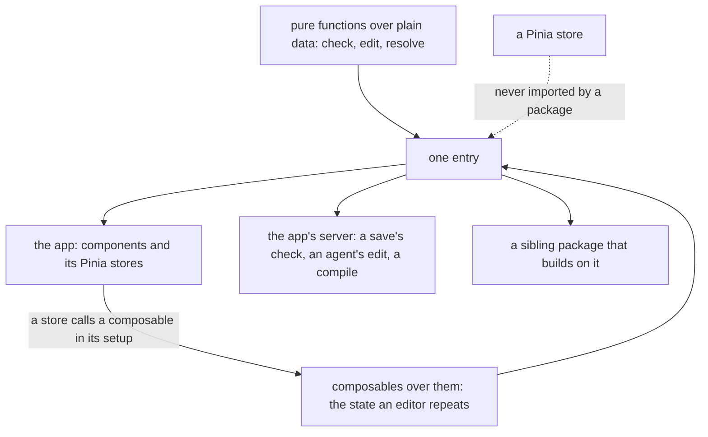

# Headless package shape

The one shape a headless package takes: a Vue package, named `vue-<thing>-headless`, with one entry holding its functions and its composables together. It is a repo-wide standard, so it belongs under the architecture area, and the [editor layout package](../vue-editor-layout-headless-package/design.md) is the first package written to it.

## How it works

A package holds the pure functions over its document and, beside them, the composables that keep a document's state. Both are exported from the one entry, so a consumer imports a function or a composable from the same place, and a composable is written once in the package instead of once in each editor.

## Order

The abstraction is built before anything is renamed. The editing session composable goes into the block editor package under its current name, the three stores call it, and what it removed is measured. Only a measured benefit carries on to the renames, which then follow the convention in one pass each. A rename done first would move every consumer twice if the abstraction changed the package's surface, and would be decided before the benefit that justifies it is known.

## Why every package can be a Vue package

Every consumer of these packages is Vue code or runs beside it. The Nuxt app and its sibling packages are Vue, and the app's server, which checks a save, applies an agent's edit and compiles an email, is the same Nuxt app with Vue installed. The Azure Functions app has no Vue, and none of these packages has a consumer there. A package that needs Vue costs the server nothing it does not already carry.

The functions stay pure. A function over a document is the same function with a reactive wrapper beside it, so nothing is rewritten to use a ref. What changes is where the wrapper lives: in the package, once, where the editors now write it three times.

## What the audit found

The block editor, the survey engine, the survey expression language and the MJML blocks hold all their logic in pure functions, and each editor's store and commands wrap them. They join the three packages already named for Vue under one convention and one set of manifest rules.

The math expression compiler is the one editor-adjacent package that stays as it is. It compiles an expression to a function of numbers, holds no state for a composable to keep and has a single consumer, so a Vue peer on it would be cargo. If a consumer later wants reactive state over it, it follows the convention then.

| Package today                                                           | Becomes                        | Why                                                             |
| :---------------------------------------------------------------------- | :----------------------------- | :-------------------------------------------------------------- |
| headless-block-editor                                                   | vue-block-editor-headless      | The home of the editing session composable                      |
| headless-survey-engine                                                  | vue-survey-engine-headless     | A survey runner's state is a composable over its functions      |
| survey-expression                                                       | vue-survey-expression-headless | One shape for the survey packages, as the owner asked           |
| mjml-blocks                                                             | vue-mjml-blocks-headless       | Built on the block editor, so it takes the block editor's shape |
| vue-grid-layout-headless, vue-pdfjs-headless, vue-canvas-frame-headless | unchanged                      | Already the convention                                          |

## Pinia

The editors' stores are Pinia setup stores, and Pinia stays in the app. A package does not import it, since a package that did would force the store library on every consumer, and each store's id is its path under the app's store folder, which a test holds, so a package cannot own a store of its own.

Typing is not the obstacle. A store as a whole is not generic, and the repo's answer is a generic method on the store, as the to-do list's `setItemValue` is, and a generic composable for what several stores share. What the three editor stores share is a shape: a document, an undo history held as a shallow ref, a commit that sets the two together, a load that clears the history and a selected id. The survey creator's store writes it, the page builder keeps it per resource, and the whiteboard writes it again with a watcher that clears the history before a commit sets its own. That is one piece of business logic written three times, so it is extracted: one composable, generic over the document and the history's entry, called inside each store's setup. It forwards no store function, so the no-redirect rule does not touch it, and each store keeps what is its own, the page builder's keyed map and preview and the whiteboard's content loading.

The composable lives in the block editor package, since all three editors consume that core and the history it edits. Its API is the union of what the three stores use, and the commands that turn a gesture into one core edit are read in the same pass, since the survey creator and the page builder each write their own insert, move and key commands over the same core.

## The editing session's members

The editing session is the union of what the three editors use: the members their stores hold, and the commands that turn a gesture into one core edit. The table lists each member, the store it came from and where it lands. The session takes the members the three share, and each store keeps the rest.

| Member                      | Survey creator (`survey/creator.ts`)                                                            | Page builder history (`pageBuilder/history.ts`)                                           | Whiteboard (`resource/whiteboard/index.ts`)                    | In the session                                             |
| :-------------------------- | :---------------------------------------------------------------------------------------------- | :---------------------------------------------------------------------------------------- | :------------------------------------------------------------- | :--------------------------------------------------------- |
| `document`                  | a `ref` the store holds, set only by `commit`                                                   | none in the history store: documents are held per resource by the document store          | `whiteboard`, the content ref that `createContentData` returns | the store's own ref, passed in                             |
| `history`                   | a `shallowRef` history                                                                          | `historyMap`, a keyed `shallowRef` of one history per open resource                       | a `shallowRef` history                                         | `history`, one shallow ref                                 |
| `commit(document, history)` | sets both                                                                                       | `commitEdit`: the document through the document store, the history, and a cleared preview | the `editState` setter sets both                               | `commit`                                                   |
| `load`                      | `load`: a commit with an empty history, and no selection                                        | `clearHistory(resourceId)`, which the webpage and email stores call on load               | a sync watcher on the content clears the history on every load | `load`, and the sync watcher                               |
| selected node               | `selectedId`, read and written through the node helpers                                         | none: the canvas store holds one selected node id per resource                            | none: the editor store holds `selectedIds`, which is many ids  | `selectedPointer`, over an optional selection port         |
| `selectedNode`              | a computed over the pointer                                                                     | none                                                                                      | none                                                           | stays with the survey store, which holds the children port |
| `isUndoable`, `isRedoable`  | computed over the lengths of the history's two stacks                                           | `getUndoLabel` and `getRedoLabel`                                                         | none                                                           | stays with each store                                      |
| apply an edit               | `applyEdit` in the commands composable: the survey schema, the interaction merge, then `commit` | `applyEdit(resourceId, operations, label, interactionId)` in the history store            | `commitOperations`, which applies with no merge                | not in the session                                         |
| undo and redo               | the commands composable applies the inverse or the operations, then `commit`                    | `undo` and `redo` in the history store                                                    | `undoWhiteboardEdit`, called by the keyboard composable        | not in the session                                         |
| preview                     | none: `isPreview` is the mode flag                                                              | `previewMap`, with `getPreview`, `setPreview` and `clearPreview`                          | the editor store's `preview`                                   | not in the session                                         |

A session holds one document and one history, so a store that edits one document calls it in its setup. The page builder keeps one history per open resource, and its documents sit in another store, so it is not one session; the Decisions say why.

## Decisions

- **Every headless package is a Vue package.** Its consumers are all Vue, so a second tier buys nothing, and the composables an editor repeats are written once in the package. Rejected: a framework-free core with an optional Vue subpath and an optional peer, which was this change's first design. It needs a check on which file is which, a second entry per package and a second place to look for every composable, to protect a consumer that does not exist.
- **One entry.** A function and a composable come from the same import, and the manifest exports the package entry and nothing else. Rejected: a subpath per concern, which is the same second tier under another name.
- **The name says it is a Vue package and headless.** The three packages that exist already follow `vue-<thing>-headless`, so the four renamed packages follow it and the convention is one rule. Rejected: keeping `headless-<thing>` for the packages that hold no composable yet, which makes the prefix mean "has a composable today" and changes when one is added.
- **The rename waits for the measurement.** Building the composable and wiring the three stores shows what a Vue package saves, and the names follow. Rejected: renaming first, which commits every consumer to a name before the abstraction behind it is proven.
- **No old name is kept.** A renamed package deletes its old name, its spec area and its inventory rows, and updates every consumer in the same change, as the repo's no-compatibility-debt rule asks. Rejected: a re-exporting package under the old name for a release.
- **No headless package imports Pinia.** A store is the app's, and a shared shape is a composable the app's store calls. A manifest check holds it. Rejected: a rule in a skill alone, which is the enforcement ladder's last rung when a test can hold it.
- **The editing session is one shared composable.** The document, history, commit, load and selection are business logic written three times, which the repo's rule extracts, and a generic composable carries it with no store involved. Rejected: leaving three copies because each store is short, which is how the whiteboard's history-clearing watcher came to exist in one store only; and a store factory taking a type parameter, which would give each instance an id the store-id test cannot read from the path.
- **The math expression compiler is not renamed.** It has no state and one consumer. Rejected: renaming it for uniformity, which adds a peer dependency and a prefix to a package with nothing for Vue to do.
- **A single layout engine for the grid and the editor chrome is not built.** The grid places items inside a canvas, and the editor engine places regions around it. They are separate packages that may share a size class and nothing else.
- **A session holds one document, so the page builder keeps its keyed history.** A session is created once in a store's setup, but the page builder's history is one per open resource, and each resource's document sits in the document store under the same id. A session per resource could only be made inside a callback, which a composable may not be, so the keyed history, its commit and its clear stay in the page builder's history store, as the Pinia section's "keeps it per resource" says. Rejected: a keyed session map in the package, which would move the document store's writes into the package and give a single-document editor a key it never uses.
- **The selection is a port, and a document without nodes has none.** The session reads the selected node through an optional port of two functions. The whiteboard passes none: its document is a list of elements rather than a block tree, and its selection is many ids in the editor store. Rejected: moving `selectedIds` into the session, which would change the editor store's API.
- **A document set from outside a commit clears the history.** The session clears its history whenever its document ref is set outside a commit, so a load that replaces the document starts afresh. The whiteboard's sync watcher already did this, and the session takes it. The survey creator gains it, and nothing it does changes, since its document is set only by `commit`. Rejected: clearing the history in `load` alone, which would leave the whiteboard's content loading to clear its own.
- **The apply, undo and redo steps stay with their commands.** The survey's commands and the page builder's history store each apply an edit through their schema with the interaction merge, and undo and redo through the same steps. Moving them would take the interaction merge into the package, and the merge reads the page builder's entry type, while the whiteboard, the third editor, does not merge at all. The steps remain in each caller.
- **The sibling move is one block-editor function.** The survey's and the page builder's moves to the index one away in the same slot were the same code over two documents, so both now call `getSiblingMoveOperations` in the package, with their own registry and children. Rejected: keeping each copy, which the repo's duplicate-logic rule refuses.
- **What the command extraction left.** The two `getInsertTarget` functions differ in rule: the survey takes the first slot that accepts the type, and the page builder takes the selected container's empty slot first, so they are not twins. The survey's `addUniqueName` and copy renames have no page builder counterpart, since element names are a survey concept. The page builder's keyed undo and redo are the apply, undo and redo bullet above.
- **The measurement's verdict: the abstraction earns its place on the shared shape, not on lines.** The stores and command files together lost tens of lines and the package gained about a hundred, so the lines rose. No existing test merged into another, the survey creator's gained history clear changes nothing it does today, and the page builder, whose history is one per resource, does not call the session. What the session earns is that the document, history, commit and load shape, with the whiteboard's history reset, is written once and tested in the package, and that two identical moves became one function, so the next editor of one document calls the session instead of writing a fourth copy. The renames carry on, since their reason is the convention, that every consumer is Vue and a package may hold a composable, and it does not rest on the line count. Rejected: reverting tasks 2.1 to 2.3, which would restore the whiteboard's reset to one store and the duplicate move to two files to answer a saving in lines that the design never promised.

## Key files

| File                                                                          | Role                                                                                   |
| :---------------------------------------------------------------------------- | :------------------------------------------------------------------------------------- |
| `packages/vue-block-editor-headless/package.json`                             | renamed, and the home of the editing session composable                                |
| `packages/vue-block-editor-headless/src/composables/useEditSession.ts`        | the editing session composable, over one document                                      |
| `packages/vue-block-editor-headless/src/services/getSiblingMoveOperations.ts` | the move to the sibling index, which the survey creator and the page builder both call |
| `packages/vue-survey-engine-headless/package.json`                            | renamed                                                                                |
| `packages/survey-expression/package.json`                                     | renamed                                                                                |
| `packages/mjml-blocks/package.json`                                           | renamed                                                                                |
| `packages/vue-grid-layout-headless/package.json`                              | already the convention, and the reference for a manifest with Vue as a peer            |
| `apps/web/app/store/survey/creator.ts`                                        | the survey creator's store, one of the three with the shared shape                     |
| `apps/web/app/store/pageBuilder/history.ts`                                   | the page builder's keyed history, the second                                           |
| `apps/web/app/store/resource/whiteboard/index.ts`                             | the whiteboard's store, the third                                                      |
| `scripts/src/services/workspace/getHeadlessPackageFailures.ts`                | the shape check: name, Vue peer, one entry and no Pinia import                         |
| `scripts/src/services/workspace/getHeadlessPackageFailures.test.ts`           | the check's five scenarios over fixture manifests and sources                          |
| `scripts/src/services/workspace/checkIsHeadlessPackage.ts`                    | which packages the shape check applies to: a headless name or keyword                  |
| `scripts/src/services/workspace/checkIsHeadlessPackage.test.ts`               | the three cases of which packages count as headless                                    |
| `scripts/src/services/workspace/constants.ts`                                 | the headless keyword, the name rule and the Pinia import rule                          |
| `scripts/src/models/workspace/PackageShapeManifest.ts`                        | the manifest fields the check reads beyond PackageManifest                             |

## Sources

- The pinia skill's rules that a store cannot be generic as a whole, that a generic member is a method, and that a store function is never forwarded through a wrapper, which decide where a shared shape can live.
