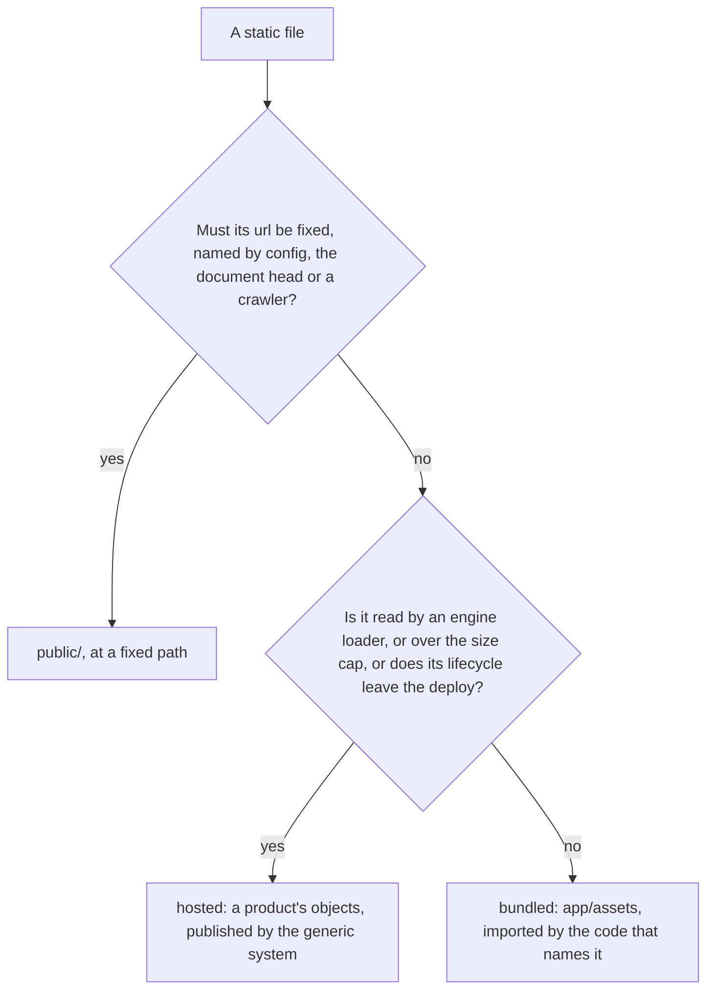
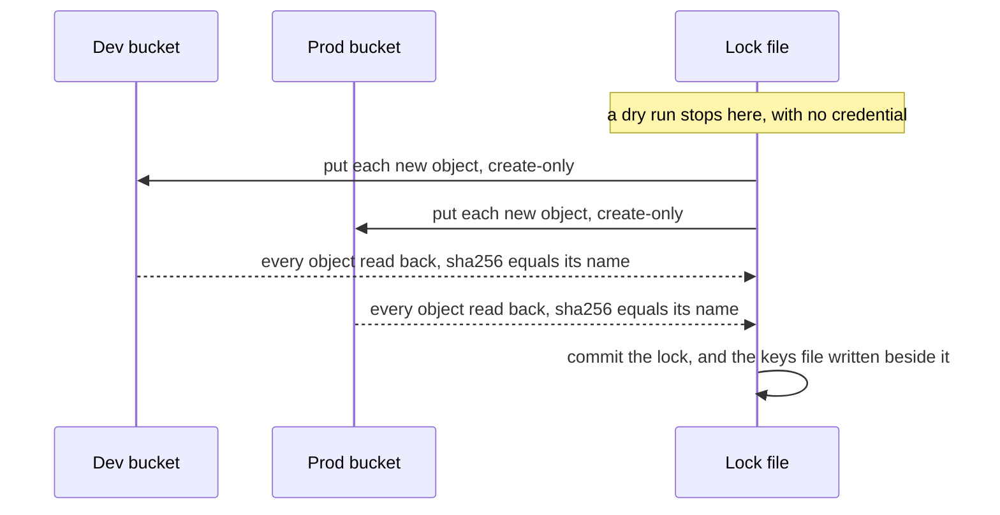

# Hosted assets

The generic system behind every large or engine-read file the app serves: content-addressed objects in a public R2 bucket, one committed lock per product, a typed key map the code imports, one url builder, one cache contract, one preloader, and one local mirror for development and tests. A product declares its assets. It never writes its own publish, lock, url or cache code.

Genshin's hosted game data is the first user of the machinery, and its code moves onto the generic system in this change, so one copy remains.

## Placement

Every static file is in one of three places. The place is decided by the file, not by habit.

- **Bundled** (`apps/web/app/assets/`): small files the UI imports, which must deploy atomically with the code that names them: icons, UI images and CSS fonts. The bundler fingerprints them, and a missing file fails the build.
- **Hosted** (R2 through the generic system): large or engine-loaded media, which is game textures, audio, tilemaps and tilesets, and the fonts a game engine loads; generated datasets; and any file over the bundle cap. A file whose lifecycle is independent of a deploy is hosted too, because a publish can replace it without a deploy.
- **Public** (`apps/web/public/`): only files that need a fixed url: `robots.txt`, `favicon.ico`, the manifest icons and `.well-known`.
- **User uploads** keep their own private and public buckets (`StorageBucket`), and this change does not touch them.

This replaces the two-place rule in the static-assets design. That design's rule was that a file is either bundled or in `public/`, and it had no hosted place, which is why the game's binaries were bundled.

### What "everything remote" would cost

The alternative is a default that hosts every static file and keeps git holding only code. The generic system makes that a declaration change if the owner ever wants it, so it is not rejected for being impossible. It is not the default because:

- **Version skew.** A deploy names a file by url. A remote file that changes independently of the deploy means a page built against one set of hashes can run against a lock published later, or the reverse. A bundled file is fingerprinted by the same build that names it, so the two cannot disagree.
- **Dev needs the network.** A remote icon makes `pnpm dev` and an offline session fail on a file the bundle would have carried.
- **Offline precache is lost.** The service worker precache takes the build's own files. Today the precache globs are `**/*.{js,css,html}` (`packages/unplugin-pwa-nuxt/src/services/buildServiceWorker.ts`), so bundled images are not precached either. Remote files are not in the precache at all. The offline gain of bundling images is therefore smaller than it looks, and the change does not claim it. Hosted objects are kept by the preloader's own cache, which is the offline story for hosted media.
- **A publish for every icon edit.** A two-line icon change would need a lock commit and a publish before it is visible.

## The generic system

| Piece                     | Source it generalises                                                                                             | What the generic form does                                                                                                                                         |
| :------------------------ | :---------------------------------------------------------------------------------------------------------------- | :----------------------------------------------------------------------------------------------------------------------------------------------------------------- |
| Content-addressed objects | genshin's `getGameDataHash`, which is the sha256 of the source's bytes                                            | the same hash for any bytes; a genshin record's hash is still the sha256 of its compact JSON, which is what its name already is                                    |
| Object path               | `getGameDataObjectPath(dataset, hash)`                                                                            | `<scope>/<sha256><extension>`, the extension derived from the content type                                                                                         |
| Lock                      | `gameDataLock.json`                                                                                               | one lock per product with `objects` and `indexes`, each entry a sha256, a byte count and a content type; the lock keeps genshin's index section as a generic index |
| Typed key map             | `gameDataKeys.ts`, written by `writeGameDataKeys`                                                                 | the same renderer, given a product's name and its keys                                                                                                             |
| Publish                   | `publishGameData`, `publishGameDataToBucket`, `planGameDataPublication`, `commitGameDataLock`                     | the same pipeline, with a product's scopes and its bucket                                                                                                          |
| Verify                    | `verifyGameData`, `verifyGameDataObject`                                                                          | the same check, run per product against its own lock                                                                                                               |
| Prune                     | `pruneGameData`                                                                                                   | the same retention rule, per product                                                                                                                               |
| Url builder               | `getGameDataObjectUrl`, `getGameDataBaseUrl`                                                                      | one builder taking a product's origin                                                                                                                              |
| Reader                    | `readGameData`, `readGameDataObject`                                                                              | one reader taking a key and the product's base url                                                                                                                 |
| Preloader                 | `useCharacterPackPreload`, `planCharacterPackDownload`, `downloadCharacterPackFiles`, `listHeldCharacterPackUrls` | the same plan, download and held-set, over a product's lock instead of Genshin's character packs                                                                   |
| Local mirror              | `GAME_DATA_LOCAL_BASE_URL` and the CI mirror keyed on the lock                                                    | the same mirror, keyed on each product's lock                                                                                                                      |

**`keyframe-store` is not the store layer.** Its store holds document lineages as zstd keyframes and deltas, which a PNG has none of, and a delta against a binary file saves nothing. Its one function the publish needs, `getContentAddress`, is the sha256 of a byte array, and the generic system imports that function and nothing else from the package. The genshin code already imports it, so one copy of the hash remains.

**Cloudflare already provides** the pieces that would otherwise be hand-rolled, and the design uses them rather than copying them:

- R2 custom domains serve a bucket's objects at the root of a hostname, with CORS headers when the bucket has a CORS policy (`https://developers.cloudflare.com/r2/buckets/cors/`). They are the edge cache's origin.
- Cache Rules set the edge cache behaviour of a zone's requests. The docs fetched for this design do not say whether they override an origin's `Cache-Control`; the verification task settles it.
- `@pulumi/cloudflare` 6.24.0 declares an `R2CustomDomain` resource (`r2customDomain.d.ts` in its install), so the custom domains are declared with the estate's own provider, not by hand.
- Workers static assets is not used. The app's bundle is served by the Worker, and a hosted object is not a Worker asset.
- Cloudflare Images is not used. The objects are published as they are, with no transform.

### Where it lives

A new workspace package, `hosted-assets`, holds the runtime: the lock's type, the key map's type, the url builder, the plan, the download, the held-set, the eviction and a headless preload with its progress and status, plus one Vue composable over it for the engines' scenes. A Vue composable belongs in a package that depends on Vue, and the package follows the headless-package shape of the other `*-headless` and engine packages.

The publish is in `scripts/src/services/hostedAssets/`, beside the R2 transport it already uses.

Rejected: putting the runtime in `@esposter/shared`. That package is read by the server, so a Cache Storage downloader and its types would enter server code that never runs them. Rejected: keeping the runtime inside `genshin-world`, because the dungeons game would then import a Genshin package. Rejected: a copy per product, which is the duplication this change removes.

## Lock and key map

Every artifact that can be derived from a committed lock is computed from it, never committed beside it. A key map, a url or a held-set is either computed at runtime from the lock or written at build time into a gitignored `generated/` folder, so there is nothing to drift and nothing to check.

One committed generated file remains, Genshin's `gameDataKeys.ts`. It is committed because the typecheck of the root reads the literal union of its keys (`GameDataKey`) from source, without running a build first, and the readers of `genshin-world` are typed against that union. Moving it to a build-time file would make the root typecheck depend on a build that CI does not run first. It keeps the existing generated-output mechanism: the publish writes it through `formatGeneratedSource`, and `getGameDataKeysSource.test.ts` holds its source to the lock. The dungeons key map is not committed: its literal union is generated into a gitignored file by the Nuxt prepare step of `apps/web`, which task 3.2 confirms runs at install.

## Publish

`hosted-assets publish` takes one product. The product declares its scopes, its source files and its bucket.

- **Dry run first.** `--dry-run` needs no credential and names what would change: the records, the keys added, removed or changed, and each changed object's path. A publish is not run without it, as the genshin-data skill already requires.
- **Dev, then prod.** Both buckets take each object before the lock is committed, and the lock is committed only after both. A failure in either bucket throws before the commit, so a committed lock never names an object a reader cannot fetch. This is the existing `publishGameData` order, kept.
- **Verification by hash.** Each object is read back from its bucket and its bytes are hashed. The hash must equal the sha256 in its name, and for an encoded object (Brotli or zstd) the decoded bytes are hashed, as the genshin verify already does. The check runs before the lock is committed, so the lock names only objects that were checked.
- **Scope and first publish.** The first publish of a product reads its files from the repository, and a repository file is removed only after each object's sha256 equals its file's. Later edits go through `pull`, which restores a working copy from the lock. A publish writes only under the product's declared scope prefixes.
- **Refusals.** A publish refuses, before any dry run writes its output:
  - a WAV file, since audio is published as MP3, which the lock names; the format ban is a banned-extension list, `.wav` first;
  - a file over `HOSTED_OBJECT_MAX_BYTES`, which is 16 MiB. The number is a policy: one request per object, and a bound on what a preload holds in memory. A 21 MB WAV is refused, and its MP3 is well under the cap. The owner may change the number;
  - a file whose source is not in its product's declared folder;
  - an object under a scope prefix another product's lock already declares;
  - an object whose extension has no content type in the product's declaration.

## Url builder and cache contract

### Object names and headers

- **Name.** `<scope>/<sha256><extension>`, where the sha256 is of the source's bytes, so the same bytes always have one name and a changed file is a new url. Nothing is ever purged, and an old url is never reused for new bytes. Genshin's record names are this shape already.
- **Cache-Control.** `public, max-age=31536000, immutable` on every hosted object, the value genshin's `GAME_DATA_CACHE_CONTROL` already sets.
- **Content-Type.** Set on each object at publish from its source's extension: `image/png`, `image/webp`, `audio/mpeg` for MP3, `font/woff2`, `application/json`, and `application/xml` for Tiled's `.tsx` and `.tmx` and for `tilemap.json`'s JSON as `application/json`. The worker route used `httpMetadata.contentType`, and the R2 custom domain serves the stored value, so a wrong type is a stored fact that the publish checks by reading it back.
- **Content-Encoding.** Compression is stored only where it helps. Brotli for text objects (JSON, XML, `.tsx`, `.tmx`): `Content-Encoding: br`, with the hash over the decoded bytes. None for PNG, WebP, MP3 and WOFF2, which are already compressed. Genshin's records keep `zstd`, which the publish already stores. Rationale: the Cloudflare docs for automatic compression name a default by plan (Brotli on Pro and Business, Gzip on Enterprise, Zstandard on Free), and the docs do not say whether the rule applies to a custom domain, so the stored encoding does not depend on the plan.
- **CORS.** A bucket CORS policy with `AllowedOrigins: *` and `AllowedMethods: GET, HEAD`, so R2 sets `Access-Control-Allow-Origin` on the custom domain's responses. This is the same public-read stance the route's `Access-Control-Allow-Origin: *` already takes. The docs confirm the custom domain returns CORS headers when the policy exists.

### Where the bytes are served from

Three options were compared. The owner's question was whether the edge caches today, and the docs answer it only in part.

What the docs fetched for this change state:

- Cloudflare caches by file extension, not by MIME type: PNG, WebP, MP3, WOFF2, PDF, SVG and ZST are in the default table, and JSON, XML, TMX, TSX and TXT are not. The page says "The Cloudflare CDN does not cache HTML or JSON by default."
- On an R2 custom domain, "By default, only certain file types are cached," and the page's note for caching every file is a Cache Everything rule.
- The Workers Cache API is per data center: "The Cache API is available globally but the contents of the cache do not replicate outside of the originating data center." Its `match()` "never sends a subrequest to the origin."
- The docs fetched do not say whether a response produced by a Worker is cached at the edge by default. The cache-status page returned 404, so the `cf-cache-status` values are read in the verification task, not taken from the docs. Both are verification steps below, not assumptions.

The three options:

**(a) The current Worker route plus the Cache API.** The Worker stays in the path. Each request invokes it, the Cache API answers a hit in the data center that stored it, and a miss reads R2. Costs: a Worker invocation on every request, a Class B read on every miss, and a per-colo cache that a cold data center fills again. Code lands in the asset route.

**(b) One shared R2 bucket behind a custom domain, with a Cache Rule.** The domain serves the bucket directly, so a hit never invokes a Worker or reads R2. The bucket is shared by every hosted product, and each product's scope is a key prefix, so one domain and one Cache Rule per environment serve them all, and a new product edits no infrastructure. The Cache Rule makes JSON, XML and TMX cacheable, since the default table excludes them.

**(c) The current route unchanged.** The route answers `Cache-Control: public, max-age=3600`, which is not immutable, so the browser re-asks after an hour and the edge's behaviour is undocumented. Every first request in each data center reaches the Worker and R2.

Decision: **(b)**.

Numbers, from the R2 pricing page: a Class B operation (GET or HEAD) is $0.36 per million beyond 10 million free each month, and a Class A operation (PUT or LIST) is $4.50 per million beyond 1 million. Egress through the custom domain is free. Each uncached object read is one Class B operation, and a Worker invocation pays for its own request. The dungeons game's first visit reads about 80 objects, and the Worker route pays for each of them in every data center's first visit, where the custom domain pays once per data center and then serves from the edge. The money at this scale is small. The reason is latency and invocation count, and the docs give no number for either, so the design does not claim one.

**The rejected record.** `openspec/rejected/infra/cdn-in-front-of-blob-storage/design.md` rejects "a CDN in front of that bucket". Its reason states the premise that "the assets hosts already answer from Cloudflare's edge, through the web Worker's asset route, and immutable caching answers a repeat visit with no request, so a cache layer in front of the Worker would only save the Worker's read of a first visit's few hundred kilobytes." Under the written-record rule, a record is overturned when materially new evidence invalidates it. Three facts do:

1. The premise that the hosts answer from the edge through the Worker is not documented. The docs fetched say Cloudflare caches by extension and that the Cache API is per data center, and they say nothing about a Worker's response being cached at the edge by default.
2. The saving was measured as "a first visit's few hundred kilobytes". The dungeons game's first visit is about 70 MB of media, and the game's own first visit is the one the preloader downloads in full, so the record's figure no longer describes the traffic.
3. The record's own last sentence says "adding one later changes only the hosts' configuration". That is the change (b) makes, and it touches no code path the record protects.

The new record names the rejected direction, "every public bucket served by the Worker route", as rejected, with these facts, so the old reason cannot return beside it. The rejected folder is deleted in this change, since its idea is superseded by (b) and this section keeps the reason.

The verification task reads `cf-cache-status` on the dev custom domain: the first request is a miss, the second a hit, and a hit reports no Worker invocation in the Worker's own logs. If the Cache Rule does not cache JSON or XML, the rule's edge TTL is the fix, and the design does not change.

### Hostnames and the route

One public bucket, `public-hosted-assets`, holds every hosted product's objects, and a product's scope is its key prefix, so an object is `<scope>/<sha256><extension>`. Genshin's scopes are its datasets, and its objects keep their names through the migration: a record stays `<dataset>/<hash>.json`. The dungeons game's scope is `dungeons`. A product's scopes are the prefixes its lock declares, and a publish refuses an object under a prefix another product's lock already declares, so no two products share one.

One custom domain per environment serves the bucket's root: `hosted.esposter.com` in production and `hosted.dev.esposter.com` in development. The bucket has one CORS policy, and the domain has one Cache Rule. A product declares its scope and its files and edits no infrastructure, so a new product is a declaration and not a Pulumi change.

The repository declares no certificate. Live, `*.esposter.com` is listed on the certificate that serves `www.esposter.com`, and `*.dev.esposter.com` on the one that serves `dev.esposter.com`, both issued by Google Trust Services WE1. Each hosted name is one label under one of those wildcards, so neither needs a certificate change. The verification task reads the live certificate once each domain attaches. Read live: `hosted.esposter.com` is served by the zone's universal `*.esposter.com` certificate, and `hosted.dev.esposter.com` by a certificate Cloudflare issued for that exact name when its domain attached, both Google Trust Services WE1, so the change added no certificate. The user hostname `assets.dev.esposter.com` has its own wildcard, `*.assets.dev.esposter.com`, which is not the one the hosted names use.

The asset route keeps serving the user buckets on `assets.esposter.com` and `assets.dev.esposter.com`. It stops serving the two game buckets, which are retired under Migration.

### Migration

Genshin's objects are copied server-side with `CopyObject` into `public-hosted-assets`, under the same names, so no object is downloaded. `CopyObject` is a Class A operation at $4.50 per million, so the copy costs a fraction of a cent. Every locked hash is then verified in the new bucket from the hosted origin before the origin switches. The app reads the hosted domain, and only then are `public-genshin-assets` and `public-dungeons-assets` emptied and their Pulumi resources removed. A tab still running an older bundle requests a deleted url after the emptying. The window is one deploy, and the owner accepted it.

## Load

### The preloader

The generic preloader takes a product's lock and its hosted origin, and it does what Genshin's `useCharacterPackPreload` does today, for every object the lock names:

1. read the lock, which is the product's committed lock;
2. list the Cache Storage entries under this product's scope prefixes, and compare each to the url the lock names for each object;
3. plan the objects the cache lacks, with their bytes;
4. fetch each with bounded concurrency and retries, storing the response in the cache, and report the bytes loaded as `downloadProgress`;
5. on success, call `onHeld` once, and delete the cache entries under this product's own scope prefixes that the lock does not name. The cache is shared by every product, so an entry under another product's prefix is neither read for eviction nor deleted;
6. on failure, keep the previous entries and report the failure with the paths that failed.

Genshin's composable's `downloadProgress`, `status` and `onHeld` keep their shape, so a loading bar takes the same prop for both products. The character-pack names move: `CHARACTER_PACK_CACHE_NAME` becomes the shared `hosted-assets` cache name, which every product uses, and `CHARACTER_PACK_DOWNLOAD_*` becomes the generic constants.

Each game preloads all of its own hosted objects behind its loading bar, before play. Nothing is preloaded app-wide, and nothing is fetched on demand mid-play. A game's preload begins when its route mounts and ends at its `onHeld`.

### How the engines read the held bytes

Three options, and the one that keeps `scene.load.image(key, url)` and `TextureLoader.load(url)` unchanged is the service worker:

- **Cache-first in the service worker (chosen).** The worker answers any request for a hosted origin's url from the product's cache when the cache holds it, and passes everything else to the network. Phaser's loader and three's `TextureLoader` request the same absolute urls they always requested, and the worker answers from the cache the preloader filled. The urls embed the hash, so a cached answer is never stale. The worker's route is one generic route over the origins the build knows, not one per product. Cost: a worker controls a page only after it activates, so `sw.ts` claims its clients on activation, and the change verifies this in a driven browser run.
- **The HTTP cache under immutable headers.** The preloader's own `fetch` stores each response in the HTTP cache, and the engines' later requests hit it. Rejected because the HTTP cache cannot be listed, so the plan cannot tell which objects are held, and the browser may evict an entry for space without telling the page. The planner then re-downloads files it believes are held, or believes nothing is held when they are gone.
- **Blob urls.** The preloader downloads the bytes, creates a `blob:` url for each, and hands the engines those urls. Rejected because every call site would take a map of blob urls instead of the key map's absolute urls, which changes each loader, and because the blob urls live in memory for one page only, so a reload downloads everything again.

The worker's route is declared next to the shared cache name, and it does not read any product's lock. The Cache Storage name is one constant for every product, `hosted-assets`, because a url already embeds the product's scope.

### CORS and CSP

- **Images.** Phaser's loader sets `crossOrigin` per file, and the loader's own default is `undefined`: `LoaderPlugin.js` gives "a file that doesn't have its own crossOrigin set" the loader's value, and the loader's value is `undefined` by default ("which is undefined by default" in the source). A texture from another origin needs `anonymous`, so the game sets `loader.setCORS('anonymous')` (`LoaderPlugin.js`, `setCORS`), and three's `TextureLoader` gets the same value on its image loader.
- **Audio and Tiled files** load by XHR (`AudioFile`, `XMLFile`, `JSONFile`), which needs the `Access-Control-Allow-Origin` header that the bucket's CORS policy sends.
- **Fonts.** Phaser's font loader builds a `FontFace` from the url, and `FontFace` fetches cross-origin with CORS. The app's CSP has no `font-src` today, so it falls back to `default-src`, which the module sets to `'self'` (`packages/nuxt-security-module`'s policy tests). `font-src` is declared with the hosted origins, and `img-src` already allows `https:`.
- **`media-src` and `connect-src`** list every hosted origin, since audio is fetched by XHR and the Tiled files are fetched the same way. The current `media-src` lists only `PUBLIC_ASSETS_BASE_URL`, which becomes one of the origins.

## Dev and tests

- **Development** reads the dev custom domain. A developer without the network loads the game's assets from the local mirror the tests use, which is one cache of the same objects.
- **Tests** read a local mirror, keyed on the product's lock. The mirror is filled from the bucket by the fill step, which runs once per lock, and the test setup serves it at a local base url, `HOSTED_ASSETS_LOCAL_BASE_URL`, the same way `GAME_DATA_LOCAL_BASE_URL` works today. A suite never reaches the network.
- **The mirror's fill** is the one step that reads every object of a lock, so the verification of Sync below runs there.

## Sync at the lowest cost

The rules, in order of preference:

1. **Construction first.** A derived artifact is computed from the lock or generated at build time into a gitignored folder. Nothing derived is committed, so nothing needs a check. The key map and the urls are such artifacts, and the genshin keys file is the one committed exception, for the reason in Lock and key map.
2. **One invariant needs a check: a committed lock names objects that exist in their bucket with the hash their key claims.** Once the sources have left git, the lock is the source of truth, so there is no source-to-lock check and no lock-to-disk check beyond the commit discipline the publish already has.

What checks the invariant today, for Genshin's lock:

- `pnpm -C scripts genshin:data verify`, a CLI command that fetches every object of the lock from both buckets anonymously and checks each hash. It is not run by any workflow. `grep` finds no `genshin:data verify` in `.github/workflows/CI.yaml` or `Deploy.yaml`.
- The mirror fill in `.github/workflows/build-packages.yaml` ("Fill the game data mirror"), which downloads the lock's objects into `~/.cache/workspace-data/content` when the cache keyed on the lock misses, on `main` and `ai/queue`. The check the fill makes on each object is one of the things the task below reads.
- The Coverage job restores that mirror, and the mirror's key is the lock's hash, so a changed lock always misses and always fills.

The change makes one generic check over every product's lock, and places it in the fill, which already reads every object:

- The change makes the fill verify the sha256 of each object it stores, with the publish's own `verifyGameDataObject`, and fail on a mismatch. An object the bucket lacks fails the fill too.
- Each product's fill runs over its own lock, so a product added later is covered by its declaration with nothing else edited.
- The fill reads the public origins and needs no credential. A HEAD would show that a name exists without checking its bytes, so the fill's GET is the check, and no HEAD-only pass is added.

**It gates the push's CI, and so the deploy.** The fill runs inside `build-packages`, which is part of CI for the commit on `main` or `ai/queue`, and the Deploy workflow runs only once CI's run on that commit succeeds (`pulumi-infra` skill, "Worker code"). A red fill therefore holds the deploy, which is the right gate: a deploy of a lock naming a missing object would ship pages that 404 on their first assets. It does not gate on every run, because a cache hit skips the fill, and a cache hit means the lock did not change. An object can go missing only by a manual delete, since `prune` keeps every object a lock names, and that delete is outside any push, so a run does not re-check it.

3. **Every other sync invariant stays a workspace test under `scripts/src/workspace`**, run by the Coverage job's single test run, with no new step. One test per invariant, sharing helpers. This change touches one of them: `scripts/src/workspace/pathLiterals.test.ts` holds the workflows to the mirror cache constant's path, and it moves with the constant, which gives the generic mirror its own name.

No new CI job is added. The fill is an existing step, and the check is added to it.

## Genshin: the binary audit

The owner's goal is that no game asset is committed to GitHub or bundled, and each game fetches its own assets behind its loading bar. The audit of `packages/genshin-world`, `packages/genshin-interface`, `packages/genshin-engine` and the Genshin files of `apps/web` finds 470 committed binary or data files totalling 110.9 MiB. The decision for each group:

| Group                                                                         | Files |     Size | Reader                                                                                        | Decision and reason                                                                                                                                                                                                                           |
| :---------------------------------------------------------------------------- | ----: | -------: | :-------------------------------------------------------------------------------------------- | :-------------------------------------------------------------------------------------------------------------------------------------------------------------------------------------------------------------------------------------------- |
| Parity references, `parity/references/*.webp`                                 |    36 | 50.5 MiB | the parity suites and `genshin:parity`                                                        | **stays**. Committed lossless beside its snapshot, by the recorded rule in the genshin-parity skill (`SKILL.md`: "a reference is committed to git as lossless WebP"; `references/approval.md`), and recoverability keeps it in the repository |
| Component references, `*.reference.webp` beside each screen                   |    58 | 43.3 MiB | the visual suites                                                                             | **stays**, the same rule                                                                                                                                                                                                                      |
| Visual snapshots, `components/**/Index*.png`                                  |   155 | 12.7 MiB | the visual suites, written by `approve` from the render                                       | **stays**. They are regression baselines the test suites read, and no app code imports them, so they are not in the bundle                                                                                                                    |
| Authored world files, `src/data/regions/*.json` and `src/data/catalogue.json` |    33 |  2.6 MiB | `genshin:data authored` publishes them; tests read them                                       | **stays** as authored source, which the genshin-data skill's settled list keeps ("Deleting an authored file once it is published" is rejected). The runtime reads the published copy through the lock, and no app code imports them           |
| Login music recordings, `src/data/login/recordings/*.ogg`                     |    21 |  0.9 MiB | the login's music, which Nitro serves from `publicAssets` (`apps/web/configuration/nitro.ts`) | **hosted**. It is the one Genshin file the app serves from its own deploy, so it moves to the product's lock, and the login's preloader fetches it with the rest of the game                                                                  |
| Other JSON in the engine and world packages                                   |   167 |  0.8 MiB | typed config the code imports, and fixtures the tests read                                    | **stays**. Each file is small typed configuration that the bundle carries as code, and a lock row per file costs more than the bytes                                                                                                          |
| The lock, `src/generated/gameDataLock.json`, and the generated keys beside it |     2 |  0.1 MiB | the readers                                                                                   | **stays**. The lock is what the hosting names                                                                                                                                                                                                 |
| `apps/web/app/assets/icons/genshin.svg`                                       |     1 |  0.3 KiB | the app's icon                                                                                | **stays**, bundled as a small UI icon                                                                                                                                                                                                         |
| `apps/web/server/services/genshin/saveGenshin.bench.json`                     |     1 |  2.8 KiB | a bench                                                                                       | **stays**, a test fixture                                                                                                                                                                                                                     |

`genshin-engine` has no binaries, only JSON, so it has no migrating group. The audit finds that the bundle already holds no Genshin texture or audio: the components import none of the PNGs, since the visual snapshots are read by tests only. The one migrating group is the login recordings, plus the game's preload moving from the character packs to every object of the lock.

Tasks per migrating group are in `tasks.md`.

## The enforcer

The placement rule has two checks, and both extend the test the other agent is adding for WAV files and files over 2 MiB, rather than restating it:

- **The bundle check** fails any file under `apps/web/app/assets/` that is over 2 MiB or has a banned extension, which is `.wav` first. A file the bundle cannot hold is hosted instead.
- **The hosted check** is a separate test over the engine loaders. It fails when a loader module imports a media file (`.png`, `.webp`, `.mp3`, `.ogg`, `.woff2`, `.tsx`, `.tmx`, `.json` of a map) by its path, since such a file is read by url from the product's key map. It also fails when a key a loader names has no entry in the product's lock.

Each check is one test, sharing the file-walking helper the bundle check uses. Neither runs a new CI step: both are workspace tests in the Coverage job's single run.

## Notes

- The character packs' preloader moves as it is, and its tests move with it. The one behaviour that is new is the eviction of entries under the product's own scope prefixes that its lock no longer names, which Genshin's packs never had: their cache kept older copies forever.
- Genshin's game data is about 100 MB, the figure the rejected static-data record gives. A game's preload now covers every object of the lock, so the first visit to Genshin downloads that set behind the opening's bar. The change measures the lock's total in a task before the preload is turned on for records.
- Nothing in this change is dated. The Cloudflare docs quoted here are the pages as fetched for the change.

## Rejected

- **Everything remote, git holding only code.** Rejected as the default for the version-skew, dev-network, offline-precache and per-icon-publish costs above. The system makes it a declaration if the owner later wants it.
- **A new CI job for the lock check.** Rejected: the fill already reads every object, and a job would add a runner and a wait for a check the fill makes.
- **A per-product copy of the publish, lock or preloader.** Rejected: it is the duplication this change removes.
- **`keyframe-store` as the object store.** Rejected for the reason under The generic system: its lineage store has no use for a single binary object.
- **`@esposter/shared` as the home of the runtime.** Rejected for the reason under Where it lives.
- **The Worker route with the Cache API as the edge (a).** Rejected for the invocation and per-data-center costs above.
- **The current route unchanged (c).** Rejected: `max-age=3600` is not immutable, and the edge's behaviour for it is undocumented.
- **The HTTP cache as the held store.** Rejected: it cannot be listed, so the plan cannot match its contents.
- **Blob urls for the engines.** Rejected: every loader's call site changes, and the bytes do not outlive the page.
- **Every public bucket served by the Worker route.** Rejected by this change, with the facts under Where the bytes are served from.
- **Per-product buckets and custom domains.** Rejected: each product would need its own bucket, custom domain, CORS policy and Cache Rule, a Pulumi change for every new product, which breaks the rule that a product only declares its assets. One bucket and one domain per environment, with each product's scope as a key prefix, need no infrastructure change for a new product.

## Key files

| File                                                                          | Role                                                                                        |
| :---------------------------------------------------------------------------- | :------------------------------------------------------------------------------------------ |
| `packages/db-schema/src/models/storage/StorageBucket.ts`                      | the public buckets a product's origin names                                                 |
| `apps/infra/src/cloudflare/resources/r2Buckets/`                              | the buckets; the shared hosted bucket and its custom domain are declared beside them        |
| `apps/web/server/routes/assets/[bucket]/[...key].get.ts`                      | serves the user buckets only, once the game buckets are off the route                       |
| `apps/web/configuration/security.ts`                                          | the `connect-src`, `font-src`, `img-src` and `media-src` directives over the hosted origins |
| `apps/web/service-worker/sw.ts`                                               | the cache-first route over the hosted origins, and the claim on activation                  |
| `packages/unplugin-pwa-nuxt/src/services/buildServiceWorker.ts`               | the precache globs, which `**/*.{js,css,html}` keeps off hosted objects                     |
| `scripts/src/services/gameData/publishGameData.ts`                            | the publish pipeline the generic publish generalises                                        |
| `scripts/src/services/gameData/verifyGameDataObject.ts`                       | the per-object hash check the fill reuses                                                   |
| `scripts/src/services/gameData/writeGameDataKeys.ts`                          | the keys renderer the generic renderer generalises                                          |
| `scripts/src/services/gameData/getGameDataKeysSource.ts`                      | the keys source, and the one committed generated file this change keeps                     |
| `packages/genshin-world/src/generated/gameDataLock.json`                      | Genshin's lock, which the generic lock format replaces in place                             |
| `packages/genshin-world/src/services/data/readGameData.ts`                    | Genshin's reader, which becomes the generic reader                                          |
| `packages/genshin-world/src/composables/useCharacterPackPreload.ts`           | the preloader the generic composable generalises                                            |
| `packages/genshin-world/src/services/character/planCharacterPackDownload.ts`  | the plan the generic plan generalises                                                       |
| `packages/genshin-world/src/services/character/downloadCharacterPackFiles.ts` | the download the generic download generalises                                               |
| `packages/genshin-world/src/services/character/listHeldCharacterPackUrls.ts`  | the held-set the generic held-set generalises                                               |
| `packages/genshin-world/src/services/character/constants.ts`                  | the cache name and the download constants that move to the generic system                   |
| `packages/genshin-world/src/services/login/constants.ts`                      | the login recordings' directory, which becomes a hosted origin                              |
| `apps/web/configuration/nitro.ts`                                             | the `publicAssets` mount of the login recordings, removed                                   |
| `.github/workflows/build-packages.yaml`                                       | the mirror fill, which gains the per-object hash check                                      |
| `.github/workflows/CI.yaml`                                                   | the mirror restore, keyed on the lock                                                       |
| `scripts/src/workspace/pathLiterals.test.ts`                                  | holds the workflows to the mirror cache constant's path                                     |
| `openspec/specs/architecture/static-assets/design.md`                         | the two-place rule this design replaces                                                     |
| `openspec/specs/architecture/generated-artifacts/design.md`                   | the table row for `pnpm phaser:gen`, removed                                                |
| `openspec/rejected/infra/cdn-in-front-of-blob-storage/design.md`              | the superseded rejection, deleted                                                           |
