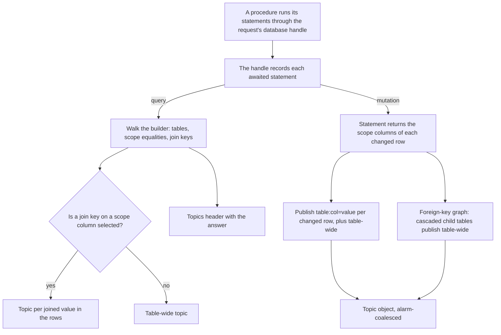

# Design

## Context

Every query and mutation names its live topics through `getTopicsProcedure` (`apps/web/server/trpc/procedure/getTopicsProcedure.ts`). The router files carry about 170 such declarations across 35 files. A query's topics are what its answer was read from; a mutation's are what it changed; the Topic object fans a publish out to the users watching it. The mechanism is described in the [client-data design](../../specs/architecture/client-data/design.md) under "Live reads" and in the [cloudflare-services design](../../specs/architecture/cloudflare-services/design.md).

A declaration is written once per procedure and drifts from the query it describes. The bookmark dock reads bookmarks joined to resources and to room memberships, and declares only `Bookmark:<user>`, so a change to a resource or to a membership never reaches it. The invite landing page reads its room's member count and watches only the viewer's own room list, so another member's join does not refresh the count. Each gap was fixed by hand, and each fix added an assertion that a write publishes a named topic. Those assertions only pin the list they name.

The owner's goal is that this class of gap, and the per-procedure tests that guard it, disappear. The declaration should become one per table, and the mechanism should derive each procedure's topics from the query it runs.

## Decision

Live topics are read-set and write-set tracking over the Drizzle queries the procedures run. Five parts:

1. **One declaration per table.** A table's Drizzle definition names its scope columns: the columns a topic is keyed by, such as `userId`, `roomId` or `postId`. A column whose value is a bearer secret is marked secret, and its topic carries a digest instead of the value. This declaration is the only one. Its count grows with tables, not with procedures.
2. **Reads.** The request's database handle records each statement its procedure awaits. The walker reads that statement's builder: the table it reads, its joins, its conditions and its subqueries. Each equality of a scope column with a value names one topic, `table:col=value`. A join on a scope column names the joined rows by the join's own key values, when the statement selects that key. A table with neither gets its table-wide topic, `table:*`.
3. **Writes.** Inserts, updates, deletes and upserts return the scope columns of each row they change, so the publish set is `table:col=value` for each changed row plus `table:*`. A statement in `db.batch` is captured the same way.
4. **Cascades.** A delete also changes the child rows its foreign keys cascade to, and `RETURNING` does not report them. The foreign-key graph names the cascading child tables, and each one publishes its table-wide topic.
5. **`getTopicsProcedure` and its `getTopics` callbacks disappear.** The middleware collects the request's read set for a query, written into the topics header as now, and its write set for a mutation, published once the resolver returns as now.

## Spike evidence

The spike ran in a scratch worktree and committed nothing to the app. It used the schema's real migrations and drizzle's D1 driver over an in-memory SQLite that emulates the D1 binding (the same SQLite engine family); it did not use D1 or Miniflare. Each of the five reads was copied verbatim from its router, with the same real helper modules imported, and run against seeded data where a list has 50 rows. The counts below are measured at the change's base commit.

### 1. Read sets come from the builders, not from the emitted SQL

- A select builder keeps its parts in `config` (table, joins, where, having, set operators, fields), and its conditions are drizzle SQL chunk trees. `eq`, `inArray` and `isNull` each leave a column, an operator string and a bound value in that tree. The walker reads the tree. It extracted the scope equalities, join keys, null checks, correlated subqueries and set-operator operands of all five reads, and the aliased tables of relational queries (drizzle names them `d0`, `d1`, which map back to their tables).
- The hooks differ in what they see. Drizzle's logger sees only the SQL text and its parameters, so it cannot name columns. Drizzle's cache seam, a `Cache` whose strategy is `all`, receives each select's tables and each single write's tables. It does not receive writes in `db.batch`, and it does not receive raw SQL. The walker needs the builder itself, which the request's handle reaches by wrapping the builder returned to the procedure. The spike recorded awaited builders through a global hook on drizzle's `QueryPromise`; production must not patch a library class, so the handle is a request-scoped proxy whose `then` records the builder it wraps. Task 1.3 proves that against the five reads.
- The spike did not build a parser for the emitted SQL. It would re-derive what the builder already holds, from `?` placeholders mapped to parameters by position, and it would still not know which columns are scope columns. See the alternatives.

### 2. The five reads, inferred against declared

Topic counts per read. "Table" is the table-wide policy for every unscoped table. "Row" is the row policy, which names joined rows by their values. The declared count is today's, and the sidebar's includes one topic per listed room.

| Read                                        | Declared today      | Table policy | Row policy | Row policy by table                                                     |
| ------------------------------------------- | ------------------- | ------------ | ---------- | ----------------------------------------------------------------------- |
| `readBookmarks` (dock)                      | 1 (`Bookmark:user`) | 4            | 62         | bookmarks 1, room memberships 1, resources 30, resource publications 30 |
| `readPosts` (feed)                          | 1 (`Feed:posts`)    | 3            | 3          | post likes 1, blocks 1, posts (table-wide) 1                            |
| `readRooms` (sidebar, 50 rooms)             | 51                  | 3            | 52         | room memberships 1, rooms 50, users 1                                   |
| `searchUsers` (name search, `staticReason`) | 0, never watched    | 3            | 52         | blocks 2, users 50                                                      |
| `readInvite` (landing page)                 | 1 (`RoomList:user`) | 7            | 6          | invites 1, bans 1, rooms 1, users 1, room memberships 2                 |

The gaps are topics the read depends on that its declared list does not name:

- **`readBookmarks`**: changes to the bookmarked resources and to the viewer's room memberships. This is the gap the owner named. The table policy covers both (`resources:*`, `resourcePublications:*`, the membership topic); the row policy covers them per row.
- **`readInvite`**: the member count (room memberships of the invite's room, from any member) and the viewer's own bans. Another member's join publishes the room's topic, which this page does not watch.
- **`readPosts`**: the blocks the feed filters by. Today they reach the feed only because `createBlock` and `deleteBlock` publish `Feed:posts` by hand (`apps/web/server/trpc/routers/block.ts`). The inferred set makes that hand publish unnecessary. The viewer's own likes are named by the read; whether the like write's topics name them was not checked.
- **`readRooms`**: a direct message's partner name, which the declared list does not name. The table policy covers it with `users:*`.

Findings that limit the design:

- **A join's values must come from the join's own key.** The row policy, asked to name the direct-message partner from the rows, took the value of a column with the same name on the room (its owner's `userId`) and produced `users:id=viewer`, which is wrong. The sidebar's rows do not carry the partner's id. The wrapper must select the join key the walker found when the statement does not, or the join falls back to table-wide. Task 1.2 pins this read.
- **A bearer secret must not be a topic name.** `readInvite` looks an invite up by its id, which is the secret the link carries; its own comment says no topic names it. An inferred `invites:id=<token>` would travel in the topics header and in watch frames. The scope declaration marks that column secret, and its topic carries a digest. The spike's digest form is `sha256:` and twelve hex characters.
- **A table-wide topic fans out.** `users:*` would fire on every write to the users table. The storage ledger moves `storageBytesUsed` on that row, so every upload would refetch every sidebar that lists a direct message. The migration measures each table's fan-out before its table policy is accepted (task 6.1).
- **A cascade is not in `RETURNING`.** Deleting one resource removed one bookmark, and the statement's `RETURNING` reported only the resource. The foreign-key graph names twelve child tables that cascade from `resources`, bookmarks among them. The write set adds their table-wide topics.
- **Batched writes return their rows.** Each statement in `db.batch` returned its `RETURNING` rows in the spike, so batched writes capture their scope values. The cache seam does not see them, so the wrapper cannot rely on it.
- **Writes outside D1.** The inventory found no raw SQL writes through the D1 handle in `apps/web/server`. Durable Object SQLite writes use drizzle's durable-sqlite builders and take the same wrapper inside the object, where a builder write sits at the call, room and user objects. Durable Object storage writes (`ctx.storage.put` and `delete`, nine sites) hold keys, not topic-watched data, and keep their typed events. R2 writes (two direct puts and fourteen helper sites) publish their blob key, as the editor section explains. KV is not used.
- **`staticReason` reads stay as they are.** `searchUsers` is a name search. A table-wide users topic would make it live and bring the fan-out above, so its declaration that it is not watched is kept as a classification, not a topic list.

### 3. Cost

Measured on the host, not in a Worker. The figures are the baseline the migration measures against.

- **Page load** (dock, sidebar and feed together), the distinct topics a page subscribes: 53 declared; 9 under the table policy; 116 under the row policy.
- **A bookmark toggle** (one row with a resource, scope values for the user and the resource): 1 publish declared (`Bookmark:user`); 3 inferred (two scope topics and the table-wide topic).
- **A room rename**: 2 inferred (the room's id topic and its table-wide topic).
- **A resource delete**: the resource's topics plus the table-wide topic of each of the twelve cascading child tables.
- **The walk's CPU**, averaged over 200 repeats on the host, building a read's topic set on each call: bookmarks 0.43 ms, sidebar 0.84 ms, feed 0.93 ms.

The row policy multiplies subscriptions by a page's size: 62 for the dock, against 1 declared. The table policy multiplies fan-out instead. Neither is free, and the trade is decided per join from the migration's measurements, not from this table.

### 4. Client re-reads a watch would replace (code reading at the base commit)

These two cases were found by reading the client, not by the spike's runs. Each is a second request the client makes because a read is not watched, and the inferred design removes both.

- **The `updateUserToRoom` event.** The user event carries the viewer's changed membership row, but a member's display name is a server row the event does not carry. The subscribable (`apps/web/app/composables/message/subscribables/useUserToRoomSubscribables.ts`) therefore re-reads `room.readUsersByIds` for that member. The event is sent by the mention-count notify in the room object, by `notifyMentionCounts`, by the last-read write in `createUserMessage`, by the job that takes back erased mention counts (`apps/jobs/src/services/account/takeBackErasedMentionCounts.ts`), and by the mention-count clear. Each of those writes changes a `usersToRooms` row. The inferred write set publishes `usersToRooms:roomId=<room>` and `usersToRooms:userId=<user>` for it, and the member store's read names `usersToRooms:roomId=<room>` through its room-scoped membership join. The store refreshes from the write, and the event's refresh role goes.
- **The `joinRoom` participant re-read.** The direct-message list reads its page, then calls `readParticipants` as a second request (`apps/web/app/composables/message/room/useReadDirectMessages.ts`). Its participants are a separate procedure's read, so the list's own watch never collects them, and the `joinRoom` handler (`apps/web/app/composables/message/events/useRoomListEvents.ts`) re-reads the same participant read. The participant read declares one `Room:<id>` topic per input room, and folded into the list by hand it would be a topic per row.

## Nested reads and writes outside a request

A read awaited inside another read runs through the same request handle, so its statements are recorded in the outer procedure's read set. The walker names each nested statement's topics by the same rules as any other statement: a scope equality names its table exactly, and a join on a scope column names the rows the statements return. For the direct-message participants, the nested statements add two kinds of topic. The viewer's own memberships are one scope topic, `usersToRooms:userId=<viewer>`, for the whole list. The participants' membership and user rows are joined by each direct message's room id, which is one topic per direct message the list already names, so the nested read adds no topic per participant.

A client that awaits a second procedure after the first is a separate request with its own read set, and that is why the two re-reads above exist. The migration folds each such second read into its procedure's resolver, so the list's response carries its participants, and it deletes the client's re-read.

The write capture belongs to the database handle, not to the request. A queue job or a Durable Object's SQLite writes through the same handle wrapper, so each handle that writes needs the wrapper: the web context, the jobs' handle, and each object's drizzle handle. A write through a handle that is not wrapped publishes nothing. The migration installs the wrapper on every such handle before any router's declarations are deleted.

## Join and table policy

A scope equality names its table exactly. A table with no scope equality but a join on one of its scope columns is named by the joined rows' key values, where the statement selects the key; where it does not, the table is named table-wide. A table with neither is named table-wide. A table's declaration may mark a join table-wide when its measured fan-out says so, which is the decision point task 6.1 produces.

## Alternatives considered

- **Keep hand declaration and fix each gap.** This is the status quo. It was lost because the gaps recur, as the commit history shows, and each fix adds a test that only pins the list it names.
- **Table-level topics only.** Cheap: a page subscribes 9 topics against 116. It was lost as the only policy because a joined table's table-wide topic fans out to every reader of the list, as the users and resources examples show. It stays as the fallback.
- **Row-level topics only.** Exact, but a dock and a sidebar subscribe a topic per listed row, and a join whose key is not selected cannot be named at all. It was lost as the only policy, and it stays for joins whose key is selected.
- **Parsing the emitted SQL.** The statement's text carries `?` placeholders that map to parameters by position, and drizzle's aliases, subqueries and set operators would all need re-deriving. Parsing would also not know which columns are scope columns. It was lost because the builder already holds the structure and the parameters' columns.
- **Row-delta subscriptions, in the style of SpacetimeDB.** Here the server keeps each subscribed query's predicate, and each write evaluates its changed rows against those predicates and pushes row deltas, with no refetch. On this stack it would take four things. The predicates would live in the Topic objects' or the user objects' storage, compiled from the same builder walk. Every write would evaluate its changed rows against every predicate on its table, so the cost per write grows with the subscriptions. Each subscriber's result set would be held in storage so a delta can be applied, which for a 50-row list is 50 stored rows per subscriber. And every client store would have to apply deltas, where today the stores apply by id for some lists and refetch the rest. What it saves is the refetch, one indexed D1 read per invalidation per watcher, which the stores already make and which is cheap. It was not chosen for the general case. It is deferred for named hot lists: the feed is the first candidate, because its table-wide topic is the one every post write fans out to. The revisit trigger is the migration's measurement (task 6.1) showing one list's refetch reads, summed over its watchers, dominating the page's cost. The threshold is set from that measurement, not now.
- **A topic per row for the feed.** Already rejected in the client-data design, on its cost. The row policy above repeats that cost only for joins whose key is selected, which is why the table policy stays the default.

## Editor content

The open editor's content is read from R2 by its blob key (`readResourceContent`, and `reloadResource` on the client). It is not watched today: a watch would refetch the whole document on every publish and re-apply it to the editor. The editor stays live through the `saveResourceContent` typed event. The event-class refactor (commit `247d012944`) left that event out of its class map on purpose, as a finding: the event makes its subscribers re-read content through a raw read that no topic watches.

Under the inferred design the content has a topic: the blob key that holds the document. Every write to it publishes the key, whether it is `saveResourceContent`, `saveResourceContentDelta`, `saveStagedResourceContent`, or an R2 put or delete of that key. A watch on the key would refetch the whole document. The refetch guard avoids that: the watch first reads the resource row, which holds `contentHash` and `contentVersion` in D1, and it fetches the blob only when the hash differs from the one the editor last saved or applied. The editor's own save then finds the same hash and applies nothing. With the guard, the save event carries nothing the watch does not, and `saveResourceContent`'s event can be removed.

Until the guard ships, the content read is a documented exception: its topic is published, its watch is carried by the typed event, and the client-data design records it. Task 4.1 either builds the guard and removes the event, or keeps the exception and records it. It does not leave both mechanisms running for the same content.

## Maintenance and runtime cost

Maintenance is O(1) in the number of procedures: one scope declaration per table, no declaration per procedure, and no topic assertion per procedure. The router-wide coverage test (task 2.2) replaces the per-procedure assertions: every query procedure's read set must cover every table its query touches, and every write's publish set must match the read sets of the queries it changes.

Runtime cost is not assumed. The walk, the subscriptions per page, the publishes per write and the fan-out of each table-wide topic are measured in a deployed Worker against the baseline above (task 6.1), and the join and table policies are decided from those measurements. Until the measurement, the numbers in this design are the only evidence.

## Migration

The router migration is one sequence of commits, pushed together, so no build runs the inferred mechanism with some routers still declaring. Each router's commit deletes its own declarations and its hand topic assertions and adds its coverage test. The sequence ends with the cutover, which deletes `getTopicsProcedure`, the `getTopics` callbacks and `meta.topics`. The `staticReason` classification stays, as a classification and not a topic list.

Before the sequence starts, the wrapper, the walker and the write capture are built and tested against the five reads and the coverage test, with the runtime unchanged.

## Key files

| Path                                                                           | Role                                                                |
| ------------------------------------------------------------------------------ | ------------------------------------------------------------------- |
| `apps/web/server/trpc/procedure/getTopicsProcedure.ts`                         | The declaration middleware, deleted by the cutover                  |
| `apps/web/server/models/trpc/Meta.ts`                                          | The `topics` meta flag the declaration sets, deleted by the cutover |
| `apps/web/server/trpc/context.ts`                                              | The request context whose `db` the request's handle wraps           |
| `apps/web/server/db/index.ts`                                                  | The D1 handle the context shares                                    |
| `packages/db-schema/src/sqliteTable.ts`                                        | The table definition that carries the scope declaration             |
| `packages/db-schema/src/models/realtime/Topic.ts`                              | The topic name type, which gains inferred names                     |
| `packages/db-schema/src/services/realtime/getTopic.ts`                         | The hand-written topic constructor, deleted with the declarations   |
| `packages/db/src/services/realtime/publishTopics.ts`                           | The publish the write set feeds                                     |
| `apps/web/server/services/realtime/publishTopics.ts`                           | The web app's binding of that publish                               |
| `apps/realtime/src/durableObjects/TopicObject.ts`                              | The Topic object the publishes fan out through                      |
| `packages/db-schema/src/schema/app/bookmarksInApp.ts`                          | A scope declaration case: the bookmark dock's table                 |
| `apps/web/server/trpc/routers/bookmark.ts`                                     | The dock read the spike measured                                    |
| `apps/web/server/trpc/routers/post.ts`                                         | The feed read the spike measured                                    |
| `apps/web/server/trpc/routers/room/index.ts`                                   | The sidebar read the spike measured                                 |
| `apps/web/server/trpc/routers/invite.ts`                                       | The landing page read whose member count the spike found unwatched  |
| `apps/web/server/trpc/routers/friend.ts`                                       | The name search declared `staticReason`                             |
| `apps/web/server/trpc/routers/block.ts`                                        | The block write that publishes the feed by hand                     |
| `apps/web/server/trpc/procedure/resource/createResourceProcedures.ts`          | The resource content reads and saves the editor section covers      |
| `apps/web/app/composables/message/subscribables/useUserToRoomSubscribables.ts` | The `updateUserToRoom` handler whose member re-read goes            |
| `apps/web/app/composables/message/events/useRoomListEvents.ts`                 | The `joinRoom` handler whose participant re-read goes               |
| `apps/web/app/composables/message/room/useReadDirectMessages.ts`               | The direct-message list's second request, folded into its procedure |
| `apps/web/server/trpc/routers/room/directMessage.ts`                           | The participant read, folded into the direct-message list procedure |
| `apps/jobs/src/services/account/takeBackErasedMentionCounts.ts`                | A job write to `usersToRooms` that needs the wrapper on its handle  |

## Sources

- The live-query mechanism and its declarations: the [client-data design](../../specs/architecture/client-data/design.md) and the [cloudflare-services design](../../specs/architecture/cloudflare-services/design.md).
- The event-class refactor that made the typed event the editor's refresh: commit `247d012944`.
- The row-delta subscription model in the alternatives is the owner's description of SpacetimeDB-style subscriptions, taken from the change's brief. Its details were not checked against SpacetimeDB's own documentation, and the alternative's cost claims are reasoned from this stack, not measured.
