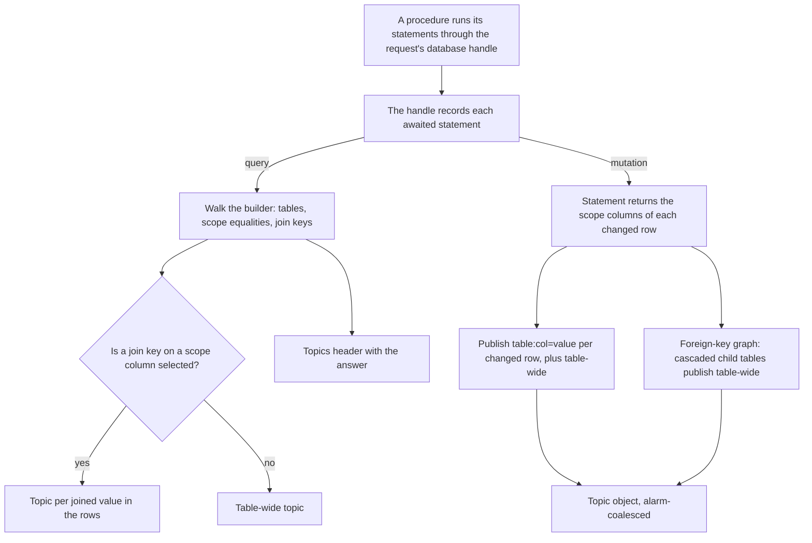

# Design

## Context

Every query and mutation names its live topics through `getTopicsProcedure` (`apps/web/server/trpc/procedure/getTopicsProcedure.ts`). The router files carry about 170 such declarations across 35 files. A query's topics are what its answer was read from; a mutation's are what it changed; the Topic object fans a publish out to the users watching it. The mechanism is described in the [client-data design](../../specs/architecture/client-data/design.md) under "Live reads" and in the [cloudflare-services design](../../specs/architecture/cloudflare-services/design.md).

A declaration is written once per procedure and drifts from the query it describes. The bookmark dock reads bookmarks joined to resources and to room memberships, and declares only `Bookmark:<user>`, so a change to a resource or to a membership never reaches it. The invite landing page reads its room's member count and watches only the viewer's own room list, so another member's join does not refresh the count. Each gap was fixed by hand, and each fix added an assertion that a write publishes a named topic. Those assertions only pin the list they name.

The owner's goal is that this class of gap, and the per-procedure tests that guard it, disappear. The declaration should become one per table, and the mechanism should derive each procedure's topics from the query it runs.

## Decision

Live topics are read-set and write-set tracking over the Drizzle queries the procedures run. Five parts:

1. **One declaration per table.** A table's Drizzle definition names its scope columns: the columns a topic is keyed by, such as `userId`, `roomId` or `postId`. A column whose value is a bearer secret is marked secret, and its topic carries a digest instead of the value. This declaration is the only one. Its count grows with tables, not with procedures.
2. **Reads.** The request's database handle records each statement its procedure awaits. The walker reads that statement's builder: the table it reads, its joins, its conditions and its subqueries. Each equality of a scope column with a value names one topic, `table:col=value`. A join on a scope column names the joined rows by the join's own key values, when the statement selects that key. A table with neither gets its table-wide topic, `table:*`. A column is never part of a topic's name: each topic carries the columns the statement references in its table (see Columns), and a column the statement does not reference is not among them.
3. **Writes.** Inserts, updates, deletes and upserts return the scope columns of each row they change, so the publish set is `table:col=value` for each changed row, and `table:*` for the table. Each topic a write publishes carries the columns it changed: an update publishes the columns it sets and its `$onUpdate` columns, and an insert or a delete publishes no column list, since it changes which rows the table holds, a row-set change that every watch of the topic hears. A read of a table that references no column of an update's SET therefore hears of that update on no topic. An update that moves rows out of a value, and a delete, also read the rows they change before they run, so the values those rows held before are published too. A statement in `db.batch` is captured the same way.
4. **Cascades.** A delete also changes the child rows its foreign keys cascade to, and `RETURNING` does not report them. The foreign-key graph names the cascading child tables, each of which publishes its table-wide topic, and the rows each child holds are read before the delete and named by their scope values, at every depth. The reads are described under Before-image reads.
5. **`getTopicsProcedure` and its `getTopics` callbacks disappear.** The middleware collects the request's read set for a query, written into the topics header as now, and its write set for a mutation, published once the resolver returns as now.



## Columns

A column is metadata of a watch and of a publish, not part of a topic's name. A topic is `table:*` or `table:col=value` (the schema refuses a `table.col` name). What a watch reads and what a publish changes is carried beside the topic, as a `ColumnTopic` (`{ columns?, topic }`):

- **A watch's columns** are the columns the read's statement references in the topic's table, read from its quoted names. A column is named by its quoted name after one of the table's own qualifiers (its name, or the alias the statement gives it). Drizzle leaves a column bare in a group that selects from one table alone, so a bare quoted name belongs to the table that group reads from, and to every table the statement reads when the group reads from several or none. A bare name in a subquery over one table is therefore not another table's reference: the publication subquery of the bookmark dock names its own columns, not the bookmarks' or the resources'. A raw fragment names its columns in bare text, so when a bare word is a column of any table, the watch names every column of the table. A statement that references no column names an empty list, so a count is woken by a row-set change alone. A kind or a blob topic has no columns to name, so it names none (`undefined`).
- **A publish's columns** are the columns the write changes: an update's SET columns and its `$onUpdate` columns, on every topic the update publishes. An insert or a delete publishes `undefined`, the row-set change.
- **The wake rule** (`checkWakes`): a publish wakes a watch of the same topic when either side has no column list, or the two lists share a column. A row-set change therefore wakes every watch of its topic, and an update wakes a watch only through a column the watch reads.
- **The Topic object** stores each subscriber's columns at subscribe, as the union of the columns that subscriber has subscribed with (`null` naming every column), and the union of the columns the publishes since its alarm changed. The alarm wakes each subscriber whose stored columns meet the pending columns, so a burst of publishes is told together and reaches each subscriber whose columns any of them changed. A late subscription (one whose read began before the last publish) is told at once, whatever columns it reads: the object keeps no history of publishes to match against the read's start, so that case costs one refetch of a read a publish raced.
- **The user object** passes each watch's columns to its topics' `subscribe`. A tab's own watches are not filtered by column: a person's tabs share one subscriber per topic, so a publish that wakes the person invalidates each tab watching the topic. The fan-out is per person, not per tab, and its cost is measured with the rest of the fan-out (task 6.1).
- **The wire.** A watch frame names each topic with its columns. A query's answer names its topics in the topics header, each with its columns after a separator no encoded topic holds, and a list naming no column keeps that separator, so an empty list and no list are told apart. The client holds each topic once with the union of the columns its queries read, and sends a watch again when that union widens.
- **Coverage.** The app-wide coverage check wakes a read by the same rule (`getWokenTopics`), so its pair filter and its wake-up check agree with the Topic object.

The columns a statement references are the golden read sets' record: `readSets.test.ts` and the db goldens (`getReadTopics.test.ts`, `getWriteTopics.test.ts`) name each topic and its columns for the five reads and the writes they test.

## Spike evidence

The spike ran in a scratch worktree and committed nothing to the app. It used the schema's real migrations and drizzle's D1 driver over an in-memory SQLite that emulates the D1 binding (the same SQLite engine family); it did not use D1 or Miniflare. Each of the five reads was copied verbatim from its router, with the same real helper modules imported, and run against seeded data where a list has 50 rows. Its topic counts are not kept here: the read-set goldens name the topics each read watches, and task 6.1 measures the cost.

### 1. Read sets come from the builders, not from the emitted SQL

- A select builder keeps its parts in `config` (table, joins, where, having, set operators, fields), and its conditions are drizzle SQL chunk trees. `eq`, `inArray` and `isNull` each leave a column, an operator string and a bound value in that tree. The walker reads the tree. It extracted the scope equalities, join keys, null checks, correlated subqueries and set-operator operands of all five reads, and the aliased tables of relational queries (drizzle names them `d0`, `d1`, which map back to their tables).
- The hooks differ in what they see. Drizzle's logger sees only the SQL text and its parameters, so it cannot name columns. Drizzle's cache seam, a `Cache` whose strategy is `all`, receives each select's tables and each single write's tables. It does not receive writes in `db.batch`, and it does not receive raw SQL. The walker needs the builder itself, which the request's handle reaches by wrapping the builder returned to the procedure. The spike recorded awaited builders through a global hook on drizzle's `QueryPromise`; production must not patch a library class, so the handle is a request-scoped proxy whose `then` records the builder it wraps. Task 1.3 proves that against the five reads.
- The spike did not build a parser for the emitted SQL. It would re-derive what the builder already holds, from `?` placeholders mapped to parameters by position, and it would still not know which columns are scope columns. See the alternatives.

### 2. The five reads, inferred against declared

The gaps are topics the read depends on that its declared list does not name:

- **`readBookmarks`**: changes to the bookmarked resources and to the viewer's room memberships. This is the gap the owner named. The table policy covers both (`resources:*`, `resourcePublications:*`, the membership topic); the row policy covers them per row.
- **`readInvite`**: the member count (room memberships of the invite's room, from any member) and the viewer's own bans. Another member's join publishes the room's topic, which this page does not watch.
- **`readPosts`**: the blocks the feed filters by. Today they reach the feed only because `createBlock` and `deleteBlock` publish `Feed:posts` by hand (`apps/web/server/trpc/routers/block.ts`). The inferred set makes that hand publish unnecessary. The viewer's own likes are named by the read; whether the like write's topics name them was not checked.
- **`readRooms`**: a direct message's partner name, which the declared list does not name. The table policy covers it with `users:*`.

Findings that limit the design:

- **A join's values must come from the join's own key.** The row policy, asked to name the direct-message partner from the rows, took the value of a column with the same name on the room (its owner's `userId`) and produced `users:id=viewer`, which is wrong. The sidebar's rows do not carry the partner's id. The wrapper must select the join key the walker found when the statement does not, or the join falls back to table-wide. Task 1.2 pins this read.
- **A bearer secret must not be a topic name.** `readInvite` looks an invite up by its id, which is the secret the link carries; its own comment says no topic names it. An inferred `invites:id=<token>` would travel in the topics header and in watch frames. The scope declaration marks that column secret, and its topic carries a digest. The spike's digest form is `sha256:` and twelve hex characters.
- **A table-wide topic fans out.** `users:*` would fire on every write to the users table. The storage ledger moves `storageBytesUsed` on that row, so every upload would refetch every sidebar that lists a direct message. The migration measures each table's fan-out before its table policy is accepted (task 6.1).
- **A cascade is not in `RETURNING`.** Deleting one resource removed one bookmark, and the statement's `RETURNING` reported only the resource. The foreign-key graph names twelve child tables that cascade from `resources`, bookmarks among them. The write set adds their table-wide topics.
- **Batched writes return their rows.** Each statement in `db.batch` returned its `RETURNING` rows in the spike, so batched writes capture their scope values. The cache seam does not see them, so the wrapper cannot rely on it.
- **Writes outside D1.** The inventory found no raw SQL writes through the D1 handle in `apps/web/server`. Durable Object SQLite writes use drizzle's durable-sqlite builders and take the same wrapper inside the object, where a builder write sits at the call, room and user objects. Durable Object storage writes (`ctx.storage.put` and `delete`, nine sites) hold keys, not topic-watched data, and keep their typed events. R2 writes (two direct puts and fourteen helper sites) publish their blob key, as the Blob topics section explains. KV is not used.
- **`staticReason` reads stay as they are.** `searchUsers` is a name search. A table-wide users topic would make it live and bring the fan-out above, so its declaration that it is not watched is kept as a classification, not a topic list.

### 3. Cost

Not measured here. Task 6.1 measures these in a deployed Worker, against a baseline taken at the base commit on the same seed, and the numbers are recorded in this section then.

- **A resource delete**: the resource's topics plus the table-wide topic of each of the twelve cascading child tables.

The row policy multiplies subscriptions by a page's size, against one declared topic per read, and the table policy multiplies fan-out instead. Neither is free, and the trade is decided per join from task 6.1's measurements, not from this section.

### 4. Client re-reads a watch would replace (code reading at the base commit)

These two cases were found by reading the client, not by the spike's runs. Each is a second request the client makes because a read is not watched, and the inferred design removes both.

- **The `updateUserToRoom` event.** The user event carries the viewer's changed membership row, but a member's display name is a server row the event does not carry. The subscribable (`apps/web/app/composables/message/subscribables/useUserToRoomSubscribables.ts`) therefore re-reads `room.readUsersByIds` for that member. The event is sent by the mention-count notify in the room object, by `notifyMentionCounts`, by the last-read write in `createUserMessage`, by the job that takes back erased mention counts (`apps/jobs/src/services/account/takeBackErasedMentionCounts.ts`), and by the mention-count clear. Each of those writes changes a `usersToRooms` row. The inferred write set publishes `usersToRooms:roomId=<room>` and `usersToRooms:userId=<user>` for it, and the member store's read names `usersToRooms:roomId=<room>` through its room-scoped membership join. The store refreshes from the write, and the event's refresh role goes.
- **The `joinRoom` participant re-read.** The direct-message list reads its page, then calls `readParticipants` as a second request (`apps/web/app/composables/message/room/useReadDirectMessages.ts`). Its participants are a separate procedure's read, so the list's own watch never collects them, and the `joinRoom` handler (`apps/web/app/composables/message/events/useRoomListEvents.ts`) re-reads the same participant read. The participant read declares one `Room:<id>` topic per input room, and folded into the list by hand it would be a topic per row.

## Object invocations

A Durable Object's SQLite and its core D1 reads are the request's reads too, but the web Worker reaches a room, a call or a person only through the object's own RPC, so the request's recorder never sees them. Each object has one entry, `invoke(method, args)`, on the realtime Worker's `RealtimeObject`. It runs the named RPC method in an invocation scope and answers `{ readSet, result }`: the read set is the topics the method's statements watch, and the result is the method's. The web Worker reaches every object through that entry (task 2.9), so the object's own methods keep their signatures and their call sites do not change.

- **Recording.** The object's two handles, its SQLite (`db`) and its core D1 (`#core`), are wrapped by `createObjectHandle`. Inside an invocation a handle reads the invocation's scope (`objectInvocationStorage`, an `AsyncLocalStorage`) and records into that invocation's own recorder, so two invocations on one object record apart. Outside one, a handle is the database itself.
- **Synchronous statements.** A Durable Object's SQLite runs its statements when they are called (`all`, `get`, `run`), not when they are awaited, so the recorder records those calls too: `all` and `get` with the rows they return, and `run` as a write that names no row.
- **Writes.** The entry publishes the topics its statements wrote, best-effort, once the method settles, whether it succeeded or not (`publishTopicsBestEffort` to `env.TOPIC`). An alarm runs in the same scope, so an alarm's writes publish too.
- **Unregistered tables.** The core schema does not hold an object's own tables, so their columns are not known to the walker. A read of such a table is named by every column, and so is a write's topic, so a watch wakes on any update to the table. This over-wakes and never misses an update. The names are scoped by the object that holds the table (the next bullet), so the over-wake is confined to one object's own rows.
- **One shim for the tests.** The objects' tests and the web suite's app-wide check run the same objects over `createMockObjectState` in `@esposter/db-mock`, which holds the storage, the alarm and a `node:sqlite` SQL storage. A socket is the realtime test's own mock, which reports its close to the state.

- **Object-scoped topics.** An object's own tables (its SQLite, the handle created `{ owned: true }`) name the object that holds them: `<kind>/<id>:<table topic>`, such as `room/<roomId>:messages:*` and `room/<roomId>:roomState:*`, with `:col=value` scopes inside it. The kind is the class's `topicKind` (`TopicKind.Room`, `TopicKind.Call` or `TopicKind.User`), and the id is the object's own name, read from its id at `invoke` (`getObjectName`). The core's tables are shared and stay unscoped, so a write to the core names the topics every object's watchers already read. A message written to one room therefore reaches no watch of another room: "a message written in one room wakes no watch of another room" was red while the topics were `messages:*`.
- **The room's reads are checked by composition, not by a stand-in of the room in the web suite.** The web's app-wide check proves the D1 half: a query's header carries the topics its D1 statements read, and each write's publish wakes the queries it changes. The room half is the realtime suites' wake check: each object's own reads and writes are checked against each other, so a read whose answer a write changes must be woken by a topic that write published. The web side proves that the stub forwards whatever read set `invoke` returns into the header (`createObjectStub.test.ts`). Together they cover a room read the web triggers. The realtime half is not landed yet (task 2.12), so the thread follows keep `getThreadFollowTopics` until it is.
- **Rejected: cross-app import.** The web's tests importing `apps/realtime`'s objects would make one app an import of another. The monorepo spec says nothing imports an app, and the web's import rule carves out a relative path only for `apps/web/configuration`'s reads of db-schema, which states that a subpath import never reaches outside its own package.
- **Rejected: extraction.** Moving the Durable Object classes and their services into a workspace package to share them with the web tests changes where the Worker's own code lives, for a test.
- **The web side.** The web Worker reaches an object through `createObjectStub`, which `useRoomObject`, `useCallObject` and `useUserObject` apply to their stub. Each RPC method runs through the object's `invoke`, and the read set it reports is recorded into the request's read scope (`requestObjectReadsStorage`, an `AsyncLocalStorage`). `inferTopicsMiddleware` merges that scope with the statements' and blobs' read topics into a query's topics header, so a query watches the object tables it read as well as the D1 tables it read. A call made outside a request records nothing. A mutation's object writes are not merged, since the object publishes them itself.
- **What the stub does not route.** `fetch` is the object's HTTP entry, which a socket's upgrade is forwarded to, and `then` is asked of a stub awaited as a value. Both reach the stub itself. Every other name is an RPC method, which is how the stub's class names it.
- **The thread follows keep their declaration until the room stand-in exists.** `readFollowedThreads` answers from the room's threads, and its watch of them is only checked by a case over a room. The web suite's room is a mock until task 2.10, so `followThread`, `unfollowThread` and `readFollowedThreads` keep `getThreadFollowTopics` until then, and move to inference in the same change as the stand-in.

## Nested reads and writes outside a request

A read awaited inside another read runs through the same request handle, so its statements are recorded in the outer procedure's read set. The walker names each nested statement's topics by the same rules as any other statement: a scope equality names its table exactly, and a join on a scope column names the rows the statements return. For the direct-message participants, the nested statements add two kinds of topic. The viewer's own memberships are one scope topic, `usersToRooms:userId=<viewer>`, for the whole list. The participants' membership and user rows are joined by each direct message's room id, which is one topic per direct message the list already names, so the nested read adds no topic per participant.

A client that awaits a second procedure after the first is a separate request with its own read set, and that is why the two re-reads above exist. The migration folds each such second read into its procedure's resolver, so the list's response carries its participants, and it deletes the client's re-read.

The write capture belongs to the database handle, not to the request. A queue job or a Durable Object's SQLite writes through the same handle wrapper, so each handle that writes needs the wrapper: the web context, the jobs' handle, and each object's drizzle handle. A write through a handle that is not wrapped publishes nothing. The migration installs the wrapper on every such handle before any router's declarations are deleted.

The jobs' handle is `getDb()` in `apps/jobs/src/services/shared/db.ts`. A job statement reads it, and outside a unit of work it is the D1 handle itself. `runUnit` opens a unit for each queue message (`handleQueueBatch`) and for the nightly purge (`worker.ts`), records the unit's statements in an `AsyncLocalStorage` scope, and publishes the write set best-effort once the unit settles, whether it succeeded or not, since a write that landed before a failure still changed rows. The hand publishes stay for now. Each of their readers still declares its topic by hand, so the inferred publish does not reach it (task 2.4).

The auth instance writes outside `ctx.db`: it is built once, over the module's handle, so a session revoke bypassed the request's recorder. Its handle is `requestDatabase` in `apps/web/server/db/requestDb.ts`, a proxy that reads the request's handle from an `AsyncLocalStorage` scope (`requestDbStorage`) each time a call runs. The web Worker runs with `nodejs_compat`, since Nitro's `nodeCompat` is on, so the scope is available. `inferTopicsMiddleware` runs a recorded procedure inside that scope. The session router still declares its topics by hand, so its revoke is recorded only once that router is inferred (task 3.2); until then its hand topic covers the revoke.

## Join and table policy

A scope equality names its table exactly. A table with no scope equality but a join on one of its scope columns is named by the joined rows' key values, where the statement selects the key; where it does not, the table is named table-wide. A table with neither is named table-wide. A table's declaration may mark a join table-wide when its measured fan-out says so, which is the decision point task 6.1 produces.

Phase 2 built the table policy for every table without an equality. The row policy names a joined table by the rows a join returns, and a joined row a WHERE clause removes is not among them: the bookmark dock leaves out a bookmark whose resource is in the recycle bin, so restoring that resource publishes a topic the dock would not hold. Task 6.5 built the row policy, and task 6.6 made it sound: a table is named by its rows only through a join that keeps the partner's rows, and only when it carries no filter of its own. The Row policy section has the rule.

## Row policy

A table a statement names table-wide is named by the rows the statement returns when the statement joins it on one of its scope columns, through a join that keeps the partner's rows, and returns the partner key. Each returned row names the value its partner holds, `table:col=<value>`, and the table's table-wide topic is dropped only when every unscoped occurrence of it is named that way. A table one of whose unscoped occurrences no returned row names stays table-wide, and its row topics are dropped, since the table-wide topic covers every row. A table no returned row carries a join value for stays table-wide, so an empty read names what it named before. The rule has two conditions, and a table that fails either is read whole.

- **The join keeps the partner's rows.** The walker records each join's kind. A left join keeps the partner (the side the join does not null-fill), so the partner's rows are in the read whether or not the joined table holds a row for their value. An `in` over the table itself keeps the rows its subquery names, since each value the subquery returns is held by a row of the outer read. Any other join is `inner`, and so are the right, full and cross joins, which the walker reads as inner: the partner's rows exist in the read only through the joined table, so a row of a value no returned row carries can bring the partner's first row in.
- **No filter or inner join references the occurrence.** A condition on one of its columns, other than a scope equality or a join, is a filter the walker records with the clause it sits in (`FilterSite`): `where`, `joinOn` (the ON clause of an inner join, or of a left join on its partner), or `leftJoinOn` (the ON clause of a left join, on the table that join brings). A filter in `where` or `joinOn` is a null test, a comparison, a pattern or a `not in`, and a write that makes a filtered row pass brings back a row no returned row carries, so the table is read whole. A filter in `leftJoinOn` removes only the joined table's matches, never the partner's rows, so the table is still named by the partner's key values. The filter rule covers the bookmark dock's recycle-bin test, which is in `where`. A condition under a `not` removes the rows it holds, so every column it names is a filter, never a scope: `not(eq(userId, V))` leaves every other value's rows, and no scope names them. A `not` written by hand through the sql template (``sql`not ${condition}` ``) is not read as a negation, since the condition is walked as its own chunk, so a scope equality under it names its value. The app's negations use drizzle's `not()` helper, which is read. The one hand-written `not` the app holds, in `apps/jobs/src/services/account/eraseAccountUserRow.ts`, negates an `exists` over `json_each.value`, which names no scope column, so the limit holds nothing today; a hand-written `not` over a scope column is a known limit, open. An equality on the table a left join keeps (the partner, not the null-filled side) in that join's ON clause is a filter too, since the join returns all of that table's rows whatever the ON clause tests. The sidebar's direct-message participant query moved its `userId <> viewer` into the ON clause of a left join on its memberships (see the sidebar bullet below). An inner join whose condition references the occurrence blocks its naming the same way, since an inner join drops each row no match reaches. A filter or an inner join on another occurrence of the table, or on another table, leaves the occurrence named.
- **Only conditions filter.** A column in the select list, a group clause or an order clause removes no row, so the walker records it as no filter. A column that a join's condition compares on its right side is read once, as that join's operand, and not again as a filter of its own. An aliased table the join brings is read as the join it is: before this rule its join was read as inner, so its partner's rows were not preserved.

The sidebar's default read names its viewer's scope and its listed room, `message_usersToRooms:roomId=<room>`, in place of the table-wide topic. With direct messages, each listed direct message's memberships are named by its room. The read-set goldens (`readSets.test.ts`, `getReadTopics.test.ts`) pin these topics, and the counts are not kept here.

Filters and naming are kept per table occurrence, the alias or name a statement gives a table (`getOccurrenceKey`). The DM sidebar's viewer membership (scoped by `userId = viewer`, filtered by `isHidden = false`) is a different occurrence from the participants' memberships (a left join's partner in a subquery, named by each room's key), so the filter does not stop the participants being named by their room. Unhiding a direct message is a write to the viewer's own membership, which publishes the viewer's scope topic (`message_usersToRooms:userId=<viewer>`) and wakes the sidebar; its refetch names the room it now shows by that room. A filter, and an inner join's condition, still blocks row naming on the occurrence it references, and on no other occurrence of its table. An occurrence is told apart by its table, its alias or name, and its statement level, so a name a subquery reuses is a different occurrence from the outer one. The rule is the main session's and the coordinator's decision, applied as given.

Inner joins. A left join names its occurrence by its rows only when no inner join's condition references that occurrence, since an inner join drops each row no match reaches, and a write that gives such a row its first match brings a row no returned row carries. The rule is per occurrence, whatever the order of the joins, so an inner join after a left join blocks the occurrence it references and no other.

Table-wide per occurrence. A table is table-wide when any of its unscoped occurrences in the statement is named by no returned row, so a table with one row-named occurrence and one unnamed occurrence keeps its table-wide topic. The statement's occurrences are listed by the walker (`ReadSetOccurrence`), each with its level and whether an equality of its own at that level scopes it.

The `in` over another table is also not named by the rows. The decided rule named such a table by the outer rows whenever the outer read returned the column. That misses a value's first row when the subquery reads another table: a room's first emoji is in a room the viewer's membership subquery selects, but no emoji row yet carries that room, so the write publishes a value no returned row names. The test "a table an in over another table tests stays table-wide" pins this, and the main session accepted it.

**The sidebar's participant read, by plan (tasks 6.12 and 6.18).** The participant read, `getDirectMessageDisplayNames`, is a derived table of the viewer's direct-message rooms, each with its other participants. Its rooms are restricted to the viewer's own by an `in` over the viewer's memberships, and its participants are searched by their room's index, so no query scans the rooms or the memberships. The plan the plan check rejects scanned the participants' memberships:

```
CO-ROUTINE d
SCAN participantMembership USING INDEX usersToRooms_roomId_index
SEARCH message_rooms USING INDEX sqlite_autoindex_message_rooms_1 (id=?)
SEARCH participantUser USING INDEX sqlite_autoindex_auth_users_2 (id=?)
SCAN d
```

The plan after tasks 6.12 and 6.18 groups the rooms by the room itself, and left-joins the participants on it:

```
CO-ROUTINE directMessageDisplayNames
SEARCH message_rooms USING INDEX sqlite_autoindex_message_rooms_1 (id=?)
LIST SUBQUERY 1
SEARCH message_usersToRooms USING COVERING INDEX sqlite_autoindex_message_usersToRooms_1 (userId=?)
SEARCH participantMembership USING INDEX usersToRooms_roomId_index (roomId=?) LEFT-JOIN
SEARCH participantUser USING INDEX sqlite_autoindex_auth_users_2 (id=?) LEFT-JOIN
USE TEMP B-TREE FOR GROUP BY
SCAN directMessageDisplayNames
```

The last `SCAN` reads the derived table's own output, which holds only the viewer's direct messages. A direct message the viewer is alone in has a row keyed by its own room, so the rows group by the room, not by the participant's membership, which is null for that room.

## Builder decisions

Phase 1 (tasks 1.1 to 1.3) settled the following, which the later phases build on.

- **Scope declaration.** `sqliteTable` takes `scope: { columns, secretColumns? }` and keeps it on the table under `Symbol.for` with the product's prefix, read by `getTableScope`. A registry keyed by table name was rejected: two copies of the db-schema package could disagree, and `sideEffects: false` can drop a module that registers. `alias()` forwards unknown symbol keys to the table it aliases, so an aliased table reads its own scope. The invite's `id` is in `secretColumns`, so its topic carries a digest.
- **Recorder.** `recordStatements` returns a request-scoped handle over the context's `db`. A query is recorded when it is awaited, a `db.batch` records its statements when it is made, and a builder a method returns is wrapped so the query at the end of its chain is recorded. Drizzle's classes are not patched; a test holds each query class's `then` to the one drizzle wrote. The handle records statements only; a statement's rows are captured in phase 2, where `RETURNING` is needed.
- **Statement detection.** Drizzle's query classes take `then` through a mixin, so `instanceof` cannot name them. A statement is a value with `then` and `getSQL` functions.
- **Read set.** A read set holds the tables a read names, its scope equalities with their value and a secret flag, the joins with a scope column on one side (each side oriented by its column, the list sorted), its filters, the joins with each join's kind and the side a left join null-fills, its statement levels, and its table occurrences, each with its level and whether an equality of its own scopes it. A join side and a filter carry the level they are read in, and a subquery's selected column, which is read at a level the walk has not opened, carries level -1, which no occurrence holds, so it is never named by its rows. Every level the walk opens is kept in `levels`, an empty one too, so an occurrence's level is its position there; a merged read set moves each statement's level numbers past the levels the statements before it opened. A join side carries `selectedAs` by the rule of Join key names below, never by column name alone, so the direct-message partner's join is not keyed by the room's own `userId`. A derived column resolves to the base column its subquery selects.
- **Statement levels (task 6.2).** The statement a read awaits is one level, and each statement nested in it is a level of its own: a builder in an expression (`in (select …)`, `exists (…)`), a derived table (`.as()`), and a relational query's nested relation, which is a parenthesised select in the query's text. A level records the tables its FROM and joins declare and the tables it names by a scope equality of its own. A table occurrence is named table-wide unless an equality of its own at its level names it, so a nested equality never hides the outer read's unscoped reference to the same table, and two occurrences of one table are named apart. A column reference does not name a table: a correlated reference to an outer table names it at the outer level, where its FROM declared it. A derived table's equality names the rows of its subquery, not the outer read's own reference to the same table.
- **Relational SQL.** Drizzle writes a relational query's aliases and column references as text, so a reference is read against the alias declared in its own parenthesised group.
- **Join key names (task 6.19).** A join side's `selectedAs` is the name the read's top-level select returns the side's column under. The side's own column of its own occurrence is that name when the select returns it. Otherwise the same column of another top-level occurrence serves, provided no left join null-fills that occurrence, since a null-filled side's value is absent from the rows its join leaves unmatched. The walk records each left join's null-filled occurrence when the join is read, and a derived table's column records none, since it names its base table and no occurrence the statement declares. A self-join's partner is therefore named table-wide when the select returns only the partner's own room, and by the viewer's rooms when the select also returns the viewer's room. A subquery's selected column takes the outer column's own name, and no borrowed one, because the two are equal in every row the outer read returns. A relational query's columns are read through the alias its own FROM declares for the root table, `"d0"` in `from "message_usersToRooms" as "d0"`, and a statement that declares none names no key.
- **Known limits.** A later operand of a set operator names its column in the emitted SQL, not as a column, so its join is not read. Its scope equality is, and that equality covers every row the join would name; `searchUsers` is the case. A relation's nested select is not the read's select, so a join key only a relation selects is not a selected key.
- **Against the spike's findings.** The `readPosts` read set names a join the spike's findings do not list: a post's author, through the `user` relation. Whether that topic is per author or table-wide is for the naming step, and task 6.1 measures its fan-out.
- **Known gaps from review.** The table-wide exclusion was keyed by table name across the whole statement, so a scope equality in a subquery also excluded the outer select's unscoped read of the same table, and that read missed another member's join. Task 6.2 names each table per statement level (Statement levels above). A write that moved a row out of a scope value published only the post-image's values, so a reader of the old value was not woken. The before-image closes it (task 6.3, under Before-image reads).

Phase 2 (tasks 2.1 and 2.2) settled the following.

- **Statement rows.** The handle records each awaited statement with the rows it resolved to, for a read as for a write. A relational query's single row is a list of one; a count and a write without RETURNING name no row. `db.batch` hands each statement the rows its own position returned.
- **Write set.** Every procedure publishes the writes it makes, a query's included, whichever way it ends (a write may land before a failure): `readMyInvite` deletes a lapsed invite and returns its row, so the room's invite list is woken by it. A write that asks for RETURNING publishes the scope values of each row it returned and its table's topic, and one that returned no rows publishes nothing. A write that asks for none publishes its table's topic and the scope values of the rows it read before it ran, since the rows it leaves are not known. A delete also publishes the tables its foreign keys change beyond its own rows.
- **Cascades come from the schema.** `walkCascade` walks every table's foreign keys, read once per isolate, and returns the tables a delete removes rows from and the tables it changes. A cascading key removes the child rows it holds, so the child's own children are walked in turn; a set-null or set-default key changes its child without removing it, so nothing beneath that child is walked. `getCascadeRowTopics` names only the children a set-null or set-default key changes, by the value each held, since a cascading child is read. A resource delete changes thirteen tables, not twelve: the twelve its foreign keys name directly, and `resource_resourceVersionAssets`, whose composite key cascades from `resource_resourceVersions`. The spike counted the direct children. The thirteenth is a row the delete removes, so the write set names it and the test pins thirteen.
- **Digest.** A secret scope value is named `sha256:` and the first twelve hex characters of its `hashSecretToken` digest. One function, `getScopeValue`, serves the write side and the read side, so the two name a secret alike. The test's invite id is 43 characters, which names `sha256:66d34fba71f8`.
- **Topic types.** `Topic` takes both arms at 3.1, the first migrated router: `topicSchema` accepts a kind topic or a `ScopeTopic`, so a migrated reader's watch and a migrated writer's publish name the same string, and the watch frames, the invalidations and the Topic objects carry either. The kind arm goes at the cutover (task 5.1), with the last kind publisher. Widening it breaks no consumer: the web typecheck passes with both arms, the connection store included.
- **Read naming.** A scope equality names its rows by its value, a secret by its digest. Every table occurrence no equality of its own names is named table-wide unless a left join names it by its rows, which is the table policy the join section gives: the statement's own FROM table, and each table it joins, at each level. A table is table-wide when any of its unscoped occurrences is unnamed. The row policy (tasks 6.5 and 6.6) names a table by its joins' returned values where the Row policy section allows it, and the rest stays table-wide.
- **Read naming, measured after task 6.2.** Against HEAD, four of the five reads keep their topics (the ids differ run to run): the dock (4), the feed (4), the name search (3) and the landing page (7). The sidebar moves from 3 to 4. Its participants' level names `message_usersToRooms` with no equality of its own, so it names `message_usersToRooms:*`. Every write publishes its table's `table:*` topic, so each write to `usersToRooms`, including the `lastReadAt` and `mentionCount` writes, now wakes each sidebar that holds a direct message. The row policy for that participants' join, keyed by the viewer's direct-message rooms, would name those rows instead, and task 6.1 decides between the two from the measured fan-out. Task 6.5 named the sidebar's participants by the listed rooms, and task 6.6 reverts that to the table, since the participant query filters its memberships; see Row policy.
- **Match.** A read is woken by a write exactly when a topic in the read's set is in the write's publish set and the columns meet by the wake rule (Columns). A table-wide topic in the write set reaches only the readers that watch that table-wide topic, since a Topic object is notified by its own name.
- **Proof.** Dropping the table-wide topic of every table without an equality (the gap the dock's declaration has, which names only its own bookmarks) leaves the dock's resource rename unmatched, and the rename test fails with the resource's table topic missing; the membership, invite and coverage tests still hold. Removing the cascade rule fails the resource delete test.
- **Statement rows for reads.** A read's rows are recorded beside its statement, as a write's are, though the table policy does not read them. The row policy is the reader, and the recorder is the same for both.
- **Coverage scope.** The golden read sets in `topicMatch.test.ts` cover the five reads. Each migrated router's cases are a factory in its `<router>LiveTopicCalls.test.ts` (the room's in `room/liveTopicCalls.test.ts`), which sets up its state on a context and returns its queries and writes. `liveTopicCoverage.app.test.ts` runs every migrated router's cases together against the root router, so a write in one router is checked against the reads of every other: the bookmark dock against the room router's joins. The harness enumerates the procedures and fails one that has no case, so a router cannot migrate with an unchecked procedure. After each write the check reruns only the queries whose read topics name a table the write's topics name, cascades included: a query on no table the write touched cannot change, so its answer is carried over. The first read of each query is also its coverage check, so the check makes one pass over the queries before the first write. The clicker and dungeons cases take their buckets from the shared mock database, so the check starts no Miniflare of its own for them. Until the cutover, a procedure that declares its topics by hand is not checked.
- **Known limits.** An update names the scope values its rows held before it, and with RETURNING those they hold after it, so a scope value the update changes names both (task 6.3). Nothing in the schema cascades on update, so no update's children are walked.
- **Known limits (cascade depth), closed by task 6.4.** A comment's replies were named by the comment's delete only at the first level, where its `parentId` column is a scope column (`posts:parentId=<its id>`). A cascade below that level is not in the delete's `RETURNING`, since SQLite removes those rows while the outer delete walks its rows, so a reader of a deeper reply page, keyed by a reply removed with its parent, was not woken. The before-image reads close it: the delete reads the reply tree at every depth, through a recursive subquery over its own key, before it runs.

## Before-image reads

A write's `RETURNING` names the rows after it. The rows before it are read first, so a reader of a value the write moves a row away from, or of a child row the write removes, is named too (task 6.3 for an update, task 6.4 for a delete).

- **Which writes read.** An update whose SET writes a scope column reads the rows its WHERE matches, with the same WHERE, for their scope values. A delete reads, for each table it removes rows from through a cascading key and that has a scope column, the rows the removal reaches. The delete's own table is read through its WHERE, and each child through its key over its parent's rows, transitively, so a grandchild is read whatever key it holds. A set null or set default key changes its child in place, so the child is not read: a scope column it changes is named from the rows the delete returned. An insert and an upsert read nothing.
- **Where the reads run.** In the same `db.batch` as the write, ahead of it, so each read sees the rows the write sees and the reads and the write are one atomic D1 batch. A standalone write with reads runs as a batch of its reads and itself, and resolves to the write's own result, which drizzle's D1 batch maps as an awaited statement is mapped. A write with no reads runs as it did. The reads run on the unrecorded database, so they are not the request's statements.
- **How a read is built.** A read is a subquery over the write's WHERE and its parents' conditions, so no read depends on a value an earlier statement returned, which is what lets the reads sit in the batch. A child's condition is its key in the parent's referenced column, selected under the parent's condition. A self-reference (a reply's parent is a post) is the one cycle: its rows are the closure of the rows the other keys remove, a recursive subquery over the table's own key, so the replies of a reply are read at any depth. A table reached by two keys, such as a grant held by a membership's composite key and by its role, is read by the union of its keys, so one path does not miss its rows.
- **What a write names.** An update names the scope values of its rows before it and, with RETURNING, after it. A delete names the scope values of every row it removes, its own and its cascades', from its RETURNING and its reads, and names each cascaded table table-wide as before. A write with neither RETURNING nor reads names its table alone.
- **Limits.** A cycle through tables other than the table itself is not walked: the schema has none, and a table in such a cycle has no condition, so it is not read rather than read in full. A cascade that a set null or set default key starts is named by the delete's own rows, not by a read of the child.

## Blob topics

A bucket binding's reads and writes are topics too. A blob topic is `<bucket binding>:<key>` (`BlobTopic`): `USER_ASSETS:user/a/one` names one blob, and `USER_ASSETS:user/a/` names the directory a listing lies in. The empty key, `USER_ASSETS:`, is the bucket's root. Every listing lies in it, so a write publishes it, and the topic schema accepts the empty key for that reason. A key is named whole, so the schema bounds it at `BLOB_KEY_MAX_LENGTH`, R2's key limit of 1024: a file's key, which carries its prefix, its id and a name of up to 1000 characters, is the longest a blob takes, and its topic must parse like any other.

- **Reads.** `get` and `head` record the key they read. `list` records the directory its prefix lies in (`getBlobListTopic`): the prefix up to its last `/`, so a write beneath the prefix wakes it. A prefix that does not end at a directory names the directory it starts in, which is wider and never misses a write beneath the prefix.
- **Writes.** `put` and `delete` publish their key, each directory above it deepest first, and the root (`getBlobWriteTopics`), so a listing of any of those places is woken. A `delete` takes one key or a list of them. A multipart upload's `complete` publishes the key it was created for, as a put does, since that is when its object appears.
- **Recording.** `recordBucket` wraps every bucket binding, on the web and in the jobs. It records a call only while a scope holds blobs: the web request's (`requestBlobsStorage`, which `inferTopicsMiddleware` opens beside the request's database scope) or the jobs unit's. A query's blob reads join its topics header, and a procedure's or unit's blob writes publish with its statements, whichever way the procedure ends, since a write may land before a failure.
- **Bucket names.** The schema refuses a blob topic whose bucket is no binding a storage bucket names. The names are derived from `StorageBuckets` through `getStorageBucketBindingName`, not listed.
- **Header encoding.** A topic travels in the topics header encoded, so a key's space or comma is not read as the header's separator. The client reads the same header back and decodes each topic before it parses it.
- **Blob-state procedures.** `createReadBlobStateProcedure` and `createSaveBlobStateProcedure` declare no topics and take no topic kind. A read's watch is the blob it reads, and a save publishes the blob it writes, so the clicker and the dungeons routers drop their hand topics.

## Alternatives considered

- **Keep hand declaration and fix each gap.** This is the status quo. It was lost because the gaps recur, as the commit history shows, and each fix adds a test that only pins the list it names.
- **Table-level topics only.** Cheap: a page subscribes one topic per table it reads, not one per row. It was lost as the only policy because a joined table's table-wide topic fans out to every reader of the list, as the users and resources examples show. It stays as the fallback.
- **Row-level topics only.** Exact, but a dock and a sidebar subscribe a topic per listed row, and a join whose key is not selected cannot be named at all. It was lost as the only policy, and it stays for joins whose key is selected.
- **Parsing the emitted SQL.** The statement's text carries `?` placeholders that map to parameters by position, and drizzle's aliases, subqueries and set operators would all need re-deriving. Parsing would also not know which columns are scope columns. It was lost because the builder already holds the structure and the parameters' columns.
- **Row-delta subscriptions, in the style of SpacetimeDB.** Here the server keeps each subscribed query's predicate, and each write evaluates its changed rows against those predicates and pushes row deltas, with no refetch. On this stack it would take four things. The predicates would live in the Topic objects' or the user objects' storage, compiled from the same builder walk. Every write would evaluate its changed rows against every predicate on its table, so the cost per write grows with the subscriptions. Each subscriber's result set would be held in storage so a delta can be applied, which for a 50-row list is 50 stored rows per subscriber. And every client store would have to apply deltas, where today the stores apply by id for some lists and refetch the rest. What it saves is the refetch, one indexed D1 read per invalidation per watcher, which the stores already make and which is cheap. It was not chosen for the general case. It is deferred for named hot lists: the feed is the first candidate, because its table-wide topic is the one every post write fans out to. The revisit trigger is the migration's measurement (task 6.1) showing one list's refetch reads, summed over its watchers, dominating the page's cost. The threshold is set from that measurement, not now.
- **A topic per row for the feed.** Already rejected in the client-data design, on its cost. The row policy above repeats that cost only for joins whose key is selected, which is why the table policy stays the default.

## Editor content

The open editor's content is read from R2 by its blob key (`readResourceContent`, and `reloadResource` on the client). It is not watched today: a watch would refetch the whole document on every publish and re-apply it to the editor. The editor stays live through the `saveResourceContent` typed event. That event is not in the event class map, because its subscribers re-read content through a raw read that no topic watches.

Under the inferred design the content has a topic: the blob key that holds the document. Every write to it publishes the key, whether it is `saveResourceContent`, `saveResourceContentDelta`, `saveStagedResourceContent`, or an R2 put or delete of that key. A watch on the key would refetch the whole document. The refetch guard avoids that: the watch first reads the resource row, which holds `contentHash` and `contentVersion` in D1, and it fetches the blob only when the hash differs from the one the editor last saved or applied. The editor's own save then finds the same hash and applies nothing. With the guard, the save event carries nothing the watch does not, and `saveResourceContent`'s event can be removed.

Until the guard ships, the content read is a documented exception: its topic is published, its watch is carried by the typed event, and the client-data design records it. Task 4.1 either builds the guard and removes the event, or keeps the exception and records it. It does not leave both mechanisms running for the same content.

## Maintenance and runtime cost

Maintenance is O(1) in the number of procedures: one scope declaration per table, no declaration per procedure, and no topic assertion per procedure. The router-wide coverage test (task 2.2) replaces the per-procedure assertions: every query procedure's read set must cover every table its query touches, and every write's publish set must match the read sets of the queries it changes.

Runtime cost is not assumed. The walk, the subscriptions per page, the publishes per write and the fan-out of each table-wide topic are measured in a deployed Worker against the baseline above (task 6.1), and the join and table policies are decided from those measurements. Until the measurement, the read-set goldens are the only evidence, and they pin what each read names, not what it costs.

## Migration

The router migration is one sequence of commits. Each router's commit deletes its own declarations and its hand topic assertions, adds its coverage test, and adds `.returning()` to each write whose rows a reader of the router names by equality, since a write without it publishes its table alone. The sequence ends with the cutover, which deletes `getTopicsProcedure`, the `getTopics` callbacks and `meta.topics`. The `staticReason` classification stays, as a classification and not a topic list.

Coexistence is by declaration, one writer per procedure: a procedure that declares `topics` (set by `getTopicsProcedure`) keeps its hand list, a procedure that declares a `staticReason` is watched by no topic, and every other procedure infers. The middleware reads the meta to choose, so the two never publish for the same procedure. The partial states are not landed alone. A migrated reader stops watching the kind topics an unmigrated writer still publishes: the like router publishes `post:<id>` and `feed:posts` by hand, which `readPost` and `readPosts` do not watch once they infer, so a landed partial state leaves a like stale in the feed until the like router migrates. The sequence lands as one push, so `main` never carries a router whose readers have moved and whose writers have not.

Before the sequence starts, the wrapper, the walker and the write capture are built and tested against the five reads and the coverage test, with the runtime unchanged.

## Key files

| Path                                                                           | Role                                                                                            |
| ------------------------------------------------------------------------------ | ----------------------------------------------------------------------------------------------- |
| `apps/web/server/trpc/procedure/getTopicsProcedure.ts`                         | The declaration middleware, deleted by the cutover                                              |
| `apps/web/server/trpc/middleware/inferTopicsMiddleware.ts`                     | The inferred topics middleware every public procedure runs                                      |
| `apps/web/server/trpc/initTrpc.ts`                                             | The one tRPC instance the public procedure and its middleware are built on                      |
| `apps/web/server/trpc/routers/liveTopicCoverage.test.ts`                       | `expectLiveTopicCoverage`, the check over a set of cases                                        |
| `apps/web/server/trpc/routers/liveTopicCoverage.app.test.ts`                   | The app-wide check: every migrated router's cases against the root router                       |
| `apps/web/server/models/trpc/Meta.ts`                                          | The `topics` meta flag the declaration sets, deleted by the cutover                             |
| `apps/web/server/trpc/context.ts`                                              | The request context whose `db` the request's handle wraps                                       |
| `apps/web/server/db/index.ts`                                                  | The D1 handle the context shares                                                                |
| `packages/db-schema/src/sqliteTable.ts`                                        | The table definition that carries the scope declaration                                         |
| `packages/db-schema/src/services/realtime/getBlobTopic.ts`                     | The topic a blob takes in its bucket, `<binding>:<key>`                                         |
| `packages/db-schema/src/services/realtime/getTableScope.ts`                    | Reads a table's scope declaration back from its symbol                                          |
| `packages/db/src/services/realtime/recordStatements.ts`                        | The request-scoped handle that records each awaited statement                                   |
| `packages/db/src/services/realtime/recordBucket.ts`                            | The R2 binding's proxy that records a call's blob reads and writes into the scope               |
| `packages/db/src/services/realtime/getBlobWriteTopics.ts`                      | The topics a write publishes: its key, each directory above it, and the root                    |
| `packages/db/src/services/realtime/getBlobListTopic.ts`                        | The topic a listing names: the directory its prefix lies in                                     |
| `packages/db-schema/src/services/realtime/checkWakes.ts`                       | The wake rule: whether a publish's columns reach a watch's                                      |
| `packages/db-schema/src/services/realtime/mergeColumnTopics.ts`                | Merges a list's entries per topic, with the union of their columns                              |
| `packages/db-schema/src/services/realtime/unionColumns.ts`                     | The union of two column lists, where no list names every column                                 |
| `packages/db/src/services/realtime/getWokenTopics.ts`                          | The topics a read reaches through a write, by the wake rule                                     |
| `packages/db/src/services/realtime/getReadSet.ts`                              | Merges the statements' read sets into the facts a read names                                    |
| `packages/db/src/services/realtime/getStatementReadSet.ts`                     | Walks one built statement's chunks into its read set                                            |
| `packages/db/src/services/realtime/getJoinScopeValues.ts`                      | The row policy: the values a returned row names a joined scope table by                         |
| `packages/db/src/models/realtime/FilterSite.ts`                                | Where a read's filter sits: a left join's ON clause, another ON clause, or the WHERE clause     |
| `packages/db/src/services/realtime/getOccurrenceKey.ts`                        | The key a table occurrence (its table and the alias or name the statement gives it) is named by |
| `packages/db-schema/src/models/realtime/Topic.ts`                              | The kind topic type, and `ScopeTopic` for the inferred names                                    |
| `packages/db/src/services/realtime/getWriteTopics.ts`                          | The write set a request's statements publish, from RETURNING rows                               |
| `packages/db/src/services/realtime/getReadTopics.ts`                           | The topics a request's reads watch: scope equalities and table-wide topics                      |
| `packages/db/src/services/realtime/walkCascade.ts`                             | The cascade walk: the tables a delete removes rows from, and changes                            |
| `packages/db/src/services/realtime/getCascadeRowTopics.ts`                     | The set null and set default children a delete names by the value each held                     |
| `packages/db/src/services/realtime/getBeforeReads.ts`                          | The reads a write makes before it runs: an update's old scope, a delete's cascades              |
| `packages/db/src/services/realtime/getRemovalConditions.ts`                    | Each removed table's rows as a subquery over its parent's, and the self-reference closure       |
| `packages/db/src/services/realtime/batchStatements.ts`                         | The one batch call the recorder's reads and writes go through                                   |
| `packages/db/src/services/realtime/getScopeValue.ts`                           | The name a scope value takes, a secret's by its digest, both sides                              |
| `apps/web/server/trpc/routers/topicMatch.test.ts`                              | The match of reads to writes, and the five reads' table coverage                                |
| `packages/db-schema/src/services/realtime/getTopic.ts`                         | The hand-written topic constructor, deleted with the declarations                               |
| `packages/db/src/services/realtime/publishTopics.ts`                           | The publish the write set feeds                                                                 |
| `apps/web/server/services/realtime/publishTopics.ts`                           | The web app's binding of that publish                                                           |
| `apps/realtime/src/durableObjects/TopicObject.ts`                              | The Topic object the publishes fan out through                                                  |
| `packages/db-schema/src/schema/app/bookmarksInApp.ts`                          | A scope declaration case: the bookmark dock's table                                             |
| `apps/web/server/trpc/routers/bookmark.ts`                                     | The dock read the spike measured                                                                |
| `apps/web/server/trpc/routers/post.ts`                                         | The feed read the spike measured                                                                |
| `apps/web/server/trpc/routers/room/index.ts`                                   | The sidebar read the spike measured                                                             |
| `apps/web/server/trpc/routers/invite.ts`                                       | The landing page read whose member count the spike found unwatched                              |
| `apps/web/server/trpc/routers/friend.ts`                                       | The name search declared `staticReason`                                                         |
| `apps/web/server/trpc/routers/block.ts`                                        | The block write that publishes the feed by hand                                                 |
| `apps/web/server/trpc/procedure/resource/createResourceProcedures.ts`          | The resource content reads and saves the editor section covers                                  |
| `apps/web/app/composables/message/subscribables/useUserToRoomSubscribables.ts` | The `updateUserToRoom` handler whose member re-read goes                                        |
| `apps/web/app/composables/message/events/useRoomListEvents.ts`                 | The `joinRoom` handler whose participant re-read goes                                           |
| `apps/web/app/composables/message/room/useReadDirectMessages.ts`               | The direct-message list's second request, folded into its procedure                             |
| `apps/web/server/trpc/routers/room/directMessage.ts`                           | The participant read, folded into the direct-message list procedure                             |
| `apps/jobs/src/services/account/takeBackErasedMentionCounts.ts`                | A job write to `usersToRooms` that needs the wrapper on its handle                              |
| `apps/jobs/src/services/shared/db.ts`                                          | The jobs' handle: `getDb()` inside a unit, which `runUnit` records and publishes                |
| `apps/web/server/services/storage/requestBlobs.ts`                             | The request's blob scope, opened by `inferTopicsMiddleware` beside its database scope           |
| `apps/web/server/db/requestDb.ts`                                              | The auth instance's handle, read from the request scope each time a call runs                   |
| `apps/web/server/services/realtime/requestObjectReads.ts`                      | The request's object read scope, opened by `inferTopicsMiddleware` beside its blob scope        |
| `apps/web/server/services/realtime/createObjectStub.ts`                        | The object stub the web hooks return, which runs each RPC method through the object's `invoke`  |
| `apps/realtime/src/services/durableObject/recordObjectHandle.ts`               | The object handles that record each invocation's statements into its own recorder               |
| `apps/realtime/src/durableObjects/RealtimeObject.ts`                           | The base object's `invoke` entry, which answers the read set and publishes the writes of a call |
| `apps/realtime/src/services/durableObject/scopeColumnTopic.ts`                 | Scopes an owned table's topic by its object, `<kind>/<id>:` before the table topic              |

## Sources

- The live-query mechanism and its declarations: the [client-data design](../../specs/architecture/client-data/design.md) and the [cloudflare-services design](../../specs/architecture/cloudflare-services/design.md).
- The event class map that leaves the editor's typed event out: `RealtimeEventClassMap` in [packages/db-schema](../../../packages/db-schema/src/models/realtime/RealtimeEventClassMap.ts).
- The row-delta subscription model in the alternatives is the owner's description of SpacetimeDB-style subscriptions, taken from the change's brief. Its details were not checked against SpacetimeDB's own documentation, and the alternative's cost claims are reasoned from this stack, not measured.
