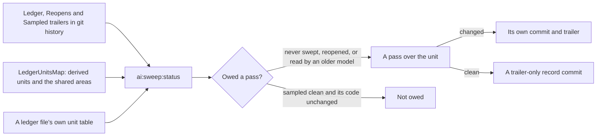

# Design

## Context

A ledger is one settled question carried across a tree too large for one commit. Its row in `.agents/ledgers/README.md` names the skill that owns the rules, the unit a pass reads and the `Scope` a resume runs over. A sweep commit carries `Ledger: <ledger> | <unit>`, a rule change carries `Reopens: <ledger>` or `Reopens: <ledger> | <unit>`, and the model a pass ran on is the commit's `Co-Authored-By` line. Those trailers are already the record a unit's date is read from. The `Swept` column every ledger carries is a copy of them, written into the tree.

## Decision

The ledger files hold units and what only they know. The status is read from history every time it is asked for.

### Coverage is read from the trailers

`pnpm ai:sweep:status` reads every trailer from the local clone's full history, takes each ledger's units from `LedgerUnitsMap` or from the ledger file's own table, and prints every unit's date and model. Given one ledger, it prints that ledger's units. Reading all of history takes seconds, so caching it would buy nothing. The status runs locally only: CI checks out one commit, so no test reads the trailers, as the `sweeps` skill already settles.

No ledger file has a `Swept` column, and `pnpm ai:sweep:ledger-coverage` is deleted. A ledger whose units are derived keeps a file only for the units that carry something, such as a note or the `dependencies` verdicts, and `ledgerUnits.test.ts` holds each of its rows to a unit the tree still derives. The `kit-differs-from-source` rule, that a kit counts as swept only once its overlay holds no `Unclassified` entry, becomes part of the status: such a kit reads as open, whatever its trailer says.

### One area list

`.agents/ledgers/areas/` holds the areas and units that `invariants`, `quality`, `security` and `write-once` all read. The list is hand-written, since its units are judgements about what one pass reads. The quality and security tooling areas add the openspec folders the tree derives. `LedgerUnitsMap` gives each of the four questions the list's units per area, so a trailer still names `quality/packages`, and every trailer in history keeps the unit it named: the four copies held the same unit strings, which a test checked. A question keeps a file for an area only for the units it holds a note on, so adding a question writes no rows. `naming`, `typescript`, `file-organization`, `testing` and `test-values` keep their own unit tables, since each sizes its units to its own question.

### Every date the tables hold is kept

A trailer may carry the date and model of a pass: `Ledger: <ledger> | <unit> | <date> · <model>`. The status orders events by their own date, so a carried date sits where the pass happened rather than where the trailer was written. Before any column is dropped, a trailer-only record commit carries every dated cell the trailers alone do not reproduce: the older dates kept when ledgers merged, and the dates written by hand. The status is then compared with every cell about to be deleted, once, and no table goes until the two agree on every unit's date and model.

### The sitting rules

Four rules make a sweep cost what it finds, and the `sweeps` skill states each one. A clean unit's trailer rides a trailer-only record commit when the sitting has no other, since git keeps a commit that starts empty through `pull --rebase` and trailers never conflict. A rule change reopens only the units its find recipe hits. A unit may be read once and judged against several questions in turn. A ledger whose random sample finds no defect is sampled clean, its unread units owed again only on a reopen or a change to their code; `pnpm ai:sweep:status` reads the `Sampled:` trailer and the paths changed since.

## Rejected alternatives

- **Each area-split question keeping its own copy of the `invariants` area list, held equal by `ledgerAreaUnits.test.ts`.** Every question rewrote every unit, so rows grew as questions times units, and a test whose only job is keeping copies equal is the [write-once](../../specs/architecture/write-once/design.md) page's list held equal to its source.
- **Writing coverage into the files from the trailers.** The cells held nothing the trailers did not. Keeping them cost a rewrite in every sitting and a rebase conflict whenever two sessions swept rows of one file, and they went stale whenever a sitting skipped the run.
- **Never committing a trailer on its own.** The `sweeps` skill rejected the empty commit, because a rebase could not be relied on to keep one. Git keeps a commit that starts empty through `pull --rebase`, so that reason no longer holds. Without the empty commit, a clean sitting's trailers would be lost once no table was left to commit.
- **Recipes run by the status itself, keyed by a rule id.** That needs a registry of every rule with a runnable query beside the skills that state the rules, which is a second copy of them. The sitting that changes a rule already holds its recipe, and its per-unit `Reopens:` trailers give the same reopen with nothing new to keep.
- **Moving each ledger's scope into its owning skill's `paths:` frontmatter.** Claude Code treats a skill with `paths:` as conditional and loads it only once a matching file is touched, so the move would change when every skill loads. A ledger's scope is also its question's domain, not a skill's loading trigger: `quality` reads the whole repository, and several ledgers have more than one owner or a spec page as their owner.
- **A separate manifest of skills, globs and sweep dates.** It would be a second index beside `.agents/ledgers/README.md`, a stored sweep date is the cache this design removes, and a sweep due on a fixed cadence is a scheduled job.

## Notes

- Zero defects in a sample of `n` bounds the defect rate below about `3/n` at 95% confidence, the rule of three, so a sample of 30 claims less than a tenth. The units a sample left unread may still hold tidies at the rate the sample found them. They are picked up when their code next changes, as the `sweeps` skill's draining rule already has every edit do.

## Key files

| Path                                                              | Role                                                                   |
| ----------------------------------------------------------------- | ---------------------------------------------------------------------- |
| `.agents/ledgers/README.md`                                       | the index: each ledger's rules owner, unit and scope                   |
| `.agents/ledgers/areas`                                           | the one area list the area-split questions read                        |
| `scripts/src/services/sweeps/ledgerCoverage/LedgerUnitsMap.ts`    | the ledgers whose units are derived, the shared areas among them       |
| `scripts/src/services/sweeps/ledgerCoverage/getLedgerEvents.ts`   | reads the trailers, a carried date and a sample among them             |
| `scripts/src/services/sweeps/ledgerCoverage/getLedgerCoverage.ts` | one ledger's units dated, sampled or open, from its events             |
| `scripts/src/sweeps/ledgerStatus/index.ts`                        | `ai:sweep:status`: every unit's date and model, read from the trailers |
| `scripts/src/workspace/ledgerUnits.test.ts`                       | holds each derived ledger's rows to units the tree still derives       |
| `.agents/skills/sweeps/SKILL.md`                                  | the sweep process: trailers, record commits, reopens and samples       |
