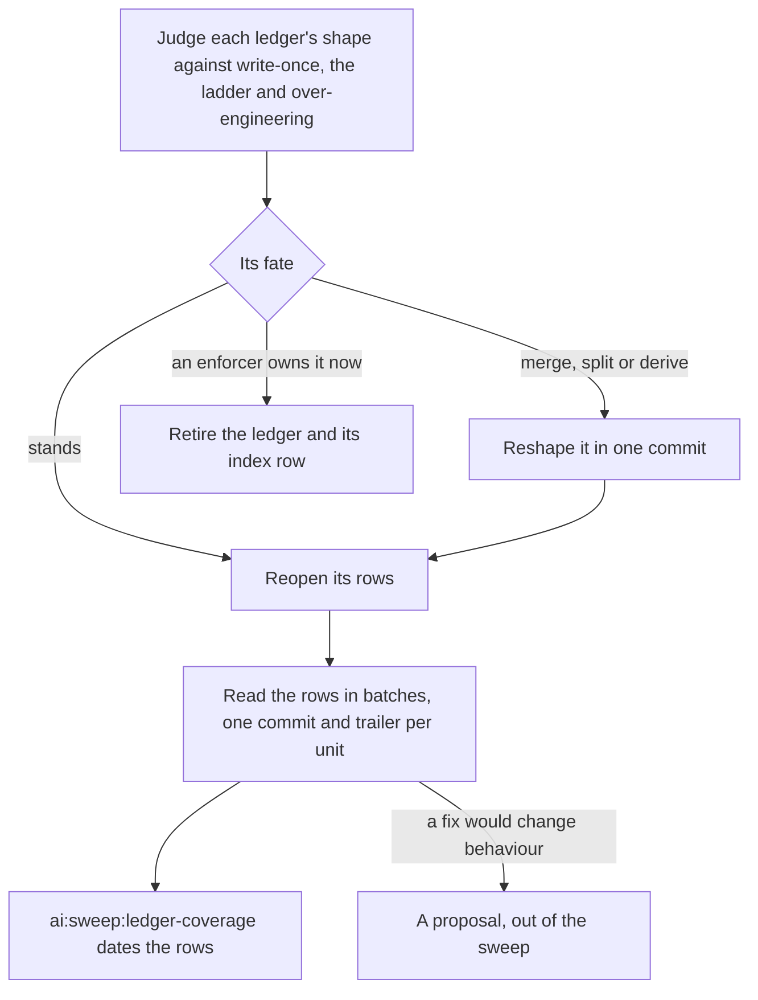

# Design

## Context

A ledger is one settled question carried across a tree too large for one commit. Its index row in `.agents/ledgers/README.md` names the skill that owns the rules, the unit a pass reads and the scope that reopens a row. Each area file is a coverage table, and `pnpm ai:sweep:ledger-coverage` writes a row's date from the `Ledger:` trailer of the commit that swept it.

The ledgers fall into three kinds:

- **Area-split ledgers** — `invariants`, `naming`, `quality`, `security`, `test-values`, `typescript`, `file-organization`, `write-once` and `testing` — each hold one file per area of the app, packages and tooling.
- **Single-file ledgers** keyed by a framework or a tool, such as `pinia`, `trpc`, `routing`, `build`, `oxlint` and `github-actions`.
- **Derived ledgers** whose rows `LedgerUnitsMap` reads off the tree: `dependencies`, `docs/skills`, `kit-records` and `kit-differs-from-source`, and from 1.3 the openspec folders in the `quality` and `security` tooling tables.

Apart from `testing` and `write-once`, the ledgers carry dates from before the current rules, many of them from the first sitting the ledgers existed. `write-once` has no swept row at all.

## Decision

The refresh runs in two phases. The shapes come first, and every reshaped ledger then has its rows read under the current rules. A ledger whose shape stands is simply reopened and read.

Reopening a row sets its `Swept` cell to `—` in the commit that reshapes or reopens its ledger. The sweeps skill already treats a row read against a narrower rule set as unswept, so this records a fact rather than adding a mechanism.

## Shape candidates

Each candidate below is a question for its own task, not a settled answer. The pass that judges it reads the ledger's rules and its owner before deciding, and records the outcome in the owning skill or this design.

- **`genshin-evidence` and `genshin-spec-evidence`.** Both hold one row per Genshin spec page under one owner, the `openspec` skill's links-and-sources page, at nearly the same row count. If they ask one question of each page, they merge and the row is read once. If one asks it of `design.md` and the other of `spec.md`, the unit names that difference and the index row says so.
  - _Decided (1.1): merged into `genshin-evidence`, one row per spec folder._ The unit is the folder, its `design.md` and `spec.md` read together, and `LedgerUnitsMap` derives the rows from the tree, so a new folder opens at `—` with no row written by hand. The two old ledgers held 281 and 280 rows and missed six folders (`dev-tools`, `menu-time`, `menu-settings`, `kits`, `puzzles`, `session-store`), which open at `—`. Of the 286 derived folders, 280 keep the older of their two old dates, since both old rows were dated; no old row held a note. The design-side recipe drops an unchecked `- [ ]` line from test one, and test two is unchanged. Run on the carried dates, the recipe opens 38 folders: 37 are dated (3 by test one, 35 by test two) and the carry rule leaves them dated for a pass to read, and `session-store` is open. `genshin-spec-evidence` and its index row are deleted. The coverage run re-dates 82 of the carried rows to `—`: a same-day `Reopens: genshin-evidence` trailer is not older than their carried date, and the sweep trailers that dated them name design units no folder row matches. They are carried here as the carry rule states, so the next run clears them until the lead decides.
- **`kit-records` and `kit-differs-from-source`.** Both derive their rows from the same kit overlay listing. They stay apart only if a pass reading one would not also answer the other.
  - _Decided (1.2): merged into `kit-differs-from-source`, and `kit-records` is retired._ Both held one dated row per overlay (121 each), so one row now reads the overlay under the framework decisions on `Unsourced`, `Unclassified` and `DiffersFromSource`. A row keeps the older of its two dates: 62 agree, 38 keep `kit-differs-from-source`'s and 21 keep `kit-records`'s. The `design is …` notes go, since the recipe derives the design; the three content notes carry over (`columbina`, `lisa`, `tartaglia`). No overlay links to its design, and 81 of the 121 kit design pages never name their overlay, so the design folder is derived from the kit's name: `arataki-itto` is `itto`, `kuki-shinobu` is `kuki`, and the recipe's command resolves all 121 kits to exactly one folder. The `Unclassified` check moves to `kit-differs-from-source` unchanged, so it still fails only a dated row whose overlay holds one. No overlay holds `Unclassified` today; a stricter rule (no overlay may hold one at all) is a policy the lead has not chosen, and is not in this change. The coverage run raises 21 of the carried rows to a later `kit-differs-from-source` sweep trailer, a date newer than the older one the carry rule keeps; they are carried as the rule states, so the next run raises them until the lead decides.
- **The hand-listed tooling tables** in `quality`, `security` and `file-organization`, of several hundred to over a thousand rows each, one per file. A unit sized to one file is a roster the tree already holds. Either the unit becomes a directory a pass can read in one sitting, as the testing tooling rows now are, or the ledger joins `LedgerUnitsMap` and its rows are derived.
  _Decided:_ `quality/tooling` and `security/tooling` join `LedgerUnitsMap`. Their openspec rows are the tree's, one per folder holding a spec, design, tasks or proposal (1,448), and their directory units are the invariants ledger's 27, which the copies already held, so no scripts row was resized. Rows go from 695 to 1,475 in quality (844 open) and from 726 to 1,475 in security (811 open). The copies' `scripts/src — the entrypoints` row is in no invariants unit, so the derivation drops it until 1.4 adds the unit. An openspec folder an old row named keeps that row's date, and `openspec/specs/genshin/artifact-enhancement`, new to quality, takes its two documents' 2026-11-01 date. `file-organization/tooling` is resized, not derived: 1,615 rows become 320 directory units, depth four under `scripts/src` with `genshinAssets` and `genshinParity` one level deeper, 235 dated with the oldest date of the files each covers and 85 open. The 85 include units holding 893 tracked files no row covered before.
- **The area split repeated across ledgers.** Several area-split ledgers write out the same areas and units by hand. If one derived listing of areas and units could serve every area-split ledger, the copies go; if the ledgers genuinely size their units differently, each keeps its own table and the index says why. _Decided:_ `invariants` is the one list. `quality`, `security` and `write-once` are held to it per area by `ledgerAreaUnits.test.ts`, 27 cases, with the openspec folders the tooling tables derive excluded. The list is hand-written, since its units are judgements about what a pass reads, so no generated listing replaces it; the quality and security tooling tables take it through `LedgerUnitsMap` because their openspec rows are derived anyway. Reconciled: `app-shell` (the copies lacked `compiler`, reopened at `—`), `resource` (the copies' `webpageEditor` row, reopened at `—`), `server` (`security` named an `app` folder the tree does not hold, which folds into `emailEditor`, `dashboard` and keeps its date), `packages` (twelve workspace packages no invariants unit names are added there, and `security` lacked them, so it gains them at `—`), `tooling` (`scripts/src — the entrypoints` joins invariants, and `write-once` gains the two root rows at `—`). `naming`, `typescript`, `file-organization`, `testing` and `test-values` keep their own tables, the index saying why.
- **A ledger an enforcer now owns.** A rule that lint or a workspace test enforces needs no pass (the `sweeps` skill, handing to an enforcer). Each ledger's rules table is read for rows the enforcement ladder has since taken over, and a ledger left with nothing to judge is retired.

## Rejected alternatives

- **Re-dating every row without reading it.** It would make the tables say the current rules hold where nobody has checked, which is the drift the ledgers exist to prevent.
- **Filing each ledger's refresh as its own change.** A sweep is never a change, because it never ends; one change holds only the one-time redesign and its order, and each ledger's progress stays in its own rows.
- **Reading the rows before fixing the shapes.** A pass over a ledger that is about to merge, or whose units are about to resize, is spent on a table that is then rewritten.

## Key files

| Path                                                           | Role                                                 |
| -------------------------------------------------------------- | ---------------------------------------------------- |
| `.agents/ledgers/README.md`                                    | the index: each ledger's rules owner, unit and scope |
| `scripts/src/services/sweeps/ledgerCoverage/LedgerUnitsMap.ts` | the ledgers whose rows are derived from the tree     |
| `scripts/src/workspace/ledgerUnits.test.ts`                    | holds each derived ledger's rows to the tree         |
| `.agents/skills/sweeps/SKILL.md`                               | the sweep process, trailers and resizing rules       |
| `openspec/specs/architecture/write-once/design.md`             | the red flags a ledger's own shape is judged by      |
