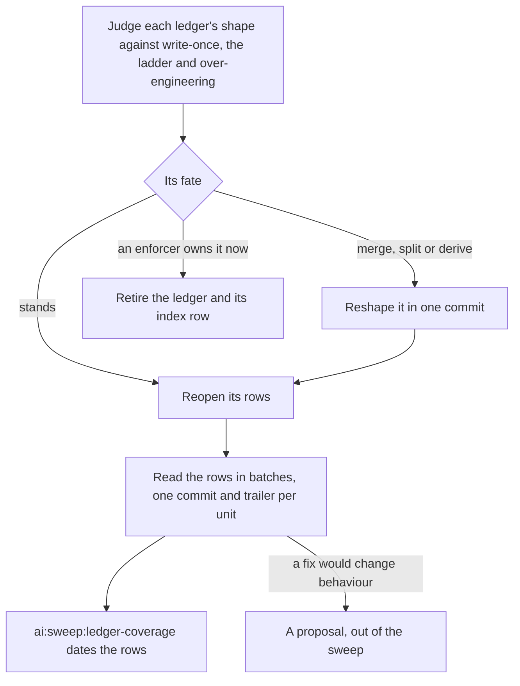

# Design

## Context

A ledger is one settled question carried across a tree too large for one commit. Its index row in `.agents/ledgers/README.md` names the skill that owns the rules, the unit a pass reads and the scope that reopens a row. Each area file is a coverage table, and `pnpm ai:sweep:ledger-coverage` writes a row's date from the `Ledger:` trailer of the commit that swept it.

The ledgers fall into three kinds:

- **Area-split ledgers** — `invariants`, `naming`, `quality`, `security`, `test-values`, `typescript`, `file-organization`, `write-once` and `testing` — each hold one file per area of the app, packages and tooling.
- **Single-file ledgers** keyed by a framework or a tool, such as `pinia`, `trpc`, `routing`, `build`, `oxlint` and `github-actions`.
- **Derived ledgers** whose rows `LedgerUnitsMap` reads off the tree: `dependencies`, `docs/skills`, `kit-records` and `kit-differs-from-source`.

Apart from `testing` and `write-once`, the ledgers carry dates from before the current rules, many of them from the first sitting the ledgers existed. `write-once` has no swept row at all.

## Decision

The refresh runs in two phases. The shapes come first, and every reshaped ledger then has its rows read under the current rules. A ledger whose shape stands is simply reopened and read.

Reopening a row sets its `Swept` cell to `—` in the commit that reshapes or reopens its ledger. The sweeps skill already treats a row read against a narrower rule set as unswept, so this records a fact rather than adding a mechanism.

## Shape candidates

Each candidate below is a question for its own task, not a settled answer. The pass that judges it reads the ledger's rules and its owner before deciding, and records the outcome in the owning skill or this design.

- **`genshin-evidence` and `genshin-spec-evidence`.** Both hold one row per Genshin spec page under one owner, the `openspec` skill's links-and-sources page, at nearly the same row count. If they ask one question of each page, they merge and the row is read once. If one asks it of `design.md` and the other of `spec.md`, the unit names that difference and the index row says so.
- **`kit-records` and `kit-differs-from-source`.** Both derive their rows from the same kit overlay listing. They stay apart only if a pass reading one would not also answer the other.
- **The hand-listed tooling tables** in `quality`, `security` and `file-organization`, of several hundred to over a thousand rows each, one per file. A unit sized to one file is a roster the tree already holds. Either the unit becomes a directory a pass can read in one sitting, as the testing tooling rows now are, or the ledger joins `LedgerUnitsMap` and its rows are derived.
- **The area split repeated across ledgers.** Several area-split ledgers write out the same areas and units by hand. If one derived listing of areas and units could serve every area-split ledger, the copies go; if the ledgers genuinely size their units differently, each keeps its own table and the index says why.
- **A ledger an enforcer now owns.** A rule that lint or a workspace test enforces needs no pass (the `sweeps` skill, handing to an enforcer). Each ledger's rules table is read for rows the enforcement ladder has since taken over, and a ledger left with nothing to judge is retired.

## Rejected alternatives

- **Re-dating every row without reading it.** It would make the tables say the current rules hold where nobody has checked, which is the drift the ledgers exist to prevent.
- **Filing each ledger's refresh as its own change.** A sweep is never a change, because it never ends; one change holds only the one-time redesign and its order, and each ledger's progress stays in its own rows.
- **Reading the rows before fixing the shapes.** A pass over a ledger that is about to merge, or whose units are about to resize, is spent on a table that is then rewritten.

## Key files

| Path                                                           | Role                                                 |
| -------------------------------------------------------------- | ---------------------------------------------------- |
| `.agents/ledgers/README.md`                                    | the index: each ledger's rules owner, unit and scope |
| `scripts/src/services/sweeps/ledgerCoverage/LedgerUnitsMap.ts` | the ledgers whose rows are derived from the tree     |
| `scripts/src/workspace/ledgerUnits.test.ts`                    | holds each derived ledger's rows to the tree         |
| `.agents/skills/sweeps/SKILL.md`                               | the sweep process, trailers and resizing rules       |
| `openspec/specs/architecture/write-once/design.md`             | the red flags a ledger's own shape is judged by      |
