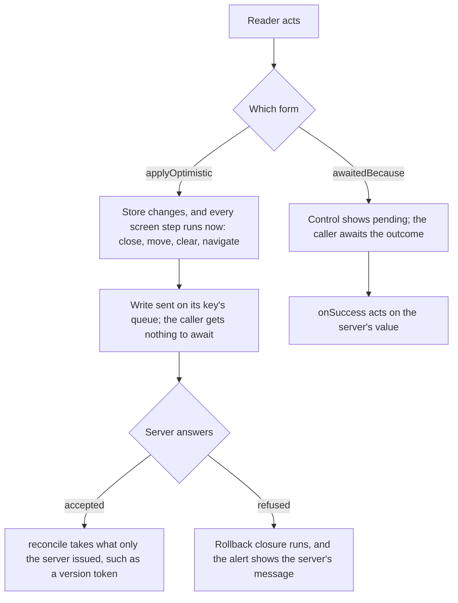

# Optimistic by construction

Every write a reader makes shows on screen when it is sent, and the only code that runs on the server's answer is the code that undoes a refusal. The [client data standard](../../specs/architecture/client-data/design.md) states that rule. This change makes the client's write primitives hold it, so a write cannot wait for the server unless it names why.

## Scope

What works today: `useMutation` applies a write through `applyOptimistic` and runs its rollback on a refusal. Thirty-odd dialogs pass `is-optimistic` and close as their write is sent. Content stores write their content ref before they save, and roll it back when the save is refused.

What leaks: `executeMutation` resolves to a `MutationOutcome` in every form, and content stores' actions resolve to `isSuccessful`, so a caller can await either and act on the answer. Dialogs wait by default. Creates whose row needs the server's id draw a placeholder or wait. An audit of `apps/web/app` found around eighty steps that wait on the answer. They include closing dialogs, ending edit modes, clearing composers, moving rows, navigating off a deleted room, and refreshing a list to learn what the client already wrote.

What this change adds is described in the sections below.

## How it works

A write takes one of two forms, and the form decides what its caller can see:

**An optimistic write returns nothing.** `executeMutation` is overloaded on its options:

- With `applyOptimistic`, it returns `void`. The write still runs on its key's queue, but no caller can sequence anything after the answer. The screen steps a write causes therefore run from the action itself, beside the write. An optional `reconcile` receives the server's result, for values only the server issues that the next write reads, such as a `contentVersion`. Its name says what it is for, and it is not a place to close a dialog.
- With `awaitedBecause`, it returns `Promise<MutationOutcome<TResult>>` as today, and `onSuccess` acts on the result.

Options that name neither do not compile.

**A wait names its reason from a closed set.** `AwaitedReason` has three values. A wait that fits none of them is optimistic:

| Reason                 | When                                                                                                                                                       | Examples                                                                                       |
| :--------------------- | :--------------------------------------------------------------------------------------------------------------------------------------------------------- | :--------------------------------------------------------------------------------------------- |
| `ServerIssuedValue`    | What the reader sees next is a value only the server mints: a token, a link, a presigned URL, server-rendered output, or an id resolved against other rows | Creating an invite or a webhook, regenerating a link, joining a room by code, an email compile |
| `ServerDecidedOutcome` | The server decides what happens, so nothing correct can be drawn first                                                                                     | Moderation actions, call admission, a blueprint deploy's results                               |
| `IrreversibleStep`     | The step that follows the write cannot be rolled back if the write is refused                                                                              | Signing out after deleting the account, the page reload that takes a game lease                |

**Dialogs answer optimistically by default.** `useDialogAnswer(isOpen).answer(write, awaitedBecause?)` calls the write and closes the dialog in the same tick. `UiConfirmDialog`, `StyledDialog`, `StyledFormDialog` and `StyledEditFormDialog` take an `awaitedBecause` prop in place of `isOptimistic`, and only an awaited dialog shows pending and stays open when its write resolves `false`. When an optimistic dialog's write is refused, the rollback restores the store row, and the dialog's draft re-seeds from the row the next time it opens. That is the rollback rule the standard already holds for a closed control.

**Content stores keep their success private.** `createContentData`'s `saveContent(rollback)` takes the closure that undoes the change the store just made and returns nothing. The store's own success boolean stays inside the resource store, which still owns the version token, the dirty check and the save-state latch. A store action built on it, such as `toggleCompleted`, `saveItem`, `saveSheet` or `saveBlueprint`, returns `void` in turn, so no component can close a dialog on a content save's answer.

**A create names its own id.** A create whose row is drawn in a list takes a `uuidv7()` id from the client, and the procedure's input accepts it under the same schema the row's id already has. The row is drawn at once under its real id, so the placeholder swap that `createMessage` and `createRoomCategory` use today is deleted, and a create's echo lands on the row it already drew. A create whose row the server fills with relations, such as a comment's author or a role's position, draws them from what the client holds: the reader is the author, a new row has no counts, and a new role goes below the others.

## Decisions

- **Types, not a lint rule.** A lint rule over "statements after `await` of a write" cannot tell a rollback from a screen step, so it would be noisy or leaky. The type of an optimistic write leaves nothing to await, and the compiler finds every caller. That is rejected: holding the rule in prose and review, the old direction.
- **Optimistic by default, awaited by reason.** The dialogs' default flips. The old direction, awaited by default with `is-optimistic` as the opt-in, is rejected: it made every new dialog wait until someone noticed.
- **A version token is not a reason to wait.** The old exception for optimistic-concurrency writes is rejected. A stale token is a refusal like any other, so the rollback undoes the save and the refresh prompt shows in `onError`, and the bumped token arrives through `reconcile`.
- **Client-generated ids over placeholders.** A placeholder's temporary id has to be swapped for the server's on the same reactive object, and a live echo carrying the real id can race it into a duplicate. A client id is the row's real id from the start, and the procedure's existing id schema checks it. A collision is no more likely than any other `uuidv7()` collision, and the primary key refuses it like any other duplicate.

## Key files

| File                                                      | Role                                                                                        |
| :-------------------------------------------------------- | :------------------------------------------------------------------------------------------ |
| `apps/web/app/composables/shared/useMutation.ts`          | The two forms of `executeMutation`: `void` with `applyOptimistic`, an outcome with a reason |
| `apps/web/app/models/shared/MutationOutcome.ts`           | What an awaited write resolves to                                                           |
| `apps/web/app/composables/ui/useDialogAnswer.ts`          | Closes a dialog as its write is sent, unless the dialog names a reason to wait              |
| `apps/web/app/components/Ui/ConfirmDialog.vue`            | `awaitedBecause` in place of `isOptimistic`                                                 |
| `apps/web/app/components/Styled/Dialog.vue`               | `awaitedBecause` in place of `isOptimistic`                                                 |
| `apps/web/app/components/Styled/FormDialog.vue`           | `awaitedBecause` in place of `isOptimistic`                                                 |
| `apps/web/app/components/Styled/EditFormDialog/Index.vue` | Saves optimistically and closes at once                                                     |
| `apps/web/app/services/resource/createContentData.ts`     | `saveContent(rollback)`, returning nothing                                                  |
| `apps/web/app/store/resource/index.ts`                    | The resource store's content save, whose success stays private                              |
| `apps/web/app/store/message/data.ts`                      | `createMessage`, whose placeholder swap gives way to a client id                            |
| `apps/web/app/store/resource/todoList/index.ts`           | The todo actions, returning `void`                                                          |
| `apps/web/app/store/resource/blueprint/index.ts`          | `saveBlueprint`, adopting the manifest at once                                              |
| `apps/web/app/store/survey/index.ts`                      | `saveSurvey`, writing its content at once                                                   |

## Notes

- A write whose follow-up step really does depend on the answer, and is not one of the three reasons, is a write the server should answer differently. For example, a refresh that re-reads what the client just wrote is deleted, not awaited: the write's own optimistic apply already drew that state, and [live queries](../../specs/architecture/cloudflare-services/design.md) refetch what another reader changed.
