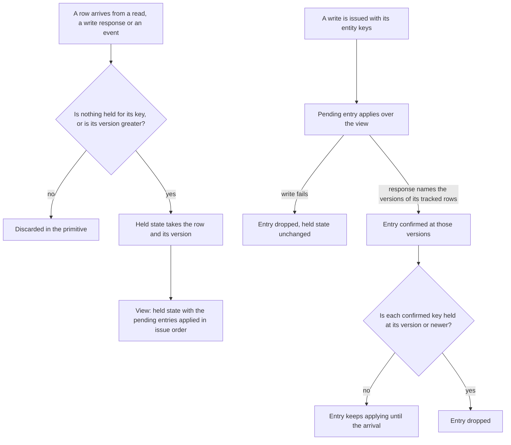
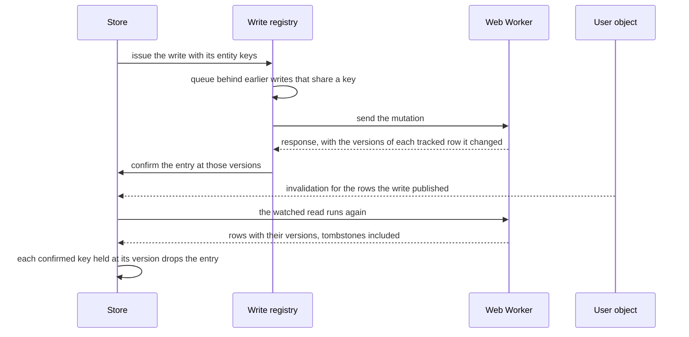

# Optimistic overlay

Server truth is held per table row, every row carries a version the database raises on each change, and an arrival applies only when its version is newer than the one held. A pending write is an entry the screen reads on top of that truth, dropped once the server's version of each row it changed has arrived. No write restores an older value, no caller orders its own async work, and no caller checks whether its result is stale.

## Scope

**Works today.** Each `useMutation()` instance owns its own queue. Every optimistic write carries a hand-written rollback closure, over a hundred `applyOptimistic` sites, and each rollback compares before it restores. Replay pushes sit over reads (`readWithReplayedPushes` and `recordReadingPush`). Reads and writes are ordered by call ids and by supersede. Three hand-moved executors serialise writers: the pair executor, the room category executor and the membership executor.

**Adds.** One app-scoped write registry keyed by typed entity keys. A `version` column in the shared metadata definition. Soft delete with revival on the pair tables. Write responses that name the version of every tracked row the write changed. An arrival gate in the primitive, and a view per store. Run scopes for local work that has no version.

**Infrastructure.** No new service, queue or Durable Object. The version increment is a Drizzle update value that the database evaluates, so the version is raised inside each statement. The migration adds one column per table, group by group.

**Failure and retry.** A failed write drops its entry and changes no held state, and nothing retries, as today. A write the server applied whose response was lost is still published to its watchers, so the watched read brings the changed rows at their new versions and held state takes them. Until that arrives the view shows held state, which may briefly read as the old value. A rejected write restores nothing, so an older value cannot come back.

## The model

Eight rules hold the design together. Every store, every read and every write follows them.

1. Every row the server holds has a version, a non-negative integer the database raises on every change and never lowers. A row that is soft-deleted and revived keeps climbing, so its version never restarts while its key exists.
2. An arrival is a row with its version, from a read, a write response or an event. Held state keeps, per row key, the newest version it has applied, tombstones included. An arrival applies when nothing is held for its key or its version is greater than the held one. An equal or lower version is discarded in the primitive, so no caller branches on it.
3. A tombstone is a row whose deletion has set `deletedAt` and raised its version. It hides the row from the view and is kept as held state, so an older arrival for that key loses.
4. Absence never removes. A read that omits a held row says nothing about that row.
5. A write becomes an entry in the write registry: its entity keys and its apply over the view. The entry is pending until the write's response or failure. The response names the version of every tracked row the write changed, and the entry is then confirmed at those versions. It drops once held state for each confirmed key is at or above its confirmed version. A failed entry drops at once and changes no held state.
6. The view is held state with the pending entries applied over it in issue order. It is a computed value, so it recomputes when held state or the entries change, and a read of it costs nothing more.
7. A write queues behind the earlier writes that share any of its keys, across every store of the app. Reads never queue. Queueing orders what the server applies, and no rollback depends on it any more.
8. Client-side work that has no version runs in a run scope. A newer run of the same scope aborts the signal of the run before it, and the primitive commits only the newest run's result.

A row created on the client holds no version, below every version, so the server's first arrival for it applies even at version zero.



The settlement order is the mechanism the diagram sketches: a write's own response, the read its publish woke, or an event each arrive as ordinary arrivals, and any of them can confirm the entry.



## Decisions

**The overlay is the only optimistic mechanism.** Entries and arrivals replace rollback closures and their compare guards. The guards are written by hand at each site, and the unfriend rollback that re-added a friend after a block is the failure a forgotten guard produces. Rejected: rollback by snapshot, which restores a whole list and drops every arrival that landed meanwhile.

**Versions decide order, and nothing orders by time or by call.** Rejected: call ids with latest-issued wins, which is bookkeeping per caller and blind to events and write responses. Rejected: the read's start time as the order, because `readAt` is a Worker's clock, and the live-topics design already allows a second of skew between clocks. Rejected: `updatedAt` as the version, because the metadata sets it from the Worker's clock, so two writers in one millisecond tie and skewed isolates can run it backwards. Rejected: a global write sequence, because one counter row would serialise every write in the database, and D1 offers no sequence a client can read.

**The version lives in the shared metadata definition, and the database raises it.** The increment is the update value the Drizzle SQLite builder embeds as raw SQL instead of binding, the same path the metadata's `updatedAt` already takes. The Database section records what was checked. Rejected: a trigger generated by the migration builder, which would hold the rule in a second place. A trigger stays the fallback only if a raw write path turns up. Rejected: an application-set version, because a write that names the number can lower it.

**Hard deletes become tombstones on the pair tables and on any table the overlay orders.** A hard delete removes the row and its version, and a re-created row starts again at zero, so a client's tombstone would reject the revived row as older. Chosen: soft delete that sets `deletedAt` and raises the version, revival by an upsert whose conflict branch clears `deletedAt` and raises the version, reads that return tombstones within their scope, a view that hides them, and absence that never removes. Rejected: remembering the version of one's own delete on the client, which cannot see another client's delete and cannot order a revived row. Rejected: a separate tombstone table, a second write and a second read for the same fact. Rejected: keeping hard deletes with the row dropped unversioned, which lets a late read re-add the removed row, the unfriend-after-block shape. The cost is that every server statement which decides from these tables filters live rows, and the view hides the tombstones.

**Object schemas share the version definition, not the wrapper.** The realtime object schemas import the table builder from Drizzle directly, so they receive no metadata columns today. Chosen: the version definition is one function that the wrapper and the object schemas both spread, so each table gets the column with no per-table step, and the object schemas keep their own shape. Rejected: moving the object tables onto the wrapper, which would add creation and update timestamps and a deletion column to call participants, and nothing reads them there.

**A write's response names every tracked row it changed.** The write recorder already adds `RETURNING` to each write, so each changed row comes back by its scope values. The middleware that appends the topics header only answers queries today, and it is extended to mutations, so the header carries each tracked row's key and version. Chosen: every changed row settles by version, including rows the response's own value does not carry, such as the friend row an accept inserts. Rejected: settling on the returned row alone, which misses the side rows. Rejected: settling on the topic re-read alone, which waits for the topic object's alarm window and cannot tell whether a re-read was issued before the write landed. Rejected: settling on echoes, since the pair tables have no typed event and an event carries no write identity.

**Queues are per key across the app, and writes do not supersede.** Rejected: per-field keys, under which commuting field writes on one row would run in parallel. Each field would become a key to remember, and the row is the owner's rule, so the latency of commuting writes is measured in the pilot instead. `isSupersede` has one consumer, the virtual background pipeline, which is local work. A superseded server write still sends, and with versions its response applies in order, so latest-wins has nothing to drop.

**Local work runs in a run scope.** Rejected: keeping `isSupersede` with a predicate the callee checks, because the callee has to remember the check, and the pipeline's commit is side effects spread across its awaits.

**Counts stay re-read, and the storage total is a row.** A count has no row, and `createBatchedRefresh` already runs one read at a time. The storage usage total is a column on the user row, so it is a row arrival and needs no aggregate path.

**`MutationStatus.Stale` leaves the set.** A read can no longer be superseded. An aborted local run resolves with no effect, as a superseded read did.

## Store surface

A store builds its collections from the primitive, which holds the held state and the entries. The store returns only its view under its own name, and held state never leaves the primitive, so no component can write it and no store rebuilds the view by hand. A store's public names are the view, the functions that issue writes, and the functions that ingest reads. Components read the view.

Truth is held per table row: friendship rows, user rows and membership rows are separate collections, and a list item is a join of them. The friend store holds one list of users today, and under this design it holds friendship rows and user rows, with the view joining them. That change of shape belongs to the pilot.

## Settling

A confirmed entry drops when held state for each of its confirmed keys is at or above the version the response named. Four arrivals can carry that version: the write's own response, the watched read its publish woke, any other read, and an event row. The primitive does not distinguish them, so no call site names its source, and no read's start time is compared with anything.

The realtime events that carry rows (call participants, room emoji and the user's storage usage) carry the row and its version in place of a partial patch. The change goes in with the group that owns each event, and `RealtimeEventClassMap` names the frame class each event carries.

## Lists and single rows

A list holds its rows by id with their versions, and its view is those rows in the list's sort order. A single row is a list of one with the same rule. Arrivals carry whole rows, so two writes that change different fields of one row compose: each entry applies to the held row in issue order.

A paged read returns tombstones within its page's scope, so a page can hold fewer live rows than its size, and its cursor advances over the tombstones. That is an accepted cost. A first-page read still updates rows by id as it does today, and the later pages keep their rows.

## Creates

A create with a client id puts a placeholder at the position its list's sort key gives. Identifiers made with `uuidv7` sort by creation time, so an id-ordered list places the placeholder exactly. The server's response names the row's version and confirms the entry, and the placeholder holds no version until then.

A server-placed create, such as a room category, appends its placeholder at the tail until the response's row arrives with the position the server chose. Creates on one key still queue, since two in flight would tie on the position the server picks. Messages keep their own send path, as the client data design says.

## Offline cache

The offline cache persists held state for its partition, live rows and tombstones with their versions. It never persists the view or the entries. Hydration restores held state, and the view computes over it. The IndexedDB record gains a version, so the cache's database version rises and its upgrade clears the stores, as the offline cache design already does on a key change. Records without a version are never hydrated. Writes fail offline today, so no entry is held offline. The placeholder filter on `isLoading` stays on the message path alone.

## Local work and residue

A run scope is the primitive's name for local work: the virtual background pick, the dataset binding pick and any whole-value read that no version covers. The primitive keeps one abort controller per live scope. A new run in a scope aborts the controller of the run before it, and the primitive commits a run's result only while that run is the scope's newest. The callee receives the signal for its awaits and never checks it.

The virtual background pipeline's effects move into one commit at the end of the run. The pick it resolved is applied by the primitive, and a transformer that an aborted run created is released by the scope. The pick shows in a local value the run owns: set when the run starts and dropped when the run ends without committing, with no restore closure.

Whole-value reads with no version keep the run scope. Each group in the tasks lists the reads it leaves as residue, and a count or a blob-backed read is residue.

## Database

The version facts were checked against the installed Drizzle release and with a probe, which ran the generated SQL on SQLite:

- The Drizzle SQLite update builder takes an update value that is SQL and embeds it raw, and it binds only plain values. The metadata's `updatedAt` already takes this path.
- An insert that omits the version gets zero, from the column default.
- An update raises the version by one, and a second update raises it again, so a soft delete and a later revival each move it.
- An upsert whose conflict branch sets other columns also raises the version, so a revived row continues its count.
- A write that names a version sets it, so no writer may name one.
- The D1 driver and the Durable Object driver both build their SQL with the same SQLite dialect, so the increment reaches the realtime objects too.

The migration adds `version` as a not-null integer with a default of zero, one table group at a time, through the drizzle skill. SQLite requires a default to add a not-null column. Existing rows read zero, which is their true value, since no row has yet been changed through a versioned writer. The backfills skill keeps a default where a current writer produces the absence, and the insert path omits the column and receives zero from the same default, so the default stays. Live pair rows need no backfill. The pair tables had no tombstones before this change, because their deletes were hard, so there is nothing to backfill for removals already made. A tab that was open across the deploy runs the old client against the new server, and it shows tombstones unfiltered until it reloads. That is the tradeoff the backfills skill accepts for latest-shape-only code.

The object tables migrate through the object configurations, and the object database applies its migrations when it starts. A raw statement that updates a tracked table would skip the increment, so the migration task scans for raw writes, and each one routes through the builder.

## Entity keys

An entity key is a table and its primary key value. The primitive holds keys in a map keyed by the table object and then by the key value, so no key is built as a string and two tables cannot collide. The key's type comes from the table's select model narrowed to its primary key columns. A composite key that the table declares in its extra configuration, as the blocks table does, has to name its columns, because a column's type does not carry a composite key. The first pilot task verifies that Drizzle's types behave as this assumes.

The key cannot be derived from a procedure's input, and the evidence is specific. Six procedures take one bare user id schema: `createBlock`, `deleteBlock`, `deleteFriend`, `acceptFriendRequest`, `declineFriendRequest` and `sendFriendRequest`. They write three tables. The friendship row's key is the pair helper applied to the session user and the input, so the input alone is not the key and the session is needed. An accept writes two tables under one pair, so one input names two rows. A tRPC procedure's metadata lives on the server, the client cannot read it, and a per-procedure table would be the manual list the owner has ruled out.

The smallest typed declaration is at the write's call site: one entity key for each row the write changes. The pair writes build their keys with the same helper the server uses, which is `getFriendshipId` on the session user and the other party. A write's keys are checked against the server's recorded write set in the wake-check suite, so an omitted key fails a test instead of racing in production. A multi-row write passes a list of keys and queues behind any in-flight write that shares one of them. Reads keep their per-instance keys, since reads are not ordered by entity.

## Enforcement

The enforcement ladder is applied rung by rung, and each rule names the rung that holds it.

| Rung               | What holds the rule                                                                                                                                               | What it costs               |
| :----------------- | :---------------------------------------------------------------------------------------------------------------------------------------------------------------- | :-------------------------- |
| 1. By construction | A write's options take entity keys and an entry, with no rollback member. A read without a version does not typecheck where it is ingested. The view is readonly. | Nothing                     |
| 2. Structural      | One primitive is the only writer of held state, and one registry is the only queue.                                                                               | One review of the primitive |
| 3. Lint            | A selector fails an entry's apply when its body assigns a ref. The lint retires with the call-id names it no longer needs to catch.                               | One rule over every file    |
| 4. Test            | The wake check fails a write whose declared keys miss a row it changed. The primitive's tests pin the gate, the settle rule and the run scope.                    | Upkeep of fixtures          |
| 5. Remembered      | The owning sections of the client data, async operations and friends design pages, and the pinia and drizzle skills, state the rules.                             | Every reader                |

## Costs

- **Rendering.** The view recomputes when held state or an entry changes, not on each read. Its cost is the rows of the collection times the entries pending, which is small for a page with a few writes in flight. The pilot benchmarks the recompute.
- **Memory.** Held state keeps one version per row, and tombstones on the pair tables are kept, so the pair tables grow with the pairs ever related. This change adds no purge. Growth is measured in the pilot, and a purge is a separate change with its own safety argument.
- **Wire.** Every returned row carries its version, and a tracked write's response carries the keys and versions of the rows it changed, which for a pair write is a few rows.
- **Server.** One more increment per update, which the `updatedAt` column already pays for. Live filters on the statements that decide from the pair tables, and an upsert on each revival.
- **Latency.** A row's writes queue behind one another, so commuting writes on one row, such as a camera toggle and a mute, wait for each other. The pilot measures this before the groups start.
- **Tests.** Rollback and call-id assertions go, and arrival and settle assertions replace them. Tests wait on the view's change and never on a timer. The registry belongs to each Pinia instance, so each test gets its own queue.

## Tests

- The primitive's suite covers the gate (an older arrival is ignored, a newer one applies, an equal one is ignored, a placeholder accepts version zero), tombstones, absence, the view, confirmation, failure, the queue per key across two instances, and an aborted run committing nothing.
- The three pilot races each get a regression test written first and seen failing against the current rollback, which is the proof run. The unfriend-after-block race is one of them.
- The wake check asserts that a write's declared keys cover the rows its recorded write set names.
- A type test asserts that a write option carrying a rollback fails typecheck, and that a read without a version fails where it is ingested.
- The rollback closure assertions, the supersede and stale tests in the primitive's test file and the cache's test file, and the merge test go with the code they pin.

## Deleted sites

Each site below is deleted by the change that replaces it. None of them is aliased or kept beside its replacement.

| Site                                                                                                                                                                                                     | What it does today                                                         | Deleted by                                                                   |
| :------------------------------------------------------------------------------------------------------------------------------------------------------------------------------------------------------- | :------------------------------------------------------------------------- | :--------------------------------------------------------------------------- |
| `apps/web/app/composables/shared/useMutation.ts` call-id map, its getter, supersede and the `checkIsStale` argument of queries and writes                                                                | Orders reads and writes by call                                            | Primitive task, after the last caller                                        |
| `apps/web/app/services/shared/settleOperation.ts` stale and silent-when-stale branches                                                                                                                   | Drops a result a newer call superseded                                     | Primitive task                                                               |
| `apps/web/app/models/shared/OperationContext.ts` `checkIsStale` and `isSilentWhenStale`                                                                                                                  | Carries the stale check into settlement                                    | Primitive task                                                               |
| `apps/web/app/models/shared/MutationStatus.ts` the `Stale` status                                                                                                                                        | Reports a superseded result                                                | Primitive task                                                               |
| `apps/web/app/composables/shared/useReadingPushes.ts`, with `apps/web/app/services/shared/mergeSnapshot.ts` and `apps/web/app/models/shared/SnapshotPush.ts`                                             | Replays pushes over an in-flight read                                      | Room group, when its last caller moves                                       |
| `apps/web/app/store/message/user/friend.ts`, `block.ts` and `friendRequest.ts` replay calls, their `store*` mirror functions and the pair executor export                                                | Replays and mirrors writes into three stores                               | Pilot                                                                        |
| The rollback closures in `friend.ts` (unfriend), `block.ts` (block and unblock) and `friendRequest.ts` (accept and decline)                                                                              | Restore rows after a rejected write                                        | Pilot                                                                        |
| `apps/web/app/store/message/room/userToRoom.ts` and its membership executor                                                                                                                              | Serialises membership writes by hand                                       | Room group                                                                   |
| The room category executor in `apps/web/app/store/message/roomCategory.ts`                                                                                                                               | Serialises category creates and moves by hand                              | Room group                                                                   |
| The replay calls in `apps/web/app/store/message/room/emoji.ts` and `apps/web/app/store/message/room/call/participant.ts`                                                                                 | Replays emoji and participant pushes over reads                            | Room group                                                                   |
| `apps/web/app/composables/shared/useCachedRead.ts` supersede method and its use of the primitive's supersede                                                                                             | Marks a pushed value as newer than an in-flight read                       | Root group, when `apps/web/app/store/storage.ts` moves to a user row arrival |
| `apps/web/app/composables/message/room/useRefreshRoomUsers.ts` `checkIsStale` parameter and guard, and the whole-map replacement                                                                         | Drops a refresh a newer one superseded, and replaces the room's member map | Room group, after membership gains tombstones                                |
| `apps/web/app/composables/message/subscribables/useRoomUserSubscribables.ts` stale-check argument                                                                                                        | Passes the stale check into the refresh                                    | Room group                                                                   |
| The virtual background pipeline's `checkIsStale` and `checkIsCurrent` in `apps/web/app/store/message/room/realtime.ts`, with its supersede write                                                         | Drops a pick a newer pick superseded                                       | Room group, as the first run scope consumer                                  |
| `apps/web/app/components/Dashboard/Visual/Preview/DatasetBindingForm/Index.vue` supersede call and its hand key                                                                                          | Drops a source read a newer pick superseded                                | Dashboard group, as a run scope                                              |
| The stale and supersede cases in `apps/web/app/composables/shared/useMutation.test.ts`, `apps/web/app/composables/shared/useCachedRead.test.ts` and `apps/web/app/services/shared/mergeSnapshot.test.ts` | Pin the deleted behaviour                                                  | With the code each one pins                                                  |

## Alternatives and their reasons

Each alternative that lost is recorded in the decisions above, beside the choice it lost to. The rejected alternatives for the entity key are in the entity key section.

## Key files

| File                                                                            | Role after the change                                                                                   |
| :------------------------------------------------------------------------------ | :------------------------------------------------------------------------------------------------------ |
| `apps/web/app/composables/shared/useMutation.ts`                                | The primitive: the registry, the arrival gate, the view's entries and the run scope                     |
| `apps/web/app/composables/shared/useMutation.test.ts`                           | The primitive's suite, rewritten around the gate, the settle rule and the run scope                     |
| `apps/web/app/composables/shared/useReadingPushes.ts`                           | Deleted: replaced by arrivals                                                                           |
| `apps/web/app/services/shared/mergeSnapshot.ts`                                 | Deleted: replaced by the arrival gate                                                                   |
| `apps/web/app/models/shared/SnapshotPush.ts`                                    | Deleted: the push forms are the entries' applies                                                        |
| `apps/web/app/services/shared/settleOperation.ts`                               | Settles a write or a read without the stale branches                                                    |
| `apps/web/app/models/shared/OperationContext.ts`                                | The settlement context without the stale fields                                                         |
| `apps/web/app/models/shared/MutationStatus.ts`                                  | The outcome set without the stale status                                                                |
| `apps/web/app/composables/shared/useCachedRead.ts`                              | The cache gate, with no supersede                                                                       |
| `apps/web/app/composables/shared/useWatchTopics.ts`                             | The watch a read takes, unchanged: it delivers the invalidations that bring rows back at their versions |
| `apps/web/app/services/shared/createBatchedRefresh.ts`                          | The count re-read, unchanged, one read at a time                                                        |
| `apps/web/app/services/shared/createOperationData.ts`                           | Row helpers used by the pair stores, retired with them                                                  |
| `apps/web/app/store/message/user/friend.ts`                                     | The friend store: friendship and user rows with an entry-based unfriend                                 |
| `apps/web/app/store/message/user/block.ts`                                      | The block store: entry-based block and unblock                                                          |
| `apps/web/app/store/message/user/friendRequest.ts`                              | The request store: entry-based send, accept and decline                                                 |
| `apps/web/app/store/message/room/userToRoom.ts`                                 | The membership store, on entries and arrivals                                                           |
| `apps/web/app/store/message/roomCategory.ts`                                    | The category store, creates by placeholder and server position                                          |
| `apps/web/app/store/message/room/emoji.ts`                                      | The emoji store, on row arrivals from events                                                            |
| `apps/web/app/store/message/room/call/participant.ts`                           | The participant store, on row arrivals from events                                                      |
| `apps/web/app/store/message/room/realtime.ts`                                   | The virtual background pipeline as a run scope with one commit                                          |
| `apps/web/app/composables/message/room/useRefreshRoomUsers.ts`                  | The refresh applies user rows as arrivals                                                               |
| `apps/web/app/composables/message/subscribables/useRoomUserSubscribables.ts`    | The room user subscription, without a stale argument                                                    |
| `apps/web/app/components/Dashboard/Visual/Preview/DatasetBindingForm/Index.vue` | The binding pick as a run scope                                                                         |
| `apps/web/app/store/storage.ts`                                                 | The storage meter, storing the user row's arrival                                                       |
| `apps/web/app/services/message/room/setRoomUsers.ts`                            | Applies user rows one by one, not as a whole map                                                        |
| `packages/db-schema/src/createMetadataSchema.ts`                                | The version definition, with the timestamps and deletion column                                         |
| `packages/db-schema/src/sqliteTable.ts`                                         | The wrapper that spreads the metadata into every D1 table                                               |
| `packages/db-schema/src/models/SqliteTable.ts`                                  | The wrapper's type, which names the metadata columns                                                    |
| `packages/db-schema/src/schema/auth/usersInAuth.ts`                             | The user row whose storage total arrives with its version                                               |
| `packages/db-schema/src/schema/social/friendsInSocial.ts`                       | The friendship table, soft-deleted with revival                                                         |
| `packages/db-schema/src/schema/social/friendRequestsInSocial.ts`                | The request table, soft-deleted with revival                                                            |
| `packages/db-schema/src/schema/social/blocksInSocial.ts`                        | The block table, soft-deleted with revival and a composite key                                          |
| `packages/db-schema/src/objects/call/schema.ts`                                 | The call object tables, given the version definition                                                    |
| `packages/db-schema/src/objects/room/schema.ts`                                 | The room object tables, given the version definition                                                    |
| `packages/db-schema/src/objects/user/schema.ts`                                 | The user object tables, given the version definition                                                    |
| `packages/db-schema/drizzle.room.config.ts`                                     | The room object's migration configuration                                                               |
| `packages/db-schema/drizzle.call.config.ts`                                     | The call object's migration configuration                                                               |
| `packages/db-schema/src/models/realtime/RealtimeEventClassMap.ts`               | The class of each event, now carrying rows with versions                                                |
| `apps/web/server/trpc/routers/friend.ts`                                        | Soft delete of a friendship, and live filters on the server statements that decide                      |
| `apps/web/server/trpc/routers/block.ts`                                         | Soft delete of a block and its friendship and request, with revival                                     |
| `apps/web/server/trpc/routers/friendRequest.ts`                                 | Soft delete of a request, accept on the live request, and revival on send                               |
| `apps/web/server/trpc/routers/storage.ts`                                       | The usage read, unchanged in its query and carried by the user row's event                              |
| `apps/web/server/trpc/middleware/inferTopicsMiddleware.ts`                      | The header of each mutation: the tracked rows it changed, with their keys and versions                  |
| `apps/web/server/trpc/middleware/inferTopicsMiddleware.test.ts`                 | The header test, extended to mutations                                                                  |
| `apps/web/server/trpc/routers/friend.test.ts`                                   | The pair router tests, extended to tombstones and revival                                               |
| `apps/web/app/store/message/user/friend.test.ts`                                | The unfriend regression tests                                                                           |
| `apps/web/app/store/message/user/block.test.ts`                                 | The block regression tests                                                                              |
| `apps/web/app/store/message/user/friendRequest.test.ts`                         | The request regression tests                                                                            |
| `apps/web/app/services/shared/mergeSnapshot.test.ts`                            | Deleted with its code                                                                                   |
| `apps/web/app/services/cache/indexedDb/writeIndexedDb.ts`                       | The cache writes held state with versions                                                               |
| `apps/web/app/composables/cache/indexedDb/`                                     | The pagination cache that persists held state for a partition                                           |
| `packages/configuration/eslint/restrictedSyntaxes.js`                           | The selector that fails an entry's apply when it assigns a ref                                          |
| `openspec/specs/architecture/client-data/design.md`                             | The rollback, concurrency and live-read sections, rewritten to the overlay                              |
| `openspec/specs/architecture/async-operations/design.md`                        | The outcome, write and read sections, rewritten without call ids                                        |
| `openspec/specs/architecture/cloudflare-services/design.md`                     | The version column, tombstones and the write header                                                     |
| `openspec/specs/esbabbler/friends-and-dms/design.md`                            | The replay paragraph, rewritten to versions and tombstones                                              |
| `openspec/specs/esbabbler/offline-cache/design.md`                              | The cache persists held state with versions                                                             |

The new files, in the tree form the design template asks for, are the registry's module and its test. Their paths follow the file-organisation skill once the pilot is written, and they are not listed as existing files here.

```text
apps/web/app/composables/shared/                  the registry and the run scope, in the primitive's folder
apps/web/app/services/shared/                     the arrival gate's apply, one function per form
```

## Sources

- [Replicache, How it works](https://doc.replicache.dev/concepts/how-it-works): a local mutation stays pending until the server confirms it, and the client re-runs the unconfirmed mutations over each new server state. The overlay takes the view-over-server-state shape and the drop on confirmation. Replicache confirms by a mutation id, and this design confirms by row version.
- [TanStack Query, Optimistic updates](https://tanstack.com/query/latest/docs/framework/react/guides/optimistic-updates): the "via the UI" pattern renders the pending variables without touching the cache, and keeps the variables when a mutation fails so a retry can use them. The overlay is render-only with no rollback. Unlike that pattern, a failed entry is dropped here and not kept for retry.

## Notes

- A failed write's entry is dropped, so the view can show the held value again for a moment. The server may still have applied the write, and the watched read brings its row back at the new version. This is the one place the view can read older than the server, and it lasts until that arrival.
- The primitive keeps the registry per Pinia instance. Nuxt renders each request with its own instance, so no queue or entry crosses a request, and the tests get a fresh queue each time.
- Read keys stay per instance, since a read is not ordered by an entity. Only writes take entity keys.

## Open questions

None changes the tasks. The pilot's measurements settle the row-level queue choice before any group moves, and their result is recorded in this design before the groups start.
