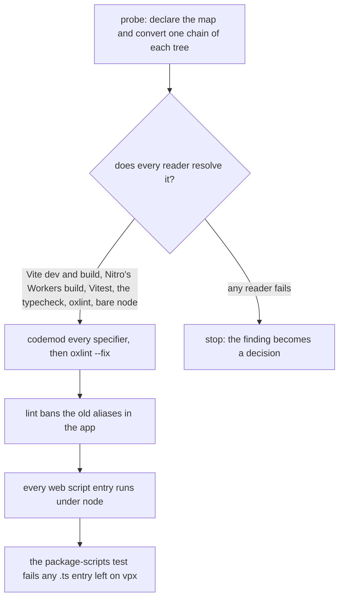

# One way to address a package's own source — design

## Context

A package's own files are reached two ways. Every package under `packages/*`, the repo-root `scripts` and the repo root's own folders declare subpath imports in their manifest (`"#src/*": "./src/*.ts"`), and the lint bans anything else there (the file-organization skill, `references/import-aliases.md`). The web app instead imports through the aliases Nuxt generates into its four tsconfigs and its Vite and Nitro configs: `@/` for `app/`, `@@/` for the app's root, and Nuxt's own `#shared/` and `#server/`. Nuxt reads those aliases and Node does not, so a script under `apps/web/scripts` that reaches app code cannot run under `node`, and runs under `vpx --tsconfig tsconfig.root.json` instead. That is the last reason the repository runs a script under `vpx` once the value-sets change has removed every `enum` (`openspec/changes/architecture-value-sets/design.md`).

## Goals

- One way for any package to address its own source: the subpath imports its manifest declares.
- Every `.ts` script runs under `node`.
- Nuxt's aliases and the manifest never disagree about where a name points.

## Decisions

### The web app declares its trees in its manifest

```json
"imports": {
  "#src/*.vue": "./app/*.vue",
  "#src/*": "./app/*.ts",
  "#shared/*": "./shared/*.ts",
  "#server/*": "./server/*.ts",
  "#scripts/*": "./scripts/*.ts",
  "#configuration/*": "./configuration/*.ts"
}
```

`#src` is the name every package already gives its source, so the app's `app/` folder takes it. A `.vue` file is imported with its extension, so it has its own pattern; Node, TypeScript and Vite all pick the longest matching key. `#shared` and `#server` keep the names Nuxt already gives those folders, and point at the same folders. A root file a module imports (the UnoCSS configuration, the manifest itself) takes a named entry of its own.

**Rejected — `#app/*` for the app's source:** Nuxt owns `#app`, which resolves to its own runtime (`nuxt/app`); declaring it would shadow Nuxt's import in the app and break every module reaching Nuxt's runtime through it. **Rejected — keeping `@/` and `@@/` and the `vpx` runner:** two ways of addressing source, and a second runner kept only because Node cannot read one of them. **Rejected — tsconfig `paths` alone:** Node ignores them, which is the problem.

### Nuxt's aliases and the manifest agree, and a test holds them to it

Nuxt keeps generating `#shared` and `#server` as aliases, and Vite and Nitro read Nuxt's alias before a manifest's map. Both point at the same folder, and a test in `apps/web/configuration` resolves each name both ways and fails if they diverge. That covers the one way a later Nuxt default could split them. Nuxt still generates `@/` and `@@/` for its own modules; nothing in the app imports through them, because the lint refuses both.

### The conversion is one codemod commit, and the probe comes first

The rewrite is a specifier substitution (`"@/` to `"#src/`, `"@@/scripts/` to `"#scripts/`, `"@@/configuration/` to `"#configuration/`, and the root files to their names), applied to imports, `vi.mock` paths and dynamic imports alike. It lands in one commit with the import order `oxlint --fix` writes, since `#` specifiers sort apart from `@` ones. It runs only after the probe below has passed. A failing probe stops the change and its finding becomes a decision here.



### Every script runs under `node`, and the test says so

With no `enum` and no alias left, the web app's script entries become `node scripts/…/index.ts`, and `scripts/src/workspace/packageScripts.test.ts`, which already strips every module a `node` entry reaches, also fails any script entry that runs a `.ts` file under `vpx`. The package-scripts skill's rule becomes one line: a `.ts` script runs under `node`. **Rejected — removing the `vpx` binary:** it is vite-plus's runner, and vite-plus stays for tests, lint and builds; only its use as a script runner ends.

## Key files

| Path                                                              | Role                                                             |
| :---------------------------------------------------------------- | :--------------------------------------------------------------- |
| `apps/web/package.json`                                           | the web app's subpath imports and its script entries             |
| `apps/web/configuration/typescript.ts`                            | the Nuxt TypeScript options beside which the alias test sits     |
| `oxlint.config.ts`                                                | the import ban, extended to the app's old aliases                |
| `scripts/src/workspace/packageScripts.test.ts`                    | strips each `node` entry's modules; fails a `.ts` entry on `vpx` |
| `.agents/skills/file-organization/references/import-aliases.md`   | the alias map, rewritten for one way                             |
| `.agents/skills/package-scripts/references/typescript-scripts.md` | the runner rule, reduced to `node`                               |

## Not built

Everything above: the app imports through Nuxt's aliases and its scripts run under `vpx`.
