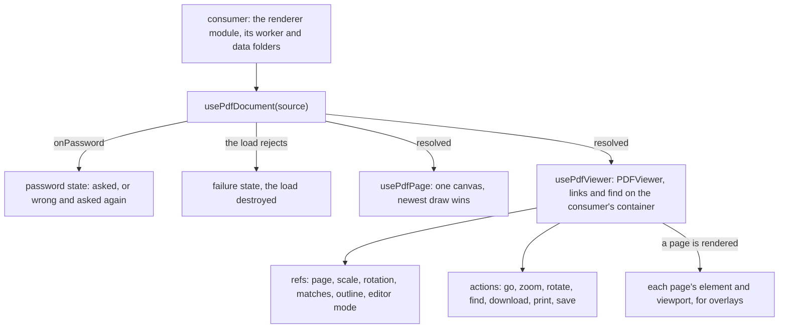

# PDF viewer as a headless package

The PDF viewer's loading, page drawing and viewer state move into `vue-pdfjs-headless`, a published workspace package with no styling. The app's thumbnail and viewer keep only their look. The package then builds the features the audit set aside, because a viewer package owes them even though the app's dialog draws none of them yet.

## Scope

Today the viewer lives in the app. `apps/web/app/services/pdf/loadPdfDocument.ts` imports the renderer after mount and points it at the app's worker and the folders the server mounts. `apps/web/app/services/pdf/getCanvasScale.ts` caps a page's canvas. The thumbnail and the viewer components hold the rest: the draw cancelled by a newer one, the password prompt, the viewer's event bus, and the toolbar's page, zoom, rotation, search, download and print.

After the change:

- **`usePdfDocument`** takes a source and the renderer, and returns the document, its loading progress, the password prompt and the failure. It destroys the loading task on a source change or an unmount.
- **`usePdfPage`** draws one page into a canvas the consumer renders, at the canvas's width times the pixel ratio, capped by area. A width change starts a fresh draw, which supersedes any draw still running.
- **`usePdfViewer`** builds the renderer's `PDFViewer`, `PDFLinkService` and `PDFFindController` on a container the consumer renders. It returns their state as refs and their actions as functions.
- **`vue-pdfjs-headless/xfdf`** reads and writes XFDF, the annotation exchange format, and is framework-free.
- **The app** keeps `apps/web/app/components/Pdf/Thumbnail.vue` and `apps/web/app/components/Pdf/Viewer.vue` as markup and tokens, the toolbar drawn with the UI library, and the folders the server mounts.

The package's peers are `vue` and `pdfjs-dist`, the latter for types only. The renderer module itself is passed in.

## How it works

The split is the one `@vuetify/v0` makes under the UI library: state and actions here, every element the consumer's. Each composable takes the elements the consumer renders and returns refs and functions. None of them draws chrome.



- **The renderer is injected.** The consumer passes the renderer's module, its worker URL and the base URLs of its character maps, standard fonts and image decoders. The package never imports `pdfjs-dist` at runtime, so a consumer that needs older browsers passes the renderer's legacy build, and any bundler takes the package as plain ESM. The app passes the build it loads today, so its worker and API still come from one install.
- **Sources.** A source is a URL, bytes or a `File`, so opening a local file needs no second path. The renderer's loading parameters reach `getDocument` as given, which includes range loading, streaming and auto-fetch. Loading progress is a ref fed by the task's `onProgress`.
- **Pages for overlays.** The viewer reports each rendered page's element and viewport. A consumer then places its own elements over a page and converts a rectangle in PDF coordinates to the screen with that viewport. Area highlights use the same conversion.
- **Search and highlight.** Search drives the find controller, with case, whole words and the match count as refs. Highlighting a list of terms on load is a search over that list, with every match highlighted.
- **Zoom.** Zoom steps between the renderer's scale bounds, and fits to the width, the page or actual size. Pinch zoom reads two pointers on the container, and Ctrl with the wheel zooms the same way. Both scale about the point under the pointer.
- **Bookmarks and thumbnails.** The outline is the document's own, read once it loads, and following an entry goes through the link service. A thumbnail sidebar is `usePdfPage` over each page at the sidebar's width, drawn when its row comes into view, with the current page marked from the viewer's state.
- **Forms and annotations.** Forms are filled through the renderer's annotation layer with forms enabled. Editing sets the renderer's annotation editor mode: free text, ink, highlight and stamp. The document's annotation storage reports every change as an event the consumer can listen to. A comment is a PDF text annotation, the sticky note every PDF reader shows. The package lists a document's comments and adds one at a point on a page. XFDF export reads the annotation storage, and import writes it.
- **Download, print and save.** Download saves the original bytes under the file's name. Once anything has been edited or filled, it saves the bytes `saveDocument` writes instead. A watermark is written as a free-text annotation on every page before that save, so the downloaded file carries it. Print keeps the app's current approach: each page drawn to an image, a batch at a time, in a container only print shows.
- **Fullscreen** requests it on the container the consumer passed, and the ref follows `fullscreenchange`.

## Decisions

- **A headless package over app components.** [Dependency admission](../../specs/architecture/dependency-admission/design.md) names the state a viewer's controls drive as the example of a rewrite's own behaviour, and that state is what both wrappers were installed for. Leaving it in the app was rejected: a second Vue consumer of the renderer would write the loader, the draw cancelling and the find wiring again.
- **Composables over components.** Shipping styled `PdfThumbnail` and `PdfViewer` components was rejected, since a toolbar in the package's own markup is a look every consumer would have to override.
- **The renderer passed in over a renderer dependency.** Importing `pdfjs-dist` from the package was rejected. It would choose the build for every consumer and pin the package to the major it was built against, which is the version cost the [PDF viewer](../../specs/architecture/pdf-viewer/design.md) was rebuilt to remove. The renderer's types stay a peer, so a consumer's renderer major is checked against the package's.
- **The features are built, not deferred.** Twenty rows named the consuming app as their owner, which no dependency is, and the viewer's page set five more aside for now. Parity is measured against the upstream's surface rather than the dialog's, so all of them are built here and tested. The dialog keeps the controls it draws today.
- **XFDF read and written by the package.** The renderer has no XFDF. Depending on a PDF writing library for it was rejected: the annotation storage is already the model both directions map to, and XFDF is plain XML over it.

## Key files

| File                                                         | Role after the change                                           |
| :----------------------------------------------------------- | :-------------------------------------------------------------- |
| `apps/web/app/components/Pdf/Thumbnail.vue`                  | The row's canvas over `usePdfPage`                              |
| `apps/web/app/components/Pdf/Viewer.vue`                     | The pages' container and the toolbar over `usePdfViewer`        |
| `apps/web/app/components/Message/Model/FileRenderer/Pdf.vue` | The attachment: the thumbnail, and the dialog on a click        |
| `apps/web/app/services/pdf/constants.ts`                     | The mounted folders' base URLs and the app's own print settings |
| `apps/web/configuration/nitro.ts`                            | The renderer's folders mounted from its install                 |
| `openspec/specs/architecture/pdf-viewer/design.md`           | The app's use of the package                                    |

The package itself:

```text
packages/vue-pdfjs-headless/src/composables/  usePdfDocument, usePdfPage, usePdfViewer, each with its test
packages/vue-pdfjs-headless/src/services/     the canvas scale, pinch zoom, print, download and save
packages/vue-pdfjs-headless/src/xfdf/         readXfdf and writeXfdf, framework-free
packages/vue-pdfjs-headless/src/models/       PdfSource, PdfRenderer, PdfComment, PdfPageOverlay
openspec/specs/vue-pdfjs-headless/README.md   the package's requirements and both Upstream tables
```

## Notes

- Annotation editing, forms, comments and the watermark all rest on the renderer's annotation storage and on `saveDocument` writing it out. A kind of annotation the renderer cannot write on save is recorded on the package's page by the task that builds it, before anything is built around it.
- The app's dialog changes nothing a reader sees. The new features reach the app only when a dialog draws their controls, and that is a product decision for the attachment, not this change.

## Sources

- [PDF.js API](https://mozilla.github.io/pdf.js/api/draft/module-pdfjsLib.html): `getDocument`'s parameters, range loading, streaming and auto-fetch among them.
- [mozilla/pdf.js — `src/display/api.js`](https://github.com/mozilla/pdf.js/blob/master/src/display/api.js): the loading task's `onPassword` and `onProgress`, and the document's `saveDocument`, which the API page lists without their members.
- [mozilla/pdf.js — `web/pdf_viewer.js`](https://github.com/mozilla/pdf.js/blob/master/web/pdf_viewer.js): the viewer component, its annotation and annotation editor modes, and its events.
- [ISO 19444-1, XML Forms Data Format](https://www.iso.org/standard/74272.html): the XML format for a PDF's annotations and form data.
- [hrynko/vue-pdf-embed](https://github.com/hrynko/vue-pdf-embed) and [vue-pdf-viewer/vue-pdf-viewer](https://github.com/vue-pdf-viewer/vue-pdf-viewer): the trackers the Upstream tables judge.
