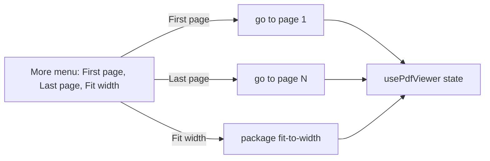

## Context

The primary bar holds the page and zoom controls and a More menu of everything an ordinary session does not use. The menu's view group has Rotate left, Rotate right, Fit page and Actual size. The viewer's state, from the package's `usePdfViewer`, already offers going to a page by number and fitting to the width, which the zoom gesture and the opening scale use.

## How it works

The commands change state the page field and the zoom readout already show, so neither needs a new display.

## Gap analysis

The controls of the reference viewer's markup, with the verdict this change gives each.

| Feature                                                      | Verdict                                                                                               |
| ------------------------------------------------------------ | ----------------------------------------------------------------------------------------------------- |
| First page, Last page                                        | Built as two menu items.                                                                              |
| Zoom to page width                                           | Built as Fit width.                                                                                   |
| Find, rotate, zoom, print, save, sidebar                     | Already built.                                                                                        |
| Scroll and spread modes, presentation, hand tool, properties | Rejected: [PDF viewer reading modes](../../rejected/architecture/pdf-viewer-reading-modes/design.md). |
| Highlight, draw and image tools                              | Deferred: [PDF viewer markup tools](../../deferred/architecture/pdf-viewer-markup-tools/design.md).   |
| Signatures                                                   | Rejected: [PDF viewer signatures](../../rejected/architecture/pdf-viewer-signatures/design.md).       |

## Decisions

- **Menu items, not bar buttons.** The bar holds what every session uses, and a first or last page command is an occasional one, as the viewer's decisions about the bar already say.
- **No shortcut.** Home and End would be the natural keys, and the viewer adds no key handling of its own, so the commands stay reachable by Tab like every other control.

## Key files

| File                                             | Role                                                   |
| ------------------------------------------------ | ------------------------------------------------------ |
| `apps/web/app/components/Pdf/Viewer/Toolbar.vue` | the More menu, which gains the three items             |
| `apps/web/app/components/Pdf/Viewer/Index.vue`   | holds the package's state that the three commands call |

## Sources

- [pdf.js viewer markup](https://raw.githubusercontent.com/mozilla/pdf.js/master/web/viewer.html) — the reference viewer's toolbar: first page and last page commands, and a zoom choice that fits the page width.
