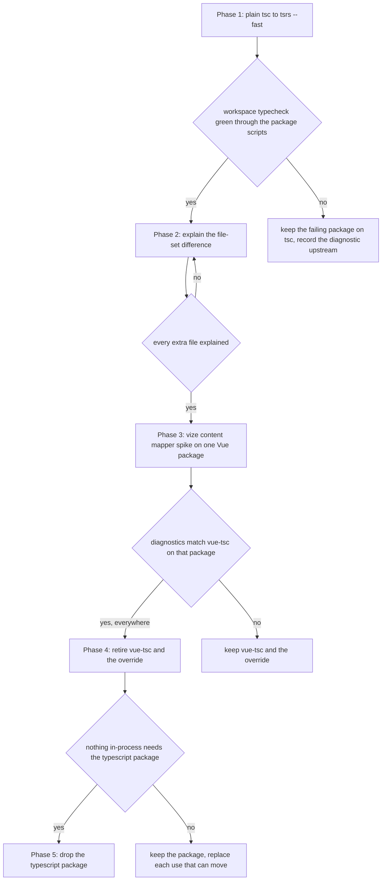

# Design

## Context

The current arrangement is recorded in [monorepo tooling](../../specs/architecture/monorepo-tooling/design.md) under "TypeScript compiler": plain `tsc` everywhere (`vue-tsc` where a package holds `.vue` files), and the `typescript` package overridden onto `typescript-native-bridge`, so the classic API runs the Go compiler in-process. That section states that no `tsgo` invocation remains in any script, and that the override is the whole switch. This change moves away from that arrangement in phases, and the archived spec will rewrite the section as built.

## Decisions

### Phase 1: plain `tsc` to `tsrs --fast`

`tsrs` is the Rust port of the TypeScript 7 checker, a standalone CLI shipped with per-platform binaries. Its `latest` tag is the `0.20.0-ts7.1.0-beta` release. Plain typecheck scripts now run `tsrs --fast`, and the `noEmit` setting comes from the shared `tsconfig` chain, which sets it in `packages/configuration/tsconfig.base.json`. A flag that repeats the config would be a second place for the same fact, so the scripts omit it.

Rejected: keeping the flag and passing it through every script. It duplicates a setting the config already owns.

The `--fast` preset enables the adaptive checker counts and lazy member resolution. Its side effects are that diagnostics can change in known check-order cases, and that counters differ. The repo accepts that for a typecheck gate because the same program is checked the same way on each run, and a failure reproduces from the source.

### The `azure-mock` false positive

`packages/azure-mock/src/models/table/MockTableClient.ts` returns an object literal from a function whose return type is `PagedAsyncIterableIterator`, and its `byPage` member takes a destructured parameter with a default: `({ maxPageSize } = {})`. `tsrs` reports `TS7031` (implicit `any` on the binding element) under both the default mode and `--fast`. `tsc` in this repo reports no error, and stock TypeScript 5.9.3 accepts a minimal reproduction of the same shape. So the diagnostic is a `tsrs` gap, not a defect in the source.

Rejected: keeping `azure-mock` on `tsc` until `tsrs` is fixed. That leaves one package on the old path for a reason the repo can remove in the source. The fix is an explicit `PageSettings` annotation on the parameter, which is the type the interface already names, and it reads more plainly than the inferred form.

The owner files the upstream report. The reproduction is the shape above, with the `tsrs` version and the two passing compilers named.

### Phase 2: the file sets differ

`tsrs --listFiles` lists 1736 files for the same package where `tsc --listFiles` lists 1640 (measured on `packages/shared`, and on the whole repository the counts differ the same way). The gap is open and is the next task, not a finding. A file counted only by `tsrs` is either a default library file the two compilers count differently, or a file `tsc` excludes through a `tsconfig` setting `tsrs` reads differently. The phase ends when every extra file is explained in this page.

### Phase 3: `vize` and Vue checks

`vize` checks `.vue` files through a content mapper declared in `tsconfig` (`contentMappers` with `"package": "vize"`), and its README runs that mapper through `tsrs`. Its own README marks it experimental, and its type checking requires `typescript@beta`, so it does not remove the `typescript` package. `tsrs` runs content mappers from the CLI, but its language server does not run them, so editor diagnostics for `.vue` files are not covered by this path.

Rejected: removing `vue-tsc` now. `vue-tsc` reads the classic API that the override provides, so the override cannot go until a replacement covers every `vue-tsc` use.

### Phase 4 and 5: the override and the `typescript` package

The override stays while `vue-tsc`, `@volar/typescript` and the editor read the classic API. The `typescript` package stays while `scripts/src` imports it in-process (about twenty files use `ts.createSourceFile` and the factory), and while build and tooling packages reach it through peers, including `rolldown-plugin-dts`, `tsdown`, `vite-plugin-checker` and `@arethetypeswrong/core`. `tsrs` ships an `ast` subpath among its beta API subpaths, which is the first candidate for the `scripts/` uses; whether it covers them is unverified.

## Mechanism

Each phase is gated. A later phase cannot start on an earlier one's assumption, and a gate fails closed to the previous arrangement.

## Key files

| File                                                                     | Role                                                                     |
| :----------------------------------------------------------------------- | :----------------------------------------------------------------------- |
| `package.json`, `pnpm-workspace.yaml`                                    | the `tsrs` root devDependency and its catalog entry                      |
| `apps/*/package.json`, `packages/*/package.json`, `scripts/package.json` | each package's `typecheck` script, and `apps/web`'s service-worker check |
| `packages/configuration/tsconfig.base.json`                              | sets `noEmit`, which every swapped script inherits                       |
| `packages/azure-mock/src/models/table/MockTableClient.ts`                | the source the `tsrs` false positive was reproduced in                   |
| `openspec/specs/architecture/monorepo-tooling/design.md`                 | owns the TypeScript compiler section, rewritten as built at archive      |
| `openspec/specs/architecture/lint-toolchain/design.md`                   | owns the type-aware lint pass, out of scope here                         |
| `scripts/src/services/**` (in-process `typescript` imports)              | the uses phase 5 must replace or keep                                    |

## Notes

- The speed difference seen so far is one sample on `packages/shared` (about 0.9 seconds for `tsrs --fast` against about 2.4 seconds for `tsc`), not a benchmark. The phase that adopts `tsrs` for the whole repository measures it.
- Dropping the flag from the scripts changes no check: `tsc` and `tsrs` both read `noEmit` from the chain, which is the same fact.

## Sources

- [tsrs README](https://github.com/oxc-project/tsrs) — the release tag, the `--fast` preset and its side effects, and the stability statement.
- [tsrs compatibility](https://github.com/oxc-project/tsrs/blob/main/docs/COMPATIBILITY.md) — the content mapper and language server rows.
- [vize README](https://github.com/ubugeeei-prod/vize) — the experimental status and the `typescript@beta` type-checking path.
