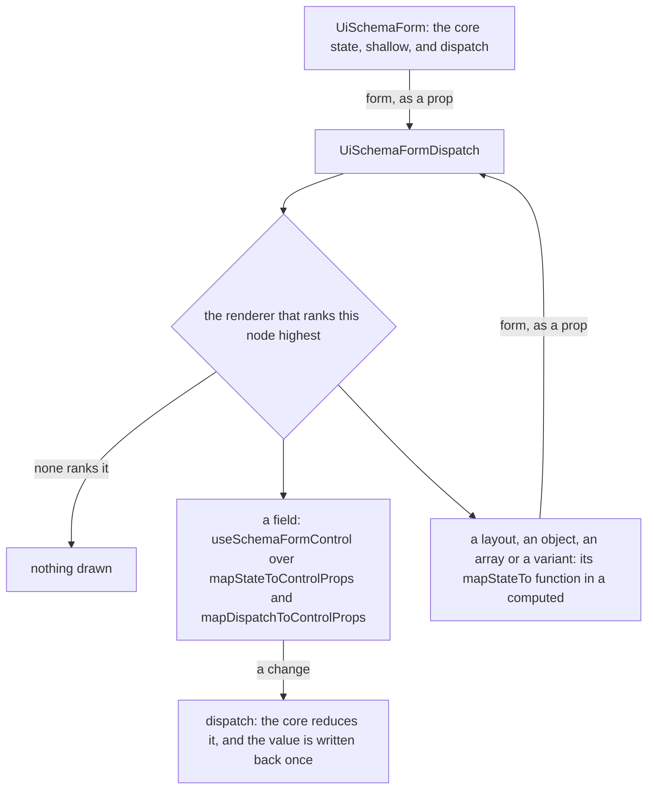

# Schema form bindings of the app's own

`UiSchemaForm` holds JSON Forms' core state, and every node is drawn by a `<script setup>` renderer of the app's own, which the [schema forms](../../specs/architecture/schema-forms/design.md) page records. The renderers still read that state through `@jsonforms/vue`'s `useJsonForms*` composables. This change replaces them with calls to `@jsonforms/core`'s own mapping functions, as the [dependency admission](../../specs/architecture/dependency-admission/design.md) standard absorbs a component wrapper.

## How a node reads the form

## Decisions

- **The state is a prop, not an injection.** `UiSchemaForm` passes `form` — the shallow state and `dispatch` — to `UiSchemaFormDispatch`, which passes it to the renderer it picks, which passes it to every nested dispatch. `UiSchemaFormRendererProps` gains it. The [Vue conventions](../../../.agents/skills/vue/SKILL.md) ban injection because an injected input is missing from a component's signature and a test must mount its provider; the exception the skill made for JSON Forms' `dispatch` existed only because the library's composables injected, and it goes with them. Rejected: keeping the injection under our own composables, which would keep the exception for no library's sake.
- **Each binding is the core's mapping function.** A field calls `mapStateToControlProps` and `mapDispatchToControlProps` inside `useSchemaFormControl`, which already holds the field's layout meta and issue. The layout, object, array and variant renderers each call their one function in a `computed` — `mapStateToLayoutProps`, `mapStateToControlWithDetailProps`, `mapStateToArrayControlProps` with `mapDispatchToArrayControlProps`, `mapStateToOneOfProps` — and the dispatch calls `mapStateToJsonFormsRendererProps`. A composable wrapping one call would be a one-line composable, which the app does not write. The array's `addItem`, `removeItems`, `moveUp` and `moveDown` stay thunks the renderer calls, as the core returns them.
- **One change per edit.** The root already reduces each action and writes the value back only when it differs, so an edit emits once (#2003); the bindings add no emit of their own.
- **Nothing proxied deeply.** The state stays `shallowReactive`, so the renderer registry and the Ajv instance inside the core are never made reactive (#1832, #2025).
- **A node no renderer ranks draws nothing.** The library's `UnknownRenderer` printed a notice into the form; every node a form schema produces has a renderer, which the forms' schema snapshot tests pin, so an unranked node is skipped rather than shown to a reader.
- **No control ids.** The library's `useControl` created an id per scope and released it on unmount (#2213); the renderers label their inputs with Vue's `useId`, so the id registry has no reader.

## Upstream

Every `@jsonforms/vue` issue and pull request the audit selected from `eclipsesource/jsonforms`, open and closed, gets one verdict in an Upstream table on the schema forms design page. Its four defects are settled above (#1832, #2025 by the shallow state; #2250 by construction, since nothing is published as CommonJS; and the open pull request #2623 by the shallow state), and its features are out of scope: the bindings have one consumer, so no Nuxt module, side-effect flag or exposed validator is built.

## Key files

| File                                                         | Role after the change                                             |
| :----------------------------------------------------------- | :---------------------------------------------------------------- |
| `apps/web/app/components/Ui/SchemaForm/Index.vue`            | the core state and dispatch, passed down as `form`                |
| `apps/web/app/components/Ui/SchemaForm/Dispatch.vue`         | the renderer ranked highest, given `form`                         |
| `apps/web/app/composables/ui/useSchemaFormControl.ts`        | a field's control, layout meta and issue, over the core's mapping |
| `apps/web/app/models/ui/UiSchemaFormRendererProps.ts`        | what every renderer takes, `form` among it                        |
| `apps/web/app/services/ui/schemaForm/SchemaFormRenderers.ts` | which renderer draws which node, by rank                          |

## Sources

- [JSON Forms](https://github.com/eclipsesource/jsonforms): the core package's `mapStateTo*` and `mapDispatchTo*` functions, and the Vue package's bindings read for behaviour.
