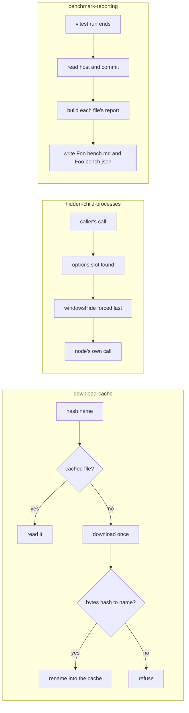

# Shared Node Capabilities

The package's three parts are peers. Each is used on its own, by different callers, and none depends on another's rules, so each gets a capability page of its own, and the architecture index lists them. Each page states its rules as requirements, and its scenarios are the names of the tests that already check them.

## How it works

Each part is a separate flow, drawn together only so the three read as one package. The download-cache flow refuses a name before it builds a path from it, and only then reads the cache or downloads. The child process wrappers find the options slot by node's own argument shapes, and force the window flag after any caller option. The reporter runs once per test run, and writes two files beside each bench that recorded results.

## Decisions

- **Three capabilities, not one with sub-capabilities.** A sub-capability is a feature that only exists inside its parent. These three have no shared rule, and each has its own callers, so they are peers ([page shapes](../../specs/architecture/README.md)).
- **Under `architecture/`, with no area.** The package serves the repo's own tooling and downloads, and an installable library is what earns an area. Nothing here is installed by another project.
- **Scenario titles are the existing test titles.** A requirement's scenarios match the tests that check it, so a reader can find the proof from the page. Where a rule has no test, the tasks name one to write, and nothing is added to pin a constant.
- **The cache is one folder per machine.** Every checkout, worktree and ephemeral run reads the same cache root, so a dependency fetched once is not fetched again in a new worktree. The root and the content folder are constants in the cache's constants module, and the design page states them rather than a requirement, since a test would only pin the path.
- **Benchmark reports are checked offline.** The committed `*.bench.md` and `*.bench.json` are diffed in review rather than gated in CI, so the page states what a report contains and leaves the threshold to the bench skill. The package's bundle-size tests in its index test are its size gate, and the page names them without a requirement.

## Key files

The pages describe these existing files.

| File                                                                    | Role                                                    |
| ----------------------------------------------------------------------- | ------------------------------------------------------- |
| `packages/shared-node/src/cache.ts`                                     | the `cache` subpath barrel                              |
| `packages/shared-node/src/services/cache/readContentAddressedObject.ts` | the read-through cache                                  |
| `packages/shared-node/src/services/cache/constants.ts`                  | the cache root and the content folder                   |
| `packages/shared-node/src/childProcess.ts`                              | the `child-process` subpath barrel                      |
| `packages/shared-node/src/services/childProcess/withHiddenWindow.ts`    | the options-slot rule every wrapper shares              |
| `packages/shared-node/src/services/childProcess/spawn.ts`               | the wrapper for `spawn`, with the others beside it      |
| `packages/shared-node/src/services/BenchmarkMarkdownReporter.ts`        | the Vitest reporter                                     |
| `packages/shared-node/src/services/buildBenchmarkFileReport.ts`         | a file's results projected into groups                  |
| `packages/shared-node/src/services/formatBenchmarkMarkdown.ts`          | the Markdown rendering                                  |
| `packages/shared-node/src/services/writeBenchmarkReport.ts`             | the two files beside each bench                         |
| `packages/shared-node/src/services/readBenchmarkEnvironment.ts`         | the host and commit every report records                |
| `packages/shared-node/src/services/constants.ts`                        | the fixed run options and the native baseline name      |
| `packages/configuration/src/services/getBenchmarkReporters.ts`          | the reporter is wired only for the `bench` command      |
| `oxlint.config.ts`                                                      | the rule that bans `child_process` outside the wrappers |

## Notes

- The reporter's wiring lives in `packages/configuration`, which builds before this package, so it is referred to by its path string. The benchmark-reporting page names it and does not own it.
- Each capability page is written from the code as it stands, and each one's scenarios are checked by the tests named in its tasks.
