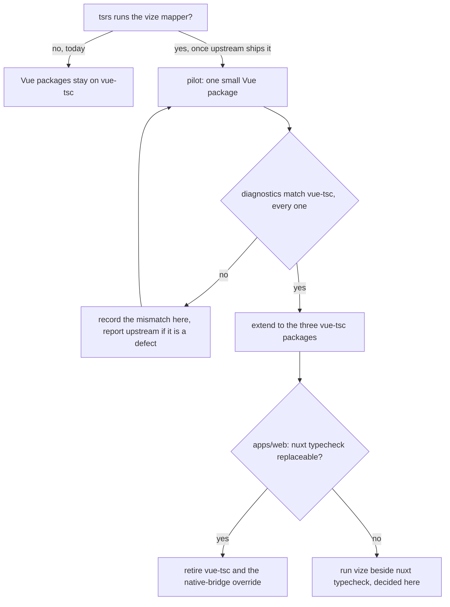

# Design

## Context

Plain typecheck now runs through `tsrs` ([Rust toolchain change](../architecture-rust-typescript-toolchain/design.md)). The Vue checks did not move, because `vue-tsc` reads the classic TypeScript API that the `typescript-native-bridge` override provides, and `tsrs` ships no classic API. Two things make the Vue path different: `vize` checks `.vue` files through a content mapper, a separate process that TypeScript spawns and asks for virtual TypeScript per file, and that mapper protocol is implemented by `tsrs`'s CLI but not by its language server. The current arrangement is recorded in [monorepo tooling](../../specs/architecture/monorepo-tooling/design.md) under "TypeScript compiler", which this change will rewrite as built.

## The spike

A scratch project in the session's scratchpad, installed with `vize@0.587.0`, `typescript@beta` (the 7.1 beta) and `tsrs@0.20.0-ts7.1.0-beta`, with one SFC (`src/Hello.vue`) declaring a `number` ref as a `string`:

| Command                                            | Result                                                                                        |
| :------------------------------------------------- | :-------------------------------------------------------------------------------------------- |
| `tsc --runExternalCode --noEmit -p tsconfig.json`  | `Hello.vue(5,7): error TS2322: Type 'number' is not assignable to type 'string'.`             |
| `tsrs --runExternalCode --noEmit -p tsconfig.json` | `Hello.vue(1,1): error TS18069`, the mapper process failed while handling the project request |
| `tsrs --noEmit -p tsconfig.json`                   | `TS18068`: content mappers require `--runExternalCode`                                        |
| `tsrs` with the mapper's declared options set      | the same `TS18069`, so `rootDir`, `checkJs` and `noUnusedLocals` are not the cause            |

The mapper is declared in vize's `package.json` under `typescript.contentMapper`, with `exec` running `node ./bin/vize content-mapper`, `dynamicConfig: true`, and the compiler options it reads. The `tsc` run is the reference for what the mapper returns, and the `tsrs` run fails on the request that precedes any output.

## Decisions

### The Vue checks wait on `tsrs`, not on a second compiler

The goal is one compiler for every check. A permanent split, with `tsrs` for TypeScript and `tsc` for `.vue`, keeps the classic API alive and gives the Vue path a separate speed and memory profile to maintain. So the Vue packages stay on `vue-tsc` until `tsrs` runs the mapper. The mapper gap is reported upstream, not patched around in the repo.

Rejected: switching the Vue packages to the TypeScript 7.1 beta's `tsc` now. It works in the spike, but it makes the Vue checks depend on a beta classic compiler that the rest of the repo does not use, and it is the same dependency the `tsrs` path would remove.

### The compiler for the proven path

If the Vue packages move before `tsrs` does, they need the TypeScript 7.1 beta, because that is the release vize's mapper is conformance-tested against. The `typescript` package is pinned to `6.0.3` through the native bridge, and `scripts/` imports it in-process. Two options:

- Move the `typescript` package to the 7.1 beta for everything. This changes the in-process API `scripts/` reads, and the native bridge goes with it.
- Alias a second `typescript` for the Vue packages only. This keeps `scripts/` on the bridge, and puts two TypeScript copies in the lockfile.

The choice is taken at the pilot gate, against which in-process uses `scripts/` has.

### Formatter and linter stay on oxfmt and oxlint

`vize fmt` formats the pilot's 258 files identically to oxfmt on the current tree, but it has no `objectWrap` option: on a multi-line object literal oxfmt collapses it under the repo's `objectWrap: "collapse"`, and `vize fmt` keeps it expanded with trailing commas. `vize lint` has no plugin API, and oxlint runs sixteen repo-owned JS plugins (`scripts/src/oxlint/*.ts`) with type-aware rules, so those rules would be lost. Both stay.

### Pilot before scope

`packages/vue-canvas-frame-headless` was proposed as the pilot for its size, but it is not a valid one. Its `typecheck` is `tsrs --fast`, not `vue-tsc`, and it has no `.vue` file: its only `defineComponent` sits in a browser test fixture. A diagnostic match on it would compare two outputs with no Vue source behind them. The pilot is `packages/vue-phaserjs`: the smallest package that runs `vue-tsc` today and has real `.vue` files (27). Its result: `vue-tsc` reports nothing, and the `tsrs` run through the mapper reports no diagnostic in any `.vue` file, with 27 `.vue` files in the program. It reported one `.ts` diagnostic, the canvas mock in `src/test/setupCanvas.ts` missing `lang`. That diagnostic also appears with `tsrs` and no mapper, so it comes from the TypeScript 7.1 DOM typings, and the mock gained `lang` in the same change. Its gate is that the mapper's diagnostics match `vue-tsc`'s on the same program, every diagnostic, both the error set and the locations. A mismatch is recorded in this design before the next package starts, and a mismatch that is a `vize` or `tsrs` defect is reported upstream.

### `apps/web` last

`nuxt typecheck` generates the type declarations it checks against (auto-imports, route types, `.nuxt`), and that generation runs through Nuxt's own `vue-tsc` integration. Replacing it means either wiring vize into Nuxt's typecheck, or running vize outside Nuxt's generated config. `vize` ships a Nuxt module, but whether its check replaces `nuxt typecheck` or sits beside it is not established by the spike. That decision is written here when the pilot is done.

## Mechanism

## Key files

| File                                                       | Role                                                                                                                                    |
| :--------------------------------------------------------- | :-------------------------------------------------------------------------------------------------------------------------------------- |
| `packages/genshin-interface/package.json`                  | `typecheck` runs `vue-tsc`                                                                                                              |
| `packages/genshin-world/package.json`                      | `typecheck` runs `vue-tsc`                                                                                                              |
| `packages/vue-phaserjs/package.json`                       | `typecheck` runs `tsrs --fast --runExternalCode`; its tsconfig's `contentMappers` names vize; `vue-tsc` stays for the declaration build |
| `apps/web/package.json`                                    | `typecheck` is `nuxt typecheck` followed by the service-worker `tsrs` check                                                             |
| `pnpm-workspace.yaml`                                      | the `typescript` override onto `typescript-native-bridge`, and the `vue-tsc` pin                                                        |
| `openspec/specs/architecture/monorepo-tooling/design.md`   | owns the TypeScript compiler section, rewritten as built at archive                                                                     |
| `openspec/changes/architecture-rust-typescript-toolchain/` | the change this one depends on, for every plain `tsc` path                                                                              |

## Notes

- `tsrs --noEmit` on a config with `contentMappers` is refused without `--runExternalCode`. That flag is required for the mapper, and the scripts that will use it must pass it explicitly.
- The `TS18069` message points at the mapper process. It is not a type error in the `.vue` file, so a green or red run here does not yet say anything about the Vue source.
- Removing `vue-tsc` from a package is not the same as switching its `typecheck` script. Every non-private Vue package builds its declarations through `dts.tsc.vue` (`packages/configuration/src/services/getTsdownConfigurationVue.ts`), and `rolldown-plugin-dts` loads `vue-tsc` with `require.resolve("vue-tsc")` and runs it in a separate process. So `vue-tsc` stays a build dependency until declarations for `.vue` files come from somewhere else. `apps/web`'s `nuxt typecheck` runs `vue-tsc` the same way, through Nuxt. `scripts/` no longer uses the classic API: it reads sources through `oxc-parser` (`969e141dec`). `vite-plugin-checker` and `@volar/typescript` have no tracked references in the repo.
- On Windows, `tsrs` does not launch the mapper's bare `node` command: with `node` in `exec` it reports `TS18069` without spawning anything. The same command with `node.exe` spawns and checks normally. The cause is not pinned down. The mapper's `exec` is declared by the `vize` package, so a local run on Windows needs a workaround until `tsrs` launches the bare name. CI on Linux is not checked by this.
- `vize`'s Nuxt module (`@vizejs/nuxt`) does not touch `nuxt typecheck`. It replaces Nuxt's Vue SFC compiler and adds an oxlint-based lint checker in dev. Registering it would change how every component compiles, so it is a separate decision from the typecheck migration.
- The 7.1 beta package does not replace the native bridge. It exports the CLI and the sync and async APIs, and `createSourceFile` and `createProgram` are undefined on its classic module, so it cannot host the consumers above.

## Landmines

Found while running the mapper on the repo. Each has its status against the upstream trackers; none is filed from this repo, since the owner files upstream reports by hand.

- **Dynamic event listeners on components break the mapper's virtual code.** A `@[\`...\`]`listener on a component (not a native element) makes the mapper write the expression raw into a type literal as a key, which is a syntax error in the virtual file.`apps/web`has a set of`components/Dungeons`files that use it, and`vue-tsc`accepts them. No upstream issue matches; the nearest are vize`#10617`(undeclared`$`-prefixed template globals) and `#10251`(dynamic component refs), which are different. Candidate to report, with`components/Dungeons/MobileJoystick/ConfirmThumb.vue` as the reproduction.
- **`tsrs` stops using the mapper after five transform failures.** It prints `TS18070` and skips the mapper for every file after that, so the rest of the `.vue` files go unchecked with no diagnostic. On `apps/web`, five files failed this way although the mapper transforms each of them when asked directly, and the failures were not seen on an earlier run. No upstream issue found for `TS18070` or the failure budget.
- **`tsrs` does not spawn the mapper's bare `node` on Windows.** `node.exe` works. No upstream issue matches; `tsrs` `#694` (Windows path handling in default library lookup) is related but not the same failure.
- **The mapper's virtual code imports `vize/content-mapper-helpers`**, so every package that uses the mapper needs `vize` resolvable from its own folder. This is a requirement, not a defect, and it changes the lockfile per package.
- **`vue-tsc` is still needed for `.vue` declarations** (see Notes). Switching a package's `typecheck` script does not remove it.
- **TypeScript 7.1's DOM typings require `lang` on `CanvasRenderingContext2D`**, which fails the canvas mock under `tsrs` and not under TypeScript 6.0.3. This is a compiler-version difference, not a vize defect.
- **Nuxt's `typecheck` takes only `vue-tsc` or `golar`.** The checker list is fixed in `@nuxt/cli`, and no module can add to it, so the Nuxt route to the mapper is not in Nuxt's own command.
- **Upstream performance is open:** vize `#10620` reports `vize check` slower than `tsc` with the same mapper on a mid-size Nuxt app. Speed is not measured here.

## Sources

- [vize README](https://github.com/ubugeeei-prod/vize) — the `contentMappers` entry, the `typescript@beta` requirement and the experimental status.
- [vize content-mapper conformance workflow](https://github.com/ubugeeei-prod/vize/blob/main/.github/workflows/content-mapper-conformance.yml) — the TypeScript commit the mapper is tested against.
- [vize vue-tsc comparison workflow](https://github.com/ubugeeei-prod/vize/blob/main/.github/workflows/typecheck-vs-vue-tsc.yml) — report-only, not a gate.
- [tsrs content-mapper port notes](https://github.com/oxc-project/tsrs/blob/main/notes/contentmappers.md) — the JSON-RPC protocol and the host the failing request goes through.
