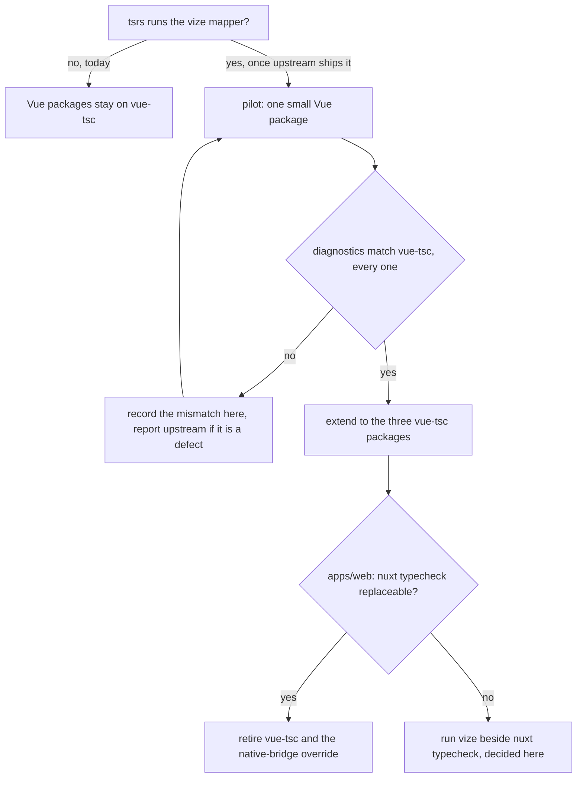

# Design

## Context

Plain typecheck now runs through `tsrs` ([Rust toolchain change](../architecture-rust-typescript-toolchain/design.md)). The Vue checks did not move, because `vue-tsc` reads the classic TypeScript API that the `typescript-native-bridge` override provides, and `tsrs` ships no classic API. Two things make the Vue path different: `vize` checks `.vue` files through a content mapper, a separate process that TypeScript spawns and asks for virtual TypeScript per file, and that mapper protocol is implemented by `tsrs`'s CLI but not by its language server.

## The spike

A scratch project in the session's scratchpad, installed with `vize@0.587.0`, `typescript@beta` (the 7.1 beta) and `tsrs@0.20.0-ts7.1.0-beta`, with one SFC (`src/Hello.vue`) declaring a `number` ref as a `string`:

| Command                                            | Result                                                                                        |
| :------------------------------------------------- | :-------------------------------------------------------------------------------------------- |
| `tsc --runExternalCode --noEmit -p tsconfig.json`  | `Hello.vue(5,7): error TS2322: Type 'number' is not assignable to type 'string'.`             |
| `tsrs --runExternalCode --noEmit -p tsconfig.json` | `Hello.vue(1,1): error TS18069`, the mapper process failed while handling the project request |
| `tsrs --noEmit -p tsconfig.json`                   | `TS18068`: content mappers require `--runExternalCode`                                        |
| `tsrs` with the mapper's declared options set      | the same `TS18069`, so `rootDir`, `checkJs` and `noUnusedLocals` are not the cause            |

The mapper is declared in vize's `package.json` under `typescript.contentMapper`, with `exec` running `node ./bin/vize content-mapper`, `dynamicConfig: true`, and the compiler options it reads. The `tsc` run is the reference for what the mapper returns, and the `tsrs` run fails on the request that precedes any output.

## Decisions

### The Vue checks wait on `tsrs`, not on a second compiler

The goal is one compiler for every check. A permanent split, with `tsrs` for TypeScript and `tsc` for `.vue`, keeps the classic API alive and gives the Vue path a separate speed and memory profile to maintain. So the Vue packages stay on `vue-tsc` until `tsrs` runs the mapper. The mapper gap is reported upstream, not patched around in the repo.

Rejected: switching the Vue packages to the TypeScript 7.1 beta's `tsc` now. It works in the spike, but it makes the Vue checks depend on a beta classic compiler that the rest of the repo does not use, and it is the same dependency the `tsrs` path would remove.

### The compiler for the proven path

If the Vue packages move before `tsrs` does, they need the TypeScript 7.1 beta, because that is the release vize's mapper is conformance-tested against. The `typescript` package is pinned to `6.0.3` through the native bridge, and `scripts/` imports it in-process. Two options:

- Move the `typescript` package to the 7.1 beta for everything. This changes the in-process API `scripts/` reads, and the native bridge goes with it.
- Alias a second `typescript` for the Vue packages only. This keeps `scripts/` on the bridge, and puts two TypeScript copies in the lockfile.

The choice is taken at the pilot gate, against which in-process uses `scripts/` has.

### Formatter and linter stay on oxfmt and oxlint

`vize fmt` formats the pilot's 258 files identically to oxfmt on the current tree, but it has no `objectWrap` option: on a multi-line object literal oxfmt collapses it under the repo's `objectWrap: "collapse"`, and `vize fmt` keeps it expanded with trailing commas. `vize lint` has no plugin API, and oxlint runs sixteen repo-owned JS plugins (`scripts/src/oxlint/*.ts`) with type-aware rules, so those rules would be lost. Both stay.

### Pilot before scope

`packages/vue-canvas-frame-headless` was proposed as the pilot for its size, but it is not a valid one. Its `typecheck` is `tsrs --fast`, not `vue-tsc`, and it has no `.vue` file: its only `defineComponent` sits in a browser test fixture. A diagnostic match on it would compare two outputs with no Vue source behind them. The pilot is `packages/vue-phaserjs`: the smallest package that runs `vue-tsc` today and has real `.vue` files (27). Its result: `vue-tsc` reports nothing, and the `tsrs` run through the mapper reports no diagnostic in any `.vue` file, with 27 `.vue` files in the program. It reported one `.ts` diagnostic, the canvas mock in `src/test/setupCanvas.ts` missing `lang`. That diagnostic also appears with `tsrs` and no mapper, so it comes from the TypeScript 7.1 DOM typings, and the mock gained `lang` in the same change. After the canvas mock's cast in `src/test/setupCanvas.ts`, `tsrs --fast` and `vue-tsc --noEmit` both exit with 0 diagnostics on the package, so the pilot's diff is empty. Its gate is that the mapper's diagnostics match `vue-tsc`'s on the same program, every diagnostic, both the error set and the locations. A mismatch is recorded in this design before the next package starts, and a mismatch that is a `vize` or `tsrs` defect is reported upstream.

The first package after the pilot is `packages/genshin-interface`, also compared. Its `tsrs` run reports 0 diagnostics and its `vue-tsc` run reports 0 diagnostics, so the diff is empty on both the error set and the locations. `packages/genshin-world` is compared clean as well, at `9d1bb6fc19`: `tsrs` and `vue-tsc` each report 0 diagnostics, so the diff is empty. With `packages/vue-phaserjs` clean after its canvas mock cast, that closes task 4.1 across the three packages. `packages/vue-phaserjs` was compared as the pilot above, and its post-cast result is recorded there.

### `.vue` declarations from `vize check --declaration`

`vize check --declaration --declaration-dir` was run through `tsrs` on `packages/genshin-interface` and compared with `vue-tsc --declaration --emitDeclarationOnly` on the same build tsconfig. It is not a drop-in:

- **No component declaration matches.** `vue-tsc` writes Vue's own `DefineComponent` with a slots wrapper. `vize` writes its own component model: exported `Props`, `Emits` and `Slots` types, a `__setup` function carrying the template slots and exposed members, and a `new <$AuthoredProps>()` constructor type, with every file importing a shared `__vize_helpers.d.ts` that the emit writes beside them. The props, slots and exposed members are all present, in a different type.
- **A consumer checked by `vue-tsc` rejects that type.** The consumer test pointed `packages/genshin-world`, through a scratch tsconfig `paths` entry, at a declaration tree for `genshin-interface`, once from `vue-tsc` and once from `vize` (the barrels and the non-`.vue` files from `vue-tsc` in both), and checked it with each checker. A dependent otherwise reaches a sibling through the `source` condition and never reads built declarations, so the redirect is what makes the test mean something. The result is a matrix:

  | Dependent checked by   | `vue-tsc` declarations | `vize` declarations |
  | :--------------------- | :--------------------- | :------------------ |
  | `tsrs` with the mapper | clean                  | clean               |
  | `vue-tsc`              | clean                  | tens of `TS2345`    |

  Every `vue-tsc` error is the same shape: attributes passed to a component that its props do not declare (`role`, `aria-*`, `class`, a listener) are refused against `$AuthoredKeyWitness`, because the `vize` constructor type is written for the mapper's own virtual code and not for `vue-tsc`'s call.

- **It does not read the build the way tsdown does.** With no file patterns it found only the config files, because the shared Vue tsconfig's `${configDir}` include is not expanded; with a `src` pattern it ignores the tsconfig's excludes and emits the fixtures and visual files too, and it reports every auto-imported name as missing until the package's `auto-imports.d.ts` and `vite-env.d.ts` are named on the command line as well.
- **It is slower than `vue-tsc` on the native bridge**, by roughly an order of magnitude on this package.
- **It emits per file, with no barrel.** The bundling into one `.d.ts` per entry stays with the declaration plugin, which would take the per-file output and inline the helper file.

**Decision: `vue-tsc` stays the declaration generator until every consumer is checked by the mapper.** The `vize` declarations work for a mapper-checked dependent and break a `vue-tsc`-checked one, and `apps/web` is `vue-tsc`-checked, and stays so after its mapper diagnostics are triaged. A published package also reaches consumers outside this repo, and any of them on `vue-tsc` would hit the same refusal, so these declarations cannot be what a published package ships while `vue-tsc` is the common checker. The gate is not reachable by triage alone: `apps/web` stays on `nuxt typecheck` ("`apps/web` last", below), which is `vue-tsc`-based, so passing task 5.2 leaves the app `vue-tsc`-checked. Task 5.3 weighs two ways to clear the gate: move `apps/web` onto the mapper, or narrow the gate to the published consumers. The decision below rejects both. The order is therefore the app first (tasks 5.2 and 5.3), then the plugin that runs the emit on the build's own file list and feeds the bundler (task 6.1).

**Rerun on `vize` 0.638.0 over `genshin-interface` and `genshin-world`, and the gate it settles (task 5.3).** The declarations of the 57 components of `genshin-interface` were built twice, by `vue-tsc` and by `vize check --declaration` (11 seconds for the package, helpers file included), then swapped into one tree of `.d.ts` files, and `genshin-world` was checked against each tree by `vue-tsc` and by `tsrs` with the mapper. The trees had to sit inside the package for `vue` to resolve, and the `#src/` subpath imports of the `vue-tsc` emit had to be made relative, as the real build bundles both away. The control and the variants:

| Declaration tree                                         | `vue-tsc` consumer | mapper consumer |
| :------------------------------------------------------- | -----------------: | --------------: |
| `vue-tsc` declarations (control)                         |                  0 |               0 |
| `vize` declarations                                      |                 51 |               0 |
| `vize`, guard also allows `import("vue").HTMLAttributes` |                 19 |               0 |
| `vize`, guard also allows `Record<string, unknown>`      |                  0 |               0 |

Every error is the same TS2345 on `__vizeInvalidComponentProps`. The guard in the emitted constructor measures extra keys against the props and emits alone, and Vue lets undeclared attributes fall through to the root element: `GameButton` declares `kind` and `tip`, and its callers pass `disabled` and `@click`. The global HTML attributes cover only part of that (`id`, `role`, `onClick`), so the report is about undeclared attributes in general: `reports/declaration-rejects-fallthrough-attributes.md`. The one edit that clears the whole package pair is in the helper, so that report's fix is the only thing this pair needed. A package other than these two may need more, which is why 6.1 re-runs the matrix on each.

**Decision: the gate is a `vue-tsc`-checked consumer accepting the `vize` declarations, and `apps/web` does not move onto the mapper for it.** Narrowing the gate to the published consumers does not help, because those are `vue-tsc` consumers too: a published package reaches projects outside this repository that check with `vue-tsc`. Moving `apps/web` onto the mapper is blocked on its own (eight mapper defect classes, and `nuxt typecheck` takes only `vue-tsc` or `golar`), and it would not unblock the declarations, since the declarations are judged by their consumers and not by the app's checker. So task 6.1 waits on one thing: the matrix above coming out clean for a `vue-tsc` consumer, which is the report's fix, then the same matrix again on `genshin-interface` and `genshin-world` with their size snapshots read. Until then `vue-tsc` stays the declaration generator.

**The third Vue package, `vue-phaserjs` (27 components), adds no gap to the declaration gate.** Its only dependent is `apps/web`, which `vue-tsc` checks. The app was checked against a `vue-tsc` tree and against a `vize` tree, and the `vize` declarations add no error: both report the same seven errors, all stale generated barrels of the local checkout. A probe assigning `Scene` to `number` shows the redirect took effect (the `vue-tsc` tree resolves it to `DefineComponent`, the `vize` tree to `vize`'s component type), so the clean result is not an unresolved import. The emit has one finding of its own: `vize check --declaration` over `vue-phaserjs` exits 1 with `TS4094` and `TS5088` in `__vize_external__/…/shared/dist/index.js` while `tsconfig.vue.json` sets `allowJs`, and passes with `allowJs` off (28 files). It was not reduced: two standalone attempts with a JavaScript dependency did not reproduce it, so it is recorded here and is not a draft.

**The emit fails under `noUnusedLocals` for a component used twice.** `vize check --declaration` reports `TS6196` on the generated `__Foo_Component_1`, `_CheckProps_1` and `_CheckTail_1` aliases and writes no helpers file, which is why the matrix above needed a scratch tsconfig with `noUnusedLocals` off. The other paths (`vize check` without `--declaration`, and `tsrs --runExternalCode`) are clean on the same input. Drafted as `reports/declaration-emit-unused-generated-aliases.md`.

**`apps/web` keeps `vue-tsc` regardless.** `nuxt typecheck` runs it, so the `typescript-native-bridge` override that `vue-tsc` needs stays while the app does. Task 7.1 therefore removes `vue-tsc` from the Vue packages and leaves the override and the app's dependency until the app has another checker.

**The compile plugin stays `unplugin-vue/rolldown`, and no gap there blocks anything.** `vize` states in its 0.638.0 notes that its Vite plugin is the drop-in replacement for `@vitejs/plugin-vue`, and that the unplugin and the other bundlers are experimental and outside that claim. The package builds run on rolldown through tsdown. Compiling a component and checking its types are separate jobs, so a `vize` compile plugin is neither a step toward the type check nor a requirement of it.

### `apps/web` last

`nuxt typecheck` generates the type declarations it checks against (auto-imports, route types, `.nuxt`), and that generation runs through Nuxt's own `vue-tsc` integration. Replacing it means either wiring vize into Nuxt's typecheck, or running vize outside Nuxt's generated config. `vize` ships a Nuxt module, but whether its check replaces `nuxt typecheck` or sits beside it is not established by the spike. That decision is written here when the pilot is done.

**The comparison, run.** `nuxt typecheck` is clean on the app. The same app project through `tsrs --runExternalCode` is a tsconfig that extends `.nuxt/tsconfig.app.json`, adds `contentMappers` for `vize` and the `useTemplateRef` composable, and checks several times faster. It does not match: the app's own files report tens of diagnostics across tens of files that `vue-tsc` does not, in a handful of classes listed under "Landmines". The third-party components in `node_modules` check clean.

**The comparison, run again on `vize` 0.637.0.** `nuxt typecheck` (`vue-tsc` 3.3.11 on the native bridge) is clean on the app in 91 seconds, and the same app project through `tsrs` 0.20.1 (`--runExternalCode --noEmit`, a scratch tsconfig that extends `.nuxt/tsconfig.app.json`, names `vize` as the `.vue` mapper and `useTemplateRef` as Vue's composable) finishes in 10 seconds on the same macOS machine, so the prize is a check nine times shorter. The mapper ran over the whole program: no `TS18069` or `TS18070`, no syntax error in any virtual file. It reports 103 diagnostics in 63 files that `vue-tsc` does not, none in `node_modules`, and by shape they are the classes under "Landmines": 30 `TS7053` (a `defineModel` beside `defineProps<Props>()`), 28 `TS2339` (a generic component's slot payload typed `any`), 20 `TS6133` and 1 `TS6196` (the dotted tag's import read as unused), 7 `TS7006` and `TS7031` (a callback nested in an inline callback prop), 6 `TS18048` (`possibly 'undefined'` in a template closure), 4 `TS2353` (the strictness difference, an unknown attribute on a generic component), and single diagnostics that are the `onUpdate:modelValue: never` key class (`User/ProfileCard/Row.vue`), the `Event`-typed `@select` class (`Message/RightSideBar/Search/Input.vue`), the unexplained test cast (`TS2590` and `TS2352` in `Search/Input.test.ts`) and the 7.1 DOM typings (`TS2488`). Two shapes that were not first in the list are reduced since: `Type '{}' is not assignable to type '$RequiredSlots<…>'` at `User/ProfileCard/Row.vue(26,4)` is the dynamic component picked by a generic key (the second error of that class), and `Type 'string' is not assignable to type 'T'` at `Ui/Tabs.vue(31,42)` is the dotted tag again: `Tabs.Root` is typed `any`, so `typeof value === 'string'` narrows its payload to `string`. Neither is a finding in the app, and the guard in `Tabs.vue` is needed under `vue-tsc`, where the payload is `T | T[] | undefined`. The per-file diff, as `line code` pairs:

- `app/components/App/Dock/CommandMenu.vue`: 35 TS2353
- `app/components/Clicker/Model/ItemList.vue`: 329 TS2339, 350 TS2339, 371 TS2339, 553 TS2339, 587 TS2339, 615 TS2339
- `app/components/Dungeons/World/Character/Index.vue`: 297 TS7006, 307 TS7006, 315 TS7006, 325 TS7006, 336 TS7031
- `app/components/Dungeons/World/Character/Player.vue`: 383 TS18048, 383 TS18048
- `app/components/Genshin/Dev/Console/Index.vue`: 211 TS7053
- `app/components/Genshin/Dev/Panel/Index.vue`: 255 TS7053
- `app/components/Message/Content/Header/CreateDirectMessageParticipantDialog.vue`: 51 TS2339, 227 TS7053, 227 TS2339
- `app/components/Message/DraftsAndSent/DeleteConfirmDialog.vue`: 176 TS7053, 176 TS2339
- `app/components/Message/LeftSideBar/CollapsibleHeader.vue`: 205 TS7053
- `app/components/Message/Model/Member/ActionDialog/Confirm.vue`: 180 TS7053, 180 TS2339
- `app/components/Message/Model/Member/ActionDialog/Shell.vue`: 189 TS7053, 189 TS2339
- `app/components/Message/Model/Member/ActionDialog/Timeout.vue`: 184 TS7053, 184 TS2339
- `app/components/Message/Model/Message/Input/Composer.vue`: 221 TS7053
- `app/components/Message/Model/Room/ConfirmDeleteDialog.vue`: 180 TS7053, 180 TS2339
- `app/components/Message/Model/Room/Create/DirectMessageDialog.vue`: 292 TS2339, 21 TS2339
- `app/components/Message/Model/Room/Emoji/NameField.vue`: 184 TS7053
- `app/components/Message/Model/Room/Settings/LeftSideBar.vue`: 261 TS7053, 261 TS2339
- `app/components/Message/Model/Settings/Dialog.vue`: 170 TS7053, 170 TS2339
- `app/components/Message/Model/Status/PickerForm.vue`: 90 TS7053
- `app/components/Message/RightSideBar/Search/Input.test.ts`: 23 TS2590, 23 TS2352
- `app/components/Message/RightSideBar/Search/Input.vue`: 50 TS2322
- `app/components/Resource/AskClaudeDialog.vue`: 252 TS7053, 252 TS2339
- `app/components/Resource/RenameDialog.vue`: 190 TS7053, 190 TS2339
- `app/components/Resource/ShareDialog.vue`: 264 TS7053, 264 TS2339
- `app/components/Resource/Sheet/Column/ChartDialog.vue`: 178 TS7053, 178 TS2339
- `app/components/Resource/Sheet/ExportDialog.vue`: 220 TS7053, 220 TS2339
- `app/components/Resource/Sheet/Row/Field/Input/Date.vue`: 27 TS2339
- `app/components/Resource/Sheet/Row/Table.vue`: 150 TS7006, 150 TS7006
- `app/components/Resource/Sheet/SelectionToolbar.vue`: 175 TS7053
- `app/components/Resource/TagsEditorDialog.vue`: 207 TS7053, 207 TS2339
- `app/components/RichTextEditor/Suggestions.vue`: 219 TS18048, 219 TS18048, 219 TS18048, 220 TS18048
- `app/components/Styled/Dialog.vue`: 208 TS7053, 208 TS2339
- `app/components/Styled/EditFormDialog/ConfirmCloseDialog.vue`: 204 TS7053
- `app/components/Styled/EmojiPicker/CategoryRail.vue`: 24 TS2353
- `app/components/Styled/EmojiPicker/SkinToneMenu.vue`: 28 TS2353
- `app/components/Styled/FormDialog.vue`: 226 TS7053, 226 TS2339
- `app/components/Ui/Alert.vue`: 5 TS6133
- `app/components/Ui/Avatar.vue`: 2 TS6133
- `app/components/Ui/Breadcrumbs.vue`: 6 TS6133
- `app/components/Ui/Button.vue`: 4 TS6133
- `app/components/Ui/Checkbox.vue`: 3 TS6133
- `app/components/Ui/Collapsible.vue`: 2 TS6133, 205 TS7053
- `app/components/Ui/ConfirmDialog.vue`: 203 TS7053, 203 TS2339
- `app/components/Ui/Dialog.vue`: 6 TS6133, 221 TS7053, 221 TS2339
- `app/components/Ui/FormDialogFooter.vue`: 174 TS7053
- `app/components/Ui/List/Index.vue`: 10 TS6196
- `app/components/Ui/LoadingBar.vue`: 3 TS6133
- `app/components/Ui/LoadingLine.vue`: 2 TS6133
- `app/components/Ui/OverflowMenu.vue`: 27 TS2353
- `app/components/Ui/RadioGroup.vue`: 4 TS6133
- `app/components/Ui/ResizeHandle.vue`: 212 TS7053
- `app/components/Ui/Select/Activator.vue`: 7 TS6133
- `app/components/Ui/Select/Index.vue`: 6 TS6133
- `app/components/Ui/Slider.vue`: 2 TS6133
- `app/components/Ui/Switch.vue`: 2 TS6133
- `app/components/Ui/Tabs.vue`: 4 TS6133, 31 TS2322
- `app/components/Ui/TextField.vue`: 7 TS6133
- `app/components/Ui/ToggleGroup.vue`: 5 TS6133
- `app/components/Ui/Tooltip/Index.vue`: 5 TS6133
- `app/components/Ui/Tree/Index.vue`: 4 TS6133, 198 TS7053
- `app/components/Ui/Tree/Item.vue`: 5 TS6133
- `app/components/User/ProfileCard/Row.vue`: 26 TS2345, 26 TS2322
- `app/services/capture/inlineFontFace.ts`: 17 TS2488

**The comparison, run a third time on `vize` 0.638.0 (Windows, `tsrs` 0.20.1).** The same scratch tsconfig gives 104 diagnostics: 103 that `nuxt typecheck` does not report, in 63 files, and one that both report (`PageBuilderKind.ts`, a stale generated barrel of `headless-block-editor` in the local checkout, not a `vize` finding). The 103 match the 0.637.0 run class by class: 30 `TS7053`, 28 `TS2339`, 20 `TS6133` and 1 `TS6196`, 7 `TS7006` and `TS7031`, 6 `TS18048`, 4 `TS2353`, and the single diagnostics of the generic-key class (`TS2345` and `TS2322` at `User/ProfileCard/Row.vue`), the `Event`-typed `@select` (`TS2322`), the `Tabs.Root` payload (`TS2322`), the test cast (`TS2590` and `TS2352`) and the 7.1 DOM typings (`TS2488`). The mapper ran over the whole program with no syntax error and no diagnostic in `node_modules`. The mapper took 64 seconds and `nuxt typecheck` 252 seconds on this machine, a check four times shorter, against nine times on the earlier macOS run. `vize` 0.638.0 changes nothing in the classes, as its release notes suggest. Every class now has a reduced reproduction in `reports/`, and the three shapes that had none are resolved above, so the next rerun waits on the filed issues being fixed.

**The comparison, run a fourth time on `vize` 0.650.0 (Linux, `tsrs` 0.20.1), after all twelve filed issues (#11359 to #11368, #11390, #11391) were closed upstream.** Closed is not fixed in a release, so each report's reduction was run on the release published after the fixes merged (0.650.0 at 19:31 UTC on 2026-11-02, after #11379, #11380, #11382, #11383 and #11395), against the old version named in its report as a control. Eleven are fixed: the control reproduces the drafted diagnostic, 0.650.0 reports none, and the same file with a deliberate real error still reports it (and `vue-tsc` agrees). The twelfth, `declaration-rejects-fallthrough-attributes`, is not: its reduction as drafted (one required prop, no emits) already passes `vue-tsc` on 0.638.0, because the helper's `$RelaxedDynamicUnionExtra` rule covers that shape. A producer with `defineEmits<{ change: [] }>()` or with two required props still gives the drafted `__vizeInvalidComponentProps` TS2345 for `disabled`, `id`, `role` and an unknown attribute on a `vue-tsc` consumer, on 0.638.0 and on 0.650.0 alike, the emitted `Foo.vue.d.ts` is byte-identical, and the guard (`Exclude<keyof Authored, keyof Allowed>`) is still in the shipped helper. The issue is closed but the bug is not, and the reduction should be corrected upstream. Not fixed means task 6.1 is still blocked.

The app project through `tsrs --runExternalCode` (same scratch tsconfig as the earlier runs, after the workspace dependencies were built so their barrels exist) reports **21 diagnostics, down from 103**, in 30 seconds. The `defineModel` `TS7053`, the generic slot `TS2339` and the dotted-tag `TS6133` classes are gone. What remains, by class:

- Closed issue, reduction fixed, the real file still reports (the fix covers the drafted input and not the app's shape): `User/ProfileCard/Row.vue(26)` (`TS2345` and `TS2322`, #11366), `Message/RightSideBar/Search/Input.vue(50)` (`Event` into `SerializableValue`, #11367), `Ui/Tabs.vue(34)` (`'string'` to `'T'`, #11363), `Ui/List/Index.vue(10)` (`Props` unused, #11360), `Dungeons/World/Character/Index.vue(344)` (`TS7031`, #11361) and `Dungeons/World/Character/Player.vue(383)` (`sprite` possibly undefined, the closure shape reduced but never drafted). Each needs a new reduction from the real file.
- The strictness difference, not drafted: 8 `TS2353` on attributes of generic components (UnoCSS attributify names such as `px0`, `shrink0`, `pt4`, `dataVariant`, `uiItem`, `dataItemId`, and `"p0"`).
- New since the last run: `Ui/Slider.vue(288)` `TS2345` (`(number | number[])[]` against `[value: number | number[]]`), not yet reduced.
- Not vize: `services/capture/inlineFontFace.ts` `TS2488` (7.1 DOM typings), the `Search/Input.test.ts` cast (`TS2590` and `TS2352`, unexplained), and a `nitro` duplicate-type `TS2345` in `packages/nuxt-security-module/src/module.ts(155)` that the mapper project reaches and `nuxt typecheck` does not.

The three Vue packages (`vue-phaserjs`, `genshin-interface`, `genshin-world`) still typecheck with 0 diagnostics through `tsrs` on 0.650.0. The oracle was not re-run: a full `nuxt typecheck` of the app is OOM-killed on a 15 GB container (SIGKILL at 1.5 and 2.5 minutes), so the live `vue-tsc` diff is left to a machine with more memory, and the recorded clean result from the earlier runs stands. The decision below is unchanged: 21 diagnostics, eight of them mapper defects of closed issues' shapes and eight more the unaddressed strictness difference, is still a red check.

**Decision: `apps/web` stays on `nuxt typecheck`.** Running the mapper beside it today would add a red check that is mostly mapper defects, and a check that is red on every run gets ignored. The comparison is repeated when the classes below are fixed upstream. The scratch tsconfig is not committed.

## Mechanism

## Key files

| File                                                       | Role                                                                                                                            |
| :--------------------------------------------------------- | :------------------------------------------------------------------------------------------------------------------------------ |
| `packages/genshin-interface/package.json`                  | `typecheck` runs `tsrs --fast --runExternalCode`                                                                                |
| `packages/genshin-world/package.json`                      | `typecheck` runs `tsrs --fast --runExternalCode`                                                                                |
| `packages/vue-phaserjs/package.json`                       | `typecheck` runs `tsrs --fast --runExternalCode`; the shared Vue tsconfig names vize; `vue-tsc` stays for the declaration build |
| `apps/web/package.json`                                    | `typecheck` is `nuxt typecheck` followed by the service-worker `tsrs` check                                                     |
| `packages/configuration/tsconfig.vue.json`                 | the shared Vue tsconfig: names `vize` as the `.vue` content mapper and `useTemplateRef` as Vue's composable                     |
| `pnpm-workspace.yaml`                                      | the `typescript` override onto `typescript-native-bridge`, and the `vue-tsc` pin                                                |
| `openspec/changes/architecture-rust-typescript-toolchain/` | the change this one depends on, for every plain `tsc` path                                                                      |

## Notes

- `tsrs --noEmit` on a config with `contentMappers` is refused without `--runExternalCode`. That flag is required for the mapper, and the scripts that will use it must pass it explicitly.
- The `TS18069` message points at the mapper process. It is not a type error in the `.vue` file, so a green or red run here does not yet say anything about the Vue source.
- Removing `vue-tsc` from a package is not the same as switching its `typecheck` script. Every non-private Vue package builds its declarations through `dts.tsc.vue` (`packages/configuration/src/services/getTsdownConfigurationVue.ts`), and `rolldown-plugin-dts` loads `vue-tsc` with `require.resolve("vue-tsc")` and runs it in a separate process. So `vue-tsc` stays a build dependency until declarations for `.vue` files come from somewhere else. `apps/web`'s `nuxt typecheck` runs `vue-tsc` the same way, through Nuxt. `scripts/` no longer uses the classic API: it reads sources through `oxc-parser` (`969e141dec`). `vite-plugin-checker` and `@volar/typescript` have no tracked references in the repo.
- On Windows, `tsrs` before 0.20.1 did not launch the mapper's bare `node` command: with `node` in `exec` it reported `TS18069` without spawning anything, and `node.exe` worked. Fixed upstream as `tsrs` `#820`, by `#822` (resolve Windows executables through `PATHEXT`), which 0.20.1 holds. `packages/vue-phaserjs` typechecks through the mapper on Windows with no workaround.
- `vize`'s Nuxt module (`@vizejs/nuxt`) does not touch `nuxt typecheck`. It replaces Nuxt's Vue SFC compiler and adds an oxlint-based lint checker in dev. Registering it would change how every component compiles, so it is a separate decision from the typecheck migration.
- The 7.1 beta package does not replace the native bridge. It exports the CLI and the sync and async APIs, and `createSourceFile` and `createProgram` are undefined on its classic module, so it cannot host the consumers above.

## Landmines

Found while running the mapper on the repo. Each has its status against the upstream trackers; none is filed from this repo, since the owner files upstream reports by hand.

- **Dynamic event listeners on components break the mapper's virtual code.** A dynamic listener argument on a component that is a literal, call or member expression (``@[`...`]``, `@["..."]`, `@[getKey(name)]`; an identifier, a concatenation or a conditional is fine, and so is a native element) makes the mapper write the expression raw into a type literal as a key, which is a syntax error in the virtual file. `apps/web` has 15 `components/Dungeons` files that use it, which gives 1063 syntax errors across 15 of them (about 55 to 70 per listener) under `tsrs --runExternalCode`, and the syntax errors stop the semantic pass for the whole program, so no other file's result is visible. `vue-tsc` accepts them. Reported as vize `#11140` with a one-line reproduction; the nearest existing issues, `#10617` (undeclared `$`-prefixed template globals) and `#10251` (dynamic component refs), are different. Fixed upstream since, but `apps/web` has not been run through the mapper again, so its typecheck stays on `nuxt typecheck` until it is.
- **`tsrs` did not spawn the mapper's bare `node` on Windows, fixed in `tsrs` 0.20.1.** Reported as `tsrs` `#820` and fixed by `#822` (`PATHEXT`), so a local Windows run needs no `node.exe` edit.
- **The mapper's virtual code imports `vize/content-mapper-helpers`**, so every package that uses the mapper needs `vize` resolvable from its own folder. This is a requirement, not a defect, and it changes the lockfile per package.
- **`vue-tsc` is still needed for `.vue` declarations** (see Notes). Switching a package's `typecheck` script does not remove it.
- **TypeScript 7.1's DOM typings require `lang` on `CanvasRenderingContext2D`**, which fails the canvas mock under `tsrs` and not under TypeScript 6.0.3. This is a compiler-version difference, not a vize defect.
- **Nuxt's `typecheck` takes only `vue-tsc` or `golar`.** The checker list is fixed in `@nuxt/cli`, and no module can add to it, so the Nuxt route to the mapper is not in Nuxt's own command.
- **Upstream performance is open:** vize `#10620` reports `vize check` slower than `tsc` with the same mapper on a mid-size Nuxt app. Speed is not measured here.
- **Inline callback props typed from a child's prop got implicit `any` in the mapper's virtual code (TS7006, TS7053), fixed in `vize@0.606.0`.** The shape was vize `#11023`, fixed by vize `#11074` (merged, in 0.606.0, not in 0.605.0). With 0.606.0 installed, `tsrs --runExternalCode` types the callbacks in `packages/genshin-world/src/components/Menu/Screen/Index.vue` and `World/Session/Index.vue` with no annotation, and a deliberate type error in one is still reported, so the three annotations are removed.
- **A plain-JavaScript `<script setup>` with a `type: null` runtime prop broke the mapper's virtual code, fixed in `vize@0.628.0` (#11257).** `defineProps({ options: { type: null, required: false } })`, which is how a library's compiled output spells an untyped prop, made the mapper write a syntax error into the file's virtual code. `@nuxt/image` and `@nuxt/scripts` ship about a dozen such components and `.nuxt/types/components.d.ts` imports them, so the syntax errors hid every semantic result in the app's program until the fix.
- **On the app, the mapper's semantic diagnostics that `vue-tsc` does not report** fall into the classes below. The first eight are mapper defects, and none is a real finding that `vue-tsc` misses. The last item is not a mapper defect. Each defect class was reduced to a standalone project outside the repository and run through both checkers on the newest release, with a deliberate real error in the same shape proving that `vue-tsc` reads the file. Each is drafted as an upstream report in the change's `reports/` folder, written as the `todos` skill's `references/upstream-reports.md` says, and the ten are filed upstream, `tasks.md` 5.2 listing the issue numbers. The classes, most numerous first:
  - **A `defineModel` beside `defineProps<Props>()`** gives TS7053 on the model's key, and the dialogs are where it dominates. It needs a props type named exactly `Props`, a component that is not generic, and no setup variable with the key's name. Every app component with that shape reports it and none without does.
  - **A dotted component tag** (`<Alert.Root>`) is not linked to its import. The import is reported unused under `noUnusedLocals` across the UI wrapper layer, and the tag's props and event payloads are not checked at all, so the mapper misses real errors there. It reproduces on every release tried, so it is not a regression.
  - **A type alias in a generic component's script** is declared again at module scope with its default type argument. A consumer then sees a slot payload of `any` or the default, which gives the generic list's missing slot item and an `any` index, and the component's own `Props` is reported unused.
  - **A callback nested in an inline callback prop** gets an implicit `any` (TS7006, TS7031) in the mapper's first, ignored copy of the callback. The same copy explains a `possibly 'undefined'` after an assignment inside a template closure, which is reduced but not yet drafted.
  - **A `<component :is>` that reads a property under `v-if`** reports `possibly 'undefined'`, because the type aliases generated for the tag sit outside the guard.
  - **The template ref of a generic component registered in `GlobalComponents`** is typed `{}` in place of its exposed members.
  - **An `@select` listener on `<component :is>` inside an explicit slot template** is typed as a DOM `Event`.
  - **A dynamic component picked from a map by a generic-typed key** gets `never` for its `onUpdate:modelValue`, and a cast of the key removes it.
  - **Not mapper defects:** an unknown attribute on a generic component with `inheritAttrs: false` is also reported by `vue-tsc` once `strictTemplates` is on, so it is a strictness difference; and `CSSFontFaceDescriptors` is not iterable in the 7.1 DOM typings and is in 6.0.3, which is a compiler-version difference. One test file's component cast, a conversion error and a union too complex to represent, is unexplained, and not a finding in the app: the cast is legitimate under `vue-tsc`. In the app it reproduces on demand, since a stock `defineComponent({ render })` stub cast to any entry of `SearchFilterComponentMap` (or assigned to it) fails, and the target is the mapper's component object type, with its `__vize*` members and the required `__vizeComponentMarker` and `__vizeHasFallthroughProps`. A standalone project gives the same target type (read back through an assignment to `number`) and the cast passes in both checkers, over several variants: an async component in a `satisfies Record<…, Component>` map, a top-level `await`, a component root with a slot, and a direct `typeof` cast. What differs in the app is not known, so there is no draft.
- **Newer releases change none of it, and releases come often.** Each of the eight drafts was run again on `vize` 0.638.0 and reproduces, with the same diagnostic as drafted and the oracle reading the file; the tracker search found no report of the same input for any of them. The newest release reports the same classes as the one the app was first run on, with no syntax error and none from `node_modules`, and the three Vue packages stay clean. The upstream fixes merged for the nearest reports cover other inputs, so each reduction is run again on the newest release before its report is filed. The reductions were run once more on `vize` 0.639.0 just before filing: the eight mapper reductions give the same diagnostics, the declaration emit still fails under `noUnusedLocals`, and the vize source files the fallthrough report cites are unchanged since 0.638.0. **Superseded on 0.650.0** (all twelve issues are closed upstream; see "The comparison, run a fourth time"): the 0.639.0 note is moot, since eleven of the twelve reductions no longer reproduce.
- **Which of those classes are already raised upstream.** The vize trackers, searched by words in issues and pull requests, open and closed, hold no report with these inputs. The nearest are closed or merged reports for callbacks on an attribute's later line and on event listeners, for slot outlets of generic children, for unresolved global components and for dynamic-component unions, and each draft's last section names them and says how its input differs. The search matches words, not meaning, so a search that finds nothing is a lead to check, not proof that no report exists.
- **A global `useTemplateRef` is Vue's only when the config says so.** From `vize@0.607.0` a call that resolves to an ambient declaration instead of a `vue` import is typed as that declaration says, because a separately authored function can share Vue's signature. The packages' committed `auto-imports.d.ts` declares `const useTemplateRef: typeof import('vue').useTemplateRef`, which is ambient, so every template ref came out `unknown` (TS2339, TS2769, TS2322) across the Vue packages. `tsconfig.vue.json` now names it with `vueCompilerOptions.composables.useTemplateRef`, the option `vue-tsc` reads from the same tsconfig, and `tsrs --runExternalCode` reports no diagnostics on `packages/vue-phaserjs`, `packages/genshin-interface` or `packages/genshin-world`. The other spelling of the declaration (`typeof import('vue')['useTemplateRef']`) does not change the result, so the config entry is the mechanism, not the spelling.

## Sources

- [vize README](https://github.com/ubugeeei-prod/vize) — the `contentMappers` entry, the `typescript@beta` requirement and the experimental status.
- [vize content-mapper conformance workflow](https://github.com/ubugeeei-prod/vize/blob/main/.github/workflows/content-mapper-conformance.yml) — the TypeScript commit the mapper is tested against.
- [vize vue-tsc comparison workflow](https://github.com/ubugeeei-prod/vize/blob/main/.github/workflows/typecheck-vs-vue-tsc.yml) — report-only, not a gate.
- [tsrs content-mapper port notes](https://github.com/oxc-project/tsrs/blob/main/notes/contentmappers.md) — the JSON-RPC protocol and the host the failing request goes through.
