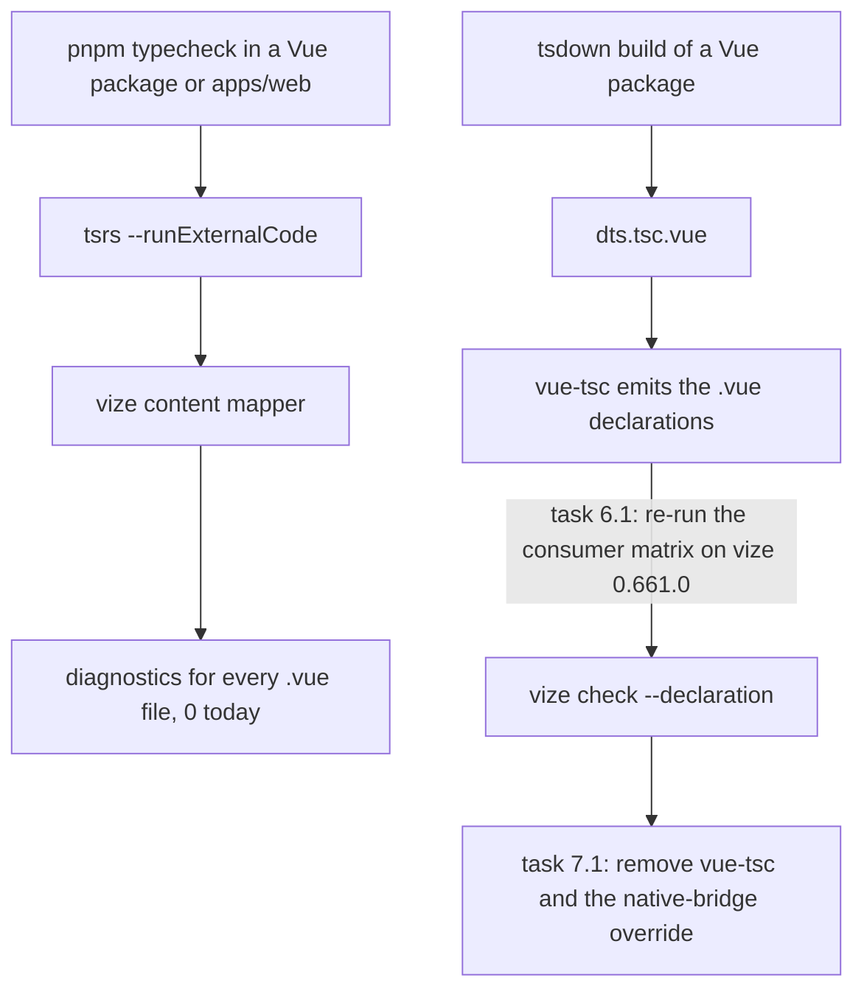

# Design

## Context

Plain typecheck runs through `tsrs` ([Rust toolchain change](../architecture-rust-typescript-toolchain/design.md)). The Vue checks stayed on `vue-tsc` at first, because it reads the classic TypeScript API that the `typescript-native-bridge` override provides and `tsrs` ships no classic API. `vize` checks `.vue` files through a content mapper, a separate process that TypeScript spawns and asks for virtual TypeScript per file. `tsrs`'s CLI implements that protocol and its language server does not.

Every Vue check now runs through the mapper on `tsrs`: `vue-phaserjs`, `genshin-interface`, `genshin-world` and the app project of `apps/web`. What `vue-tsc` still does is generate the declarations of the Vue packages' `.vue` files, and that is what keeps it installed.

## The spike

A scratch project in the session's scratchpad, installed with `vize@0.587.0`, `typescript@beta` (the 7.1 beta) and `tsrs@0.20.0-ts7.1.0-beta`, with one SFC (`src/Hello.vue`) declaring a `number` ref as a `string`:

| Command                                            | Result                                                                                        |
| :------------------------------------------------- | :-------------------------------------------------------------------------------------------- |
| `tsc --runExternalCode --noEmit -p tsconfig.json`  | `Hello.vue(5,7): error TS2322: Type 'number' is not assignable to type 'string'.`             |
| `tsrs --runExternalCode --noEmit -p tsconfig.json` | `Hello.vue(1,1): error TS18069`, the mapper process failed while handling the project request |
| `tsrs --noEmit -p tsconfig.json`                   | `TS18068`: content mappers require `--runExternalCode`                                        |
| `tsrs` with the mapper's declared options set      | the same `TS18069`, so `rootDir`, `checkJs` and `noUnusedLocals` are not the cause            |

The mapper is declared in vize's `package.json` under `typescript.contentMapper`, with `exec` running `node ./bin/vize content-mapper`, `dynamicConfig: true`, and the compiler options it reads. The `tsc` run is the reference for what the mapper returns, and the `tsrs` run failed on the request that precedes any output. The failure was `tsrs`'s Windows launch of the mapper's bare `node`, reported as `tsrs` `#820` and fixed by `#822` (resolve Windows executables through `PATHEXT`), which 0.20.1 holds.

## Decisions

### The Vue checks run on `tsrs`, not on a second compiler

The goal is one compiler for every check. A permanent split, with `tsrs` for TypeScript and `tsc` for `.vue`, keeps the classic API alive and gives the Vue path a separate speed and memory profile to maintain. So the Vue packages stayed on `vue-tsc` until `tsrs` ran the mapper, and moved when 0.20.1 did.

Rejected: switching the Vue packages to the TypeScript 7.1 beta's `tsc`. It works in the spike, but it makes the Vue checks depend on a beta classic compiler that the rest of the repo does not use, and it is the same dependency the `tsrs` path removes.

### The compiler for the proven path

Not needed. The mapper conformance-tests against the TypeScript 7.1 beta, and `tsrs` runs the mapper on its own copy of that compiler. So the Vue checks neither move the `typescript` package to the beta nor alias a second one, and `scripts/` keeps no classic-API reader (it reads sources through `oxc-parser`).

### Formatter and linter stay on oxfmt and oxlint

`vize fmt` formats the pilot's 258 files identically to oxfmt on the current tree, but it has no `objectWrap` option: on a multi-line object literal oxfmt collapses it under the repo's `objectWrap: "collapse"`, and `vize fmt` keeps it expanded with trailing commas. `vize lint` has no plugin API, and oxlint runs sixteen repo-owned JS plugins (`scripts/src/oxlint/*.ts`) with type-aware rules, so those rules would be lost. Both stay.

### Pilot before scope

`packages/vue-canvas-frame-headless` was proposed as the pilot for its size, but it is not a valid one. Its `typecheck` is `tsrs --fast`, not `vue-tsc`, and it has no `.vue` file: its only `defineComponent` sits in a browser test fixture. A diagnostic match on it would compare two outputs with no Vue source behind them. The pilot was `packages/vue-phaserjs`, the smallest package that ran `vue-tsc` and has real `.vue` files (27). The gate was that the mapper's diagnostics match `vue-tsc`'s on the same program, every diagnostic, both the error set and the locations. A mismatch is recorded here before the next package starts, and one that is a `vize` or `tsrs` defect is reported upstream.

The pilot matched after one change in the package: TypeScript 7.1's DOM typings require `lang` on `CanvasRenderingContext2D`, so the canvas mock in `src/test/setupCanvas.ts` gained it. That is a compiler-version difference and not a `vize` defect. `packages/genshin-interface` and `packages/genshin-world` matched with no change, and the app followed (below).

### `.vue` declarations from `vize check --declaration`

`vize check --declaration --declaration-dir` was run through `tsrs` on `packages/genshin-interface` and compared with `vue-tsc --declaration --emitDeclarationOnly` on the same build tsconfig. It is not a drop-in:

- **No component declaration matches.** `vue-tsc` writes Vue's own `DefineComponent` with a slots wrapper. `vize` writes its own component model: exported `Props`, `Emits` and `Slots` types, a `__setup` function carrying the template slots and exposed members, and a `new <$AuthoredProps>()` constructor type, with every file importing a shared `__vize_helpers.d.ts` that the emit writes beside them. The props, slots and exposed members are all present, in a different type.
- **A consumer checked by `vue-tsc` rejected that type on 0.638.0.** The consumer test pointed `packages/genshin-world`, through a scratch tsconfig `paths` entry, at a declaration tree for `genshin-interface`, once from `vue-tsc` and once from `vize` (the barrels and the non-`.vue` files from `vue-tsc` in both), and checked it with each checker. A dependent otherwise reaches a sibling through the `source` condition and never reads built declarations, so the redirect is what makes the test mean something. The result is a matrix:

  | Dependent checked by   | `vue-tsc` declarations | `vize` declarations |
  | :--------------------- | :--------------------- | :------------------ |
  | `tsrs` with the mapper | clean                  | clean               |
  | `vue-tsc`              | clean                  | tens of `TS2345`    |

  Every `vue-tsc` error is the same shape: attributes passed to a component that its props do not declare (`role`, `aria-*`, `class`, a listener) are refused against `$AuthoredKeyWitness`, because the `vize` constructor type is written for the mapper's own virtual code and not for `vue-tsc`'s call. Rerun over the 57 components of `genshin-interface` with `genshin-world` as the consumer, the control gave 0 errors and the `vize` tree gave 51, 19 with the guard also allowing `import("vue").HTMLAttributes`, and 0 with it also allowing `Record<string, unknown>`. The guard measures extra keys against the props and emits alone, and Vue lets undeclared attributes fall through to the root element, so one edit in the helper cleared the pair.

- **It does not read the build the way tsdown does.** With no file patterns it found only the config files, because the shared Vue tsconfig's `${configDir}` include is not expanded; with a `src` pattern it ignores the tsconfig's excludes and emits the fixtures and visual files too, and it reports every auto-imported name as missing until the package's `auto-imports.d.ts` and `vite-env.d.ts` are named on the command line as well.
- **It is slower than `vue-tsc` on the native bridge**, by roughly an order of magnitude on this package (11 seconds for the 57 components, helpers file included).
- **It emits per file, with no barrel.** The bundling into one `.d.ts` per entry stays with the declaration plugin, which would take the per-file output and inline the helper file.
- **`vue-phaserjs` adds no gap.** Its only dependent is `apps/web`, and checking the app against a `vue-tsc` tree and a `vize` tree gave the same seven errors, all stale generated barrels of the local checkout. A probe assigning `Scene` to `number` showed the redirect took effect. The emit has one finding of its own: it exits 1 with `TS4094` and `TS5088` in `__vize_external__/…/shared/dist/index.js` while `tsconfig.vue.json` sets `allowJs`, and passes with `allowJs` off. Two standalone attempts with a JavaScript dependency did not reproduce it, so it is recorded here and not filed.

**Decision: `vue-tsc` stays the declaration generator until a `vue-tsc`-checked consumer accepts the `vize` declarations.** A published package reaches projects outside this repository that check with `vue-tsc`, so narrowing the gate to the repo's own consumers does not help, and the declarations are judged by their consumers and not by the app's checker. Moving `apps/web` onto the mapper therefore did not settle it either. The one thing the gate waited on was the report that the declaration refuses undeclared attributes: #11364, then #11454 for the shape its reduction missed (a producer with an emit or two required props). #11454 is closed as completed in 0.661.0. Task 6.1 re-runs the matrix on 0.661.0, for `genshin-interface` and `genshin-world` with their size snapshots read, before `dts.tsc.vue` is replaced.

**The compile plugin is a separate job.** Compiling a component and checking its types do not depend on each other, so the compile side (the Nuxt module and the rolldown plugin) is the deferred compiler page's and does not gate this change.

### `apps/web` on the mapper

`nuxt typecheck` generates the type declarations it checks against (auto-imports, route types, `.nuxt`) and checks them with `vue-tsc`. Its checker list is fixed in `@nuxt/cli` (`vue-tsc` or `golar`), so the Nuxt route to the mapper does not exist. The app runs the generation itself and calls `tsrs` on what Nuxt writes:

```bash
nuxt prepare
tsrs --fast --runExternalCode -p tsconfig.vize.json   # the app project, through the mapper
tsrs --fast -p .nuxt/tsconfig.server.json
tsrs --fast -p .nuxt/tsconfig.shared.json
tsrs --fast -p .nuxt/tsconfig.node.json
tsrs --fast -p tsconfig.root.json
tsrs --fast -p service-worker/tsconfig.json
```

`tsconfig.vize.json` extends `.nuxt/tsconfig.app.json`, names `vize` as the `.vue` content mapper and `useTemplateRef` as Vue's composable. Only the app project names the mapper, because only it holds `.vue` files, so it is the only run that passes `--runExternalCode`. A deliberate type error written into a `.vue` file fails the script, and the script reports 0 diagnostics on the tree.

Two causes were fixed in the app and not upstream. `services/capture/inlineFontFace.ts` spread a font face's descriptors, which TypeScript 7.1's DOM typings do not make iterable (6.0.3 types `CSSFontFaceRule.style` as an iterable `CSSStyleDeclaration`, and 7.1 as a `CSSFontFaceDescriptors` with no iterator, though the browser object has one), so it uses `Array.from` and carries an unfiled `@TODO` for the typing. The root manifest lists `vue` from the catalog beside `vize`; without it the mapper runs in its silent fallback and reports four false `TS2353` diagnostics on three library components (`Tabs.Item`, `Treeview.Item`, `Select.Item`). That is configuration of this monorepo, and #11444, the report for the silent fallback, was closed as configuration.

`Input.test.ts` names its stub before the cast to the picker's instance type. Written inside the cast, the call takes the cast's type as its context, and `vize`'s component type makes that a union TypeScript refuses to compute (`TS2590`). That is #11499, open. The named stub type-checks and reads no worse, so no ignore is carried.

**The diagnostics `vue-tsc` does not report, by release.** The first runs were hidden behind syntax errors in the mapper's virtual code (#11140 and #11257, both fixed).

| `vize` release      | Diagnostics on the app project |
| :------------------ | -----------------------------: |
| 0.637.0 and 0.638.0 |                            103 |
| 0.650.0 and 0.652.0 |               21, then 15 \*\* |
| 0.658.0             |                             11 |
| 0.659.0             |                              6 |
| 0.661.0             |                       0 (1 \*) |

\* One `TS2590` in `Input.test.ts`, cleared by naming the stub (#11499).

\*\* After the two changes in the app above, and 30 seconds on Linux. A mapper run over a `.nuxt` older than the checkout reported 913 diagnostics, 855 of them in the app, where the regenerated one reported 15 on 0.652.0, so the check regenerates `.nuxt` first.

The tools agree on the other targets throughout: the three Vue packages report 0 diagnostics through the mapper and through `vue-tsc` on every release since 0.652.0, and each catches a deliberate error. The one-run `nuxt typecheck` of the app on 0.652.0 gave 0 diagnostics, as it does now.

### Resolved upstream

Every report below was reduced to a standalone project, filed on `ubugeeei-prod/vize` and closed. The batches were #11359 to #11368 with #11390 and #11391 (first pass) and #11444 to #11454 (second). The compile-side reports from the same runs (the Nuxt module, the rolldown plugin and the Vite plugin's configuration) are recorded with their status on the deferred compiler page, [`openspec/deferred/architecture/vize-compiler/design.md`](../../deferred/architecture/vize-compiler/design.md), which owns them.

| Issue  | What                                               | Closed as     | First release |
| :----- | :------------------------------------------------- | :------------ | :------------ |
| #11446 | `inheritAttrs: false` on a generic component       | completed     | 0.659.0       |
| #11447 | the payload of a generic library component         | completed     | 0.659.0       |
| #11451 | a destructured parameter of a nested callback      | completed     | 0.659.0       |
| #11452 | an assignment in an inline callback prop           | completed     | 0.659.0       |
| #11450 | a generic alias written at module scope            | completed     | 0.660.0       |
| #11445 | a cast to a `.vue` component type (`TS2352`)       | completed     | 0.661.0       |
| #11448 | a dynamic component with a generic key             | completed     | 0.661.0       |
| #11449 | a listener on a dynamic component in a slot        | completed     | 0.661.0       |
| #11453 | an event declared in camelCase and kebab-case      | completed     | 0.661.0       |
| #11454 | the declaration refuses undeclared attributes      | completed     | 0.661.0       |
| #11444 | the mapper's silent fallback on a mismatched `vue` | configuration | none          |

The twelve of the first pass (#11359 to #11368, #11390, #11391) are closed. Eleven were fixed in releases up to 0.650.0, which holds #11379, #11380, #11382, #11383 and #11395, and each reduction was re-run on 0.650.0 against the old release as its control: the control reproduced the diagnostic, 0.650.0 did not, and the same file with a deliberate real error still reported it. The twelfth, #11364, was closed with a reduction that already passed on every release (one required prop, no emits), which is why #11454 replaced it. Earlier landmines, also fixed: #11140 (dynamic event listeners wrote raw expressions into the virtual code, 1063 syntax errors across 15 `components/Dungeons` files), #11023 by #11074 in 0.606.0 (inline callback props typed from a child's prop got implicit `any`), #11257 in 0.628.0 (a `type: null` runtime prop, which `@nuxt/image` and `@nuxt/scripts` ship in about a dozen components), and #11365 (the declaration emit under `noUnusedLocals`).

Open: **#11499** (the `TS2590` above, with two further gaps in the generated helper).

### Timings, cold and warm

Every run is a fresh process. Cold clears the tools' own caches: the cache folder of `vize`, `node_modules/.vize` and the build info of `nuxt typecheck`. Warm discards two priming runs. The OS page cache was not dropped, because the machine had no passwordless `sudo` for `purge`, so cold is cold for the tools only. Wall time is the median of 3 cold and 5 warm runs, and peak memory is the largest resident set size of any run. Apple M1 with 8 cores and 16 GiB, `vize` 0.661.0, `tsrs` 0.20.1, `vue-tsc` 3.3.11 on `typescript-native-bridge`.

| Target                 | `vue-tsc` cold | Mapper cold | `vue-tsc` warm | Mapper warm | Peak memory (`vue-tsc` / mapper) |
| :--------------------- | -------------: | ----------: | -------------: | ----------: | -------------------------------: |
| `vue-phaserjs`         |           1.08 |        0.30 |           1.09 |        0.29 |                    0.9 / 0.2 GiB |
| `genshin-interface`    |           1.07 |        0.25 |           1.07 |        0.25 |                    0.7 / 0.2 GiB |
| `genshin-world`        |           6.25 |        1.28 |           6.22 |        1.27 |                    3.7 / 1.0 GiB |
| `apps/web` app project |          24.99 |        5.76 |          28.12 |        6.15 |                    7.4 / 3.4 GiB |

The whole app script against the command it replaced, on the same runs:

| Check                                                   |    Cold |    Warm | Peak memory | Diagnostics |
| :------------------------------------------------------ | ------: | ------: | ----------: | ----------: |
| `nuxt typecheck`                                        | 62.73 s | 64.26 s |     9.5 GiB |           0 |
| `pnpm typecheck` (`nuxt prepare`, then six `tsrs` runs) | 12.30 s | 12.20 s |     3.3 GiB |           0 |

The script is 5.1 times faster cold and 5.3 times warm on 0.35 of the memory, and it also checks the service worker, which `nuxt typecheck` did not. Alone, the other five `tsrs` projects take 1.35 s (server), 1.25 s (shared), 0.21 s (node), 1.07 s (root) and 0.24 s (service worker) in one run each. Every run and the scripts that made them are in [the comment on the maintainer's performance issue, #10936](https://github.com/ubugeeei-prod/vize/issues/10936#issuecomment-6592116514). The library builds on the same release, with the Rolldown plugin in place of `unplugin-vue`, are on the deferred compiler page.

`nuxt typecheck` is not a like-for-like row against one `tsrs` run: it checks five projects with incremental build info. The corpus numbers in [that thread](https://github.com/ubugeeei-prod/vize/issues/10936#issuecomment-6507703018) (2,500 generated components, an M2 Max, no warmup) are not comparable in seconds, only in ratio.

## Mechanism



## Key files

| File                                                               | Role                                                                                                                       |
| :----------------------------------------------------------------- | :------------------------------------------------------------------------------------------------------------------------- |
| `packages/genshin-interface/package.json`                          | `typecheck` runs `tsrs --fast --runExternalCode`                                                                           |
| `packages/genshin-world/package.json`                              | `typecheck` runs `tsrs --fast --runExternalCode`                                                                           |
| `packages/vue-phaserjs/package.json`                               | `typecheck` runs `tsrs --fast --runExternalCode`                                                                           |
| `apps/web/package.json`                                            | `typecheck` is `nuxt prepare` followed by six `tsrs` runs: the app (mapper), server, shared, node, root and service worker |
| `apps/web/tsconfig.vize.json`                                      | the app project: extends Nuxt's generated app config, names `vize` as the `.vue` content mapper                            |
| `packages/configuration/tsconfig.vue.json`                         | the shared Vue tsconfig: names `vize` as the `.vue` content mapper and `useTemplateRef` as Vue's composable                |
| `packages/configuration/src/services/getTsdownConfigurationVue.ts` | `dts.tsc.vue` loads `vue-tsc` for the `.vue` declarations, the last reader of it                                           |
| `pnpm-workspace.yaml`                                              | the `typescript` override onto `typescript-native-bridge`, and the `vue-tsc` pin                                           |
| `openspec/changes/architecture-rust-typescript-toolchain/`         | the change this one depends on, for every plain `tsc` path                                                                 |

## Notes

- `tsrs --noEmit` on a config with `contentMappers` is refused without `--runExternalCode`, so the scripts that use the mapper pass it explicitly.
- Removing `vue-tsc` from a package is not the same as switching its `typecheck` script. Every non-private Vue package builds its declarations through `dts.tsc.vue`, and `rolldown-plugin-dts` loads `vue-tsc` with `require.resolve("vue-tsc")` and runs it in a separate process. So `vue-tsc` stays a build dependency until declarations for `.vue` files come from somewhere else (task 6.1). `vite-plugin-checker` and `@volar/typescript` have no tracked references in the repo.
- The 7.1 beta package does not replace the native bridge. It exports the CLI and the sync and async APIs, and `createSourceFile` and `createProgram` are undefined on its classic module, so it cannot host a classic-API consumer.
- `vize`'s Nuxt module (`@vizejs/nuxt`) does not touch the type check. It replaces Nuxt's Vue SFC compiler and adds an oxlint-based lint checker in dev, so registering it would change how every component compiles. That is the deferred compiler page's decision.

## Constraints that remain

- **The mapper's virtual code imports `vize/content-mapper-helpers`**, so every package that uses the mapper needs `vize` resolvable from its own folder. This is a requirement and not a defect, and it changes the lockfile per package.
- **A mismatched `vue` makes the mapper fall back silently**, with diagnostics that look like real attribute errors. The root manifest lists `vue` beside `vize`, which clears them; why it sits at the root is in the build skill's dependency placement page.
- **A global `useTemplateRef` is Vue's only when the config says so.** From `vize@0.607.0` a call that resolves to an ambient declaration instead of a `vue` import is typed as that declaration says, because a separately authored function can share Vue's signature. The packages' committed `auto-imports.d.ts` declares `const useTemplateRef: typeof import('vue').useTemplateRef`, which is ambient, so every template ref came out `unknown` until `tsconfig.vue.json` named it with `vueCompilerOptions.composables.useTemplateRef`, the option `vue-tsc` reads from the same tsconfig. It is configuration both checkers share and not a mapper workaround, and the other spelling of the declaration does not change the result.
- **TypeScript 7.1's DOM typings differ from 6.0.3's** (`lang` on `CanvasRenderingContext2D`, the iterable `CSSFontFaceDescriptors`), which fails code written against 6.0.3 under `tsrs` and not under `vue-tsc` on the bridge. Both are fixed in the code.
- **Releases come about hourly, and a closed issue is not a fixed release.** Each reduction is re-run on the newest release before its issue is filed, and a closed issue is checked the same way before its marker or its task is ticked.

## Sources

- [vize README](https://github.com/ubugeeei-prod/vize) — the `contentMappers` entry, the `typescript@beta` requirement and the experimental status.
- [vize content-mapper conformance workflow](https://github.com/ubugeeei-prod/vize/blob/main/.github/workflows/content-mapper-conformance.yml) — the TypeScript commit the mapper is tested against.
- [vize vue-tsc comparison workflow](https://github.com/ubugeeei-prod/vize/blob/main/.github/workflows/typecheck-vs-vue-tsc.yml) — report-only, not a gate.
- [tsrs content-mapper port notes](https://github.com/oxc-project/tsrs/blob/main/notes/contentmappers.md) — the JSON-RPC protocol and the host the failing request goes through.
