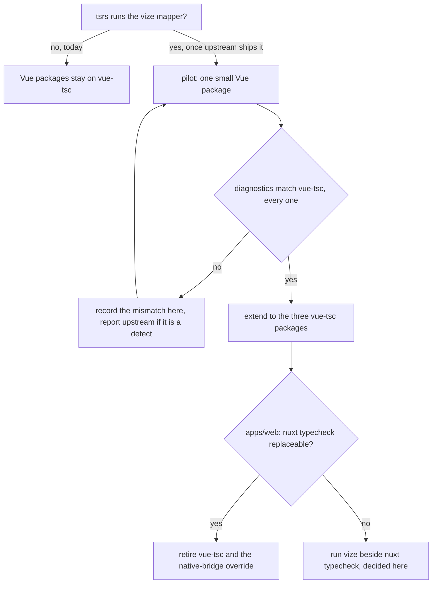

# Design

## Context

Plain typecheck now runs through `tsrs` ([Rust toolchain change](../architecture-rust-typescript-toolchain/design.md)). The Vue checks did not move, because `vue-tsc` reads the classic TypeScript API that the `typescript-native-bridge` override provides, and `tsrs` ships no classic API. Two things make the Vue path different: `vize` checks `.vue` files through a content mapper, a separate process that TypeScript spawns and asks for virtual TypeScript per file, and that mapper protocol is implemented by `tsrs`'s CLI but not by its language server.

## The spike

A scratch project in the session's scratchpad, installed with `vize@0.587.0`, `typescript@beta` (the 7.1 beta) and `tsrs@0.20.0-ts7.1.0-beta`, with one SFC (`src/Hello.vue`) declaring a `number` ref as a `string`:

| Command                                            | Result                                                                                        |
| :------------------------------------------------- | :-------------------------------------------------------------------------------------------- |
| `tsc --runExternalCode --noEmit -p tsconfig.json`  | `Hello.vue(5,7): error TS2322: Type 'number' is not assignable to type 'string'.`             |
| `tsrs --runExternalCode --noEmit -p tsconfig.json` | `Hello.vue(1,1): error TS18069`, the mapper process failed while handling the project request |
| `tsrs --noEmit -p tsconfig.json`                   | `TS18068`: content mappers require `--runExternalCode`                                        |
| `tsrs` with the mapper's declared options set      | the same `TS18069`, so `rootDir`, `checkJs` and `noUnusedLocals` are not the cause            |

The mapper is declared in vize's `package.json` under `typescript.contentMapper`, with `exec` running `node ./bin/vize content-mapper`, `dynamicConfig: true`, and the compiler options it reads. The `tsc` run is the reference for what the mapper returns, and the `tsrs` run fails on the request that precedes any output.

## Decisions

### The Vue checks wait on `tsrs`, not on a second compiler

The goal is one compiler for every check. A permanent split, with `tsrs` for TypeScript and `tsc` for `.vue`, keeps the classic API alive and gives the Vue path a separate speed and memory profile to maintain. So the Vue packages stay on `vue-tsc` until `tsrs` runs the mapper. The mapper gap is reported upstream, not patched around in the repo.

Rejected: switching the Vue packages to the TypeScript 7.1 beta's `tsc` now. It works in the spike, but it makes the Vue checks depend on a beta classic compiler that the rest of the repo does not use, and it is the same dependency the `tsrs` path would remove.

### The compiler for the proven path

If the Vue packages move before `tsrs` does, they need the TypeScript 7.1 beta, because that is the release vize's mapper is conformance-tested against. The `typescript` package is pinned to `6.0.3` through the native bridge, and `scripts/` imports it in-process. Two options:

- Move the `typescript` package to the 7.1 beta for everything. This changes the in-process API `scripts/` reads, and the native bridge goes with it.
- Alias a second `typescript` for the Vue packages only. This keeps `scripts/` on the bridge, and puts two TypeScript copies in the lockfile.

The choice is taken at the pilot gate, against which in-process uses `scripts/` has.

### Formatter and linter stay on oxfmt and oxlint

`vize fmt` formats the pilot's 258 files identically to oxfmt on the current tree, but it has no `objectWrap` option: on a multi-line object literal oxfmt collapses it under the repo's `objectWrap: "collapse"`, and `vize fmt` keeps it expanded with trailing commas. `vize lint` has no plugin API, and oxlint runs sixteen repo-owned JS plugins (`scripts/src/oxlint/*.ts`) with type-aware rules, so those rules would be lost. Both stay.

### Pilot before scope

`packages/vue-canvas-frame-headless` was proposed as the pilot for its size, but it is not a valid one. Its `typecheck` is `tsrs --fast`, not `vue-tsc`, and it has no `.vue` file: its only `defineComponent` sits in a browser test fixture. A diagnostic match on it would compare two outputs with no Vue source behind them. The pilot is `packages/vue-phaserjs`: the smallest package that runs `vue-tsc` today and has real `.vue` files (27). Its result: `vue-tsc` reports nothing, and the `tsrs` run through the mapper reports no diagnostic in any `.vue` file, with 27 `.vue` files in the program. It reported one `.ts` diagnostic, the canvas mock in `src/test/setupCanvas.ts` missing `lang`. That diagnostic also appears with `tsrs` and no mapper, so it comes from the TypeScript 7.1 DOM typings, and the mock gained `lang` in the same change. After the canvas mock's cast in `src/test/setupCanvas.ts`, `tsrs --fast` and `vue-tsc --noEmit` both exit with 0 diagnostics on the package, so the pilot's diff is empty. Its gate is that the mapper's diagnostics match `vue-tsc`'s on the same program, every diagnostic, both the error set and the locations. A mismatch is recorded in this design before the next package starts, and a mismatch that is a `vize` or `tsrs` defect is reported upstream.

The first package after the pilot is `packages/genshin-interface`, also compared. Its `tsrs` run reports 0 diagnostics and its `vue-tsc` run reports 0 diagnostics, so the diff is empty on both the error set and the locations. `packages/genshin-world` is compared clean as well, at `9d1bb6fc19`: `tsrs` and `vue-tsc` each report 0 diagnostics, so the diff is empty. With `packages/vue-phaserjs` clean after its canvas mock cast, that closes task 4.1 across the three packages. `packages/vue-phaserjs` was compared as the pilot above, and its post-cast result is recorded there.

### `.vue` declarations from `vize check --declaration`

`vize check --declaration --declaration-dir` was run through `tsrs` on `packages/genshin-interface` and compared with `vue-tsc --declaration --emitDeclarationOnly` on the same build tsconfig. It is not a drop-in:

- **No component declaration matches.** `vue-tsc` writes Vue's own `DefineComponent` with a slots wrapper. `vize` writes its own component model: exported `Props`, `Emits` and `Slots` types, a `__setup` function carrying the template slots and exposed members, and a `new <$AuthoredProps>()` constructor type, with every file importing a shared `__vize_helpers.d.ts` that the emit writes beside them. The props, slots and exposed members are all present, in a different type.
- **A consumer checked by `vue-tsc` rejects that type.** The consumer test pointed `packages/genshin-world`, through a scratch tsconfig `paths` entry, at a declaration tree for `genshin-interface`, once from `vue-tsc` and once from `vize` (the barrels and the non-`.vue` files from `vue-tsc` in both), and checked it with each checker. A dependent otherwise reaches a sibling through the `source` condition and never reads built declarations, so the redirect is what makes the test mean something. The result is a matrix:

  | Dependent checked by   | `vue-tsc` declarations | `vize` declarations |
  | :--------------------- | :--------------------- | :------------------ |
  | `tsrs` with the mapper | clean                  | clean               |
  | `vue-tsc`              | clean                  | tens of `TS2345`    |

  Every `vue-tsc` error is the same shape: attributes passed to a component that its props do not declare (`role`, `aria-*`, `class`, a listener) are refused against `$AuthoredKeyWitness`, because the `vize` constructor type is written for the mapper's own virtual code and not for `vue-tsc`'s call.

- **It does not read the build the way tsdown does.** With no file patterns it found only the config files, because the shared Vue tsconfig's `${configDir}` include is not expanded; with a `src` pattern it ignores the tsconfig's excludes and emits the fixtures and visual files too, and it reports every auto-imported name as missing until the package's `auto-imports.d.ts` and `vite-env.d.ts` are named on the command line as well.
- **It is slower than `vue-tsc` on the native bridge**, by roughly an order of magnitude on this package.
- **It emits per file, with no barrel.** The bundling into one `.d.ts` per entry stays with the declaration plugin, which would take the per-file output and inline the helper file.

**Decision: `vue-tsc` stays the declaration generator until every consumer is checked by the mapper.** The `vize` declarations work for a mapper-checked dependent and break a `vue-tsc`-checked one, and `apps/web` is `vue-tsc`-checked until its mapper diagnostics are triaged. A published package also reaches consumers outside this repo, and any of them on `vue-tsc` would hit the same refusal, so these declarations cannot be what a published package ships while `vue-tsc` is the common checker. The order is therefore the app first (task 5.2), then the plugin that runs the emit on the build's own file list and feeds the bundler (task 6.1).

### `apps/web` last

`nuxt typecheck` generates the type declarations it checks against (auto-imports, route types, `.nuxt`), and that generation runs through Nuxt's own `vue-tsc` integration. Replacing it means either wiring vize into Nuxt's typecheck, or running vize outside Nuxt's generated config. `vize` ships a Nuxt module, but whether its check replaces `nuxt typecheck` or sits beside it is not established by the spike. That decision is written here when the pilot is done.

**The comparison, run.** `nuxt typecheck` is clean on the app. The same app project through `tsrs --runExternalCode` is a tsconfig that extends `.nuxt/tsconfig.app.json`, adds `contentMappers` for `vize` and the `useTemplateRef` composable, and checks several times faster. It does not match, in two steps. First, the mapper writes invalid virtual code for about a dozen third-party components (`@nuxt/image`, `@nuxt/scripts`), and those syntax errors stop the semantic pass for the whole program, so nothing of the app's own is visible. With those components typed as `any` in a temporary copy of `.nuxt/types/components.d.ts`, the app's own files report tens of diagnostics across tens of files that `vue-tsc` does not. Second, those diagnostics fall into a handful of classes, listed under "Landmines".

**Decision: `apps/web` stays on `nuxt typecheck`.** Running the mapper beside it today would add a red check that is mostly mapper defects, and a check that is red on every run gets ignored. The comparison is repeated when the classes below are fixed upstream. The scratch tsconfig is not committed.

## Mechanism

## Key files

| File                                                       | Role                                                                                                                            |
| :--------------------------------------------------------- | :------------------------------------------------------------------------------------------------------------------------------ |
| `packages/genshin-interface/package.json`                  | `typecheck` runs `tsrs --fast --runExternalCode`                                                                                |
| `packages/genshin-world/package.json`                      | `typecheck` runs `tsrs --fast --runExternalCode`                                                                                |
| `packages/vue-phaserjs/package.json`                       | `typecheck` runs `tsrs --fast --runExternalCode`; the shared Vue tsconfig names vize; `vue-tsc` stays for the declaration build |
| `apps/web/package.json`                                    | `typecheck` is `nuxt typecheck` followed by the service-worker `tsrs` check                                                     |
| `packages/configuration/tsconfig.vue.json`                 | the shared Vue tsconfig: names `vize` as the `.vue` content mapper and `useTemplateRef` as Vue's composable                     |
| `pnpm-workspace.yaml`                                      | the `typescript` override onto `typescript-native-bridge`, and the `vue-tsc` pin                                                |
| `openspec/changes/architecture-rust-typescript-toolchain/` | the change this one depends on, for every plain `tsc` path                                                                      |

## Notes

- `tsrs --noEmit` on a config with `contentMappers` is refused without `--runExternalCode`. That flag is required for the mapper, and the scripts that will use it must pass it explicitly.
- The `TS18069` message points at the mapper process. It is not a type error in the `.vue` file, so a green or red run here does not yet say anything about the Vue source.
- Removing `vue-tsc` from a package is not the same as switching its `typecheck` script. Every non-private Vue package builds its declarations through `dts.tsc.vue` (`packages/configuration/src/services/getTsdownConfigurationVue.ts`), and `rolldown-plugin-dts` loads `vue-tsc` with `require.resolve("vue-tsc")` and runs it in a separate process. So `vue-tsc` stays a build dependency until declarations for `.vue` files come from somewhere else. `apps/web`'s `nuxt typecheck` runs `vue-tsc` the same way, through Nuxt. `scripts/` no longer uses the classic API: it reads sources through `oxc-parser` (`969e141dec`). `vite-plugin-checker` and `@volar/typescript` have no tracked references in the repo.
- On Windows, `tsrs` does not launch the mapper's bare `node` command: with `node` in `exec` it reports `TS18069` without spawning anything. The same command with `node.exe` spawns and checks normally. The cause is not pinned down. The mapper's `exec` is declared by the `vize` package, so a local run on Windows needs a workaround until `tsrs` launches the bare name. CI on Linux is not checked by this.
- `vize`'s Nuxt module (`@vizejs/nuxt`) does not touch `nuxt typecheck`. It replaces Nuxt's Vue SFC compiler and adds an oxlint-based lint checker in dev. Registering it would change how every component compiles, so it is a separate decision from the typecheck migration.
- The 7.1 beta package does not replace the native bridge. It exports the CLI and the sync and async APIs, and `createSourceFile` and `createProgram` are undefined on its classic module, so it cannot host the consumers above.

## Landmines

Found while running the mapper on the repo. Each has its status against the upstream trackers; none is filed from this repo, since the owner files upstream reports by hand.

- **Dynamic event listeners on components break the mapper's virtual code.** A dynamic listener argument on a component that is a literal, call or member expression (``@[`...`]``, `@["..."]`, `@[getKey(name)]`; an identifier, a concatenation or a conditional is fine, and so is a native element) makes the mapper write the expression raw into a type literal as a key, which is a syntax error in the virtual file. `apps/web` has 15 `components/Dungeons` files that use it, which gives 1063 syntax errors across 15 of them (about 55 to 70 per listener) under `tsrs --runExternalCode`, and the syntax errors stop the semantic pass for the whole program, so no other file's result is visible. `vue-tsc` accepts them. Reported as vize `#11140` with a one-line reproduction; the nearest existing issues, `#10617` (undeclared `$`-prefixed template globals) and `#10251` (dynamic component refs), are different. Fixed upstream since, but `apps/web` has not been run through the mapper again, so its typecheck stays on `nuxt typecheck` until it is.
- **`tsrs` stops using the mapper after five transform failures.** It prints `TS18070` and skips the mapper for every file after that, so the rest of the `.vue` files go unchecked with no diagnostic. On `apps/web`, five files failed this way although the mapper transforms each of them when asked directly, and the failures were not seen on an earlier run. No upstream issue found for `TS18070` or the failure budget.
- **`tsrs` does not spawn the mapper's bare `node` on Windows.** `node.exe` works. No upstream issue matches; `tsrs` `#694` (Windows path handling in default library lookup) is related but not the same failure.
- **The mapper's virtual code imports `vize/content-mapper-helpers`**, so every package that uses the mapper needs `vize` resolvable from its own folder. This is a requirement, not a defect, and it changes the lockfile per package.
- **`vue-tsc` is still needed for `.vue` declarations** (see Notes). Switching a package's `typecheck` script does not remove it.
- **TypeScript 7.1's DOM typings require `lang` on `CanvasRenderingContext2D`**, which fails the canvas mock under `tsrs` and not under TypeScript 6.0.3. This is a compiler-version difference, not a vize defect.
- **Nuxt's `typecheck` takes only `vue-tsc` or `golar`.** The checker list is fixed in `@nuxt/cli`, and no module can add to it, so the Nuxt route to the mapper is not in Nuxt's own command.
- **Upstream performance is open:** vize `#10620` reports `vize check` slower than `tsc` with the same mapper on a mid-size Nuxt app. Speed is not measured here.
- **Inline callback props typed from a child's prop got implicit `any` in the mapper's virtual code (TS7006, TS7053), fixed in `vize@0.606.0`.** The shape was vize `#11023`, fixed by vize `#11074` (merged, in 0.606.0, not in 0.605.0). With 0.606.0 installed, `tsrs --runExternalCode` types the callbacks in `packages/genshin-world/src/components/Menu/Screen/Index.vue` and `World/Session/Index.vue` with no annotation, and a deliberate type error in one is still reported, so the three annotations are removed.
- **A plain-JavaScript `<script setup>` with a `type: null` runtime prop breaks the mapper's virtual code.** `defineProps({ options: { type: null, required: false } })`, which is how a library's compiled output spells an untyped prop, makes the mapper write a syntax error into the file's virtual code. The other plain-JavaScript constructs tried (`defineEmits` with an array, `defineSlots()`, `type: Object`) are fine. `@nuxt/image` and `@nuxt/scripts` ship about a dozen such components, `.nuxt/types/components.d.ts` imports them, and the syntax errors then hide every semantic result in the program. `vue-tsc` accepts them. One file copied out of `node_modules` reproduces it alone. No matching upstream issue was found.
- **On the app, the mapper's semantic diagnostics that `vue-tsc` does not report** fall into these classes, most numerous first: an unnamed `defineModel` with options does not put `modelValue` on the component's own props (the dialogs, where it dominates); the item of a generic list slot is missing from the slot's props type; `possibly 'undefined'` and `used before being assigned` inside template closures; a component template ref exposes `{}` instead of the exposed members; a callback typed from a child's prop is an implicit `any`; a `v-model` argument object is rejected by a generic component's hoisted props. Two more come from the 7.1 compiler rather than the mapper: `CSSFontFaceDescriptors` is not iterable in its DOM typings, and a test file's component cast produces a union too complex to represent. Each of the first group is either a mapper defect or a real finding that `vue-tsc` misses, and none is triaged yet; the last two are a compiler-version difference.
- **A global `useTemplateRef` is Vue's only when the config says so.** From `vize@0.607.0` a call that resolves to an ambient declaration instead of a `vue` import is typed as that declaration says, because a separately authored function can share Vue's signature. The packages' committed `auto-imports.d.ts` declares `const useTemplateRef: typeof import('vue').useTemplateRef`, which is ambient, so every template ref came out `unknown` (TS2339, TS2769, TS2322) across the Vue packages. `tsconfig.vue.json` now names it with `vueCompilerOptions.composables.useTemplateRef`, the option `vue-tsc` reads from the same tsconfig, and `tsrs --runExternalCode` reports no diagnostics on `packages/vue-phaserjs`, `packages/genshin-interface` or `packages/genshin-world`. The other spelling of the declaration (`typeof import('vue')['useTemplateRef']`) does not change the result, so the config entry is the mechanism, not the spelling.

## Sources

- [vize README](https://github.com/ubugeeei-prod/vize) — the `contentMappers` entry, the `typescript@beta` requirement and the experimental status.
- [vize content-mapper conformance workflow](https://github.com/ubugeeei-prod/vize/blob/main/.github/workflows/content-mapper-conformance.yml) — the TypeScript commit the mapper is tested against.
- [vize vue-tsc comparison workflow](https://github.com/ubugeeei-prod/vize/blob/main/.github/workflows/typecheck-vs-vue-tsc.yml) — report-only, not a gate.
- [tsrs content-mapper port notes](https://github.com/oxc-project/tsrs/blob/main/notes/contentmappers.md) — the JSON-RPC protocol and the host the failing request goes through.
