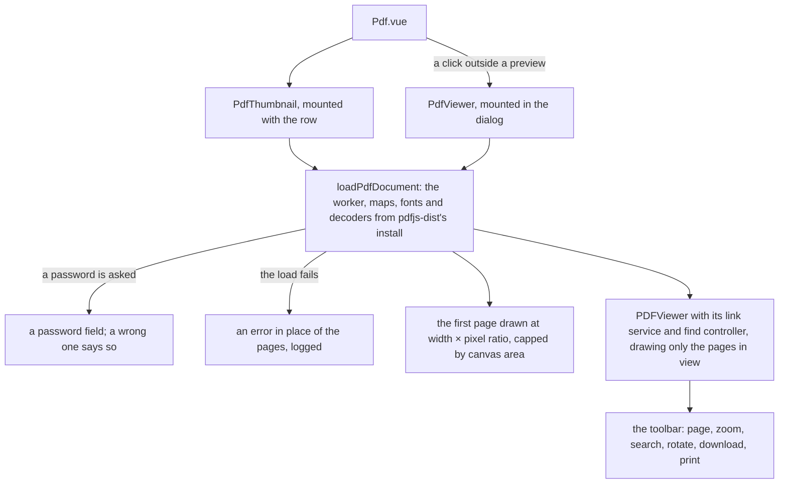

# PDF attachment over the renderer's own viewer

A PDF attachment shows its first page in the message row and opens a viewer in a dialog on a click. Both are drawn by components of the app's own over `pdfjs-dist`, in place of `vue-pdf-embed` and `@vue-pdf-viewer/viewer`, as the [dependency admission](../../specs/architecture/dependency-admission/design.md) standard absorbs a component wrapper.

## How a PDF is drawn

## Decisions

- **The two viewers become one renderer's components, a consolidation once rejected.** The rejection argued that the full viewer's product — virtual scrolling, in-document search, forms, the tree a screen reader reads — is engine-shaped and accessibility-shaped, so replacing it meant writing a document viewer. The renderer already ships that half as components, the ones Firefox's own viewer is built from, and what the closed-source viewer adds over them is chrome: a toolbar, a search field and printing, which the UI library draws with the keyboard and ARIA semantics the stop list protects. The rejection also read the version pin as the cheap half of the cost. The bundle report and the audit say otherwise, and a viewer whose licence forbids reading its source leaves every defect in it unfixable. Rejected: keeping both wrappers, the direction that rejection settled.
- **The renderer's data is served from its own install.** The character maps, the standard fonts and the image decoders' WebAssembly are Nitro public assets mounted from `pdfjs-dist`'s own `cmaps`, `standard_fonts` and `wasm` folders, as the Temporal polyfill is mounted from its install in `apps/web/configuration/nitro.ts`, under base URLs named once as constants the loader reads too. They move with the renderer's version in the lockfile, so the committed copy of the character maps under `apps/web/public/cmaps` goes, and with it the exclusion the control-character sweep keeps for it. The fonts let a PDF that does not embed a standard font draw its text, and the decoders draw a JPEG 2000 image, which the full viewer never passed (its #77). Rejected: copying the folders in a build step, which is the committed copy again under another name.
- **One loader for both.** `loadPdfDocument` imports `pdfjs-dist` inside the browser, points `GlobalWorkerOptions.workerSrc` at the worker the app already loads by URL (`pdfjs-dist/build/pdf.worker?url`), and passes `cMapUrl` with `cMapPacked`, `standardFontDataUrl` and `wasmUrl` at the mounted folders. The worker and the API are the same install, so their versions cannot drift (the full viewer's #78, #14), and the worker is never a `data:` URL, which a strict policy refuses (`vue-pdf-embed`'s #22, #90, #271). Each component destroys its loading task when its source changes or it unmounts (#160, #196), and a missing source draws nothing rather than throwing (#261).
- **The thumbnail is a canvas and nothing else.** It draws page one at the element's width, its backing store at width × `devicePixelRatio` while its CSS size stays the element's (#1, #58), and redraws when a `ResizeObserver` reports a new width (#20, #41), each draw cancelling the one in flight (#28, #194). The area is capped at 16,777,216 pixels, the largest canvas iOS Safari draws, by lowering the pixel ratio rather than leaving the canvas blank (#52); the scale is a pure function with its own test. The row's thumbnail drops the text and annotation layers it drew before: a click on it opens the viewer, where reading happens. Rejected: keeping the layers for selecting text in the row, which the click to open would fight.
- **The viewer is `PDFViewer`, not a viewer of our own.** `pdfjs-dist/web/pdf_viewer.mjs` is imported inside `onMounted` with its stylesheet, and drives an absolutely positioned scrolling container sized by the dialog. `PDFViewer` draws only the pages in view, `PDFLinkService` follows links inside the document and opens outside ones in a new tab, `PDFFindController` searches, and the text layer with `StructTreeLayerBuilder` gives selection and the tree a screen reader reads. Those were the half the old rejection called engine-shaped, and they stay the engine's.
- **The toolbar is the UI library's.** Previous and next page with a page field and the page count; zoom out and in, with fit width, fit page and actual size; a search field with match case, whole word, previous and next, and the match count from the controller's `updatefindmatchescount` event; rotate; download; print. Every control is a library control, so the keyboard and labels are the library's, and its menus open inside the dialog's top layer, which the full viewer's body-portalled menus could not.
- **Download saves the original bytes** from `getData()` under the attachment's filename, since a cross-origin blob URL ignores the `download` attribute.
- **Print renders every page** in batches into images in a print-only container, then calls `window.print()` and removes the container on `afterprint`. The print stylesheet sets an `@page` margin of 3mm, which keeps a page from spilling onto a blank sheet (`vue-pdf-embed`'s #188).
- **A password prompt can be dismissed.** The loading task's `onPassword` shows a password field in the viewer; a wrong password says so, and closing the dialog cancels the load.
- **Not carried over:** fullscreen (the dialog is the reading surface, so the fullscreen grant goes), the thumbnail sidebar (`PDFThumbnailViewer` is not exported), opening a local file, annotation editing, and the comments panel. The page itself is drawn as authored in either theme; the chrome around it follows the app's.

## What leaves the config

| File                                                                            | Entry                                                                                                                                                            |
| :------------------------------------------------------------------------------ | :--------------------------------------------------------------------------------------------------------------------------------------------------------------- |
| `apps/web/configuration/build.ts`                                               | both server-only transpile entries                                                                                                                               |
| `apps/web/configuration/vite.ts`                                                | the full viewer's pre-bundling exclusion; `pdfjs-dist` stays in `include`, with `pdfjs-dist/web/pdf_viewer.mjs` beside it, since the dialog loads it mid-session |
| `apps/web/configuration/security.ts`                                            | the `data:` script source and the fullscreen grant; `worker-src 'self'` stays for the worker                                                                     |
| `pnpm-workspace.yaml`                                                           | both catalog entries and the `pdfjs-dist` override                                                                                                               |
| `apps/web/public/cmaps`                                                         | the committed copy of the character maps, now served from the install                                                                                            |
| `scripts/src/services/sweeps/controlCharacters/readControlCharacterFindings.ts` | the exclusion for that copy                                                                                                                                      |

## Upstream

Both wrappers' trackers get one verdict per issue, in two Upstream tables on the capability's design page. The full viewer's tracker holds its issues only, since its source is closed; its features, listed by the audit, are answered by the decisions above. The thumbnail's in-scope defects carry tests: #52 on the scale function, #28 on a draw cancelled by a newer one, #261 on a missing source, #20 on a redraw at a new width.

## Key files

| File                                                             | Role after the change                                                                |
| :--------------------------------------------------------------- | :----------------------------------------------------------------------------------- |
| `apps/web/app/components/Message/Model/FileRenderer/Pdf.vue`     | the thumbnail in the row, and the dialog holding the viewer                          |
| `apps/web/app/components/Message/Model/FileRenderer/Pdf.test.ts` | the dialog's shell and when it exists                                                |
| `apps/web/configuration/security.ts`                             | `worker-src 'self'` for the renderer's worker                                        |
| `apps/web/configuration/nitro.ts`                                | the renderer's character maps, standard fonts and decoders, mounted from its install |

## Sources

- [pdf.js](https://github.com/mozilla/pdf.js): the `web/pdf_viewer.mjs` components and the `getDocument` options.
- [vue-pdf-embed](https://github.com/hrynko/vue-pdf-embed), the thumbnail wrapper replaced.
- [@vue-pdf-viewer/viewer](https://www.npmjs.com/package/@vue-pdf-viewer/viewer), the full viewer replaced, read from its tracker and its documentation only.
