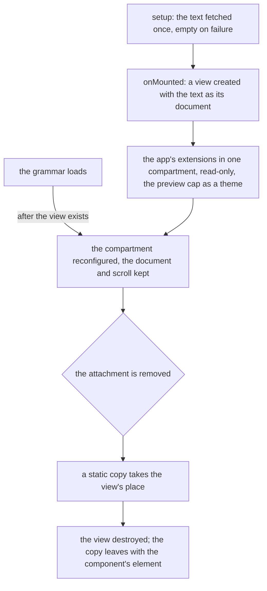

# Code view over CodeMirror's own view

`Code.vue` fetches a code attachment's text during setup and shows it read-only. It mounts CodeMirror's `EditorView` itself in place of `vue-codemirror`, which the [dependency admission](../../specs/architecture/dependency-admission/design.md) standard absorbs as a component wrapper: code of the app's own over the engine it wrapped.

## How it mounts

## Decisions

- **The text is the view's document from creation, and nothing writes it afterwards.** The wrapper's model watch replaced the whole document on every external write, which history recorded (#121) and which reset the cursor (#229). The attachment's text is fetched before mount and never changes, so the model, its watch and its emits go. Rejected: keeping `v-model` for parity with the wrapper, since no caller writes the text after it loads.
- **`basicSetup` from `codemirror`, then the app's extensions in one `Compartment`.** The wrapper applied `basicSetup` to every view, so the line numbers, folding and search a reader sees stay. The grammar arrives after the view exists, because `getLanguageExtension` loads it on first use, so the language and the app's chrome (`uiEditorExtensions`) sit in one compartment that a watch reconfigures. `useExtensions` was the one-line join of the two and is inlined at its only call site.
- **Read-only is `EditorView.editable.of(false)` with `EditorState.readOnly.of(true)`**, the two facets the wrapper's `disabled` set.
- **The preview cap is a theme on the view.** In a message preview, `EditorView.theme({ "&": … })` holds the editor at `PREVIEW_MAX_HEIGHT` with pointer events and selection enabled, which is what the wrapper's `style` prop did through the same theme.
- **Teardown leaves a static copy for the leave transition (#78).** `view.destroy()` removes the editor's element at once, while a dialog's leave transition is still showing the attachment. The component replaces the live element with a deep clone of itself, then destroys the view; the clone stays in the component's element until the transition removes it. Rejected: destroying in a leave hook, since the transition belongs to the dialog and the component cannot see it end.
- **No component surface.** The wrapper's props, events, plugin and `ready` payload served generic callers; the attachment is the only one here and needs none of them. A test reaches the view through `EditorView.findFromDOM`.

## Upstream

Every issue of `surmon-china/vue-codemirror`, open and closed, gets one verdict in an Upstream table on the [code viewer](../../specs/esbabbler/code-viewer/design.md) page, built from the audit as the [charts](../../specs/architecture/charts/design.md) page's was. The in-scope rows are settled here:

| Issue      | Verdict                                      | Proof                                                                                                                                                   |
| :--------- | :------------------------------------------- | :------------------------------------------------------------------------------------------------------------------------------------------------------ |
| #78        | In scope — defect                            | the test "#78 A dialog closes around a code attachment"                                                                                                 |
| #121, #229 | Out of scope — CodeMirror                    | the view takes its text once, at creation; a caller writing a live document marks the write with the engine's own `Transaction.addToHistory` annotation |
| #148       | In scope — defect, ruled out by construction | the app imports its own `codemirror` and `@codemirror/state`, with no wrapper between them to resolve a second copy                                     |
| #150       | Out of scope — CodeMirror                    | a keymap's precedence is the engine's `Prec`; the read-only view binds no keymap of its own                                                             |
| #201       | Out of scope — CodeMirror                    | a read-only view draws no cursor                                                                                                                        |
| #223       | In scope — defect, ruled out by construction | no package is published, so no manifest has to declare its module type                                                                                  |
| #82, #167  | Out of scope — CodeMirror                    | a textarea name and the default setup are the caller's own extensions                                                                                   |

A wrapper defect whose trigger is a surface the view no longer has — the model, the global config, a prop — takes "Out of scope — CodeMirror", its proof naming the extension a caller would use instead.

## Key files

| File                                                          | Role after the change                                      |
| :------------------------------------------------------------ | :--------------------------------------------------------- |
| `apps/web/app/components/Message/Model/FileRenderer/Code.vue` | fetches the text, mounts and tears down the read-only view |
| `apps/web/app/services/codemirror/getLanguageExtension.ts`    | loads a language's grammar when its file first opens       |
| `apps/web/app/services/codemirror/uiEditorExtensions.ts`      | the chrome, in the app's tokens                            |
| `openspec/specs/esbabbler/code-viewer/design.md`              | how the view mounts, with the Upstream table               |

## Sources

- [vue-codemirror](https://github.com/surmon-china/vue-codemirror) at 6.1.1, the wrapper replaced.
- [CodeMirror reference manual](https://codemirror.net/docs/ref/): `EditorView`, `EditorView.findFromDOM`, `Compartment`, `EditorView.editable`, `EditorState.readOnly`, `Transaction.addToHistory`.
