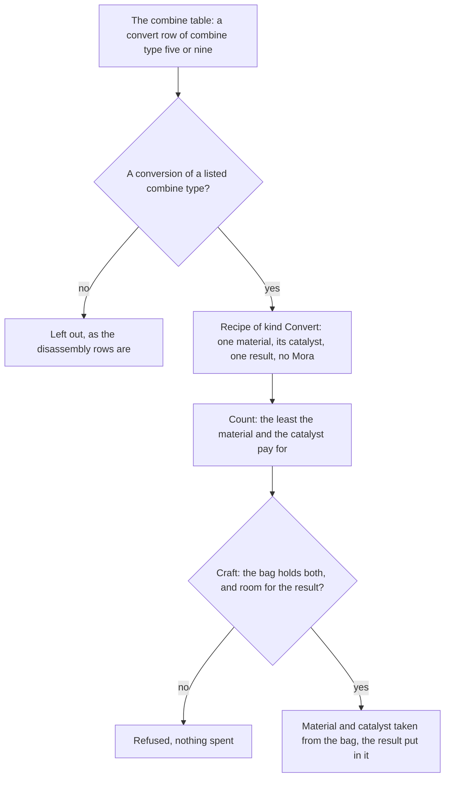

# Converting

The bench's conversions are the combine table's convert rows of two combine types. Each takes one material and the catalyst the table names, and makes one item of the same family. They are held as a recipe kind of their own, opened from the start, and listed under tabs apart from the crafts of the same combine type.

## How it works

## Decisions

### The conversions are the convert rows of two combine types

The combine table's convert rows of combine type five become recipes of kind Convert: they turn an elemental sliver, fragment, chunk or gemstone into the same tier of another element with Dust of Azoth. Combine type nine's rows turn a boss material or a billet into another of its family with Dream Solvent. Rejected: reading the wiki's Converting page for the pairs, since that page is a stub that names no conversion. Rejected: the dump's ConvertAdditional table, whose rows are the fishing points of mechanical fish and name no item. Rejected: filing a conversion under the tier kind, because a tier takes no catalyst and its count is never limited by one.

### A conversion takes one material and the catalyst the table gives

The material is one, and the catalyst is the count the table gives: for a sliver, one Dust of Azoth at the lowest tier up to twenty-seven at the highest, and for a boss material or a billet, one or two Dream Solvent. The Dream Solvent page says one solvent converts one material, which holds for the boss materials, but the table gives a billet two, so the table is followed. Rejected: applying the wiki's one-solvent rule to every conversion, which the billets contradict.

### A conversion costs no Mora, makes one item and is open from the start

Every convert row is shown by default and names no rank or instruction, so the recipe is open from the start. The dump's defaults fill its Adventure Rank and Mora with zero, and its result count is one. Rejected: giving a conversion an instruction to open it, since the table names none.

### Combine type eleven is not a conversion

Disassemble the Mechanism is combine type eleven. Its rows take one mechanical part and yield drops by a drop id, under a daily limit the game shows with its own message, so no item is made and the rule is a different one. It is left out here and needs a change of its own. Rejected: holding it as a Convert recipe with no result item, since a recipe names the item it makes.

### The conversions sit under tabs apart from the crafts

The bench's tabs are keyed by combine type, and combine type five already names the character ascension tiers, so a conversion filed under five would share that tab. A conversion's tab id is its combine type past the offset in `services/crafting/constants.ts`, and it is named by the game's own text for the combine type, so the sliver conversions read as "Character Ascension Material" and the solvent ones as "Transfigured Dreams". Rejected: string tab ids, since every cell id across the crafting screen is a number. Rejected: a separate mode for conversions, since the game's layout is not yet checked and a tab changes nothing the mode would need.

### The save's recipe cap holds every bench recipe

The save keys the crafted counts by recipe id, so a player who has crafted or converted every recipe would otherwise be refused. The cap rises to hold every row the bench now holds, the conversions included, with room to spare, and the constant lives in `services/save/constants.ts`. No field changes, so a save written under the old cap reads unchanged, and no backfill is needed. Rejected: a cap per kind, which would add a field to the save.

### A conversion emits the crafted event and draws no talent

A conversion emits the item-crafted event a craft does, counted by its combine type. The game's source text reads "Crafted/Converted at the Crafting Bench", so conversions count as crafts for an achievement's source, and that is taken as the reading until an achievement's count of conversions is checked. No crafting talent names combine type five or nine, so a conversion draws none. A talent that names one of them later would apply to conversions, which the talent table would need to say.

## Key files

| File                                                                        | Role                                                                                                          |
| :-------------------------------------------------------------------------- | :------------------------------------------------------------------------------------------------------------ |
| `scripts/src/services/genshinAssets/crafting/constants.ts`                  | The convert recipe type and the two combine types whose conversions are kept                                  |
| `scripts/src/services/genshinAssets/crafting/toCraftingRecipe.ts`           | One row as a recipe, a conversion or a craft, refusing a conversion that is not one material and its catalyst |
| `packages/genshin-world/src/models/crafting/CraftingRecipeKind.ts`          | The Convert kind                                                                                              |
| `packages/genshin-world/src/services/crafting/constants.ts`                 | The offset that puts a conversion's tab apart from the crafts                                                 |
| `packages/genshin-world/src/services/crafting/getCraftingTabId.ts`          | The bench tab a recipe is listed under                                                                        |
| `packages/genshin-world/src/services/crafting/computeLearnedRecipeCells.ts` | The learned recipes of one tab, with their crafted counts                                                     |
| `packages/genshin-world/src/services/crafting/CombineTypeGameTextKeyMap.ts` | The game's name for each tab's combine type, including Transfigured Dreams                                    |
| `packages/genshin-world/src/components/Crafting/Screen/Index.vue`           | The tabs and the picked tab's recipes                                                                         |
| `packages/genshin-world/src/services/save/constants.ts`                     | The cap on the bench's recipes in the save                                                                    |
| `packages/genshin-text/src/models/GameTextKey.ts`                           | The game text key of the Transfigured Dreams tab                                                              |

## Notes

- The conversion section's layout is provisional. The game may show conversions in a mode of their own, with its own button and amount line (the manual names COVERT_PROCESS and COVERT_AMOUNT); until a PC recording confirms it, a conversion uses the craft button and the craft's amount line.
- The new game text key needs a `genshin:text write` and a publish before the tab shows its name, and both run at integration.

## Sources

- [Dream Solvent](https://genshin-impact.fandom.com/wiki/Dream_Solvent), Genshin Impact Wiki: the solvent converts one material into another from the same boss, under the bench's filter named Transfigured Dreams.
- [Converting](https://genshin-impact.fandom.com/wiki/Converting), Genshin Impact Wiki: the crafting method at the bench that converts one material into another with a catalyst.
- [AnimeGameData](https://github.com/DimbreathBot/AnimeGameData), the community's per-patch dump: `CombineExcelConfigData`'s convert rows, `ConvertAdditionalExcelConfigData`, and the manual names COMBINE_TYPE_NAME5, COMBINE_TYPE_NAME9 and COMBINE_TYPE_NAME11.
