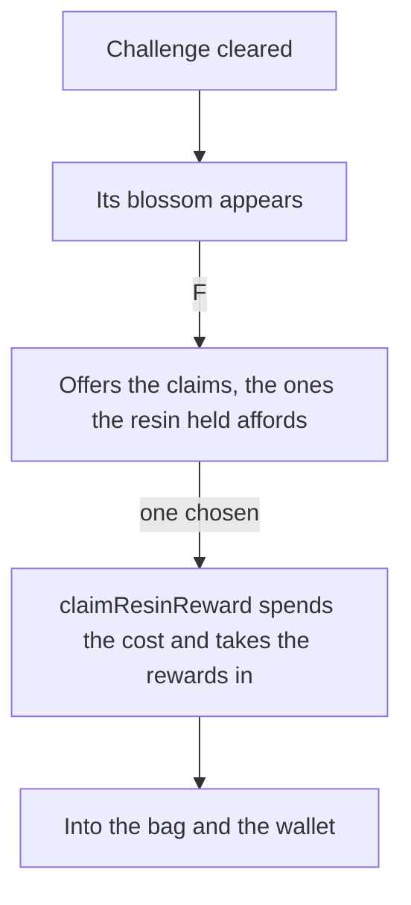

# Original Resin

The [original resin](../../../specs/genshin/original-resin/design.md) page holds the resin's count, its regeneration and refills, a claim's price, its rewards and Condensed Resin. What is left is the claim's offer on F, which each challenge's blossom needs once a challenge places one. Each challenge's own page spawns the blossom, and the claim spends the resin for it.

## Decisions

- **A cleared challenge leaves its blossom, and F offers its claim.** A [ley line outcrop](../../genshin-ley-line-outcrops/design.md)'s Ley Line Blossom, a [domain](../../genshin-domains/design.md)'s Petrified Tree or a [boss](../../genshin-bosses/design.md)'s Trounce Blossom. A challenge cleared but not claimed gives nothing. The offers and their prices are the [original resin](../../../specs/genshin/original-resin/design.md) page's.
- **Offers the holdings can pay.** `computeAffordableBlossomClaimOffers` keeps a resin offer while the Original Resin covers its price, and the Condensed Resin offer while the bag holds one, since that claim spends no Original Resin. A blossom whose offers the holdings cannot pay offers nothing.
- **Fragile Resin is used from the bag.** Its use restores 60 Original Resin, the refill rule the [as-built page](../../../specs/genshin/original-resin/design.md) already has, through `useInventoryEntry`, which the [inventory](../2026-10-18-genshin-inventory/design.md)'s bag calls for each entry's Use.
- **The offers are Original Resin and Condensed Resin.** Fragile Resin is not a claim, and Transient Resin is left out until it is carried. The game's claim text also names Fragile and Transient Resin as claim items; they are left out for now.
- **A short Original Resin offers the restore first.** When the held Original Resin covers no resin offer, the claim's offer list shows a restore prompt: one Fragile Resin restores sixty, through `refillOriginalResinWithFragileResin`, after which the claims are offered again, as the game's claim dialog does. The row reads the game's own `UI_GUIDE_FRAGILE_RESIN`, "Can use Fragile Resin to restore" (`GameTextKey.FragileResinRestore`). Its place among the rows is provisional until a recording of the claim dialog measures it.
- **The bag's Use action restores a Fragile Resin.** `useInventoryEntry` routes a Fragile Resin entry's Use to `refillOriginalResinWithFragileResin`, and the session's restore prompt calls `restoreOutcropClaim` with the same refill.
- **One claim service takes a cost and a reward list.** `claimResinReward` pays a claim in Original Resin, or in Condensed Resin where its cost names it, and takes in the reward list the challenge drew. A blossom, a domain's Petrified Tree and a boss's Trounce Blossom each pass their own cost and list. `claimBlossom` and `spendCondensedResin` are retired, and the rule that refuses a boss Condensed Resin now lives in `computeBlossomClaimOffers`.

## How it works

## Scope and order

**Built:** the claim's offer on F for each blossom a challenge places. The [ley line outcrops](../../genshin-ley-line-outcrops/design.md)' and the [bosses](../../genshin-bosses/design.md)' composables call `computeBlossomClaimPrompt`, which offers the claims from `computeAffordableBlossomClaimOffers`, and `claimResinReward` pays the one chosen. Nothing in this change is left.

## Key files

| File                                                             | Role after the change                         |
| :--------------------------------------------------------------- | :-------------------------------------------- |
| `packages/genshin-world/src/composables/useWorldOutcrops.ts`     | Offers a ley line blossom's claim on F        |
| `packages/genshin-world/src/services/enemy/computeEnemyDrops.ts` | Its bands, which a claim's rolled drops share |

## Sources

- [Original Resin](https://genshin-impact.fandom.com/wiki/Original_Resin), Genshin Impact Wiki: claims at ley line outcrops, domains and bosses and their prices.
- [Condensed Resin](https://genshin-impact.fandom.com/wiki/Condensed_Resin), Genshin Impact Wiki: three rewards at once, and never at a boss.
- [Normal Bosses](https://genshin-impact.fandom.com/wiki/Normal_Bosses) and [Weekly Bosses](https://genshin-impact.fandom.com/wiki/Weekly_Bosses), Genshin Impact Wiki: the Trounce Blossom, 40 resin, and 30 for the first three weekly claims.

## Reference

- `map-top-bar.mkv` — the map on M opened from standing still in the open world, its top bar in view with the Original Resin counter, 10 seconds at most; the counter's place and type are measured from it. On the wiki and YouTube, none found (searched 2026-10-11).
