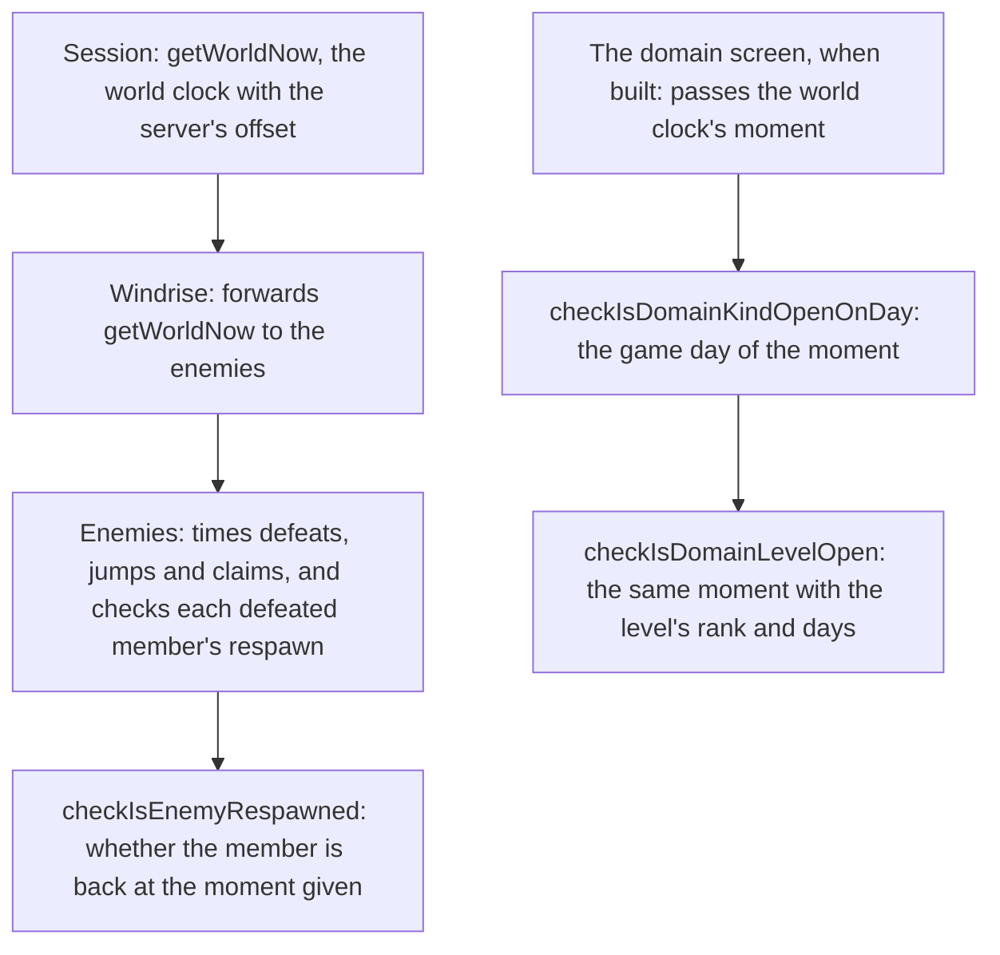

# Reset clock readers

The two readers the reset clock left on their own clocks take the world clock: the enemies' respawn check through a function threaded from Session through Windrise, and the domains' opening checks through the moment they are asked about. Both read the game day from the same clock as every other reset.

## How it works



## Decisions

- **The world clock reaches the enemies as a function.** Enemies takes `getWorldNow` as a `() => Temporal.Instant`, as the world's composables do, so each read is taken when it is made. Rejected: a `Temporal.Instant` prop, which would hold the moment Windrise last rendered and so time every respawn to it.
- **The respawn check is a pure function of the moment it is given.** `checkIsEnemyRespawned` takes `now` and the defeat, so the rule is tested without mounting the component, which the local suites do not do. Rejected: a component test, since the components' tests are browser tests that run in CI.
- **The domain checks take the moment, not a day.** `checkIsDomainKindOpenOnDay` and `checkIsDomainLevelOpen` take `now: Temporal.Instant` and read the game day with `computeGameDay`, so the caller cannot pick a zone or a date. Rejected: keeping a `Temporal.PlainDate`, which left every caller to derive the day itself. Their names are kept, since the domain screen calls them by name.
- **Defeats, jumps and claims are timed on the world clock too.** A respawn is compared with the moment its defeat was recorded at, so both must be read on the same clock. Rejected: timing the defeat on the device clock and checking it on the world clock, which would skew each respawn by the offset between them.

## Key files

| File                                                                        | Role                                                                                                       |
| :-------------------------------------------------------------------------- | :--------------------------------------------------------------------------------------------------------- |
| `packages/genshin-world/src/components/World/Enemies/Index.vue`             | Times the defeats, jumps and claims on `getWorldNow`, and checks each respawn with `checkIsEnemyRespawned` |
| `packages/genshin-world/src/components/World/Windrise/Index.vue`            | Forwards `getWorldNow` from Session to the enemies                                                         |
| `packages/genshin-world/src/components/World/Session/Index.vue`             | Passes its world clock to Windrise                                                                         |
| `packages/genshin-world/src/services/domains/checkIsDomainKindOpenOnDay.ts` | Open on the game day of the moment given, every day for Blessing                                           |
| `packages/genshin-world/src/services/domains/checkIsDomainLevelOpen.ts`     | Open at the rank, at or above the level's recommended rank, and on the game day of the moment given        |
| `packages/genshin-world/src/services/enemy/computeEnemyRespawnTime.ts`      | When a defeated camp member comes back, which the check compares with the moment given                     |

The check this change adds is a new file, so it is listed in a tree:

```text
packages/genshin-world/src/services/enemy/
└── checkIsEnemyRespawned.ts   (a defeated camp member is back at the moment given)
```

## Notes

- Windrise has no clock reads of its own, so it only forwards the function.
- The domain screen is not built yet. When it is, it passes the world clock's moment to both checks.
- The components' tests are browser tests that CI runs, so the wiring is not run by this change. The rule the wiring carries is the unit-tested part here.
