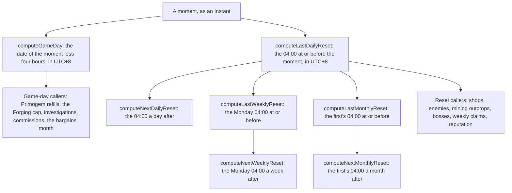

# Reset clock

Every daily, weekly and monthly reset in the world is read off one server clock, the Asia server's, UTC+8, where the daily reset is at 04:00, the weekly reset is Monday at 04:00 and the monthly reset is the first at 04:00. One module in `packages/genshin-world/src/services/time/` owns the zone, the hour, and the weekday and day constants, and every system reads its functions rather than a copy of them.

## How it works

## Decisions

- **One clock, the Asia server's.** Every reset is read at 04:00 in `Asia/Shanghai`, the zone the game's server keeps, with the weekly reset on Monday and the monthly reset on the first at the same hour. Rejected: each reader's own time zone, which the bosses and enemies pages stated. A reader in New York then saw the daily reset on another day from a reader in Shanghai, and two players shared a week only when they shared a zone.
- **The wiki's 06:00 mining respawn is not followed.** The Mining Outcrop wiki page gives the respawn at 06:00, two hours after the reset. The world keeps the one 04:00 reset that the shops and commissions already use, and the divergence is recorded on the mining outcrops page. Rejected: a respawn at 06:00 beside a draw at 04:00, which gives one region two clocks.
- **One module owns the constants.** `services/time/constants.ts` holds the zone, the hour, the weekly weekday, the monthly day and the days in a week, each with its reason. Rejected: the copies the shops, the Original Resin service, the enemies and the weekly count each kept, which had drifted apart and were why the resets disagreed.
- **A reset is an instant and a day is a date.** The reset functions return a `Temporal.Instant`, because a respawn, a claim and a mining are compared as moments. The game day is a `Temporal.PlainDate`, because the caps and the counts are kept per day. Rejected: a date for every reset, which cannot tell 03:59 from 04:00 on the same day.
- **The game day turns at the daily reset.** `computeGameDay` takes four hours off the moment in UTC+8 and reads the date, so 03:59 still belongs to the day before. Rejected: the calendar midnight, which the Forging cap and the Primogem refills do not use.
- **A moment at the reset belongs to the period it opens.** The last reset at or before a moment is the one at that instant, and the next is the one after it, so a claim made at exactly 04:00 counts toward the new week. Rejected: a reset that closes the period it ends, which would count a claim at 04:00 on Monday toward the old week.
- **The old copies are deleted, with no alias.** The daily and weekly reset modules, the weekly constants module and the mining outcrop respawn module are removed, and the zone and hour constants leave the Original Resin, shop and enemy modules. Rejected: re-exporting the old names, since every caller is in the package and reads the new functions.
- **The save keeps its shapes.** The save still stores game-day dates and the instant of a deal as ISO strings. The claim of a Trounce Blossom, a defeated enemy's instant and a teleport are held in memory and not saved, so the move to `Temporal.Instant` needs no migration.

## Key files

| File                                                                                    | Role                                                                                                 |
| :-------------------------------------------------------------------------------------- | :--------------------------------------------------------------------------------------------------- |
| `packages/genshin-world/src/services/time/constants.ts`                                 | The server's zone, the 04:00 hour, the Monday weekday, the first of the month and the days in a week |
| `packages/genshin-world/src/services/time/computeGameDay.ts`                            | The game day a moment belongs to, the date after four hours are taken off in UTC+8                   |
| `packages/genshin-world/src/services/time/computeLastDailyReset.ts`                     | The last 04:00 at or before a moment                                                                 |
| `packages/genshin-world/src/services/time/computeNextDailyReset.ts`                     | The 04:00 a day after the last daily reset                                                           |
| `packages/genshin-world/src/services/time/computeLastWeeklyReset.ts`                    | The Monday 04:00 at or before a moment                                                               |
| `packages/genshin-world/src/services/time/computeNextWeeklyReset.ts`                    | The Monday 04:00 a week after the last weekly reset                                                  |
| `packages/genshin-world/src/services/time/computeLastMonthlyReset.ts`                   | The first of the month's 04:00 at or before a moment                                                 |
| `packages/genshin-world/src/services/time/computeNextMonthlyReset.ts`                   | The first of the next month's 04:00                                                                  |
| `packages/genshin-world/src/services/shop/computeShopRefreshTime.ts`                    | The last refresh of a shop's kind, read from the reset module                                        |
| `packages/genshin-world/src/services/shop/computeNextShopRefreshTime.ts`                | The next refresh of a shop's kind, read from the reset module                                        |
| `packages/genshin-world/src/services/shop/getPaimonsBargainsOffer.ts`                   | The bargains' month, the game day's month                                                            |
| `packages/genshin-world/src/services/originalResin/refillOriginalResinWithPrimogems.ts` | The Primogem refill's game day                                                                       |
| `packages/genshin-world/src/services/forging/checkIsForgeDailyCapReached.ts`            | The forge cap, counted over the game day                                                             |
| `packages/genshin-world/src/services/investigation/countInvestigationsToday.ts`         | The investigations made since the last daily reset                                                   |
| `packages/genshin-world/src/services/commission/checkIsCommissionDayCurrent.ts`         | Whether the kept day is still current against the last daily reset                                   |
| `packages/genshin-world/src/services/commission/computeCommissionDay.ts`                | The day's four, dealt again when the kept day is no longer current                                   |
| `packages/genshin-world/src/services/leyLine/checkIsOutcropDayCurrent.ts`               | Whether an outcrop's day is still current                                                            |
| `packages/genshin-world/src/services/leyLine/checkIsMiningOutcropStanding.ts`           | A mined outcrop stands until the next 04:00 reset after its mining                                   |
| `packages/genshin-world/src/services/enemy/computeEnemyRespawnTime.ts`                  | An elite camp's member returns at the next daily reset                                               |
| `packages/genshin-world/src/services/bosses/computeBossRespawnTime.ts`                  | A normal boss's respawn instant, five seconds after its claim                                        |
| `packages/genshin-world/src/services/bosses/checkIsWeeklyBossClaimable.ts`              | Whether a weekly boss is claimable, counting the claims since the last weekly reset                  |
| `packages/genshin-world/src/services/weekly/countWeeklyClaims.ts`                       | The claims made since the last weekly reset                                                          |
| `packages/genshin-world/src/services/reputation/checkIsReputationWeeklyLimitReached.ts` | The reputation weekly limit, counted from the last weekly reset                                      |
| `packages/genshin-world/src/services/spiralAbyss/findAbyssPeriodAt.ts`                  | The Moon Spire period that began latest, read in the server's zone                                   |
| `packages/genshin-world/src/services/spiralAbyss/pickAbyssBenedictionList.ts`           | The Moon Spire blessing list's day, counted from the game epoch on the server's clock                |
| `packages/genshin-world/src/services/shared/findLatestBegun.ts`                         | The latest season begun before a moment, read in the server's zone                                   |
| `packages/genshin-world/src/services/gathering/computeGatheringRespawn.ts`              | The gathering midnight, read in the server's zone                                                    |
| `packages/genshin-world/src/composables/useWorldFishing.ts`                             | The fishing day's hours, read in the server's zone                                                   |
| `packages/genshin-world/src/composables/useWorldCommissions.ts`                         | The commissions' moment, from the world clock                                                        |
| `packages/genshin-world/src/components/World/Enemies/Index.vue`                         | The enemies' moment, compared against the reset from the module                                      |
| `packages/genshin-world/src/models/bosses/TrounceBlossom.ts`                            | The claim's instant as a `Temporal.Instant`                                                          |

## Notes

- The Enemies component takes the moment it compares from the device clock, as it did before, and the reset it compares against is the server's. Session passes a `getWorldNow` to Windrise, which does not forward it to the enemies, so threading the world clock through is a follow-up.
- `checkIsDomainKindOpenOnDay` and `checkIsDomainLevelOpen` take a day from the caller as a date. `checkIsDomainLevelOpen` has no caller outside its tests, so the domains are not rewired to the module here.
- Deleted: `computeDailyResetTime`, `computeWeeklyResetTime`, `computeMiningOutcropRespawn`, which its one rule moved into `checkIsMiningOutcropStanding`, the weekly constants module, and the zone and hour constants in the Original Resin, shop and enemy modules.
- Gathering's overworld ingredients respawn at the server's midnight, a separate moment kept in the gathering rules and not a reset, so it is not moved into this module.

## Sources

- [Reset](https://genshin-impact.fandom.com/wiki/Reset), Genshin Impact Wiki: the daily reset at 04:00 server time, the same clock this module reads.
- [Daily Reset](https://genshin-impact.fandom.com/wiki/Daily_Reset), Genshin Impact Wiki: the weekly reset on Monday at 04:00.
- [Paimon's Bargains](https://genshin-impact.fandom.com/wiki/Paimon%27s_Bargains), Genshin Impact Wiki: the monthly reset on the first, which the bargains' month counts from.
- [Mining Outcrop](https://genshin-impact.fandom.com/wiki/Mining_Outcrop), Genshin Impact Wiki: the respawn at 06:00, recorded here as the divergence the world does not follow.
