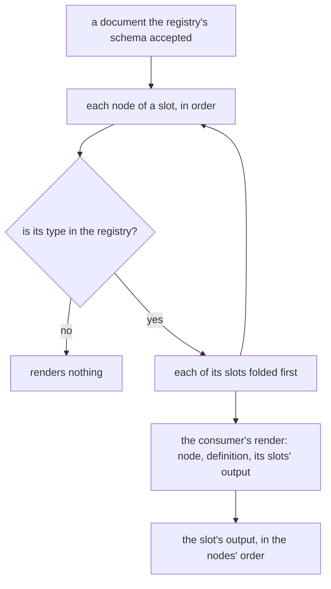

# Registry root and render fold

What the [editor core](../../specs/headless-block-editor/editor-core/design.md) needs before more than one consumer builds on it. The core was built for the page builder alone, and three things its later consumers need are missing. The email blocks over MJML ([MJML blocks](../resource-page-builder-mjml-blocks/design.md)) and the [survey on the editor core](../../deferred/resource/survey-on-editor-core/design.md) show them: a root whose content takes only some types, a root whose props are checked, and one way of turning a checked document into a consumer's output.

## The root is declared by the registry

Today a registry is a list of types. The root's content accepts every type in that list, and the root's props pass through unchecked. Each consumer meets this differently:

- MJML's body holds only wrappers, sections, heroes and raw blocks, so a text placed at the root compiles to an email MJML's validator refuses.
- A survey's root holds only pages.
- A webpage's root takes every placeable type.
- The root's props hold the email's preview text and fonts, the webpage's tokens and the survey's title and settings. Each consumer would have to check them a second time, after the core's schema had already accepted the document.

So the registry becomes an object that declares its root beside its types:

```ts
interface BlockRegistry<TDefinition extends BlockTypeDefinition = BlockTypeDefinition> {
  root: BlockRootDefinition;
  types: TDefinition[];
}
// The document's own half: the types its content accepts and the schema its props pass
interface BlockRootDefinition {
  content: string[];
  propsSchema: z.ZodObject;
}
```

`getRootAcceptedTypes` reads `root.content`, so `getAcceptedTypes` answers `/content` from it. `createBlockDocumentSchema` parses the root's props with `root.propsSchema`, and a refusal names its path under `root`, just as a node's refusal names the slot. The root's props type is that schema's output, so `models/BlockRoot.ts` is deleted rather than extended: a second declaration of the props would drift from the one the schema checks. A root prop is edited the way a node's prop is: `updateBlockNodeProps` over the pointer `/root` writes `/root/props/<key>`, so the core gains no command for it.

The registry is generic over its definition, so a consumer's extended type definitions keep their own type. That covers a render function, a form schema and an editor half: every core function still takes the base registry, and the fold below hands back the consumer's definition.

Rejected: a reserved root type in the list of types. It would make the document a node, which a paste could then copy and a slot could then accept. Also rejected: the root's rules as a second argument to every function. The two values always travel together, so every call site would carry both.

**A paste checks its copies as the slot's children, not as a document.** `pasteBlockNodes` checks its copies today by wrapping them in a document and parsing that. With a declared root, that wrapper refuses a column pasted into a section, because the root does not accept columns, and it refuses any root with required props. So the check that walks a slot's children becomes the core's slot-level schema, `createBlockNodesSchema`. It is the walk `createBlockDocumentSchema` already runs for the root's content, and a paste parses its copies with it against the destination slot's accepted types. The document schema and the paste then share one walk, with no wrapper.

## A document renders from its leaves up

A consumer that publishes a document folds the tree into its own output. The webpage folds it into an element tree for one HTML document, and the email blocks fold it into MJML's JSON form. Each node renders once its slots have rendered, so a consumer's render function is pure over a node, its definition and the output of each of its slots:

```ts
const renderBlockNodes = <TDefinition extends BlockTypeDefinition, TOutput>(
  nodes: BlockNode[],
  registry: BlockRegistry<TDefinition>,
  render: (node: BlockNode, definition: TDefinition, slots: Record<string, TOutput[]>) => TOutput,
): TOutput[] => ...
```



The fold runs over a document that has already been parsed, so a type missing from the registry can only come from a caller that skipped the parse. Such a node renders nothing rather than throwing, so a published page renders every node its registry knows. Rejected: each renderer walking the tree itself. That writes the same recursion twice, and one copy would sit in a package that cannot import the other.

## Key files

| File                                                                       | Role after the change                                                    |
| -------------------------------------------------------------------------- | ------------------------------------------------------------------------ |
| `packages/headless-block-editor/src/models/BlockRegistry.ts`               | the root's definition beside the types, generic over the type definition |
| `packages/headless-block-editor/src/models/BlockRoot.ts`                   | deleted: the root's props type is the definition's schema output         |
| `packages/headless-block-editor/src/services/getRootAcceptedTypes.ts`      | the root's declared content types                                        |
| `packages/headless-block-editor/src/services/createBlockDocumentSchema.ts` | the root's props parsed, and the slot walk shared with the paste         |
| `packages/headless-block-editor/src/services/pasteBlockNodes.ts`           | its copies checked as the destination slot's children                    |
| `packages/headless-block-editor/src/services/constants.test.ts`            | the test registry with a root that takes sections only and a titled root |

New code lands here:

```text
packages/headless-block-editor/src/models/BlockRootDefinition.ts       the root's content types and props schema
packages/headless-block-editor/src/services/createBlockNodesSchema.ts  a slot's children checked against the registry
packages/headless-block-editor/src/services/renderBlockNodes.ts        the fold from the leaves up
```

## Sources

- [MJML — mj-body](https://documentation.mjml.io/#mj-body) — the body's allowed children, which the root's content must be able to narrow to.
- [Puck — Data](https://puckeditor.com/docs/api-reference/data) — the root's props beside its content, the shape the registry's root now describes.
