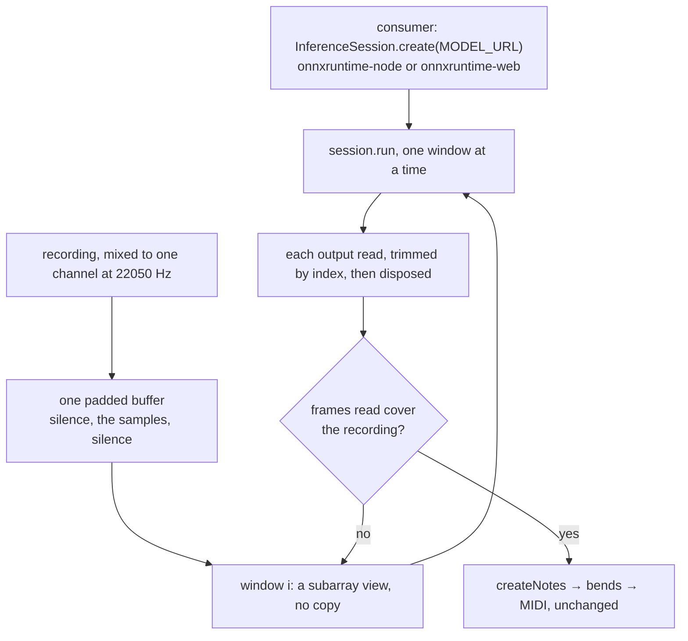

# Pitch transcription on ONNX Runtime

The package's network moves from TensorFlow.js to the consumer's ONNX Runtime. It runs as the ONNX export Basic Pitch's model repository publishes, so the weights still ship unmodified from their source, and TensorFlow.js leaves the workspace with no engine added in its place.

## Scope

Today the package ships the TensorFlow.js export: `model.json` and one weight shard. TensorFlow.js is its peer, and `readModel` runs a `GraphModel` window by window inside `tidy`, freeing each window's tensors before the next. `prepareAudioWindows` frames the whole recording with `tf.signal.frame`, which holds every window at once. `unwrapWindowReadings` slices and reshapes a tensor. Its one consumer, the Genshin music fit in `scripts`, loads the model with `loadGraphModelSync` and runs it on TensorFlow.js's CPU backend.

After the change:

- The package ships `nmp.onnx` with its `NOTICE`, and its peer is `onnxruntime-common`.
- `readModel` feeds an inference session one window at a time. The windows and the readings are plain typed arrays.
- The consumer creates the session from `MODEL_URL` with whichever runtime suits it, as it chose TensorFlow.js's backend before.
- Note creation, the bends and the MIDI writer are untouched, and `pitch-transcription/notes` still loads no runtime.

## How it works

The ONNX export and the TensorFlow.js export are two conversions of one saved model. They take the same input, a window of 43,844 samples as `[1, samples, 1]`, and give the same three readings: frames and onsets over 88 keys, and contours over 264 bins, for 172 frames a window. The ONNX graph names its outputs after the saved model's call, so the constants map them: `StatefulPartitionedCall:1` is the frames, `:2` the onsets and `:0` the contours.

Fed one window of a two-tone recording, every reading the two exports gave agreed to within 3 × 10⁻⁷. That is float rounding, far below any threshold note creation applies.

- **Windows.** The recording is copied once into a buffer padded with half an overlap of silence at the front and silence up to the last window's end. Window `i` is the view `subarray(i × hop, i × hop + windowSamples)`, wrapped as a tensor of shape `[1, windowSamples, 1]`. Memory holds the recording plus one window's readings, where `tf.signal.frame` held every overlapping window at once.
- **Readings.** Each output's data is a `Float32Array` of 172 rows. The half overlap at each end is dropped by index, and the rows are pushed in the `number[][]` shape `ModelReadings` already has, so `createNotes` reads them unchanged. The loop stops once the readings cover the recording's frames, so no window past its end runs, as today.
- **Freeing.** A CPU tensor is a typed array the collector reclaims. A tensor onnxruntime-web holds on the GPU is read with `getData()` and released with `dispose()`. `readModel` disposes every output it reads, so both runtimes free their outputs the same way.

## Decisions

- **ONNX Runtime over TensorFlow.js.** The engine stays a dependency, as an engine should under [dependency admission](../../specs/architecture/dependency-admission/design.md). The question is which one. ONNX Runtime is maintained, already installed, native under Node, and offers WebAssembly and WebGPU in a browser. TensorFlow.js is dormant. On this network under Node, one window took about 17 ms on ONNX Runtime against 1.9 s on TensorFlow.js's CPU backend. Its umbrella package also installs the layers API, the data API, the WebGL backend, `core-js`, `regenerator-runtime`, `yargs` and `argparse`, none of which the network uses. Two Basic Pitch issues the README marks out of scope as TensorFlow.js's go with it: #22, transcription failing on newer iPhones' WebGL, and #23, the `Long.fromString` failure under a bundler.
- **Rejected: a runtime of our own for the TensorFlow.js graph format.** Basic Pitch's graph uses a few dozen ops, so a kernel table covering them would be small. It would still be an engine on the stop list's terms: kernels, numerics and backends, whose speed a native runtime sets. It would be written for one network that its authors already publish in a format a maintained runtime runs, and the repo already installs that runtime.
- **Rejected: narrowing TensorFlow.js to its core, converter and CPU backend.** That sheds the umbrella's extras. It keeps a dormant engine, its CPU speed and its own dependencies, and leaves #22 and #23 where they are.
- **Rejected: converting the TensorFlow.js export ourselves.** The model repository ships its own ONNX export of the same saved model. Taking it keeps the package shipping weights unmodified from their source, as the `NOTICE` says.
- **`onnxruntime-common` as the peer.** It holds `InferenceSession` and `Tensor`, which both runtimes implement and re-export. The package builds its input tensors from that one copy, and a session refuses a tensor from a different copy, so the peer is what ties the package's tensors to the consumer's runtime. Depending on a runtime directly would choose the consumer's runtime for it.

## Key files

| File                                                                | Role after the change                                                 |
| :------------------------------------------------------------------ | :-------------------------------------------------------------------- |
| `packages/pitch-transcription/model`                                | `nmp.onnx`, unmodified, in place of the TensorFlow.js export          |
| `packages/pitch-transcription/NOTICE`                               | names the ONNX export as the model distributed                        |
| `packages/pitch-transcription/src/constants.ts`                     | `MODEL_URL` to the ONNX file, and the output tensors' names           |
| `packages/pitch-transcription/src/services/readModel.ts`            | the session over a recording, a window at a time, each output freed   |
| `packages/pitch-transcription/src/services/prepareAudioWindows.ts`  | the padded buffer and each window's view                              |
| `packages/pitch-transcription/src/services/unwrapWindowReadings.ts` | an output's rows with the overlap trimmed by index                    |
| `packages/pitch-transcription/src/services/readModel.test.ts`       | the notes the TensorFlow.js export heard, held against the new run    |
| `packages/pitch-transcription/src/index.test.ts`                    | #19: the notes subpath loads no runtime                               |
| `packages/pitch-transcription/package.json`                         | `onnxruntime-common` as the peer, `onnxruntime-node` for the tests    |
| `scripts/src/services/genshinAssets/shared/readMusicSourceNotes.ts` | the fit's session from `onnxruntime-node`                             |
| `scripts/package.json`                                              | `onnxruntime-node` and `onnxruntime-common` in place of TensorFlow.js |
| `pnpm-workspace.yaml`                                               | the catalog, without TensorFlow.js or the `core-js` build allowance   |
| `osv-scanner.toml`                                                  | without the `sprintf-js` exception                                    |
| `openspec/specs/pitch-transcription/README.md`                      | rewritten as built                                                    |

## Notes

- The readings cached beside each decoded source stay valid. They agree with what the new runtime reads to within float rounding, so no fit is rerun for the change.
- A consumer in a browser now loads ONNX Runtime's WebAssembly or WebGPU build where it loaded TensorFlow.js's. Its size is the runtime's, which the consumer already weighs when it picks one.

## Sources

- [spotify/basic-pitch — `saved_models/icassp_2022`](https://github.com/spotify/basic-pitch/tree/main/basic_pitch/saved_models/icassp_2022) — the ONNX export shipped in place of the TensorFlow.js one, beside the TensorFlow Lite and Core ML exports of the same saved model.
- [ONNX Runtime — JavaScript API](https://onnxruntime.ai/docs/api/js/) — `InferenceSession`, `Tensor`, and `onnxruntime-common` as the interface shared by `onnxruntime-node` and `onnxruntime-web`.
- [tensorflow/tfjs — releases](https://github.com/tensorflow/tfjs/releases) — 4.22.0, October 2024, the last.
