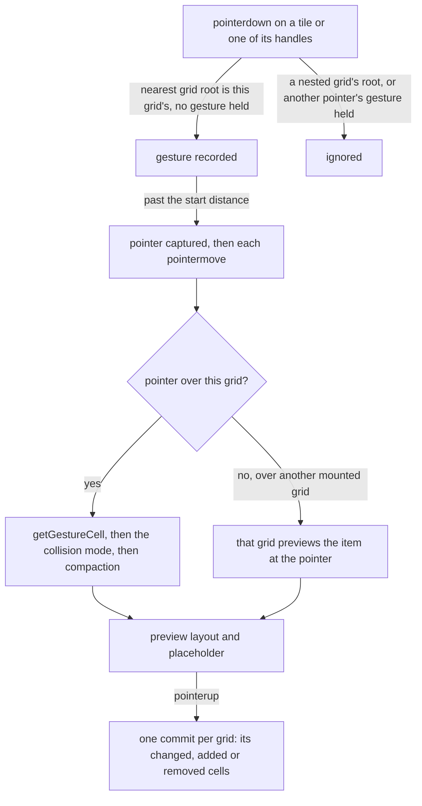

# Dashboard grid as a headless package

The dashboard grid's placement functions and gesture state move into `vue-grid-layout-headless`, a published workspace package with no styling. The dashboard keeps only its look. The package then builds the twelve features its audit set aside, because a grid package owes them even though no dashboard asks for them.

## Scope

Today the grid lives in the app. The placement functions sit under `apps/web/app/services/dashboard/grid/` and work on the dashboard's `LayoutItem`. The gesture state machine lives inside `apps/web/app/components/Dashboard/Grid.vue`, beside the markup that draws the tiles, the corner handle and the placeholder.

After the change:

- **`vue-grid-layout-headless/placement`** holds the placement functions, framework-free. They are generic over any item with an id, an origin and a span in cells, so a consumer's own model passes through unchanged.
- **`vue-grid-layout-headless`** holds `useGridLayout`. It takes the layout, the column count and the grid's options, and returns the preview layout, each item's position and size, the placeholder, and the pointer handlers a tile and its handles bind. It emits one commit of changed cells per gesture, as the dashboard's grid does today.
- **`apps/web/app/components/Dashboard/Grid.vue`** keeps only the markup and the app's tokens: the tiles, the handles it chooses to draw, and the placeholder.

The package depends on its `vue` peer and on `@esposter/shared` alone. The press rule refuses a press on a nested control with `checkIsNestedControl`, the one DOM helper it shares with the rest of the app, and everything else is native (`addEventListener`, `ResizeObserver`, `setPointerCapture`) with no utility library.

## How it works

The package splits along the line that `@vuetify/v0` draws under the UI library. The package holds the behaviour, and the consumer holds the markup. `useGridLayout` holds no element of its own. The consumer binds the grid root and each tile through the handlers it returns, and draws whatever the returned state describes.



- **Placement.** The functions the dashboard tests today move as they are, with three options added. `compactType` is `vertical`, `horizontal` or `none`, and `none` leaves a dropped item where it lands. `collision` is `push`, `swap` or `prevent`. `push` is today's behaviour. `swap` trades places with the one item the dropped one lands on, and falls back to `push` when it lands on several. `prevent` refuses the move. The grid's outer padding is its own option, apart from the margin between items.
- **Resizing.** A resize names the edge or corner it pulls. Pulling the left or the top edge moves the origin and changes the span together, so the opposite edge stays put. The composable returns a handler for each of the eight, and the consumer binds only the handles it draws.
- **Content height.** An item marked auto-height takes its rows from its content. The consumer reports the content's height, which it reads with a `ResizeObserver`. The composable sets the span to the whole rows that hold it, and compacts. That write is a commit, like any gesture's.
- **Dropping in.** A gesture whose pointer leaves its grid is shown by the mounted grid under the pointer, which previews the item at that cell. On release, the source commits a removal and the target commits an addition. An item dragged in from outside any grid, such as a palette entry, enters the same way through `startExternalDrag`, given the span it would take.
- **Nested grids.** Each grid root carries an attribute that marks it. A press belongs to the grid whose root is nearest to its target, so an outer grid never starts a gesture on an inner grid's tile. The dashboard's guard for a press inside a nested action already works this way.

## Decisions

- **A headless package over an app component.** The [dependency admission](../../specs/architecture/dependency-admission/design.md) rule is that behaviour of its own makes a rewrite a package again. A grid's placement is that kind of behaviour, and it was the reason other projects installed `grid-layout-plus`. Keeping it in the app was rejected because every other consumer would have to rebuild it.
- **A composable over components.** Shipping a styled `GridLayout` and `GridItem` pair, as `grid-layout-plus` does, was rejected. The pair's markup and class names would be the styling contract that made component wrappers app components in the first place. The composable returns state and handlers, and the consumer renders them.
- **Every edge resizes.** This overturns the dashboard grid's decision against per-edge handles (upstream #38 and #51), which was made because a dashboard resizes from its corner. A package cannot speak for its consumers' layouts. Resizing from the left or the top also moves the origin, which is the same placement logic again, not a second copy of it. The dashboard still draws one corner handle.
- **The features are built, not deferred.** The audit marked twelve rows out of scope because no dashboard asks for them, but that is a consumer's reason, and the verdict belongs to the package. Under the admission standard, an absorbed package does not leave a parity gap just because the one app using it does not call that half. Each feature is now in scope, with its test.
- **Crossing between grids through the mounted grids.** Building cross-grid moves on the HTML Drag and Drop API was rejected. It does not fire for touch input, and it would split one gesture across two event models. The pointer stays captured by the source grid. The composable finds the target among the grids mounted on the page, by the grid root under the pointer.

## Key files

| File                                                   | Role after the change                                     |
| :----------------------------------------------------- | :-------------------------------------------------------- |
| `apps/web/app/components/Dashboard/Grid.vue`           | The dashboard's tiles, corner handle and placeholder only |
| `apps/web/app/components/Dashboard/Editor/Content.vue` | The editor's binding to the package, twelve columns       |
| `apps/web/app/components/Dashboard/Index.vue`          | The published view's binding, breakpoint columns          |
| `apps/web/app/services/dashboard/constants.ts`         | The dashboard's column counts, row heights and margin     |
| `apps/web/shared/models/dashboard/data/LayoutItem.ts`  | The dashboard's saved cell, an item the package places    |
| `openspec/specs/resource/dashboard-grid/design.md`     | The dashboard's use of the package                        |

The package itself:

```text
packages/vue-grid-layout-headless/src/placement/    the placement functions, framework-free, each with its test
packages/vue-grid-layout-headless/src/composables/  useGridLayout and the mounted-grid registry
packages/vue-grid-layout-headless/src/models/       GridItem, GridGesture, CompactType, CollisionMode, ResizeEdge
openspec/specs/vue-grid-layout-headless/README.md   the area's index and its Upstream table
```

## Notes

- The dashboard's saved layouts do not change. A `LayoutItem` is already an item with an origin and a span, and the dashboard keeps vertical compaction, the push mode and the corner handle, so every saved dashboard opens exactly as it did.
- The grid models now under `apps/web/app/models/dashboard/` move into the package. The dashboard's own models, the visual and its dataset shape, stay.

## Sources

- [qmhc/grid-layout-plus](https://github.com/qmhc/grid-layout-plus): the issues the Upstream table judges, whose feature rows this change builds.
- [react-grid-layout](https://github.com/react-grid-layout/react-grid-layout): `compactType`, `containerPadding` and dropping from outside, the options the audit's feature rows ask for by those names.
- [Pointer Events, W3C](https://www.w3.org/TR/pointerevents/): pointer capture, which keeps a gesture with its source grid while the pointer crosses into another.
- [HTML Living Standard, drag and drop](https://html.spec.whatwg.org/multipage/dnd.html): the model rejected for crossing between grids, which touch input never starts.
