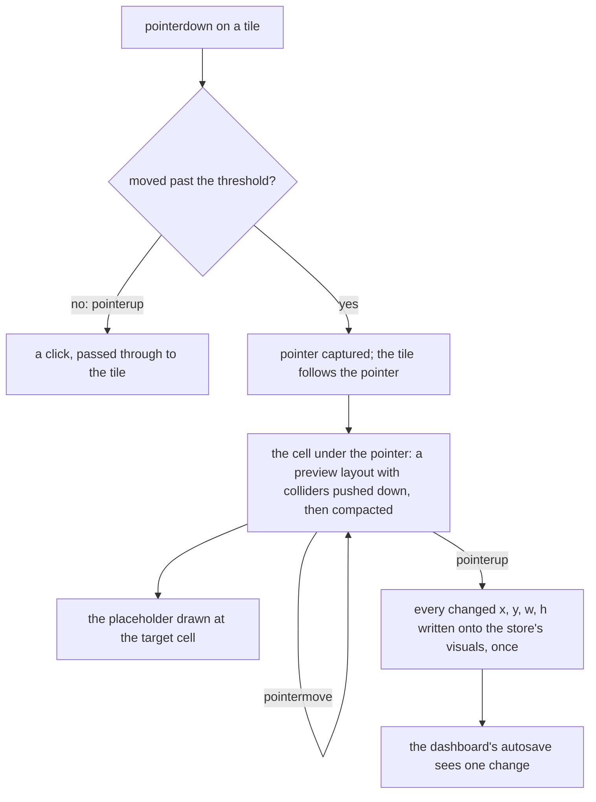

# Dashboard grid of the app's own

A dashboard places each visual by its `x`, `y`, `w` and `h` on a grid of columns and rows. The editor lets the owner drag and resize them; the published dashboard only shows them, reflowing to fewer columns on a narrower screen. Both draw through one grid component of the app's own in place of `grid-layout-plus`, as the [dependency admission](../../specs/architecture/dependency-admission/design.md) standard absorbs a component wrapper. There is no engine to keep: the placement is a small algorithm, and the gestures are Pointer Events.

## How a move lands

## Decisions

- **The placement is pure functions over `{ id, x, y, w, h }`.** One function per file in a new `grid` folder beside `apps/web/app/services/dashboard/chart`, each with its own test: the collision test between two items; vertical compaction, moving each item up in row-then-column order until it touches another or the top; a move that sets the dragged item's cell and pushes every collider down below it, recursively, skipping a collider the item moves up past by more than a quarter of its height; bounds that keep `x + w` within the columns and `w` and `h` at least one cell (#28); fitting a layout to fewer columns by bounds then compaction (#16); and the geometry from a cell to pixels and back, `colWidth = (width − margin × (cols + 1)) / cols`, with a margin of 10px around and between items. The functions never mutate their input.
- **A gesture previews, and only its end writes.** During a drag or a resize the component renders a preview layout held locally, so the store's visuals do not change and the autosave does not run on every cell crossed. On `pointerup` it writes each changed visual's `x`, `y`, `w` and `h` onto the store's own objects, which are `Visual` class instances the dashboard's autosave watches, so they are assigned in place rather than replaced by copies (#45, where the library emitted its moved event before its layout settled). Rejected: emitting a new array, which would drop the class instances for plain copies.
- **A drag starts past a threshold of a few pixels**, so a click still reaches the tile's own handler, and never from a button, a link or a field inside the tile. The pointer is captured on the tile, so a drag that leaves the grid keeps tracking (#2).
- **Resize is one handle at the bottom-right corner,** as before. Rejected: a handle per edge and corner (#38, #51), which no owner has asked for.
- **Touch is the editor's only.** `touch-action: none` is set on a tile only while the grid is editable, so a published dashboard scrolls under a finger on every platform (#54), and no user agent is read (#29).
- **The published dashboard reflows by width.** It measures its own width and takes the column count of the widest breakpoint below it: 12 from 1200px, 10 from 996px, 6 from 768px, 4 from 480px and 2 below, then fits the saved layout to that count. The fitted layout is derived and never saved, which the old copy of the visuals in `Index.vue` guarded by hand. Rejected: saving the fitted layout back into the visuals and guarding the copy by hand, which lost because the guard was the defect the derivation removes.
- **The grid's height follows its lowest item**, `bottom × (rowHeight + margin) + margin`, so the page scrolls rather than the grid.
- **A saved visual holds its position and size only.** `i` duplicated the visual's `id`, and `moved` was the library's runtime flag, which it wrote into saved documents; the optional per-item fields (`static`, the drag and resize switches and the minimum and maximum sizes) are set by nothing. All of them leave `layoutItemSchema` and `Visual`; a saved document that still carries them parses, since the schema drops keys it does not name. Rejected: keeping the library's item shape in the saved visual, which lost because `i` repeats the `id` and `moved` is a runtime flag that would be written into saved documents.
- **The styles are the component's own**, in its scoped style block and the library's tokens, in place of the CSS the library injected at runtime (#26): the tile a panel on the page's background, the placeholder a tinted cell.

## Upstream

Every issue of `grid-layout-plus`, open and closed, gets one verdict in an Upstream table on the capability's design page. The in-scope defects named above carry tests named after them: #16 and #28 on the placement functions, #45 on the single write at the gesture's end, #54 on a published tile's touch action. The features the audit lists — cross-grid drag, nested grids, auto height, horizontal growth, swap mode — are out of scope with the reason that no dashboard asks for them.

## Key files

| File                                                    | Role after the change                           |
| :------------------------------------------------------ | :---------------------------------------------- |
| `apps/web/app/components/Dashboard/Index.vue`           | the published dashboard, reflowed by width      |
| `apps/web/app/components/Dashboard/Editor/Content.vue`  | the editor's grid, editable                     |
| `apps/web/app/services/dashboard/constants.ts`          | `DASHBOARD_NO_COLUMNS` and the grid's constants |
| `apps/web/shared/models/dashboard/data/LayoutItem.ts`   | a visual's position and size, and their schema  |
| `apps/web/app/components/Resource/Dashboard/Editor.vue` | the autosave that persists a move               |

## Sources

- [grid-layout-plus](https://github.com/qmhc/grid-layout-plus), the grid replaced, and its placement helpers read for behaviour.
- [Pointer Events](https://www.w3.org/TR/pointerevents/): pointer capture and `touch-action`.
