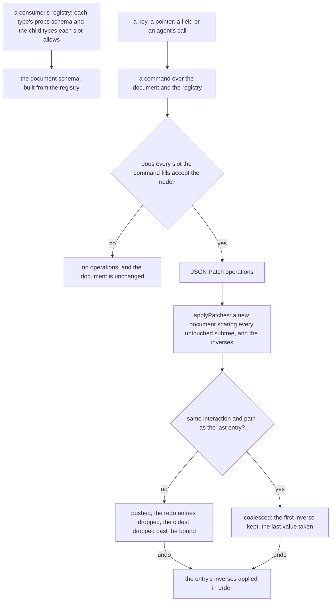

# Headless block editor core

A block editor is two things: the editing model, a tree of typed nodes with the edits that change it, and the product drawn over it — the node types, how each renders, the canvas and the panels. This change makes the first a workspace package, `headless-block-editor`, that knows no editor's node types, so the page builder's webpage and email editors are its first consumers rather than its owners.

## How an edit runs



## Decisions

- **A package, not a folder of the app.** The core's worth is that no editor's types are in it, and a package cannot import the app, so that holds by construction; a folder under `apps/web/shared` would hold it only as long as every review noticed, which the [enforcement ladder](../../specs/architecture/enforcement-ladder/design.md) ranks last. Rejected: the page builder's own `shared/` folders, which the [page builder](../resource-page-builder-program/design.md) program first chose when it had one consumer in mind.
- **Pure TypeScript, with no framework and no DOM.** Every function takes a document and returns a new one, or the operations that make it; the state stays where its consumer keeps it, a Pinia store keyed by resource in the editor and a single request in the server's agent tools. Rejected: Vue composables in the manner of Vuetify 0. The UI library already gives the editor its headless interface parts on Vuetify 0 — the tree, the reorderable list, the command palette — so the core is the editing model beneath them, and a composable would hold state the app keeps per resource and would not run on the server.
- **The tree is Puck's shape, generic over a registry.** A node is `{ type, props }` with its id inside the props, a slot is a prop holding a list of nodes, and a document is a root's props beside its content, as the [document model](../resource-page-builder-document-model/design.md) chose after weighing BlockNote, Portable Text and the Block Protocol. A registry entry holds the type, its props schema and each slot's allowed child types; the page builder's definition extends it with what only the page builder reads, its render, its form schema and its editor half. The document schema is the recursive discriminated union over the registry, refusing a duplicate id or a document past the node limit the consumer passes.
- **A command returns operations, never a document.** Insert, remove, move, duplicate, update props and paste each build JSON Patch operations against the current document, or none when a slot would refuse the node. An operation list is what the history records, what an agent sends and what a test asserts, while a command mutating a reactive document would leave the history to diff before and after to learn what changed. A move is a remove and an add, and a paste re-mints every id it carries.
- **Navigation is the keyboard's half, computed rather than drawn.** The node before and after in document order, the parent, where focus goes after a remove (the next sibling, else the previous, else the parent), the moves Alt with an arrow key makes (among siblings, into the previous sibling's first slot that accepts the node, out to just after the parent), every slot in the document that accepts a node with its path for Move to…, and the layers tree's rows. The [canvas](../resource-page-builder-canvas/design.md) draws and announces them; the core decides them, so a second editor's keyboard behaves as the first's.
- **History is a value, generic over its entry.** It is the history and the future, bounded by a limit the consumer passes, with a new entry dropping the future; undo and redo return the entry to reverse or reapply. A patch entry adds its label, its operations and its inverses, and consecutive replaces of one path within one interaction coalesce. Because the stack is generic, the sheet's command objects and the page builder's patch entries can share it, which is the [undo](../resource-page-builder-undo-as-patches/design.md) change's last task.
- **The JSON Patch applier moves to `@esposter/shared`.** `applyPatches` already serves the agent content tools from the app's `shared/` layer, kept there because both its consumers lived in the app. A package now needs it too, and the agent tools patch every resource type rather than block documents alone, so it moves into the shared utilities, unchanged, and both import it from there. Rejected: putting it in the core, which would make a sheet's patch depend on a block editor.

## Who consumes it

The webpage and email editors are the first consumers, and the only ones this change builds for. A survey builder over the MIT form library would hold pages of panels of questions in the same tree. A Note's layout blocks above its text ([note layout blocks](../../deferred/resource/note-layout-blocks/design.md)) would be a short registry. The flowchart is a graph, not a tree, so it could reuse the history, the patches and the command shape but not the slots; whether it is rebuilt on the core at all is [deferred](../../deferred/resource/flowchart-on-editor-core/design.md) until the page builder has shown the core works.

## Key files

| File                                                               | Role after the change                                            |
| ------------------------------------------------------------------ | ---------------------------------------------------------------- |
| `packages/shared/src/services/jsonPatch/applyPatches.ts`           | the applier, moved here from the app with its models and helpers |
| `apps/web/server/services/resource/applyResourceContentPatches.ts` | imports the applier from `@esposter/shared`                      |
| `apps/web/server/services/mcp/checkIsAgentWritablePath.ts`         | reads JSON Pointers through `@esposter/shared`                   |
| `openspec/specs/architecture/agent-content-tools/design.md`        | names the applier's new home                                     |

New code lands here:

```text
packages/headless-block-editor/src/models/       BlockNode, BlockDocument, Slot, BlockTypeDefinition, History
packages/headless-block-editor/src/services/     the document schema, id minting, the commands, navigation, history
```

## Sources

- [Puck — Data](https://puckeditor.com/docs/api-reference/data) and [the slot field](https://puckeditor.com/docs/api-reference/fields/slot) — the tree's shape and the allow lists a slot carries.
- [RFC 6902 — JSON Patch](https://www.rfc-editor.org/rfc/rfc6902.html) — the operations a command returns.
- [WAI-ARIA Authoring Practices — Tree View](https://www.w3.org/WAI/ARIA/apg/patterns/treeview/) — the keys the navigation answers.
