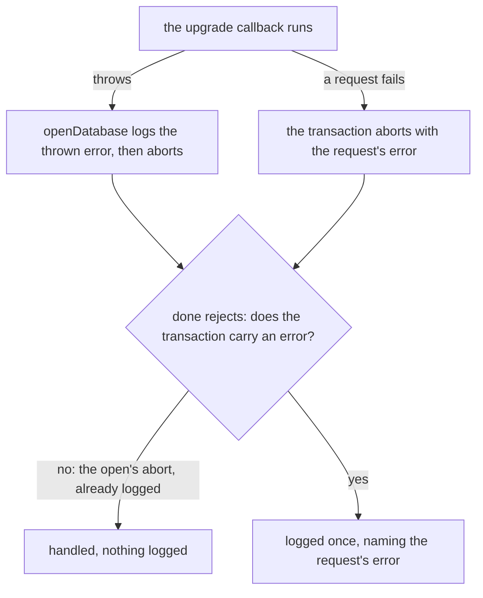

# IndexedDB upgrade failure logged once

A failed upgrade is logged twice. `openDatabase` logs the error the upgrade callback threw and then aborts the transaction. The abort rejects the transaction's `done` with an `AbortError`, and `wrapUpgradeTransaction` logs that rejection too, since nothing else reads `done`. One throw prints two console errors, the second naming only the abort.

The two logs are not redundant in every case. A failure that is not a throw, such as a request error inside the upgrade, aborts the transaction without any thrown error for `openDatabase` to log, so `done`'s log is then the only one. The fix has to keep that case logged.

## The fix

`wrapUpgradeTransaction` logs a failed `done` only when the transaction carries an error of its own. The platform already separates the two aborts. An `abort()` call leaves the transaction's `error` null, and the wrapper offers no `abort`, so the open's own abort after a throw is the only abort of an upgrade with no error, and the open has logged that throw already. A request that fails without its error being prevented aborts the transaction with that request's error, so `transaction.error` is set, and `done`'s log is the only one. `openDatabase` is unchanged.

## Decisions

- **The platform's own `transaction.error` over a cause the two functions share.** Recording the thrown error as the abort's cause, and logging `done` only when none was recorded, keeps one log per failure too, but it adds state both functions must agree on to say what the transaction already says. Rejected.
- **Keeping the open's log of the thrown error.** Leaving the transaction to log every failed `done`, with the open logging nothing, was rejected: the transaction's log would name only the `AbortError` and lose the message the callback threw, which is the one a reader needs.
- **Keeping the transaction's handler.** Making `done`'s handler silent for every abort was rejected: a request error that aborts with no throw would go unlogged, and an unread `done` with no handler at all is an unhandled rejection.

## Key files

| File                                                               | Role after the change                                                |
| ------------------------------------------------------------------ | -------------------------------------------------------------------- |
| `packages/shared/src/services/indexedDb/wrapUpgradeTransaction.ts` | logs a failed `done` only when the transaction carries its own error |
| `packages/shared/src/services/indexedDb/openDatabase.test.ts`      | the three scenarios, against `fake-indexeddb`                        |
| `openspec/specs/shared/indexed-db/design.md`                       | the `done` bullet names which failure each of the two functions logs |

## Sources

- [IndexedDB 3.0 — aborting a transaction](https://www.w3.org/TR/IndexedDB/#abort-a-transaction) (W3C) — an `abort()` call aborts with a null error, and a request's unprevented error aborts with that error.
- [IDBTransaction: error property](https://developer.mozilla.org/en-US/docs/Web/API/IDBTransaction/error) (MDN) — `null` for a transaction aborted by `abort()`.
